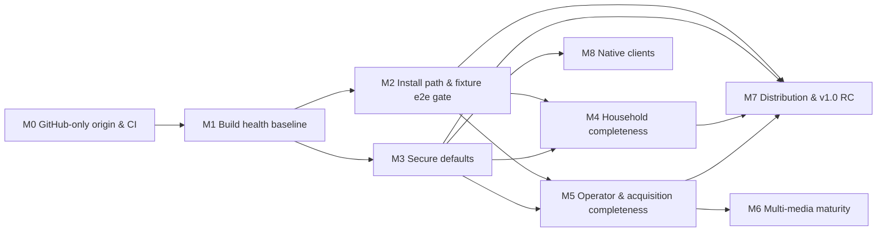

# MuxCore — Master Roadmap (canonical)

| | |
|---|---|
| **Status** | Canonical — v2.0, rewritten 2026-10-05 ([ADR-0001](docs/adr/0001-canonical-roadmap-and-spec-set.md)). Previous version preserved at [`docs/history/MASTER-ROADMAP-2026-09-02.md`](docs/history/MASTER-ROADMAP-2026-09-02.md). |
| **Owns** | Scope summary, priorities, milestones, dependencies, delivery sequencing, tasks, completion criteria, risks, and the documentation map |
| **Links, does not duplicate** | Business outcomes → [BRD](docs/specs/BRD.md) · capabilities & journeys → [PRD](docs/specs/PRD.md) · behaviour → [FRD](docs/specs/FRD.md) · requirements → [SRS](docs/specs/SRS.md) · design → [HLD](docs/architecture/HLD.md), [SDD](docs/architecture/SDD.md), [TDD](docs/architecture/TDD.md), [LLD](docs/architecture/lld/README.md) · decisions → [ADRs](docs/adr/README.md) |
| **Execution tracker** | GitHub Issues on `Muxcore-Media/umbrella` (and module repos). Each issue cites a task ID from this file (e.g. `T-M1-03`). This file stays authoritative for scope and status. |

**Maintenance rules**
1. Update task status here in the same PR that changes the work (`Todo` → `In progress` → `Done (evidence)`); keep finished milestones as a one-line summary with evidence, do not leave long checked-off lists.
2. New scope enters as an SRS requirement + a task here; never as a free-floating checklist elsewhere.
3. "Done" requires the stated verification to have been **run**; record it in the [validation log](#9-validation-log).
4. Smoke is sacred: no "deployable" claim without the fixture smoke passing ([ADR-0008](docs/adr/0008-fixture-only-acquisition-gate.md)).

---

## 1. Product in one page

**Purpose.** MuxCore is a self-hosted, modular media platform that replaces the fragmented Arr stack (Sonarr, Radarr, Lidarr, Readarr, Prowlarr, Bazarr, Tdarr, Seerr, download clients) and, over time, the Jellyfin web client, with one install: a core runtime (`muxcored`) hosting capability modules over a gRPC mesh, a household UI (`media-ui-app`), and an operator UI (`admin-ui`).

**Users.** Household members who browse/request/watch (P-1, P-2); the household operator (P-3); module developers (P-4); delivery agents (P-5). See [PRD §1](docs/specs/PRD.md#1-personas).

**Outcomes.** BO-1 one install replaces the stack · BO-2 household self-service · BO-3 Arr-grade decisions · BO-4 trust (install, migrate, update, secure defaults) · BO-5 daily control center · BO-6 own the watch experience · BO-7 beyond movies/TV. See [BRD §3](docs/specs/BRD.md#3-business-outcomes).

**Non-goals.** Hosted/multi-tenant SaaS, dashboards over existing Arr apps, bundled piracy sources or live-indexer testing, paid hard dependencies, full Tautulli API, a second playback-backend contract (for now), work in archived dump repos, telemetry. See [PRD §2.2](docs/specs/PRD.md#22-non-goals).

**Constraints.** BC-1 no paid accounts · BC-2 fixture-only acquisition · **BC-3 GitHub is the only origin** · BC-4 GitHub Free plan, private repos, no `write:packages` · BC-5 no hosted service/telemetry · BC-6 pre-1.0 beta. See [BRD §5](docs/specs/BRD.md#5-business-constraints).

## 2. Initial audit baseline vs target (2026-10-05)

This table preserves the initial audit, not the current implementation status.
Current task evidence is in §§5–6 and §9; the latest checkpoint is in §14.

| Area | Initial audit evidence | Target (v1.0 "household-ready", [PRD §5](docs/specs/PRD.md#5-product-level-acceptance-v10-household-ready)) |
|------|--------------------|------|
| Breadth | ~100 modules; movies/TV request→acquire→import→play implemented and fixture-proven; rich SPA (~1,100 tests) and admin-ui (~350 tests) | Same breadth; every Must capability Implemented |
| **Build health** | **46 of 97 Go modules fail to build at umbrella pins**; SPA typecheck fails; 3 script tests fail; integration suite cannot compile; 4 GitHub repos empty ([§9](#9-validation-log)) | All active repos green on GitHub CI (SM-8) |
| **CI / origin** | Workflows target offline self-hosted runners and a retired-origin mirror; ~1,500 retired-origin references | GitHub-hosted CI everywhere; zero retired-origin references (ADR-0002/0003) |
| Install | Registry compose + dev host work per docs; root compose broken; version skew v0.5.0–v0.5.8 across install paths; smoke does not assert fixture acquisition | One compose, one version train, smoke covers request→grab→import (SM-1) |
| Security defaults | Default admin password, insecure mesh in shipped compose, unauthenticated `Register`, no BFF CSRF, plaintext session files | Secure-defaults checklist 100 % (SM-4) |
| Household UX | Profiles missing; parental filter client-side except playback; Cast stubs; no automated a11y | J-02/J-03/J-08 e2e green; WCAG 2.1 AA [Proposed] |
| Operator UX | No indexer/downloader pages; wanted movie/TV only; migration = catalogue + profile names | J-04/J-05/J-09 covered (SM-5, SM-6) |
| Multi-media | Music partial (metadata repo empty); books partial; comics/audiobooks scaffold | Should-level (post-v1.0 allowed) |
| Native | iOS/tvOS partial; tvOS device validation blocked; Android repo empty | Should; hardware-dependent items stay Blocked |

## 3. Documentation map

| Path | Purpose | Status | Authoritative for |
|------|---------|--------|-------------------|
| [`AGENTS.md`](AGENTS.md) | Agent instructions: reading order, doc ownership, orchestration, toolchain notes, owner reference deployment | Current | How agents work in this repo |
| **`MASTER-ROADMAP.md`** (this file) | Canonical plan | Current | Scope, priority, milestones, tasks, status |
| [`docs/specs/BRD.md`](docs/specs/BRD.md) | Business requirements | Current | `BO-*`, `BC-*`, `SM-*`, stakeholders |
| [`docs/specs/PRD.md`](docs/specs/PRD.md) | Product requirements | Current | `P-*`, `CAP-*`, `J-*`, `NG-*`, v1.0 definition |
| [`docs/specs/FRD.md`](docs/specs/FRD.md) | Functional behaviour | Current | `WF-*`, `RULE-*`, state machines, permission model |
| [`docs/specs/SRS.md`](docs/specs/SRS.md) | Canonical requirements | Current | `FR-*`, `NFR-*` with status & verification |
| [`docs/architecture/HLD.md`](docs/architecture/HLD.md) | High-level design | Current | Components, trust boundaries, topology, data flows |
| [`docs/architecture/SDD.md`](docs/architecture/SDD.md) | Software design | Current | Patterns, collaboration, interface responsibilities, requirement satisfaction |
| [`docs/architecture/TDD.md`](docs/architecture/TDD.md) | Technical design | Current | Build/deps, CI, packaging, testing, security approach, migration |
| [`docs/architecture/lld/`](docs/architecture/lld/README.md) | Low-level design | Current | Acquisition, auth/sessions, core mesh, data ownership |
| [`docs/adr/`](docs/adr/README.md) | Decision records | Current | Architectural decisions (0001–0033) |
| [`docs/config-reference.md`](docs/config-reference.md) | Env var reference | Current, drift known (NFR-OPS-005) | Configuration names/defaults |
| [`README-UMBRELLA.md`](README-UMBRELLA.md), [`CONTRIBUTING.md`](CONTRIBUTING.md), [`CHANGELOG.md`](CHANGELOG.md) | Clone/bump workflow, commit/release process, changes | Current (after T-M0-03) | Process |
| `_mvp/README.md`, `_mvp/PORTS.md`, `_mvp/BFF-API.md`, `_mvp/docs/{PUBLIC-INSTALL,ACQUISITION,INFRA-BACKENDS,DUAL-LIBRARY-API,RELEASE-BUILD}.md` | Stack runbooks and API refs | Current with known gaps (BFF-API incomplete) | Stack operation |
| `media-ui-app/AGENTS.md`, `media-ui-app/docs/PLAYBACK.md` | Consumer UI design system, player | Current (parts aspirational: TanStack Query, Playwright, profiles) | UI conventions |
| `BAZARR-PARITY.md`, `TDARR-PARITY.md`, `TAUTULLI-TRACEARR-PARITY.md`, `LISTSYNC-PARITY.md` | Parity records | Historical/partly inaccurate → corrected in T-M0-05 | Nothing normative (SRS owns requirements) |
| `core.wiki/`, `muxcore-docs/wiki/` | User/developer wiki and its static-site snapshot | Partly stale; `muxcore-docs/wiki` is newer than `core.wiki` | End-user/developer guides (must not contradict specs) |
| `docs/FREEZE-PINS.md` | Pin snapshot 2026-09-07 | Historical | — |
| `TASKS.md`, `_mvp/docs/MASTER-ROADMAP.md`, `.project-management.md`, `IMPROVE-LOOP-SUMMARY.md`, `USABILITY-DEPLOY-LOOP-SUMMARY.md`, `AGENT-MODULE-AUDIT-2026-08-21.md`, `_mvp/docs/AGENT-MODULE-AUDIT-2026-08-21.md`, `_mvp/REPO-STATUS.md`, `_wave1/**`, `.tasks-loop-state.json`, `.improve-loop-state.json`, `.tasks-indexer-loop-state.json`, module `ROADMAP.md` files | Earlier plans, loop logs, audits | **Superseded / historical** (bannered in T-M0-05) | Nothing |
| `cache-memory/notes/`, `custom-scripts/notes/` | Old plans inside archived dumps | Historical (NG-7) | Nothing |

## 4. Conflicts found and how they were resolved

| # | Conflict | Resolution | Basis |
|---|----------|-----------|-------|
| C-1 | Retired self-hosted origin & CI documented as authoritative vs GitHub as actual tracker; the old host no longer serves it | GitHub only | Owner instruction 2026-10-05 → [ADR-0002](docs/adr/0002-github-sole-origin.md) |
| C-2 | Roadmap "only living doc" vs `.project-management.md` "tracking migrated to GitHub Issues" | Roadmap owns scope/status; Issues are the execution layer citing task IDs | [ADR-0001](docs/adr/0001-canonical-roadmap-and-spec-set.md) (Delegated) |
| C-3 | Two roadmap copies (root vs `_mvp/docs/`) diverged | Root is canonical; `_mvp` copy bannered superseded | Existing references point to root |
| C-4 | `CHANGELOG.md` lists "Public GHCR consumer mirror" and `docker-compose.public.yml` as Added; roadmap says GHCR blocked; file does not exist | Implementation evidence wins: GHCR **Blocked** (no `write:packages`), compose file absent → CHANGELOG corrected | Repo evidence + token scopes |
| C-5 | `BAZARR-PARITY.md` claims 56 providers / 184 languages / sync+upgrade complete; code has 2 providers, stubs | Code wins; doc corrected; SRS FR-SUB-001 Partial | Implementation evidence |
| C-6 | `LISTSYNC-PARITY.md` points at a missing file | Pointer replaced by SRS FR-MIG-004 reference | — |
| C-7 | Appendix C (Jellyfin parity) "no open rows" vs real gaps (profiles, server-side parental, Cast, a11y, i18n) | Gaps captured as SRS requirements in M4 | Owner playback decision (ADR-0005) requires parity |
| C-8 | `.tasks-loop-state.json` "0 open" vs open issues #2, #121, #151 | Loop state is historical; open issues mapped to tasks (T-M8-02, T-M5-04, T-M5-07) | GitHub Issues evidence |
| C-9 | Module `go.mod` sibling replaces (ensure-go-replaces.sh) vs "MVP modules pin published tags, no replace" (REPO-STATUS Wave 25–28) vs marketplace scan rejecting replaces | Published tags only; `go.work` for local dev | [ADR-0011](docs/adr/0011-go-workspace-and-published-versions.md) |
| C-10 | Draft PR #155 deletes module `AGENTS.md` / moves parity docs | Not adopted as-is; superseded by this doc set; per-module `ROADMAP.md` bannered | ADR-0001 |
| C-11 | `core.wiki` vs `muxcore-docs/wiki` drift (10 pages differ) | `muxcore-docs/wiki` is the working copy (newer, per its AGENTS.md); wiki sync is a task (T-M2-09) — resolved 2026-10-05: wikis identical, `sync-core-wiki.sh` keeps them so | Repo evidence |
| C-12 | Root CI `ubuntu-latest` vs runner doc "must use `native`" | Moot: GitHub-hosted runners | ADR-0003 |
| C-13 | Version skew (installer v0.5.0, operator v0.5.4, stack v0.5.7, starter v0.5.8) | Single release train (FR-INS-006) — implemented 2026-10-05 (`release-train.env`, `scripts/check-pins.sh`) | TDD §5 |
| C-14 | `request-media` used `contracts.CallerIDFromContext`/`WithCallerID` for the *end-user* caller, but core removed them (module caller identity is core-internal, `internal/callerid`) | Keep end-user caller in a module-local context key (`request-media/internal/authz`); no core API added | Core doc comment on `internal/callerid` ("NOT a module-facing API"); implementation evidence |
| C-15 | Umbrella `integration/` imported `integsupport` packages from core, media-movies, media-transcoder, playback-monitor, backup-local that were not in any published tag (core/backup-local versions only on orphaned branches), and asserted APIs that never existed (media-movies view state / batch refresh, playback-monitor rollups / anomaly detection) | Published `integsupport` in each module (core v0.6.3–v0.6.4 incl. caller-identity interceptor); tests for non-existent APIs rewritten to the published contracts; real bugs the suite exposed fixed upstream (media-transcoder v0.3.7–v0.3.8, media-movies v0.1.14–v0.1.15) | Implementation evidence (git history of each module) |
| C-16 | Rebuilt `metadata-musicbrainz` briefly advertised the generic `metadata` capability, which media-movies/media-tvshows/media-list-sync use to discover the TMDB-style `MetadataProvider` | Advertise only `metadata.music` + `metadata.musicbrainz` | Consumer code (`FindByCapability(ctx, "metadata")`) |
| C-18 | Registry compose runs the dev profile (plaintext mesh) with one container per module vs core ≥ v0.6.10 dialing security sidecars (authorizer/identity/auth, call policy, publish policy) in plaintext **only on loopback** (`internal/bootstrap.DialSidecar`) | Until the household switch (T-M3-02g, mesh TLS), `auth-local`, `call-policy-default`, `publish-policy-default` share core's network namespace (`network_mode: service:core`, names kept as network aliases on `core`); no core change — **resolved 2026-10-05**: in the household compose (`_mvp` cd23b18) core dials the sidecars over CN-checked TLS in their own containers (clean-room household run); the shared-network layout survives only in `docker-compose.dev.yml` | ADR-0016 (dev profile is loopback-only); implementation evidence (clean-room run) |
| C-17 | ADR-0011 "no filesystem `replace`" vs core's nested modules (`sdk/go/{client,module,mock}`, root → `./pkg/contracts`) replacing their own parent paths | Allowed: replaces that stay inside one repository are ignored by consumers and never leave the repo; ADR-0011 targets cross-repository replaces. `check-no-replace.sh` scans only module roots, and the CI template allows `./` | Go module semantics; implementation evidence |
| C-19 | Initial-audit summaries, FRD/LLD session sketches and several SRS/task rows still described defects already fixed in the 2026-10-05 validation log (including installer household, fixture defaults, restore/upgrade tests, CSRF and durable sessions) | Preserve the audit table and historical logs as dated evidence; update current statuses and design text from verified implementation. BFF sessions use encrypted JSON, not the earlier SQLite sketch. New branch checkpoints remain distinct from merged/deployed evidence | Existing §9 results, `session_store.go`, admin-ui `session/file_store.go`, T-M3-02/04/05; reconciled 2026-10-07 |
| C-20 | T-M7-01/TDD require train tags, but CONTRIBUTING and release CI used only umbrella `v*` tags | `train-YYYY.MM.N` must match committed metadata; retain historical `v*` support with separate note ranges and no post-tag write to main | [ADR-0024](docs/adr/0024-umbrella-release-trains.md); offline fixtures |
| C-21 | T-M4-05 said admin-ui `templ/a11y_test.go` was absent, but the pinned checkout already had static assertions; passing mocked UI checks could be mistaken for full WCAG/journey acceptance | Retain existing tests and add rendered DOM/axe/keyboard checks plus consumer Chromium fixtures. Automated-gate task evidence is separate from partial NFR-A11Y-001/002 and unproven full-stack journeys | [ADR-0025](docs/adr/0025-ui-verification-gates.md), local tests 2026-10-07 |
| C-22 | M7's blanket `write:packages` token blocker and B-2's blanket no-CI claim outlived later evidence | Core already published with workflow `GITHUB_TOKEN`; module-image GHCR still needs its workflow/private checkout setup. On 2026-10-07 UI CI/browser jobs started, so billing availability must be checked per run rather than assumed blocked everywhere | R-1, current GitHub PR/run observation; no claim that every repo's billing/credential blocker is resolved |
| C-23 | Core spool's textual host allow-list and config-reference default `all` did not express a connection-time address boundary | Retain exact host/port matching and explicitly listed LAN destinations; empty lists permit public destinations only, all DNS answers must pass before checked-IP dialing, and metadata/link-local destinations stay denied | [ADR-0028](docs/adr/0028-spool-dial-time-destination-policy.md), core `1eec416` and local race/lint evidence |
| C-24 | T-M5-07's raw `secrets-vault` compose profile and optional host flag could select both secrets providers although discovery expects a deliberate provider choice | Support a last-applied overlay and exclusive host selection; retain file defaults and volumes, require explicit stop/configure/migrate/start, and document the raw additive profile as unsupported for selection. Core's exclusive-capability list is unchanged | [ADR-0029](docs/adr/0029-secrets-provider-deployment-selection.md), narrow FR-INS-008 trace to existing T-M5-07; runtime acceptance remains separate |
| C-25 | The OIDC LLD proposed a new capabilities probe and SRS marked provider-aware pages wholly planned; consumer Acquisition remained viewer-visible after the first gate batch | Use actual typed AuthService responses without a new capability RPC; record the verified provider-aware and Acquisition/Requests-policy UI slices. Keep FR-AUTH-009 and FR-ADM-010 partial for their explicit remaining acceptance | admin-ui `c06ae6c`, media-ui-app `99b5ca3`, local verification below; no backend-authorization or live-provider inference |
| C-26 | FRD invite workflow said admin-ui's generated link opened the SPA and went directly Home, and its exhaustion rule omitted unlimited invites | Document the actual admin-ui redemption link and HTTP redemption-to-login handoff, retaining the separate SPA path. Apply exhaustion only to a positive finite limit | admin-ui `handler/invites.go`, `household_redeem.go`, caller/URL fixtures and auth-local `internal/store/invites.go`; no full-stack J-02 acceptance inferred |
| C-27 | NFR-MNT-005 literally required push-to-`main` although core's default branch is `master` | Target each repository's actual default branch; ADR-0003 defines hosted CI, not a mandatory branch name. Record present failures/successes by run rather than extending the old credential-count snapshot | GitHub core PR #97/#98 target and workflow evidence; no branch rename or CI-host change |
| C-28 | FR-PLAY-007/FRD described playback as the server-enforced exception, but its inputs and policy are not authoritative | Keep the requirement partial and describe the observed trust gaps before designing the provider/policy boundary; list/search/detail middleware alone would not close it | Read-only BFF review: `playback.go` request metadata, ignored rating/allowed tags in `parental.go`, self-service userdata mutation and provider-failure local fallback; implementation/design acceptance pending |
| C-29 | FRD WF-07 said resolve takes an "item ID"; `playback.go:99` takes `src`. Separately, the ADR-0031 review found the existing playback check never blocks in practice: the SPA sends only `src` (`media-ui-app/src/api/client.ts:3291-3294`) so the request-supplied `tags`/`parental_rating`/`unrated` inputs are always empty | FRD corrected to `src`; classification must come from the owning media module, not the request ([ADR-0031](docs/adr/0031-bff-enforcement-of-parental-policy.md)) | Read-only design review 2026-10-08 (file:line citations in ADR-0031 Context) |
| C-30 | FRD §1 and RULE-AUTH-3/4 say library management, root-folder changes and acquisition need privileged roles (`user` has only request/view/search; `viewer` view/search), but 43 BFF state-changing route patterns have no role check and the module gRPC calls carry no user identity | Treat as a security defect, not a doc gap: gate them as operator routes in the ADR-0031 route table (T-M5-12); until then the FRD statement is false for these routes | Independent review of `_mvp` PR #99 (2026-10-08): Go AST reachability pass over every registered handler plus runtime `httptest` on 5 routes (`DELETE /api/movies/{id}?delete_files=1` returned 200 for `user` and `viewer` and the module saw `delete_files=true`; `PATCH /api/movies/{id}` forwarded `root_folder_path=/etc`; `POST /api/releases/grab` dispatched a client-supplied `download_url`; `POST /api/blocklist/clear`; `POST /api/sessions/{id}/stop` stopped another user's session). The 170 routes classed operator do reach `sessionHasPrivilegedRole`/`sessionHasAdminRole` |
| C-31 | ADR-0031 §2.1 says to drop rows that fail BFF re-evaluation, but a paginated module response also carries a global total that cannot be repaired from one page | Reject an inconsistent paginated movie/TV response with generic no-store `503 parental.classification_unavailable`, returning no rows or total. Filter/recount locally only after complete enumeration, with deterministic ordering; an incomplete bounded scan fails closed | [ADR-0032](docs/adr/0032-fail-closed-paginated-classification.md), Accepted/Delegated 2026-10-08; verified S5b source `0b51bfd` merged in #103 as `41a18c0`, unpinned; exact verification and limits in §9 |
| C-32 | NFR-SEC-003 described the household validation as "TLS everywhere", but userdata-local `e544b35` still serves plaintext HTTP to bearer-carrying clients | Resolved at fixture level by ADR-0033 S9a–e (2026-10-09): userdata-local `v0.1.6` serves mTLS-only with verified-CN admission, and the BFF, admin-ui and household compose use it; NFR-SEC-003 stays Part for deployment, amd64/hosted and native-client acceptance | Read-only baseline evidence and caller inventory in [ADR-0033](docs/adr/0033-userdata-http-mesh-transport.md); S9a–e fixture integration evidence in §9; deployment and remaining runtime gates stay open |
| C-33 | FR-PLAY-004 said persistence across devices was implemented, but the exact-pinned native paths have only source inventory, the iOS cookie-only mutation shape conflicts with BFF CSRF, and the BFF blob proxy calls `/userdata` while userdata-local exposes `/api/userdata` | Keep FR-PLAY-004 Part, preserve existing provider tests, and add T-M4-09 native authentication/persistence verification and fixes. S9b corrected the BFF blob path and transport at fixture level (2026-10-09); native clients remain BFF callers, not mesh-certificate holders. Do not mistake offline cache or swallowed push errors for provider persistence | Exact-pinned iOS/tvOS GitHub source and canonical BFF `3c16074` inspection (§9); no native runtime, deployed-origin or cross-device persistence validation |
| C-34 | FR-REQ-001 marked requesting by users with `media.request` Impl, but canonical request-media `10483aa` authorizes resource `media.request` / action `create`, which current first-dot auth-local/OIDC policy matchers cannot grant through that permission | Keep FR-REQ-001 Part for the affected producer authorization path while preserving SPA/BFF source and fixture evidence. A future producer correction must decide member read ownership, operator actions and shared approval/policy administration before permission expansion; proposed ADR `0034` remains outline-only. State-machine and guard fixtures do not establish a working end-to-end member/manager request journey | Canonical producer source plus exact-copy auth-local `55e9747` / auth-oidc `636780b` policy fixtures (§9); default user and manager deny the current producer permission. No live journey rejection is claimed; producer full checks remain blocked by uncached SQLite / B-3, and its clean canonical checkout has no edits or publication |
| C-35 | LLD data-ownership §3 planned user deletion as a bus event `identity.user.deleted`, and six draft PRs (#187–#192) implement it | Superseded by [ADR-0035](docs/adr/0035-user-erasure-ledger.md): core's bus is at-most-once with no catch-up, `Source` is unchecked, the default publish policy would deny `auth-local`, and two drafts never resubscribe after a stream ends | Source review at the pins: core `internal/events/memory.go:18-20,276-296`, `internal/grpcmesh/events.go:104,157-163`, `sdk/go/client/client.go:501-508`, `publish-policy-default/policies.yaml`; draft commits cited in ADR-0035 Part 2 |
| C-36 | `core/docs/event-bus.md` documents a built-in publish policy (:25) and `SetSubscriberTimeout` (:104) | Not present in code; treat the doc as wrong until E1 corrects it | Design review 2026-10-09 (ADR-0035 Part 2 §B) |
| C-37 | ADR-0026 requires a current end-user admin bearer for administrative session methods, but auth-local gRPC `DeleteUser` accepts any CN-verified mesh peer as admin (`internal/server/server.go:467-478`, `admin_auth.go:59-62`) with no self-delete or last-admin check; admin-ui sends no user bearer (`handler/users.go:211`) | ADR-0035 §1 closes this for `DeleteUser` (admin bearer required; tenant, self and in-transaction last-admin checks); other user-admin methods keep the existing rule until reviewed | Source review (design 2026-10-09) |
| C-38 | BFF `DELETE /api/users/{id}` admits `manager` (`users.go:206`) but the provider HTTP path requires `admin` (`http_auth.go:62-73`) | The effective rule is admin-only; document it and fix the BFF gate in E8 | Source review |
| C-39 | run-host.sh has admin-ui and the BFF share `$DATA/media-ui/sessions.json` in different format versions; media-library-maintainer reads userdata JSON from disk (ADR-0009 conflict) | Out of scope for ADR-0035; recorded as separate defects, unverified at runtime | Source review (`_mvp/run-host.sh:593,1442`; maintainer `internal/requester_protect.go:82-100`) |
| C-40 | Umbrella #220 reports E2 ledger integration at auth-local `71c66d8`, but that canonical baseline pin lacks the ledger implementation and restores retired-origin/self-hosted CI content | Keep canonical E2 integration blocked and M0 hygiene partial. Reviewed source `v0.1.21` at `9f9ec32` is prepared in draft #223 and draft hygiene passes; canonical merge and E11 dependency/integration remain gated. Keep #220 as reported history | Root origin check: six references in the retired CI workflow; independent source comparison identifies missing store/server erasure files and current default-branch ledger/hosted workflows. Accepted source and seven draft selections are verified at their stated boundaries; no canonical merge or runtime acceptance (§6, §9) |

**Assumptions (labelled, revisit if wrong):** A-1 `MUXCORE_CI_TOKEN` exists in every repo (verified on `admin-ui` only). A-2 Content of the four empty GitHub repos is not recoverable from GitHub. A-3 Free-plan Actions minutes suffice once self-hosted jobs stop queueing. A-4 The owner's vault/homelab deployment remains in use as a reference deployment but is not a product requirement. A-5 Agents on `claude-workstation` cannot reach vault (no ZeroTier, no SSH key); module releases since 2026-10-05 are not redeployed there until the owner pulls them or grants access. A-6 E5 identity merges use an unnamespaced RPC: the delegated 2026-10-11 repair conservatively refuses a bare ID matching a tombstoned native ID even if an external account has the same string; external ingest and unlinked history retention are unchanged (T-M4-07 E5 follow-up, §6). A-7 Accepted E2 invite correction retains legacy label-only creator provenance; same-text user/module and orphan attribution cannot be reconstructed exactly, so manual reconciliation remains a limitation (ADR-0036, §6).

## 5. Milestones and dependencies

v1.0 = M0–M5 + M7 complete. M6 and M8 are Should-level and may ship after v1.0. No dates are committed (none have been approved); ordering is by dependency and priority.

| Milestone | Goal | Requirements closed | Status | Completion criteria (observable) |
|-----------|------|---------------------|--------|----------------------------------|
| **M0** | GitHub is the only origin; CI runs on GitHub-hosted runners; docs reconciled | NFR-MNT-005, NFR-MNT-006, NFR-MNT-009, NFR-SEC-012, NFR-COST-001, FR-SUB-002 | **Part (regression found 2026-10-11)** — initial criteria 1–5 passed locally on 2026-10-05 (§9), but current auth-local `71c66d8` reintroduces retired-origin/self-hosted CI content (C-40); reconciliation is pending, and hosted submodule hygiene retains B-1 limits | (1) `scripts/check-retired-origin.sh` reports 0 matches over active content (excludes `docs/history/`, `docs/adr/`); (2) every active repo has `.github/workflows/ci.yml` with `runs-on: ubuntu-latest` and no `self-hosted`/`checkout-mirror`; (3) no retired-origin workflow directories in active repos; (4) `scripts/check-submodules.sh` passes (every pinned SHA fetchable from GitHub); (5) superseded docs bannered |
| **M1** | Every active module builds, vets, and tests green standalone and in the workspace | NFR-MNT-001…004, NFR-MNT-007, NFR-SEC-013, FR-BRG-001, FR-MM-001 (restore) | **Done locally** (2026-10-05) — criteria 1, 3–6 verified (§9); criterion 2 (per-repo CI green) and CI observation of 1/5 blocked by B-1 | (1) umbrella workspace job: `go build ./... && go vet ./...` green for all active modules; (2) each active repo's GitHub CI green on `main` at the umbrella-pinned SHA; (3) `media-ui-app` typecheck/test/build green; (4) `node --test scripts/*.test.mjs` and `_mvp/scripts/run-script-tests.sh` green; (5) `integration` compiles and runs; (6) no filesystem `replace` in any active `go.mod` |
| **M2** | A fresh install reaches a passing fixture smoke that covers request → grab → import → play | FR-INS-001/003(partial)/005/006, FR-AUTH-004 (e2e), FR-BAK-002/004, NFR-DATA-002, NFR-REL-001, NFR-OPS-005, NFR-PERF-003 | In progress — original local household/dev smoke and restore evidence passed 2026-10-05; a renewed household clean-room (smoke + restore drill) passed locally on the 2026-10-07 wiring on 2026-10-08 (§9); GitHub clean-room evidence is pending | (1) `docker compose up` from root succeeds in a clean container host and `_mvp/smoke.sh` passes; (2) smoke asserts fixture search→dispatch→import→library item; (3) one version pin across compose/installer/operator/starter (check script green); (4) restore drill script green; (5) upgrade test from previous tag green for household modules |
| **M3** | Secure defaults | NFR-SEC-001…011, FR-INS-003/004, FR-EXT-003, FR-BAK-003, NFR-REL-003, NFR-OPS-004 | In progress — core profile/enrollment and initial defaults shipped; remaining path/SSRF audit rows, phase-2 profile migration and renewed stack verification remain | Secure-defaults checklist (TDD §8) all items have passing tests; SM-4 = 100 % |
| **M4** | Household consumer completeness | FR-PLAY-007/009, FR-AUTH-010, FR-ADM-010, NFR-A11Y-001/002, NFR-DATA-003 | In progress — Settings role gates and both UI automated gates verified locally; profiles, parental enforcement, deletion, migration and full-stack journeys remain | Playwright fixture e2e J-02, J-03, J-08 green; axe checks green on core pages; server-side parental table test green |
| **M5** | Operator & acquisition completeness | FR-ADM-002/006/008/009, FR-AUTH-007/009, FR-MIG-002/003, FR-ACQ-005(corpus)/006/011, FR-SUB-001, FR-TRN-001, NFR-REL-004 | In progress — T-M5-11 published contract, provider and Devices consumer slices verified; live integration/revoke propagation and remaining operator/acquisition work pending | SM-3, SM-5, SM-6 met; issues #121 and #151 closed |
| **M6** | Multi-media maturity | FR-MM-002…005, FR-REQ-006, FR-PLAY-010 | Todo | Fixture acquire→import→consume test per media type green |
| **M7** | Distribution & v1.0 release candidate | FR-INS-001 (GHCR variant), release train | In progress — release preparation/notes verified locally; new train publication, central GHCR workflow and RC acceptance remain pending | Release `train-*` tag; release notes from Conventional Commits; SM-1/2/4/8 met; GHCR push when unblocked |
| **M8** | Native clients | FR-NAT-001…003 | Partly Blocked (device, Android source) | iOS/tvOS simulator tests for auth+resume green via manual workflow; hardware checklist completed when a device is available |
| **D** | Deferred | FR-AI-001, FR-PLAY-011, NFR-PERF-001/002, NFR-OPS-003, multi-tenant isolation (NG-1), k8s operator GA, `contracts-playback` service (NG-6), HA cluster | Deferred | Re-enters only via a new SRS priority + ADR where architectural |

## 6. Tasks

Status legend: `Todo`, `In progress`, `Done (evidence)`, `Blocked (reason)`.

### M0 — GitHub-only origin & CI

Prerequisites: none beyond `gh` access with `repo`+`workflow` scopes (available).

| ID | Objective | Refs | Depends | Completion check | Status |
|----|-----------|------|---------|------------------|--------|
| T-M0-01 | Umbrella CI on GitHub: add `.github/workflows/ci.yml` (hygiene checks, script tests, workspace build, commit lint); delete the retired-origin workflow directory and `.github/workflows/RETIRED.md` | NFR-MNT-005, TDD §4.2, ADR-0003 | — | Workflow run on a PR shows all jobs executing on `ubuntu-latest` | Done — `.github/workflows/ci.yml` green on GitHub (docs/scripts, gitleaks, workspace job; workspace steps skip until B-1) |
| T-M0-02 | CI templates + `scripts/sync-ci.sh`; roll out `.github/workflows/ci.yml` to every active module; delete retired-origin workflows, self-hosted jobs, `checkout-mirror` usage | NFR-MNT-005, NFR-COST-001, TDD §4.1 | T-M0-01 | `scripts/check-ci.sh` (new) passes over all submodules | Part — template rollout and `scripts/sync-ci.sh --check` passed 2026-10-05; current auth-local `71c66d8` contains self-hosted workflows (C-40), pending pin reconciliation. Release template gained optional `RELEASE_ENTRY`/`RELEASE_LDFLAGS` repo variables (used by `muxcorectl-cli`) |
| T-M0-03 | Remove retired-origin references from active content (umbrella + modules), delete retired-origin-only scripts, update AGENTS/README/CONTRIBUTING/PUBLIC-INSTALL/wiki | NFR-MNT-006, ADR-0002, TDD §10 | — | `scripts/check-retired-origin.sh` exits 0 | Part — `scripts/check-retired-origin.sh` passed 2026-10-05; the 2026-10-11 run finds six references in the retired CI workflow at auth-local `71c66d8` (C-40), pending reconciliation |
| T-M0-04 | Submodule hygiene: `scripts/check-submodules.sh`; remove `media-ui-tv` and `muxcore-android` from `.gitmodules` (empty repos, recorded in TDD §2.1); track `playback-contract`/`metadata-musicbrainz` remediation in M1 | NFR-MNT-009 | — | Script green in CI | Done — script added; `media-ui-tv`, `muxcore-android`, `playback-contract` removed; `metadata-musicbrainz` rebuilt on `main` (T-M1-03) |
| T-M0-05 | Doc reconciliation: superseded banners (see §3), correct `CHANGELOG.md` (C-4), `BAZARR-PARITY.md` (C-5), `LISTSYNC-PARITY.md` (C-6), `.cursor/rules/muxcore-workspace.mdc`, `core.wiki/Roadmap.md` stub | ADR-0001, FR-SUB-002 | — | `scripts/check-docs.mjs` (links + SRS IDs) passes | Done — banners/moves to `docs/history/`, CHANGELOG/BAZARR/LISTSYNC corrected, `.cursor` rules updated; `check-docs.mjs` green |
| T-M0-06 | Secret scanning job (gitleaks, pinned version) in umbrella CI | NFR-SEC-012 | T-M0-01 | Job green; fails on a seeded test secret in a scratch PR | Done — gitleaks in umbrella CI with `.gitleaks.toml` (vendored doc placeholders allowlisted) |

### M1 — Build health baseline

Prerequisites: M0 T-M0-01/02 (so results are visible in CI).

| ID | Objective | Refs | Depends | Completion check | Status |
|----|-----------|------|---------|------------------|--------|
| T-M1-01 | `core` `main` green on GitHub CI; tag `v0.6.0` + `pkg/contracts/v0.6.0`, `sdk/go/client/v0.6.0`, `sdk/go/module/v0.6.0` | ADR-0011, LLD core §7 | T-M0-02 | Tags visible on GitHub; `go list -m github.com/Muxcore-Media/core@v0.6.0` resolves | Done — core `v0.6.0` (+ nested modules), `v0.6.1` (auth invite / circuit-breaker List protos), `v0.6.2` (module-manager race fix); `v0.5.8` restored at hash-matched `d732be6`; resolution tags per TDD §3.2 |
| T-M1-02 | Fold `playback-contract` package into `contracts-playback`; tag; repoint `jellyfin`, `plex`, `emby` | TDD §2.1, FR-BRG-001 | T-M1-01 | The three bridges build standalone | Done — `contracts-playback v0.2.0` `playbackv1`; jellyfin/plex/emby/playback-monitor shipped |
| T-M1-03 | Rebuild minimal `metadata-musicbrainz` (fixture corpus, `contracts-metadata` music RPCs used by `media-music`) | FR-MM-001 | T-M1-01 | `media-music` builds standalone; metadata-musicbrainz tests green | Done — `metadata-musicbrainz` v0.1.0 on `main` (default branch): WS/2 client (User-Agent, `fmt=json`, 1 req/s, 429/5xx → Unavailable), `MUSICBRAINZ_FIXTURE=1` embedded corpus, gRPC fixture e2e test, capabilities `metadata.music` + `metadata.musicbrainz` (C-16); `media-music` v0.3.0 builds standalone against it |
| T-M1-04 | Fix proto drift: `auth-local` (`authv1.InviteInfo`), `circuitbreaker-simple` (`ListRequest`) and any found by `check-proto-drift.sh` | NFR-MNT-001 | T-M1-01 | Both modules build/test green | Done — core v0.6.1; auth-local v0.1.14 (also restored missing `internal/policy` import), circuitbreaker-simple v0.1.5 |
| T-M1-05 | Fan-out: every active Go module requires `core v0.6.0`, drops `core/pkg/tenant` requires and all filesystem `replace`s, moves to GitHub-available tags of siblings, `go mod tidy`, tests green, patch tag | NFR-MNT-001, NFR-MNT-007, ADR-0011 | T-M1-01…04 | Per-repo CI green; `scripts/check-no-replace.sh` green | Done — all active modules shipped with published deps, green build/vet/test −race and lint; `scripts/check-no-replace.sh` ok (2026-10-05). Tail releases: media-music v0.3.0, media-automation v0.1.46 (corrupt descriptor regenerated; TV wanted-sibling deletion bug), request-media v0.3.2 (C-14), media-list-sync v0.1.10, media-library-maintainer v0.1.12, media-graph v0.1.3, admin-ui v0.1.13, muxcorectl-cli v0.1.1, media-movies v0.1.15, `_mvp` `d166018` (no tag: deployment repo). Per-repo GitHub CI still blocked by B-1 for repos without the secret |
| T-M1-06 | Root `integration/` compiles against `core v0.6.0` (`integsupport`) and runs with `-tags integration` | NFR-MNT-004 | T-M1-05 | Umbrella CI integration job green | Done (local) — compiles and passes locally against published core v0.6.4 and sibling `integsupport` packages (`go test -tags integration -race`, lint 0, C-15); umbrella CI job blocked by B-1 |
| T-M1-07 | `media-ui-app`: fix typecheck error and failing test | NFR-MNT-002 | — | `npm run typecheck && npm test && npm run build` green | Done — media-ui-app typecheck, 1,108/1,108 tests, build green (`d0012f3`) |
| T-M1-08 | Umbrella scripts: fix 3 failing `node --test` cases and eslint error | NFR-MNT-003 | — | `node --test scripts/*.test.mjs` and eslint green | Done — 60/60 node tests, eslint, shellcheck green |
| T-M1-09 | `scripts/gen-go-work.sh` + workspace build job; retire `scripts/ensure-go-replaces.sh` | ADR-0011, TDD §4.2 | T-M1-05 | Workspace job green | Done (local) — `gen-go-work.sh` now skips nested stub copies of other modules (`media-dlna/stub/core/...` made every workspace build fail); workspace `go build && go vet` green for all 97 active modules (2026-10-05); CI job needs B-1 |
| T-M1-11 | Clear golangci-lint debt and make lint blocking (`LINT_BLOCKING=true` repo variable) | NFR-MNT-005 | T-M1-05 | Lint job green and blocking | Done — lint 0 issues and `LINT_BLOCKING=true` on every module shipped in T-M1-05, including the tail |
| T-M1-10 | Bump umbrella pins to the green SHAs; regenerate `docs/FREEZE-PINS.md` | — | T-M1-05…09 | `git submodule status` clean; CI green | Done — pins at default-branch tips, `docs/FREEZE-PINS.md` regenerated; spool catalog 2.5.0: all 68 modules at latest tags, checksums recomputed with the ADR-0012 canonical build (core v0.6.5, `_mvp` populate script rewrite; reproducibility re-checked), `validate.py` OK. Found and fixed: admin-ui had no `cmd/module` (unloadable by core's resolver, v0.1.14), plex/emby manifests declared the retired `playback-contract` (v0.1.2) |

### M2 — Install path & fixture e2e gate (tasks; refine when M1 lands)

| ID | Objective | Refs | Completion check |
|----|-----------|------|------------------|
| T-M2-01 | Root `docker-compose.yml` includes `_mvp/docker-compose.registry.yml`; retire `docker-compose.ghcr.yml` (registry is a variable) | ADR-0007 | `docker compose config` valid in CI — **Done** (2026-10-05): root compose includes the registry file, ghcr variant retired; `docker compose config -q` green in `mvp` Script tests CI and in the umbrella workspace job |
| T-M2-02 | Publish set covers every module referenced by any compose profile | TDD §5 | compose-vs-publish check script — **Done** (2026-10-05): `_mvp/scripts/check-publish-set.sh` (+test); 19 modules added, 44/44 compose images covered |
| T-M2-03 | Smoke asserts fixture search → dispatch → import → library item (+ BFF play URL) | FR-INS-003, SM-1, ADR-0008, ADR-0014 | **Done locally (2026-10-05)** — later clean-room runs in §9 supersede the initial blockers: fixture indexer → torrent fixture engine → scanner import → media-movies → BFF stream 206 and playback resolve passed. This is historical train evidence; the 2026-10-07 wiring requires a renewed run before deployment/release claims |
| T-M2-04 | Single version train pin consumed by compose, installer, operator, starter, Helm | FR-INS-006 | `scripts/check-pins.sh` green — **Done** (2026-10-05): `release-train.env` (now train-2026.10.2: core/images v0.6.13, spool 2.6.0), check in umbrella CI; core release workflow fixed (v0.6.6/v0.6.7: Go version, syft) |
| T-M2-05 | Manifest `state_dirs` + `ExportState` coverage for household modules; restore drill script | FR-BAK-002/004, ADR-0013 | **Done locally (2026-10-05)** — host drill restored 18 modules; the later compose drill restored 16 with identical snapshot and original-password authentication (decoy refused). Manifest/volume coverage and `backup-local` archive re-indexing fixed earlier gaps; see §9 and `_mvp/docs/RESTORE.md`. New deployment changes still require renewed smoke/restore evidence |
| T-M2-06 | Upgrade-from-previous-tag tests for household modules | NFR-DATA-002, FR-INS-005, ADR-0015 | tests green — **Done** for the household set (2026-10-05): `core/sdk/go/module/moduletest` (sdk v0.6.1) + `scripts/upgrade-fixtures/snapshot.sh`; snapshot upgrade tests in request-media v0.3.3 (v0.2.7, v0.3.0, v0.3.2), auth-local v0.1.15 (v0.1.5), userdata-local v0.1.1, media-tvshows v0.1.14, media-movies v0.1.17 (v0.1.9, v0.1.15), media-automation v0.1.47, media-scanner v0.1.28. Found and fixed: media-movies `Init` hung on every v0.1.9 database; a follow-up sweep fixed the same cursor-held-across-write deadlock in media-library-maintainer v0.1.13 and media-transcoder-pool v0.2.2 and a hazard in media-tvshows v0.1.15. Image-level upgrade drill follows T-M2-10 |
| T-M2-07 | Env-var drift check vs `docs/config-reference.md` (remove phantom vars like `BACKUP_EXCLUDE`) | NFR-OPS-005 | check script green — **Done** (2026-10-05): `scripts/check-env-docs.mjs` + test, in umbrella CI |
| T-M2-08 | Remove or mark dev-only `media-ui-app/Dockerfile` + `nginx.conf`; complete `_mvp/BFF-API.md` route inventory with a test | SDD §5, TDD §7 | route-inventory test green — **Done** (2026-10-05): `routes_inventory_test.go` vs `BFF-API.md` (351 routes); found and fixed two ServeMux conflicts that made `mediauiprox` panic at startup; `media-ui-app` Dockerfile/nginx already marked dev-only |
| T-M2-09 | Sync `core.wiki` from `muxcore-docs/wiki`; remove homelab specifics from user docs | C-11, ADR-0002 | wiki diff empty; docs check green — **Done** (2026-10-05): `muxcore-docs/scripts/sync-core-wiki.sh --check` in sync; one homelab detail removed |
| T-M2-10 | Clean-room install job (`workflow_dispatch`): build images, start stack in podman/docker, run smoke | SM-1, ADR-0014 | job green — In progress: `scripts/clean-room.sh` **passes locally** (2026-10-05, rootless podman: 27 images from the pinned commits → `registry:2` → root compose → fixture smoke incl. acquisition → compose restore drill; idle RSS 470 MiB). `.github/workflows/clean-room.yml` written, not run: blocked by B-1. Renewed local run 2026-10-08 (arm64, household profile): PASS, see §9. On 2026-10-08 `actionlint` showed the workflow file was invalid (`runner` context in job-level `env:`), so GitHub recorded a failed no-job run on every push to `main`; fixed by moving the two variables to the step. It has still never run on GitHub (B-1). The first run found and fixed in `_mvp`: loopback gRPC binds, security sidecars unreachable by core in the dev profile (C-18), missing policy files / ffmpeg in images, admin-ui core/auth/userdata wiring, scanner watch dir, registry smoke never worked (no gRPC reflection → `proto/smoke.protoset`; wrong service names, field names, grpcurl argument order), compose project name |
| T-M2-11 | Module version single source: `Info().Version` drifts from `muxcore.json` and tags in ~87 of 95 modules (smoke discovery compares versions with the catalog) | FR-INS-006 | **Done** (2026-10-05): ADR-0021, `modulesdk.ManifestVersion` (sdk/go/module v0.6.3); 79 modules report the version embedded from `muxcore.json` |

### M3 — Secure defaults

The original nine items from [TDD §8](docs/architecture/TDD.md#8-security-hardening-approach) have one task each (`T-M3-01` … `T-M3-09`, in TDD order); T-M3-10 continues the path-confinement audit. Items 2, 3 and 6 are designed in [ADR-0016](docs/adr/0016-security-profiles.md)…[ADR-0019](docs/adr/0019-end-user-identity-propagation.md) and split into subtasks.

| ID | Objective | Refs | Status |
|----|-----------|------|--------|
| T-M3-01 | No default credentials; generated bootstrap secret; CI lint for default literals | NFR-SEC-001, FR-INS-004 | **Done** — `_mvp` 92810f5 (generated one-time admin secret, required compose secrets) + installer v0.3.7 (generated Postgres password) + example/dev-compose cleanup in auth-local, auth-oidc, operator, media-ui-app, storage-*, docs; `scripts/check-default-creds.sh` ok and in CI |
| T-M3-02 | Profiles `dev`/`household`: (a) core profile + CA defaults, (b) sidecar dial creds, (c) signatures in household, (d) SDK refuses insecure in household, (e) acquisition defaults fail closed, (f) installer `MUXCORE_DB_BACKEND`, (g) compose/installer switch to household (last, breaking) | NFR-SEC-003/010, FR-EXT-003, ADR-0016 | **Done** except phase 2 — (a)–(f) as before; (g) compose `_mvp` cd23b18 and installer v0.3.11 default to household (installer: fresh install, opt-in upgrade and `--dev` verified with real runs); phase-2 removal of profile inference scheduled one train later (ADR-0016) |
| T-M3-03 | Authenticated registration: (a) verified-peer module principal, (b) Register/Unregister rules + exclusive capabilities, (c) CSR enrollment + single-use tokens, (d) SDK `meshid`, (f) rebuild modules on the new SDK, (g) auth-oidc `CallerId` | NFR-SEC-002, ADR-0017, ADR-0018, ADR-0022 | **Done** — (a) core v0.6.9, (b) v0.6.11 → ADR-0022 (v0.6.14), (c)(d) v0.6.12, (f) all SDK modules rebuilt (core v0.6.12–v0.6.15, sdk v0.6.3–v0.6.5), (g) auth-oidc v0.1.6, auth-local v0.1.16; compose identity volumes + `gen-enrollment.sh` (`_mvp` cd23b18); household run proves verified-certificate registration of every service |
| T-M3-04 | BFF: CSRF, `POST /logout`, server timeouts, security headers, persisted sessions | NFR-SEC-004/006, NFR-REL-003 | **Done** — `_mvp` 831491f (CSRF Origin check, `POST /logout`, timeouts, security headers, persisted encrypted sessions) + media-ui-app be3e834 (POST sign-out) |
| T-M3-05 | admin-ui TLS dial helper; session store under data dir, protected, 0600 | NFR-SEC-003/005 | **Done** — admin-ui v0.1.15 (TLS dial helper for 27 sites + core client; hashed/encrypted 0600 sessions under the data dir; devices page no longer leaks session tokens) |
| T-M3-06 | End-user identity: (a) request-media bearer authn, (b) BFF / (c) admin-ui forward bearer and strip identity headers, (d) tenant middleware, (e) Jellyfin bridge | NFR-SEC-007, ADR-0019 | **Done** — (a) request-media v0.3.4, (b) BFF `_mvp` 831491f, (c) admin-ui v0.1.16, (d) core v0.6.11 `pkg/tenant` (`TENANT_TRUST_HEADERS`, `WithAuthenticatedTenant`), (e) jellyfin v0.3.2; ADR-0019, ADR-0020 |
| T-M3-07 | Loopback-by-default or auth: scheduler-cron, health-monitor `/status`, core `/metrics` | NFR-SEC-011 | **Done** — scheduler-cron v0.1.7, health-monitor v0.1.7, core v0.6.8; callers `_mvp`, admin-ui v0.1.16, muxcorectl-cli v0.1.2; Helm/kustomize secrets `_mvp` 085ede1 |
| T-M3-08 | Restore/target path allow-list in admin-ui | FR-BAK-003, NFR-SEC-008 | **Done** — admin-ui v0.1.15 confines restore `target_path` to `ADMIN_UI_RESTORE_ROOT` (`BACKUP_RESTORE_DIR`, `/data/restore`) |
| T-M3-09 | Audit HMAC when a key is configured | NFR-OPS-004 | **Done** — core v0.6.8 (`MUXCORE_AUDIT_HMAC_KEY[_FILE]`, `VerifyEntries`; signed-entry verification bug fixed) |
| T-M3-10 | Confine BFF playback subtitle reads to a catalog item and configured media roots | NFR-SEC-008, FR-PLAY-003, FRD RULE-VAL-1 | Blocked (current runtime investigation stopped by automated security review) — static review of `_mvp` `f7156ea` finds caller-encoded `sc_` file paths on `GET /api/playback/subtitles/{id}` without catalog/root confinement; discovery at `GET /api/playback/subtitles?src=` also needs the root boundary. The ADR-0031 gate allows configured unrestricted sessions through this route class; restricted, unconfigured and provider-failure cases are denied. Historical pre-gate fixtures are not current runtime validation. Define the sidecar-reference/trust contract before implementation, then verify direct/list routes reject forged references, traversal, outside-root paths, symlink escapes and unavailable roots while retaining adjacent regular SRT/VTT playback. Shared probe/rename resolvers are outside this slice; no implementation acceptance |

### M4 — Household completeness

| ID | Objective / refs | Status and remaining acceptance |
|----|------------------|---------------------------------|
| T-M4-01 | Server-side parental middleware in BFF (FR-PLAY-007) | In progress — [ADR-0030](docs/adr/0030-authoritative-parental-policy-resource.md) provider, first pinned as userdata-local `v0.1.5` (`e544b35`), is retained by the current source pins (§14). [ADR-0031](docs/adr/0031-bff-enforcement-of-parental-policy.md) (Accepted/Delegated) decides BFF enforcement: one gate with an exact route-class table, classification from the owning media modules (operator rating first, TMDB later), fail-closed failure behavior, a 30 s cache and an admin-run trusted migration. **State 2026-10-08:** S1–S3, S5a, S6, S7 and S8 are merged and pinned (§9). The S5a gate (`_mvp` PR #99, `7e0f45c`; umbrella pin `_mvp` `3c16074`, which also carries the T-M5-12/T-M5-13 fixes) replaced the old trust of request metadata and self-editable userdata for playback; the previous pin `3c16074` denied a restricted principal all playback and exposed list/detail titles. The 2026-10-09 integration pins `_mvp` `e9fbf38`, which carries S5b (#103), BFF session revalidation (#104) and subtitle ownership (#102); it is merged and pinned, not deployed. S5b source `0b51bfd` is locally verified under ADR-0031/0032: trusted movie/TV classification, episode inheritance, visible lists/totals, fresh item checks and a playback-only cache of at most 30 s. Source [PR #103](https://github.com/Muxcore-Media/mvp/pull/103) was selected after read-only comparison with parallel draft [PR #102](https://github.com/Muxcore-Media/mvp/pull/102) (`8757ad9`); the final test-only follow-up passes focused race/lint and independent review. PR #103 merged as `41a18c0` and #104 as `214484f`; both are carried by the `e9fbf38` pin. Parallel [PR #102](https://github.com/Muxcore-Media/mvp/pull/102) was rebuilt on #104's `214484f` as reconciled head `530537ddac5a752cd3f74b65292a5af339589c28` (11 files), adding sidecar-subtitle ownership and a session/item-bound restricted subtitle fetch: restricted sidecars need conservative filename matching and no competing video owner, module rows must name the authorized media file, and a restricted fetch requires a session/item binding and rechecks current policy and classification (unbound, expired, evicted, restart-lost, other-session or revoked bindings and provider outages fail closed). Independent review accepts the reconciled source and its focused tests. Serial full build, vet, race, lint and scripts pass on that exact commit on 2026-10-09 (Go 1.27.1, golangci-lint 2.14.0; log `/tmp/s5b-reconciled-summary.log`), with actual proto-drift plus its negative control and the generated descriptor passing; the backup-proto script check skipped because the temporary workspace lacked that sibling module. #102 merged as `e9fbf38f1ff28bfa6461b18adcca0b8d6933c4e4` (tree identical to `530537d`) and is pinned (§9, §14); the hosted Script tests pass, while hosted Build/vet/test and Lint fail on B-1 private-module credentials (not source acceptance). Filename ownership trusts the operator-managed library: a misnamed, symlinked or replaced-after-listing sidecar can carry other content (a residual, not an untrusted-user exploit claim); same-stem videos in different containers are refused; the existing unrestricted `sc_base64` confinement gap (T-M3-10) is separate. Full production verification is at `4054780`; final-head hosted scripts pass, while Go jobs stop at private-module credentials (B-1), with hosted vet/race skipped. Ambiguous segment `media_id` references and unbound subtitle IDs stay denied for restricted principals; a valid bound track fetch is served with current authorization; T-M3-10 remains blocked. The admin S6 provider-backed form and migration (admin-ui PR #66, `6d0eb55`) are merged and pinned. S9 transport design is accepted under [ADR-0033](docs/adr/0033-userdata-http-mesh-transport.md) (Accepted/Delegated; S9a–e merged and integrated at fixture level on 2026-10-09, §9; no deployment or full parental acceptance). Admin classification source `154d74b` on `codex/admin-classification-20261008` (base `c686129`) passes local and hosted checks and independent review; [PR #68](https://github.com/Muxcore-Media/admin-ui/pull/68) merged as `f14e50b`, carried by the `ddeced6` pin (§9). #68 was rebuilt on the preserved #67 base because the historical `feat/content-rating-ui` source was unrecoverable with no open PR. The historical PR #210 checkpoint recorded a separate local-only `feat/content-rating-ui` head `4629312` (also from `c686129`; unpushed, no PR, not merged) with F1 response-deadline, F2 loaded/empty/error-state and F3 uncertain-audit follow-ups, source accepted and full verification in progress. That object is unavailable in the current checkout and is not recovered or reused. Fresh read-only discovery on merged #68 established F1/F3 gaps but no additional F2 gap. Replacement source `dfdaa2f` on `codex/admin-rating-outcomes-20261008` from `f14e50b` implements the registered plan below and passes full local gates plus independent review; [PR #69](https://github.com/Muxcore-Media/admin-ui/pull/69) passes exact-head hosted build/vet/race/lint and merged as `1a90d8c`, carried by the `ddeced6` pin. Hosted Accessibility did not trigger for #69; its 37/37 result is local only. Bulk follow-up [PR #70](https://github.com/Muxcore-Media/admin-ui/pull/70), reviewed head `26015bc66c5f09be50f6cc4ab048935a92f8fc18` from `1a90d8c`, merged as `ddeced6df42d0a0ee3628d74383093422733f8b1` (tree identical to the reviewed head) and was the 2026-10-09 `admin-ui` integration pin (carried by current pins in §14). The historical candidate remains unavailable; local source verification does not establish integrated or live acceptance. S10/S11 rollout/integration and profiles remain open; merged gate/migration code is not deployment acceptance. No full acceptance: FR-PLAY-007 stays Part. History: the producer was first merged as `d07d419` (tree identical to verified candidate `b199a59`) before it was pinned; local full verification 2026-10-08 is in §9 |
| T-M4-02 | Profiles incl. kids/PIN (FR-AUTH-010) | Todo — proposed ADR-0039 records target authority and phased gates; credential custody, contracts, migration and rollout remain undecided (below) |
| T-M4-03 | Hide unsupported Cast/AirPlay (FR-PLAY-009) | Done — PR #37; SRS remains Part because Remote Playback API is not a Cast SDK implementation |
| T-M4-04 | Operator settings gating/migration (FR-ADM-010) | Part — admin-only indexer mutation controls retain admin/manager Acquisition access. Fresh direct-Settings role hydration is fixed in source `881bfb1`, merged as `ab429bc` (#44), included in earlier UI pin `816abd6` and the current pin `b00db38`, with delayed identity, current-role correction, expiry, sign-out and cross-tab fixtures. T-M5-12 source `0ef06f3` adds verified operator-action controls, merged as `517ba0a` (#47) after both hosted workflows passed; carried by the `b00db38` pin. Display preference hydration source `ef4d284` (#49), merged as `79cc826`, and preference-ordering source `54585c6` (#50), merged as `ba68ada`, are locally/independently/hosted verified and remain unpinned after `b00db38` (details below). Settings migration, an admin destination and manager page access remain open |
| T-M4-05 | Automated accessibility gates in both UIs (NFR-A11Y-001) | Done — SPA PR #38 retained; admin-ui `a567ab1` adds 13 rendered document audits, 15/15 axe suite/control and 6/6 keyboard checks. Local and hosted CI/Accessibility pass; PR #60 merged as `5206686`. NFR-A11Y-001 stays Part pending full browser/manual WCAG evidence (ADR-0025) |
| T-M4-06 | Playwright fixture e2e J-02/J-03/J-08 + viewports (NFR-A11Y-002) | Part — #44 adds fresh-session hydration coverage to navigation, keyboard/focus and indexer actions at 375/768/1280/1920 px (92 browser cases). Later merged S8 source `816abd6` records 104 passing / 12 skipped browser cases, including parental server-state UI. T-M5-12 source `0ef06f3` passes 244 / 12 existing skips locally, adding 28 operator cases and 8 member-detail contrast audits; both hosted #47 workflows pass, merged as `517ba0a`, carried by the `b00db38` pin. Follow-up #49 `ef4d284` adds 20 Display hydration cases plus focus assertions; local/hosted browser suites pass 276 cases / 16 existing skips, merged as `79cc826`, unpinned (§9). Preference-ordering follow-up #50 `54585c6` passes 292 browser cases / 16 existing skips locally on Chromium 151 and hosted on Chromium 153, with 36 independent browser cases; merged as `ba68ada`, unpinned. Phone Search entry #53 (`1eb773a`, merged `2bd3bcd8`) is accepted at scoped source level after local/hosted 1,415 units and 310 browser cases / 18 existing skips plus independent review (§6/§9); its draft-only pin advance is selected after registration with fresh pin/proto checks. Follow-up #54 (`9ee6078`, merged `a673fe5`) fixes loading after clearing a pending query, with local/hosted 1,419 units and 318 browser cases / 18 existing skips plus independent review; selected only in draft after separate registration/checks (§6/§9). Player native-button Space #56 is accepted/merged as `6674c28f` after full local/hosted 1,439 units and 358 browser cases/18 existing skips plus independent review; its draft-only pin advance is selected after registration `5cfbb1c` and fresh bounded checks (§6/§9). Player Settings Escape #57 is accepted/merged as `36dad53b` after local/hosted 1,443 units and 374 browser cases/18 existing skips plus independent source/runtime review; its exact draft-only pin advance is selected with provider #14 after registration `dc16b964` and fresh pin/proto/docs/diff checks (§6/§9). These HTTP fixtures do not establish real auth/session, acquisition/playback/resume or backend parental journeys. Screenshots are diagnostic, not comparison baselines (ADR-0025) |
| T-M4-07 | User deletion fan-out (NFR-DATA-003) | **Part (2026-10-11)** — [ADR-0035](docs/adr/0035-user-erasure-ledger.md). E1/E3 and E7–E10 have recorded source pins; canonical baseline E2 auth-local `71c66d8` lacks the reported ledger implementation (C-40). Accepted E2/E4/E5 follow-ups are published as `v0.1.21`/`v0.3.9`/`v0.1.8`; E6 `v0.1.3` source review passes. These four sources plus accepted UI #51, `_mvp` #112 and userdata-local #11 form the seven draft #223 source selections; exact source gates and bounded draft checks are recorded by checkpoint (§6/§9), while canonical main remains unchanged. E7 admin review now identifies five source-backed gaps with a root-approved test-only scope whose execution is now platform-blocked (B-8); no runtime results. E11 is merged in [umbrella #221](https://github.com/Muxcore-Media/umbrella/pull/221), with reported local mTLS stopped-consumer catch-up verification on older published dependencies. Exact root hosted gates, corrected-set E11 verification, E12 household deletion plus pre-deletion restore drill and E13 closure remain. NFR-DATA-003 stays Plan; no deployment |
| T-M4-08 | Consumer theme contrast and a rendered browser gate (NFR-A11Y-001, NFR-A11Y-002, NFR-MNT-002, ADR-0025) | Done (selected fixture scope) — source `690442b`, [PR #46](https://github.com/Muxcore-Media/media-ui-app/pull/46), merged as `7a45f33` after hosted CI/Browser success, carried by the `b00db38` pin. Anchor layering, theme-aware tertiary/danger/success text and foreground-only accent migration (59 exact mechanical files plus InviteJoin) retain accent fills/borders/brand colors and filled danger-control surfaces; light error borders follow the darker danger token. Local typecheck, 1326 unit tests, build and 208 browser cases pass (12 existing skips), including 104 new contrast cases with computed-theme assertions and negative controls at four widths/both themes; final hover-paint checks 24/24. Follow-up #48 `adf6d29`, merged as `b00db38`, adds Activity action/Movies select contrast; 256 local and hosted browser cases pass with 16 existing skips (§9); it is the pinned `media-ui-app` (`b00db38`, tree identical to the reviewed head). The earlier `d39156c` baseline Movies contrast failure was fixed at `26a594e` and is no longer pending. Media/gradient incomplete results, other routes, assistive technology, light video OSD and full/cross-browser WCAG acceptance remain open |
| T-M4-09 | Native userdata authentication and durable cross-device persistence (FR-PLAY-004, C-33) | **In progress (reviewed native drafts; Apple/provider gates pending)** — iOS `6bc13a5` (draft muxcore-ios #1, base `830d14d`) and tvOS `fe08722` (draft muxcore-tvos #1, base `a424ac6`) implement cookie-free BFF bearer requests, verified server/user/tenant binding, persisted pending edits, visible failure/retry, serialized writes and response guards. Independent Linux package tests/builds and real-loopback transport checks pass (§9); complete Apple app compilation and simulator journeys remain blocked by B-6. Neither draft is merged or pinned; FR-PLAY-004/FR-NAT-001 stay Part. Real BFF→provider persistence after app/BFF/provider restart, fresh-device/account isolation, failure/offline recovery and explicit Quick Connect limits remain required. S9a–e are merged and integrated at fixture level, including the canonical blob-path correction and authenticated transport (`_mvp` #106, admin-ui #72, umbrella #217). Ordinary blob fallback still does not prove provider persistence. The bounded ADR-0038 five-family provider source #13 (`b0a3abe2`) is accepted after actual hosted full gates and selected only in draft, still untagged. Accepted ADR-0041 separately defines the all-family provider target; its exact 20-path implementation is accepted and merged in provider #14 as `746690d7` after root/independent review, focused local passes and actual full hosted build/vet/race/lint/proto success (§6/§9). Full local SQLite gates remain B-3-blocked; the merged source is selected only in draft after registration `dc16b964` and fresh pin/proto/docs/diff checks, and remains untagged. Legacy-writer enforcement, client integration and tenant conditions remain open. BFF acknowledgment or portable cache-reload fixtures alone do not establish provider/device durability |
| T-M4-10 | Cosmetic PIN length consistency (FR-PLAY-012, NFR-A11Y-002) | Done at bounded cosmetic UI source level — #55 `c7b575b` is accepted/merged as `960074b5` after full local/hosted gates and independent runtime review; draft-only pin advance is selected after registration and fresh bounded pin/proto checks |

**T-M4-10 cosmetic PIN length (FR-PLAY-012, NFR-A11Y-002; registered 2026-10-12 before source edits) — Done at bounded cosmetic UI source level, accepted/merged; selected only in draft:**
read-only consumer/root review at canonical UI `a673fe5` finds
`src/lib/parental.ts:123` accepts four to six digits and `Settings.tsx:565` saves
their existing hash, while `PinGateDialog.tsx:25` fixes four inputs and submits
after the fourth digit. Five/six-digit cosmetic PINs therefore cannot be entered;
this source finding precedes the accepted runtime baseline below.

Sole writer `root/consumer_contract_20261012` reuses
`/workspace/media-ui-feedback-20261011` on fresh
`codex/cosmetic-pin-length-20261012` from canonical
`a673fe5b8bee21916b43c2c6e561991ea6cfeb7c`, preserving earlier branches. Exact
scope: `src/components/parental/PinGateDialog.tsx`, existing
`src/components/parental/PinGateDialog.test.tsx`, and new
`e2e/parental-pin-interaction.spec.ts`. Root commits this registration as
`d72f978` and releases test-only baseline work; freeze failing five/six-digit
unit and actual Settings-save-to-prompt browser cases before
production correction. Baseline selectors must accommodate the existing four
boxes so failures establish behavior, not a missing replacement selector.

The bounded correction uses one masked numeric input for four to six digits,
preserves leading zeros, and submits only through explicit Unlock or Enter.
Retain the existing hash verification and success/cancel callbacks. Controls
cover correct/wrong four/five/six-digit PINs, Enter, cancel, focus and overflow at
375/768/1280/1920 px. Browser fixtures save through actual Settings PUT, then use
the Player cosmetic restricted-title prompt; do not seed hashes or edit shared
fixtures. A correct local PIN must leave a fixture BFF denial visible without a
video/stream. Run focused and full typecheck/unit/build/browser gates plus
independent review before acceptance. No API, shared hash/storage, authority,
profile, dependency, gitlink or deployment changes are included. FR-PLAY-012
starts Part; FR-AUTH-010 remains Plan and T-M4-02 remains Todo.

**Cosmetic PIN baseline acceptance and production transition (2026-10-12):**
root accepts immutable `8d2bb5e206699c310dfb175ee62eecbf4523a833` from `a673fe5`
after inspecting the test diff and actual logs. Exactly the two registered test
files add 102 lines; production is unchanged. Units have two expected five/six-
digit failures and seven passes; browser cases have eight expected five/six-digit
failures and four passes across 375/768/1280/1920 px. Actual Settings PUT saves
the correct salted hash. Five/six-digit attempts keep the prompt open with an
incorrect-PIN error and make no BFF resolve request; four-digit controls reach
the retained BFF denial without video/stream. Build passes. Earlier test-only
TypeScript-cast and Settings-locator errors were corrected before this valid
baseline; their retained logs are not defect evidence.

Root approves the previously registered dialog production correction and its
tests, with no scope change; root commits this transition as `9b2913f` and
releases the registered production correction. Independent baseline review accepts `8d2bb5e` without findings after
inspecting all 12 evidence attachments, actual logs, unchanged production and the
passing build. Evidence summary: `/workspace/.tools/checks/cosmetic-pin-length-20261012/summary.txt`.
At that baseline checkpoint final repair gates were pending; current results are
recorded below, while profile/PIN authority remains outside the scope.

**Cosmetic PIN source acceptance (2026-10-12):**
authored `5531b6e9e5ba7969f0a5c43a87d3ba1113e73dbe` is published as
`c7b575b451ec9fde699596408f52b4549b3d026d` in
[media-ui-app #55](https://github.com/Muxcore-Media/media-ui-app/pull/55).
Root hash-verifies/imports identical tree `fc6fd72f24d3c7644791892d177ee0700c75933a`;
root aligns the worktree/tracking cleanly to published `c7b575b` after author and
reviewer release. Recovery `codex/recovery-cosmetic-pin-20261012` preserves authored
`5531b6e` and baseline `8d2bb5e`. Exactly the registered three files change.
One masked numeric input preserves four-to-six-digit strings and leading zeros,
uses explicit Unlock/Enter, prevents premature/duplicate verification, and clears
and refocuses after a wrong PIN. Existing verification/hash/storage/API/callback
interfaces remain unchanged.

Author full typecheck/build and 1,430 units across 186 files pass; full browser
passes 342 cases with 18 existing intentional skips, zero flaky/unexpected cases
and no new skips. Focused checks pass 236 units and all 24 browser cases at
375/768/1280/1920 px, including actual Settings save, correct/wrong PINs,
Unlock/Enter, cancel/Escape, focus and retained BFF denial without video/stream.
Logs and summary remain under `/workspace/.tools/checks/cosmetic-pin-length-20261012/`.
Independent final review accepts with fresh 236 unit and 24 browser passes; all
author/reviewer processes are released. Actual hosted CI **38193904180**, job **114632303164**,
passes typecheck/build and 1,430 units on synthetic merge
`f0917792dbb25a2d6a888aa69fbb20cf884715d0` of `c7b575b` into `a673fe5`.
Hosted browser **38193904177**, job **114632302802**, passes 342 cases with 18
existing skips on the same synthetic merge; root inspects actual hosted and
independent reviewer logs.

Root accepts the source after those gates and #55 merges as
`960074b5ec998855cb3d196a0f93628e72817331`. T-M4-10 is Done and FR-PLAY-012 Impl
for bounded cosmetic UI only; NFR-A11Y-002 remains Part and FR-AUTH-010 Plan.
One optional app attachment for #55 hung for 31 seconds and was terminated once
without retry; it is nonblocking and needs no user action. No profile/PIN grant,
server authority, live backend or deployment acceptance follows.

**T-M4-10 accepted cosmetic PIN draft-pin extension (registered 2026-10-12 before gitlink change) — Selected in prepared draft after bounded checks:**
root may advance only the prepared draft's `media-ui-app` gitlink from
`a673fe5b8bee21916b43c2c6e561991ea6cfeb7c` to accepted merge
`960074b5ec998855cb3d196a0f93628e72817331`. Root verifies the signed canonical
merge, reconstructs/hash-verifies/imports the object and confirms tree equality
with authored/published `fc6fd72f24d3c7644791892d177ee0700c75933a` before checkout.
This registration precedes checkout and the documentation
writer does not move the gitlink. Root commits the independently accepted
registration/outcomes as `91d3ba0`, then checks out `960074b5`. Actual
`bash scripts/check-pins.sh` and `bash scripts/check-proto-drift.sh` both pass
with exit 0; pin checks retain the same five known optional missing-path warnings.
Logs are `/tmp/umbrella-cosmetic-pin-pins-20261012.log` and
`/tmp/umbrella-cosmetic-pin-proto-20261012.log`. This selects only the prepared
draft; the gitlink and final outcome documentation are published in `3db0271e`.
Other six draft selections, canonical umbrella main, deployment and release
train remain unchanged; PR #223 stays draft.

**T-M4-02 profile/PIN architecture next step (FR-AUTH-010) — Proposal only, no implementation scope:**
ADR-0030/0031 exclude profile selection and PIN-unlock grants. Read-only auth
review finds current Validate returns account user/roles/tenant and Can reloads
account roles by user ID; adding `profile_id` to an admin bearer cannot isolate
a child. A new ADR must decide account versus viewer credentials, custody of
privileged browser cookies/bearers during kids use, verified ownership/selection,
default migration including invite direct insertion, PIN purpose/grants/durable
attempt budget, grant lifecycle/revocation, userdata/policy isolation and stale
or cross-tab switches. A separate viewer-grant suggestion is unaccepted and must
address retained account credentials. This next-step evidence expands neither
the cosmetic repair nor accepted ADR bodies; Todo/Plan remain unchanged.

**T-M4-02 architecture proposal registration (2026-10-12, before drafting) — Documentation only:**
sole umbrella documentation writer `root/profiles_roadmap` works from clean
`9c404ab` on `/workspace/umbrella`, branch `codex/roadmap-20261011`; that base
preserves the local roadmap-only handoff after published `3db0271e`. This first
registration changes only `MASTER-ROADMAP.md`. Root must commit it and release
the writer before proposal drafting. Read-only module reviewers are
`root/profiles_auth_design` (`auth-local`), `root/profiles_userdata_design`
(`userdata-local`) and `root/profiles_bff_design` (`_mvp`); they make no source
edits. Root owns commits and publication.

The later candidate is limited to `MASTER-ROADMAP.md`, `docs/adr/README.md`, new
`docs/adr/0039-household-viewer-profile-authority.md`, `docs/specs/SRS.md`,
`docs/specs/FRD.md` and the existing
`docs/architecture/lld/auth-and-sessions.md`. Reserved ADR `0039` must remain Proposed,
with `Decided by: Delegated` explicitly identified as an unaccepted proposal.
The candidate must address privileged credential custody during viewer use;
account/profile identity, verified ownership and selection; default-profile and
invite migration; verified per-profile userdata and parental-policy isolation;
PIN purpose, durable attempt limits and grant issuance, expiry and revocation;
cross-tab/stale-session behavior; and module/contract sequencing. It must name
required negative, migration, lifecycle and isolation tests and the independent
decision-review gate before any later implementation registration. Unresolved
questions remain explicit; accepted ADR bodies are not edited.

Registration and candidate gates are `node scripts/check-docs.mjs` and
`git diff --check`, plus root review of the exact diff and independent proposal
review before a decision can be accepted. FR-AUTH-010 stays Plan and T-M4-02
stays Todo. No source, gitlink, dependency, release-train, deployment or new
requirement closure is authorized. E7/B-8 and T-M3-10 remain prohibited; the
unchanged-head root CI jobs are not retried. Historical evidence and the prior
publication stop remain preserved; this registration opens only the named
documentation proposal.

**T-M4-02 proposed architecture candidate (2026-10-12):** root committed the
registration as `89b1555` before releasing the six-document draft.
[ADR-0039](docs/adr/0039-household-viewer-profile-authority.md) now records the
read-only auth/userdata/BFF findings, proposed typed viewer authority and
verified profile scope, default migration, PIN/grant lifecycle, stale-tab
mutation preconditions and module/test sequence. Cross-origin privileged
credential custody remains unresolved: account-wide retirement, browser-family
retirement and isolated-context alternatives need explicit review of their
coverage and cost. No option or destructive token/key retirement is accepted.
A dormant default mapping would require a separate bounded decision and
registration; this candidate authorizes no source slice. Independent review
found that bearerless Quick Connect/legacy BFF sessions bypass provider
validation; the corrected proposal explicitly requires retirement, reviewed
migration or refusal of that local authority before kids-ready acknowledgment,
with persisted-restart negative tests. Root accepted the documentation as a
Proposed record only and committed it as `803f634` after fresh docs/diff checks.
ADR-0039 remains Proposed; FR-AUTH-010 stays Plan and T-M4-02 Todo.

**T-M4-02 dormant default-profile mapping documentation registration (2026-10-12, before drafting) — No source release:**
from clean umbrella `803f634`, sole writer `root/profiles_roadmap` first changes
only `MASTER-ROADMAP.md`. Root must commit this registration and release drafting
before the separate bounded decision is written. The exact future candidate is
`MASTER-ROADMAP.md`, `docs/adr/README.md`, new
`docs/adr/0040-dormant-default-profile-mapping.md`, `docs/specs/SRS.md`,
`docs/specs/FRD.md` and `docs/architecture/lld/auth-and-sessions.md`. ADR-0039 and
all accepted ADR bodies remain unchanged. Reserved ADR `0040` starts Proposed;
root and independent exact-candidate review must precede any acceptance.

The bounded subject is an internal auth-owned one-to-one mapping from each live
account to a stable random default-profile ID: one-time transactional backfill,
atomic normal/bootstrap/invite creation, tombstone cleanup and validation after
startup/import cleanup. Later missing/invalid mappings fail rather than
regenerate. The draft must state dormant restore/downgrade limits and required
failure/rollback tests. It exposes no profile catalogue/API, claims, session or
credential change and enables no userdata/policy alias, PIN, viewer grant,
switcher or consumer activation. This is separate from ADR-0039's unresolved
viewer-authority and credential-custody decisions.

Any later auth-local source candidate requires its own exact path registration
after decision acceptance and root release; no source is released here.
The existing B-3 SQLite dependency and missing `sqlite3` tooling block local
generation of a genuine previous-tag `v0.1.21` fixture. ADR-0015 also requires
previous-release-train (N-1) provenance, currently unresolved. Do not replace
either with hand-written SQL, a fabricated snapshot or a CI workaround.
A separately authorized candidate may remain Draft while running normal
available/hosted checks, but these cannot establish migration acceptance:
no source acceptance, merge, pin, release or activation before genuine fixture
and N-1 evidence plus the remaining gates. FR-AUTH-010 stays Plan and T-M4-02
Todo. E7/B-8, T-M3-10, unchanged-head root CI retry and deployment restrictions
remain in force. Documentation gates are `node scripts/check-docs.mjs`,
`git diff --check` and independent/root review of the exact candidate.

**Dormant mapping accepted decision after registration `359e098` (2026-10-12):**
[ADR-0040](docs/adr/0040-dormant-default-profile-mapping.md) defines the accepted
internal table, checked random 128-bit/lowercase-hex identity, canonical UTC
timestamp, transactional first backfill and user/invite creation. Startup
tombstone sweep plus validation share a write transaction; offline ledger
merge/sweep/validation also share one, while earlier forward migration can
persist on a failed import. Existing missing/invalid mappings fail without
regeneration. Stability requires a surviving mapping/backup; absent-table
migration cannot detect total table loss, and writable downgrade is unsupported.
No profile field/API, credential, userdata/policy alias or consumer is activated.
Root and independent exact-candidate review accept the bounded decision as
Delegated, not Owner. Reviewed Proposed ADR SHA-256 is
`25341debd350b0f776daab1c029d14b0a4f89eeaaae76b39826c46829cc1809d`;
UTC RFC3339Nano is the accepted timestamp format. Source remains unreleased
until root commits this decision/registration and explicitly releases its owner.
The prior-tag fixture and N-1 gates below keep any later candidate Draft until
verified, regardless of ordinary hosted results. ADR-0039 remains Proposed,
FR-AUTH-010 Plan and T-M4-02 Todo.

**Auth-local dormant mapping source registration (2026-10-12, before edits) — Draft candidate only:**
sole source owner `root/profiles_auth_design` reuses
`/workspace/audits/auth-local-e2-20261011` on new branch
`codex/auth-default-profile-mapping-20261012` from actual default-branch `master`
source `9f9ec32` (`v0.1.21`), not obsolete `main` `71c66d8`; its clean reusable
`2547a4d` has the same tree. Exactly eleven authorized future source/documentation
paths are `internal/store/default_profiles.go`, `internal/store/store.go`,
`internal/store/invites.go`, `internal/store/erasure.go`,
`internal/store/default_profiles_test.go`,
`internal/store/default_profiles_erasure_test.go`,
`internal/store/upgrade_test.go`, `internal/store/session_management_test.go`,
`internal/store/erasure_test.go`, `README.md` and
`internal/store/testdata/upgrade/README.md`. New branch/source edits wait for
root's decision/registration commit and explicit owner release. Future genuine
`v0.1.21` seed/database/schema artifacts require separately registered fixture
scope; they are not included implicitly in these eleven paths. Existing
released fixture artifacts are retained; checks update their mapping assertions,
the direct session-user seed helper and erasure counts without broadening
unrelated orphan-session cleanup.

Implement only ADR-0040's dormant table and atomic creation, migration and
cleanup/validation contract. Required tests cover its full creation, checked
RNG/SQL failure, canonical ID/time, stable-open, concurrent/uniqueness,
tombstone/orphan, startup/import rollback and retained-fixture matrix. Preserve
account claims/session behavior and validate both old fixtures twice with the
new mapping assertions. Run normal full build, vet, race and configured lint
plus focused tests and independent exact-candidate review; actual hosted full
build/vet/race/lint are required. Report local B-3-blocked attempts as blocked,
never passes. No proto/API/claims/session-contract, dependency, CI/workflow,
version or existing released fixture database/schema changes belong to this
scope. No new provider credential, profile authority or consumer change.

The source PR must remain Draft, with no source acceptance, merge, pin,
tag/release or activation until genuine `v0.1.21` and N-1 fixture evidence,
all required checks and independent review pass. Ordinary hosted success
cannot waive the open fixture gates. Root owns source release and publication
coordination; E7/B-8, T-M3-10 and unchanged-head root CI restrictions remain.

**Dormant mapping draft source checkpoint (2026-10-12):** authored
`f2ffaec94ccd420797279518d05ef20f73a3e425` is published as
`b9f6f08786065404cdb352b5a384c0284ccca031` in Draft
[auth-local #48](https://github.com/Muxcore-Media/auth-local/pull/48), against
canonical `master` `9f9ec32`. Both commits have tree
`4f7bf207736eb5002e740ef49148a555afe3adc2`. Independent static review reports no
remaining code blockers; this is not source acceptance. The eleven-file
manifest `/workspace/.tools/checks/auth-default-profile-mapping-20261012/source-manifest.sha256`
has SHA-256 `80a70a668333bf10ef7a8dac9236beb236a84fcfb7187966a1ccb2e21711ee7f`.
Root inspected build/vet/focused-race/full-race/lint logs: each required provider
gate is setup-blocked by uncached `modernc.org/sqlite v1.55.0` (B-3), before
provider compilation/runtime verification. Only three unrelated packages run
in the full-race attempt; gofmt/diff pass. Actual hosted CI `38197732896` now
passes lint and full build/vet/race. Both job logs check out synthetic merge
`8dac6d7b517edd795325d86859ad9fd96980b157` of `b9f6f087` into `9f9ec32`, whose
tree equals the authored source above; provider packages pass (§9). Genuine
`v0.1.21`/N-1 fixtures remain absent/unresolved; ordinary hosted success cannot
remove the Draft/no-acceptance/merge/pin/tag/release/activation gate.
The local worktree is clean at published `b9f6f087`; recovery branch
`codex/recovery-auth-profile-mapping-20261012` preserves authored `f2ffaec9`.
An optional artifact-attachment attempt hung and was terminated; the PR exists,
but no attachment success is claimed.

**T-M4-06 player button Space registration (2026-10-12, before edits) — Done at bounded source level, accepted/merged; selected only in draft:**
under existing NFR-A11Y-002 (related NFR-A11Y-001 / FR-PLAY-005), independent
read-only UI discovery and root source review find that
`src/components/player/hooks/useKeyboardShortcuts.ts:57–79` excludes text inputs
but calls `preventDefault()` and `togglePlay()` for Space on a focused native
`BUTTON`. Settings/Mute/Fullscreen consequently lose native Space activation;
this is source evidence only, with no runtime baseline yet.

Sole UI owner `root/consumer_accessibility_discovery` reuses clean
`/workspace/media-ui-feedback-20261011` on new branch
`codex/player-button-space-20261012` from canonical `960074b5`; published
`c7b575b` has the identical tree. Exactly three future module paths are in scope:

| Path | Scope |
|---|---|
| `src/components/player/hooks/useKeyboardShortcuts.ts` | After baseline acceptance only, preserve native BUTTON-target Space activation; retain other shortcuts and existing input/overlay behavior |
| New `src/components/player/hooks/useKeyboardShortcuts.test.tsx` | Focused default-prevention/toggle/callback regressions and passing controls |
| New `e2e/player-keyboard.spec.ts` | Actual Player native-keyboard HTTP-fixture regression at 375/768/1280/1920 px |

Root commits this roadmap/SRS registration before branch/test edits and releases
only the two new test files first. Mount the existing Player at
`/player?src=%2Fstream%2Fmovies%2Ffixture-movie-1&title=The%20Long%20Journey%20Home&id=fixture-movie-1&kind=movie&back=%2Fmovies%2Ffixture-movie-1`,
using the unchanged shared fixtures, page-scoped resolve/auxiliary-read responses
and an inline deterministic PCM WAV at the fixture stream URL, with no media
asset file. Keep the strict unexpected/external request gate and first prove
loaded media metadata, separating setup errors from behavior failures.
Prove expected pre-fix failures for focused Settings/Mute Space, with
Enter and non-button global Space passing; verify native activation occurs once,
Settings menu/expanded state, Mute/video state, keyboard focus and no horizontal
overflow at all four widths. Production waits for root review of those expected
failures and passing controls. No subtitle behavior, investigation or T-M3-10
work is included; no shared fixture/config/dependency or unrelated player edit.

Focused gates are `npm test -- src/components/player/hooks/useKeyboardShortcuts.test.tsx`,
`npm run build` and
`PLAYWRIGHT_CHROMIUM_EXECUTABLE_PATH=/usr/bin/chromium npx playwright test e2e/player-keyboard.spec.ts`.
Final gates
are full `npm run typecheck`, `npm test`, `npm run build`, `npm run test:e2e`,
independent exact-candidate review and required hosted checks before scoped
source acceptance. Fixtures establish no backend or real-playback acceptance.
T-M4-06 and NFR-A11Y-001/002 stay Part; no requirement is added or closed.
Auth's registered implementation proceeds independently; E7/B-8, T-M3-10,
root CI retry and release/deployment restrictions remain unchanged.

**Accepted test-only baseline (2026-10-12):** root committed registration `bab563a` and
released only the two new tests. With the production hook unchanged at canonical
`960074b5`, units report two expected Settings/Mute Space failures and five
passing controls; build passes. The actual Player browser baseline reports
eight expected Space failures and eight Enter/global-Space controls passing at
375/768/1280/1920 px. Each browser case first establishes the inline 60-second
WAV's loaded metadata/current data without media error; fixture/runtime checks
pass, with no setup failure or correction reported. Logs and attachments are in
`/workspace/.tools/checks/player-button-space-20261012/` (`baseline-unit.log`,
`baseline-build.log`, `baseline-browser.log`, `baseline-report/`,
`baseline-results/`). Independent review reproduces the exact two/five unit and
eight/eight browser outcomes on actual Chromium at all four widths, with
setup/focus/overflow/network gates passing. Root accepts and commits test-only
`182dbcb0c05ea5ee8d463b69942ec2bd3b07c095`, then explicitly releases only the
registered native-button Space correction. Production verification and final
review remain pending; no source acceptance or requirement advancement.

**Accepted source outcome (2026-10-12):** the production change is exactly a
three-line native `BUTTON` + Space guard; only the registered hook and two new
tests change. Root inspects final logs: typecheck/build pass, 1,439 units across
187 files pass, and all nine focused hook tests pass. Full Chromium 151.0.7922.173
browser results are 358 passes, 18 existing skips and zero failures from 376
scheduled cases; all 16 new Player cases pass at the four registered widths.
Evidence is in `/workspace/.tools/checks/player-button-space-20261012/`;
`candidate-manifest.sha256` has digest
`076a663675e81449b3cb05b46b7affb36628d6e471b330b41e7b340bb2e162db`, and
`candidate.patch` has digest
`36a1c41e3d42ba56b8e85b88785af5a59af0c369c05b38d21aab6ef900036d83`.
After author resource release, independent final review approves with no
findings and fresh nine-unit/16-Player-browser passes; the manifest is unchanged.
Authored `3bf86ab30062e7293f20db8a3c1ef4935c4851c5` (baseline `182dbcb0`) is
published as `2693058d283b9ac444bfe88d25f22bb9cf601ca6` in
[UI #56](https://github.com/Muxcore-Media/media-ui-app/pull/56), against main
`960074b5`; both source commits have tree
`e4053b5e5e64fca255ca514e4d4f5864ef0df805`. Root inspects actual hosted CI
`38198409156` / job `114646139533` (typecheck, 1,439 units, build/output) and
Browser `38198409168` / job `114646139534` (358 passes / 18 existing skips): both
pass on synthetic merge `58a4d36f4521dc5365f6eb2c4a173b1e525f8b64`, parents
`960074b5` and `2693058d`, with that same tree. Root accepts the bounded source,
marks #56 ready and merges using the exact head lease. Signed canonical merge
`6674c28f2de62c1ac628defd1e3a31cc8b35259c` is verified with the identical tree.
Root
imports/verifies the canonical commit and aligns the clean worktree to published
`2693058d`; `codex/recovery-player-space-20261012` preserves authored `3bf86ab3`
and baseline `182dbcb0`. One optional PR #56 attachment attempt hung and was
terminated, with no attachment success claim. The exact source is now selected
only in the prepared draft after registration and bounded checks below; no
deployment is claimed. Baseline `182dbcb0` remains immutable and
broad T-M4-06/NFR-A11Y-001/002 stay Part.

**T-M4-06 accepted Player Space draft-pin extension (registered 2026-10-12 before checkout) — Selected in prepared draft after bounded checks:**
root commits this registration as `5cfbb1c`, then advances only the prepared
draft's `media-ui-app` gitlink from
`960074b5ec998855cb3d196a0f93628e72817331` to accepted signed merge
`6674c28f2de62c1ac628defd1e3a31cc8b35259c`. The registration precedes root
checkout; the documentation writer changes no gitlink. Root verifies/imports
the canonical object and matching tree, then checks out that exact source.
Fresh `bash scripts/check-pins.sh`,
`bash scripts/check-proto-drift.sh`, `node scripts/check-docs.mjs`,
`git diff --check` and canonical `4403e97..HEAD` commit lint all pass, exit 0;
commit lint covers 26 commits at this checkpoint. Pin checks retain the same
five optional missing-path warnings and no new warnings. Actual logs are
`/workspace/.tools/checks/player-button-space-20261012/root-pins.log` and
`root-proto.log` in that directory. Other six draft sources stay unchanged; auth-local remains
`9f9ec32`, while its dormant-mapping #48 remains Draft behind genuine fixture
gates. Consolidated pin/docs publication is `0f3471d9` (§9). Its exact new-head
hosted jobs fail with null steps and unknown cause; no executed check is inferred
and no unchanged-head retry occurs. Umbrella #223 stays Draft; canonical main,
release train and deployment do not advance. No broad accessibility closure.

**T-M4-06 phone Search entry (NFR-A11Y-002; registered 2026-10-12 before source edits) — Done at scoped source level, merged; selected only in draft:**
root's read-only review at canonical UI `fdfa25ff7d74fceeef7cf25591c292076691be6e`
finds that `src/components/layout/Nav.tsx:246` hides its only `HeaderSearch`
below the `sm` breakpoint (`hidden … sm:flex`), while the mobile Search tab opens
`/search` and `src/pages/Search.tsx:158` directs the user to that hidden header
input. The reused worktree's current published `7354e43` has the identical
`da0e24bf…` tree; the source review preceded runtime reproduction. This is an
improvement to the existing viewport requirement,
not a new API or architectural decision.

Sole source writer `root/consumer_contract_20261012` reuses
`/workspace/media-ui-feedback-20261011` on new branch
`codex/mobile-search-entry-20261012` from canonical `fdfa25ff`, preserving old
branches. Exactly three module paths are authorized after root commits this
registration and releases the source owner:

| Path | Scope |
|---|---|
| `src/pages/Search.tsx` | Reuse the existing `HeaderSearch` on phones; retain one visible search input on desktop, URL/scope behavior and existing restricted-route handling |
| `src/pages/Search.test.tsx` | Focused page regressions and unchanged route/query behavior |
| New `e2e/search-interaction.spec.ts` | Actual-client HTTP-fixture browser regression and four-width interaction checks |

The registered baseline required a failing fixture before production edits: at
375 px the mobile Search tab must lead to a visible, focusable query input. After
the bounded repair,
entering a query and pressing Enter must update the URL, invoke the expected
fixture API and display the result. Verify exactly one visible query input at
375/768/1280/1920 px, keyboard interaction, scope, clear and back navigation as
applicable, absence of horizontal overflow, and existing restricted-route
handling. Full `npm run typecheck`, `npm test`, `npm run build` and
`npm run test:e2e`, plus independent review, are required before source
acceptance. Acquisition/search results are fixtures only; no external provider
calls. No shared `HeaderSearch`, navigation, API, userdata, dependency, gitlink
or deployment edits belong to this scope. NFR-A11Y-002 remains Part. P1 userdata
work and its acceptance gates remain independent; B-3/B-7/B-8 and T-M3-10 limits
are unchanged.

**Accepted result (2026-10-12):** test-only baseline `46789ac` preserves two
expected unit failures/eight passes and three phone browser failures/nine wider
passes before the production repair. Authored final `38a194eb` adds the existing
`HeaderSearch` below `sm` only while `/search` is allowed and corrects the page
hint. It is published as `1eb773ab0bc8e09c25ea4d4f5ee36d3f2ee279eb` and accepted/
merged in [UI #53](https://github.com/Muxcore-Media/media-ui-app/pull/53) as
`2bd3bcd826efe644c16f38683c2df948d487c22c`. Root verifies the signed canonical
object and tree `5d52dfbdefedeac35497e16a6825f887cf20496c`, equal to reviewed
source. Authored history, including the baseline, is preserved on
`codex/recovery-mobile-search-20261012`. Local typecheck/build, 1,415 units across
186 files and full Chromium 151 browser suite (310 pass / 18 existing skips)
pass. Independent review finds no issue after 29 focused units and all 12 new
browser cases at four widths. Actual hosted CI and Browser gates pass with the
same counts (§9). Fixtures establish a usable phone input, one visible input on
unrestricted Search at four widths, URL/query/scope/history/clear behavior,
result rendering, no horizontal overflow and the existing restricted-entry
refusal. No live search, backend, broad accessibility or userdata acceptance is
claimed. The draft-only pin extension below is selected after registration with
fresh pin/proto checks; canonical main, deployment and train remain unchanged.

**T-M4-06 accepted phone Search draft-pin extension (registered 2026-10-12 before gitlink change) — Selected in the prepared draft:**
root advances only the prepared draft's `media-ui-app` gitlink from
`fdfa25ff7d74fceeef7cf25591c292076691be6e` to accepted canonical merge
`2bd3bcd826efe644c16f38683c2df948d487c22c`
([UI #53](https://github.com/Muxcore-Media/media-ui-app/pull/53)). Root verifies
the signed canonical object and tree `5d52dfbdefedeac35497e16a6825f887cf20496c`,
identical to reviewed source `38a194ebf1d502bb7be8e015c65faab684191ad3`.
Sole umbrella writer records the scope before root checks out the gitlink; the
writer does not move it. After the clean submodule checkout, actual
`bash scripts/check-pins.sh` passes with the same five known optional missing-path
warnings, and `bash scripts/check-proto-drift.sh` passes. Logs are
`/tmp/umbrella-mobile-search-pins-20261012.log` and
`/tmp/umbrella-mobile-search-proto-20261012.log`. These are bounded draft checks,
not substitute provider/runtime/source gates. Other six prepared draft selections, canonical umbrella main,
deployment and release train remain unchanged. This source-only draft selection
does not establish live search, provider persistence, full layout/accessibility
or household acceptance; NFR-A11Y-002 and T-M4-06 remain Part.

**T-M4-06 clearing a pending Search (NFR-A11Y-002; registered 2026-10-12 before source edits) — Done at scoped source level, merged; selected only in draft:**
root and consumer read-only review at canonical UI
`2bd3bcd826efe644c16f38683c2df948d487c22c` identifies an independent loading-state
gap: the `!canSearch` branch in `src/pages/Search.tsx` clears results/errors but
does not set loading false. Clearing a query cleans up the old effect, so the
old request's guarded `finally` cannot clear loading later. Searching status and
skeletons can therefore remain after the query becomes empty. This source
finding preceded the failing runtime baseline below. Accepted #53's clear fixture
waits for completed results and does not cover an outstanding request.

Sole source writer `root/consumer_contract_20261012` reuses
`/workspace/media-ui-feedback-20261011` on fresh
`codex/search-clear-pending-20261012` from canonical `2bd3bcd8`, preserving earlier
branches. Root must commit this registration and release the owner before edits.
The exact three-file scope is:

| Path | Scope |
|---|---|
| `src/pages/Search.tsx` | Set `loading` false in the empty/too-short-query branch; preserve current cancellation guards and all other query/route behavior |
| `src/pages/Search.test.tsx` | Deferred old-success/old-failure regressions and a newer pending-search control, proving stale completion cannot restore results/errors or finish the newer request |
| `e2e/search-interaction.spec.ts` | Hold a fixture search, clear through the visible input, and assert no Searching status, skeletons or stale results both before and after the late response at 375/768/1280/1920 px; preserve scope and focus |

Freeze a failing baseline against unchanged production before the one-line
correction. Run focused units/browser fixtures, then full `npm run typecheck`,
`npm test`, `npm run build` and `npm run test:e2e`, plus independent review before
source acceptance. Use only local HTTP fixtures, with no live traffic. Shared
`HeaderSearch`, Nav, API, userdata, dependencies, gitlinks and deployment are
outside this scope. T-M4-06/NFR-A11Y-002 stay Part. This follow-up does not alter
accepted #53 evidence, provider P1 work or B-3/B-7/B-8/T-M3-10 restrictions.

**Accepted result (2026-10-12):** test-only baseline
`66336caca17b36b771fdc60b21fd6aa42deaf3d3` preserves two expected unit failures/
12 passes and eight browser failures/12 passes on unchanged `2bd3bcd8`. Old
success/failure leaves Searching and six skeletons after debounced clear at all
four widths before release; after releasing the old response, the baseline also
fails the Searching assertion. These are state assertions, not fixture timeouts;
the explicit `response.finished()` wait belongs to the final fixture only. The one-line production reset is authored as
`0824fd8c2c6406a3adeb69de3baeb865007018b3`, published as
`9ee6078399a65d06cfdb43cf0383d99c5ed81838` and accepted/merged in
[UI #54](https://github.com/Muxcore-Media/media-ui-app/pull/54) as
`a673fe5b8bee21916b43c2c6e561991ea6cfeb7c`. Root verifies signed merge/hash and
identical reviewed/published/merge tree `e208ca9e315bcb8fc8a88ebbc66888dc12ecc807`.
Recovery `codex/recovery-search-clear-20261012` preserves the authored baseline
and final source; worktree/tracking are clean at published `9ee6078`.

Full local typecheck/build, 1,419 units/186 files and Chromium 151 browser suite
(318 pass / 18 existing intentional skips) pass. Independent review has no
findings after 33 focused units and 20 browser cases at four widths. Actual
hosted CI and Browser gates pass with those full-suite counts (§9). Browser fixtures cover clear and late old success/failure at four widths,
retaining scope and focus. Unit fixtures additionally cover a newer pending
search; that control is not browser coverage. Final browser fixtures explicitly
await `response.finished()` before asserting late results remain absent. This is scoped frontend fixture/source
acceptance, without live backend, broad accessibility or userdata activation.
The draft-only pin below is selected after registration and fresh bounded
pin/proto checks; canonical main, deployment and train remain unchanged.

**T-M4-06 accepted pending-Search clear draft-pin extension (registered 2026-10-12 before gitlink change) — Selected in the prepared draft:**
root advances only the prepared draft's `media-ui-app` gitlink from
`2bd3bcd826efe644c16f38683c2df948d487c22c` to accepted canonical merge
`a673fe5b8bee21916b43c2c6e561991ea6cfeb7c`
([UI #54](https://github.com/Muxcore-Media/media-ui-app/pull/54)). Root verifies
the signed merge object and tree `e208ca9e315bcb8fc8a88ebbc66888dc12ecc807`,
identical to reviewed authored `0824fd8` and published
`9ee6078399a65d06cfdb43cf0383d99c5ed81838`. Registration precedes root checkout;
the documentation writer does not move the gitlink. After root checks out the
exact signed merge, actual `bash scripts/check-pins.sh` and
`bash scripts/check-proto-drift.sh` pass (exit 0); pins retain the same five known
optional missing-path warnings. Logs are
`/tmp/umbrella-search-clear-pins-20261012.log` and
`/tmp/umbrella-search-clear-proto-20261012.log`. These are bounded draft checks,
not substitute source/runtime integration gates. Other six draft
selections, canonical main, train and deployment remain unchanged. This is
frontend fixture/source selection only; T-M4-06/NFR-A11Y-002 remain Part.

**T-M4-04 / T-M4-06 personal Display Settings hydration (FR-PLAY-004, FR-ADM-010) — Done (scoped source, merged/unpinned):**

Two runtime regressions first failed on merged #48 `b00db388`, using a fresh
build and Chromium 151. A held `GET /api/userdata` returned light theme / page
size 96 / hidden indicators: the document theme changed but Display controls
retained dark / 48 / visible, and explicit Save sent those stale values in the
actual PUT. An edited page size 127 survived in the second case while untouched
theme/indicators stayed stale. Test-first `bf0402d` preserves that proof.
The initial static locations (`Settings.tsx:157,411,427,435`,
`userdata.ts:815`) describe inspected base `b00db388`, not the canonical checkout.

Reviewed source `ef4d2840111de2b7f8c373d3f7b5376236f7b639` on
`codex/settings-hydration-20261008` adds Display-only sparse per-field drafts and
a preference-cache revision subscription. Untouched fields hydrate while edited
values, focus and the unsaved theme choice are preserved. Save remains explicit;
an earlier save response does not erase newer draft edits. Exact-head local
build/typecheck, 1371 unit tests and 276 browser cases pass (16 existing skips).
Independent review accepts with 46 focused unit tests and 32 selected browser
cases passing; both hosted workflows pass at that candidate (§9).
[PR #49](https://github.com/Muxcore-Media/media-ui-app/pull/49) merged as
`79cc826`, unpinned. This is separate from #44's completed identity hydration.

Save before the initial GET resolves and out-of-order transport/cache
acknowledgments were residuals of #49; the preference-only #50 repair below
addresses them within the document/session boundary. Neither slice establishes
general concurrency or provider durability. Profiles/PIN (server identity, isolation and
PIN grants), full settings migration (admin destination and manager access),
other personal panes, parental controls and backend user-deletion fan-out retain
their separate scope and gates.

**T-M4-04 / T-M4-06 Display preference ordering — Done (scoped source, merged/unpinned, 2026-10-09):**

Test-only `1f1f8d2` on `codex/preference-ordering-20261009` reproduces both
residuals in actual-client Chromium 151 fixtures. Its local base `ef4d284` has
tree `dac80e2a3bff9d2047c324ddd1353dd358533f4d`, exactly equal to merged
main `79cc826`. Saving before the held initial GET sends default/empty values
for unread preferences and unrelated blob data; the later GET replaces the
saved Display draft. An older PUT acknowledgment also replaces a newer saved
Display value. The accepted preference-only repair implements the bounded
plan registered after those failures:

- Display drafts remain editable while loading, but Save requires a successful
  GET for the current document/session. A concise read error offers Retry;
  drafts and focus persist, and read completion alone never issues a PUT.
- Local preference edit revision, request order and pending-unacknowledged
  preference edits are tracked separately. Stale GET/PUT preference and readiness
  results are rejected. A GET cannot overwrite pending saved edits; failed PUT
  keeps the marker, and only a matching successful acknowledgment clears it.
- The existing `sessionGeneration` boundary is reused without a new identity or
  tenant model. Raw unknown top-level/nested preference keys and existing
  preference normalizations and parental aliases are preserved.
- Before/after regressions, read failure/retry, newer edits, unknown fields and
  existing session-generation changes pass full applicable consumer gates and
  independent review (§9). Non-preference blob ordering, backend compare-and-swap/
  concurrent writes, provider/device durability and the other residuals above
  remain outside this repair.

Accepted source `54585c68296378b74683e0702ee7cf91e7439fd4`,
[PR #50](https://github.com/Muxcore-Media/media-ui-app/pull/50), passes full local,
independent and exact-candidate hosted checks (§9); it merged as
`ba68ada9458ce3b4ab6f639c9ac2716d2c9adbc0`, unpinned. Its Display Retry and
explicit reload after session-generation changes are verified. Retry clears
the pane's read error and restores correct
Save readiness. The separate mount-only warning residual observed at #50 is
fixed by the accepted #51 follow-up below; provider persistence remains separate.

**T-M4-04/T-M4-06 global progress-sync warning follow-up (FR-PLAY-004, FR-ADM-010; registered 2026-10-11 before production edits) — Done at scoped source level, merged/unpinned:**
`root/consumer_sync_20261011` exclusively owns `media-ui-app` on the current
GitHub main `b7d1e5787f91fe2de7ef76f440388a8186e08911` (tree
`3fbf65b14f9b3bb99370e6ad7af12d104d05b5f5`, equal to historical #50 `ba68ada`).
Test-only `e53a4be740127885acdc4aa82bdebc60eadab6d2` reproduces the residual in
actual-client Chromium 151 phone and desktop fixtures: after successful Display
Retry restores Save, draft `143`, focus and light theme, the global warning
remains (expected count 0, actual 1; `/tmp/consumer-sync-baseline-browser.log`).

Root accepted the bounded plan: `App.tsx` subscribes to the latest
current-generation GET failure state from `userdata.ts`. Keep the warning during
retry or another failure; clear it after a successful current GET. Stale or
out-of-generation completions must not change it. Preserve drafts/focus and avoid
remounts, unsolicited PUTs or equating PUT success with GET recovery. No backend
concurrency, principal, parental/PIN or provider-durability change is authorized
by this slice. Required gates: current/stale/order/generation unit regressions,
the before/after browser fixture, full typecheck/unit/build/browser checks and
independent review, with the exact hosted outcome recorded separately. Production
implementation `3622cf60ab84de104f66dfb2a7e1eb3aa3aa268c` passes local full checks,
independent review and both exact-head hosted workflows (§9). Root accepted the
bounded source and [UI #51](https://github.com/Muxcore-Media/media-ui-app/pull/51)
merged at the expected head as `1e95d2237286909e3601c9b2c3c2e13eed51f5ba`.
It remains unpinned and undeployed; FR-PLAY-004 and FR-ADM-010 remain Part.

**T-M4-06 Player Settings Escape registration (2026-10-12, before source edits) — Test baseline accepted/committed; two production paths released:**
root accepts the read-only finding at media-ui-app canonical
`6674c28f2de62c1ac628defd1e3a31cc8b35259c`: `ControlsBar` owns local
`settingsOpen`, while Escape closes only `VideoPlayer`'s parent state. The popup
and `aria-expanded` can stay open while overlay suppression is cleared. This
follows existing FR-PLAY-005 and NFR-A11Y-001/002 under T-M4-06; it creates no
new requirement or broad accessibility completion claim.

Sole UI writer `root/consumer_next_slice` reuses
`/workspace/media-ui-feedback-20261011`; root prepared the clean
`codex/player-settings-escape-20261012` branch at canonical `6674c28f`, preserving
prior branches with no file/test changes. Root commits registration in
`eb373f4` and then explicitly releases only the two test paths. Exactly four
existing paths are registered: test-first
`src/components/VideoPlayer.test.tsx` and `e2e/player-keyboard.spec.ts`; only
after root accepts and commits that baseline and explicitly releases production,
`src/components/VideoPlayer.tsx` and `src/components/player/ControlsBar.tsx`.
Root accepts and commits the test-only baseline as `ba880526` below, then commits
the roadmap checkpoint as `e8f8aa61f3c9d2aafd7d8414ca304ea0add7b079` and explicitly
releases the two production paths to recovered sole UI writer
`root/player_escape_review_resume`. The accepted baseline tests stay frozen. The bounded repair must keep the popup and parent overlay state in agreement
and return focus to Settings when Escape removes a focused menu button.

The actual loaded local 60-second WAV fixture must open Settings by Space,
press Escape on the trigger and on a menu button, assert the popup closes and
`aria-expanded` is false, and retain or restore trigger focus. Include passing
close/toggle/reopen controls and K suppression while open/restoration after
close, preserving all #56 regressions. Run focused units, build and the actual
browser baseline at 375/768/1280/1920 px; distinguish expected assertion failures
from media/network/setup errors. Root/independent baseline acceptance precedes
production. Final source needs full typecheck/unit/build/browser gates and
independent review. No runtime outcome exists at registration.

No hook, userdata, subtitle, dependency/config or shared-fixture edits are
included. Source acceptance, later pin selection and any deployment remain
separate gates; FR-PLAY-005 and NFR-A11Y-001/002 statuses do not advance. E7/B-8,
T-M3-10 and unchanged-head root CI boundaries remain unchanged.

**Player Settings Escape test-only baseline (2026-10-12) — Independently confirmed and root accepted/committed; bounded correction released:**
only the two registered test paths change from canonical `6674c28f`; production
is unchanged. The corrected author run has 41 focused unit cases: two expected
Escape failures and 39 passes, with build passing. Actual Chromium
`151.0.7922.173` runs 32 browser cases at 375/768/1280/1920 px: eight expected
Escape failures and 24 passes, zero skipped or flaky. Trigger/menu-button Escape
leaves the popup mounted and `aria-expanded` true; menu-button cases also fail
focus return. Loaded 60-second WAV/media setup, strict network/runtime-error,
no-overflow and K suppression/restoration controls pass; all #56 cases pass.
An initial RTL query typing error (`exact: true`, valid only in the Playwright
queries) was corrected in tests only; its failing unit/build logs are retained.

Independent review reproduces exactly two expected unit failures and 39 passes,
plus eight expected browser failures and 24 passes at all four widths, with zero
skipped/flaky cases or top-level browser errors. The failing assertions are only
popup/expanded state and menu-button focus; all setup and other controls pass.
The reviewer reports no baseline blockers. Root inspects the reports, diff and
manifest, accepts the baseline and commits exactly the two test paths as
`ba8805264d75b04c48d64d218e83ee3267a4eb0b`; the worktree is clean and production
is unchanged at that checkpoint.
Evidence is under `/workspace/.tools/checks/player-settings-escape-20261012/`,
including `baseline-summary.json`, `baseline-unit.json`, `baseline-browser.json`,
`reviewer-baseline-unit.json`, `reviewer-baseline-browser.json`,
`reviewer-baseline-recovered-review.md` and `.json`, `baseline-manifest.sha256`
and `baseline.patch`; manifest digest
`67d6a87049c46416dd87c35eb16c98d55dca30b8092f2cfb1017ee645550a33d`.
After roadmap checkpoint `e8f8aa61`, root explicitly releases only
`src/components/VideoPlayer.tsx` and `src/components/player/ControlsBar.tsx`.
The accepted baseline tests stay frozen. `root/player_escape_review_resume`,
which completed the independent baseline review, is now the sole production
writer; final root and separate independent source review remain required. An additional-owner spawn returned `agent thread limit reached`, so
root reuses that agent without requiring user action. No final source acceptance
or requirement advancement follows from the baseline.

**Player Settings Escape frozen correction (2026-10-12) — Accepted/merged in UI #57 after full local/hosted gates and independent review:**
only `src/components/VideoPlayer.tsx` and
`src/components/player/ControlsBar.tsx` change after accepted baseline `ba880526`;
the two test files remain byte-identical. The parent supplies the sole Settings
open state for popup mounting, `aria-expanded`, controls visibility and shortcut
suppression; the open-to-closed transition returns focus to the Settings trigger.
No hook, userdata, subtitle, dependency/config or shared-fixture change occurs.

The author passes focused 41 units/32 actual Player browser cases, full typecheck
and build, all 1,443 units/187 files and the full Chromium `151.0.7922.173` suite:
374 passes/18 existing skips, zero failures or flaky cases. Independent
`root/progress_docs_resume` source review finds no actionable issues and fresh
checks pass 41 units plus 32 loaded-WAV Player browser cases, eight each at
375/768/1280/1920 px, with zero errors/skips/flaky cases. Escape state/focus,
K suppression/restoration, native Space/Enter, close/toggle/reopen, no-overflow
and strict media/network/runtime-error gates pass. The reviewer checks all four
file hashes and complete patch before/after; the candidate is unchanged and
port 4173 is idle after the independent run.

Evidence is in the same Player directory: `final-summary.md`/`.json`,
`final-manifest.sha256`, `final.patch`, `final-production.patch`, author gate
logs/JSON, `reviewer-production-review.md`/`.json` and
`reviewer-final-unit.*`/`reviewer-final-browser.*`. Final manifest SHA-256 is
`78ce7b2d261e5402580133934b7045ccf52d124c4a3666bcbc2c2479cfe0b3f4`; canonical-base
four-file patch SHA-256 is
`b7b193db52b013e91ec59ba8c202499418a889de16601a385ddf3991af083660`; production-only
patch SHA-256 is `924f09fbf145638d00cb0303970663e88ec2a6f06dc3fdaadbd1fc737ef6d9ff`.
Root inspects the complete local evidence and independent review, commits the
production fix as `418ef8de8ca9253119e20f79b92a6104cec99f7d` after baseline
`ba880526`, and publishes [Draft UI #57](https://github.com/Muxcore-Media/media-ui-app/pull/57)
as `f17310db654aa570d9019d87e125ba1e628f192d`, parent canonical `6674c28f`, with
identical tree `6e6d061f74937660593c56969e97eaae57c14a99`. Recovery branch
`codex/recovery-player-settings-escape-20261012` preserves the authored test/fix
commits, and the working branch imports the published tree cleanly. The retained
publication manifest and `published-commit.json` identify that source. One artifact
attachment attempt hangs and is terminated without retry. Actual hosted CI
`38208836425`, job `114678239709`, passes typecheck, 1,443 units/187 files and
build. Browser `38208836243`, job `114678239021`, passes 374 cases/18 existing
skips on Chromium `153.0.8010.12`. The executed checkout is
`b7fed99eecbecf2fb129cd366bd931a13caba3e8`, parents `6674c28f`/`f17310db`, with
the exact reviewed tree. Root inspects actual logs/counts, accepts the bounded
source, marks #57 ready and expected-head merges it as signed
`36dad53b2dbc9b935dfb1a446c21c876baa5119c`, verifying/importing the identical-tree
object. `hosted-outcome.json`, hosted CI/browser logs and `merged-commit.json`
retain the evidence. Draft pin selection remains separate; no deployment,
requirement advancement or full accessibility acceptance is claimed.

**Provider/Player outcome documentation registration (2026-10-12, before outcome synchronization) — Two document paths registered and released:**
root commits the roadmap-only checkpoint as `e8f8aa61`, then explicitly releases
sole umbrella writer `root/progress_docs_resume` to edit exactly
`MASTER-ROADMAP.md` and `docs/specs/SRS.md` to record actual registered provider
and Player evidence and synchronize current release wording. Record the exact
source/commit, local and hosted results, independent/root review, remaining
gates and acceptance scope only when established. No requirement status advances
without its verification gates. No ADR body, other document, source, gitlink,
dependency/version/tag, deployment, train or CI/workflow change is included.
The release permits only this evidence synchronization; accepted ADR bodies and
all source selections remain unchanged.

**T-M4-09 remaining backend contract — bounded provider decision accepted; broader migration remains Proposed:** define and review consistent
blob omission, deletion, unknown-field preservation, progress freshness and concurrent-write semantics
before implementation. Source inspection of
userdata-local `e544b35` finds both `store/store.go:109–120` (the BFF file fallback)
and `internal/store/merge.go:50–65` (the provider blob merge) copy incoming favorite
keys into existing maps; omitting a key does not delete it. The native fixes must
retain an unacknowledged removal as pending when the returned blob reintroduces
that favorite, and must not treat a malformed/partial response as acknowledgment.
Provider `internal/store/merge.go:107–132` also fills omitted preferences with
defaults and playlists/queue with empty arrays before HTTP PUT reaches the merge
(`internal/server/server.go:130–140`); the public fallback preserves omitted
sections instead. Typed `internal/models` preferences discard unknown keys.
Provider `internal/store/store.go:89–92` then overwrites every supplied progress
entry, even after the freshness merge; stale full-map writes can replace newer
progress. Native dirty-entry writes limit that exposure but do not repair the
backend contract.
Legacy compatibility requires a fresh read and preservation of replacement
sections, but that cannot establish atomicity between devices. The initial
design-only review did not change the API. Accepted ADR-0038 now defines only
the additive five-family provider contract registered below; ADR-0037 retains
the broader progress, consumer, migration and enforcement decisions. Compatible
BFF/provider/client fixtures, unknown-field preservation, concurrent writes,
deletion after restart and on a second device remain required. S9b transport/path
repair alone cannot close these gaps or FR-PLAY-004.

**T-M4-09 design-only discovery/handoff (2026-10-11):** read-only review of
current userdata `25de169` confirms its code is identical to accepted `33dceaf1`
(the intervening change is metadata only). A stored revision exists, but no
network expected-revision precondition; omitted-section defaults, typed unknown
field loss, the later `Store.Put` freshness overwrite and absent favorite-removal
semantics remain. No tests, runtime reproduction or source edits accompany this
review.

The smallest recommended future contract under review is versioned conditional
mutations using the existing revision, explicit idempotent favorite removal and
a presence-aware raw patch, with comparison, merge, persistence and revision
increment in one atomic operation. A conflict must not trigger a blind full-blob
retry. Unrestricted legacy full-map PUT can resurrect a removed favorite, so any
additive v2 guarantee remains conditional until every writer, fallback and
migration path enforces the new contract. BFF typed blobs, fallback merging and
migration replay plus SPA full-map writes require coordinated consumer migration
without silent downgrade. This is a design proposal awaiting independent review
and a later architectural decision, not an accepted ADR or implementation scope.
FR-PLAY-004 remains Part; blocked E7 is unchanged. Proposed
[ADR-0037](docs/adr/0037-conditional-userdata-mutations.md) now collects the three
module reviews, unresolved wire/authority/uncertainty/ordering/cutover choices and
ordered provider → published contract → BFF → every client/writer → migration
and enforcement → real provider/restart/device acceptance gates. The proposal
adds no implementation authority.

**T-M4-09 proposed contract ADR scope (registered 2026-10-11 before drafting):**
root authorizes documentation only for Proposed
[ADR-0037](docs/adr/0037-conditional-userdata-mutations.md), conditional userdata
mutations and coordinated writer migration. Sole writer
`root/roadmap_reconcile_20261011` may edit this roadmap, `docs/specs/SRS.md`,
`docs/specs/FRD.md`, `docs/adr/README.md` and that new ADR file. Provider, BFF and
SPA reviewers supply read-only source/design reports; the draft is a Delegated
proposal under standing authority, not an accepted decision or permission to
edit module source. Wire format, revision authority/continuity, uncertainty,
progress ordering and rollout remain explicit review gates. Decision number `0034` stays
reserved; accepted ADR bodies, requirements' Part statuses, E7 and T-M3-10 blocks
remain unchanged. No module tests, probes, dependency or pin edits are included.

**T-M4-09 contract decision refinement (registered 2026-10-12 before ADR edits) — Docs only, review in progress:**
root coordinates read-only provider, BFF and SPA contract reviews through
`root/userdata_contract_20261012`, `root/bff_contract_20261012` and
`root/consumer_contract_20261012`. They will resolve the proposal's wire/revision,
authority continuity, presence/ordering, uncertainty and complete writer-cutover
choices against the current source and accepted ADRs. Sole umbrella writer
`root/roadmap_20261012` first records this scope and the prior published checkpoint
in this roadmap only. Changes to Proposed ADR-0037, `docs/adr/README.md`,
`docs/specs/FRD.md` and `docs/specs/SRS.md` require root's reviewed contract and
explicit release of that existing five-path documentation scope. The ADR remains
Proposed pending that review; accepted ADR bodies and requirement statuses are
unchanged. No module source/tests, dependency/version changes, gitlinks, probes,
deployment or train work are authorized by this registration. No new runtime
evidence exists. B-3/B-7/B-8 and the T-M3-10 prohibition remain in force.

**T-M4-09 bounded provider decision scope (expanded 2026-10-12 before drafting) — Docs only:**
after provider/BFF/SPA review, root releases six documentation paths to sole
writer `root/roadmap_20261012`: this roadmap, `docs/specs/SRS.md`,
`docs/specs/FRD.md`, `docs/adr/README.md`, Proposed ADR-0037 and new
`docs/adr/0038-additive-household-userdata-mutations.md`. The new decision isolates
the first additive, self-only household HTTP contract for preferences, favorites,
want-to-watch, playlists and queue; progress/watched requests are explicitly
unsupported. ADR-0037 remains Proposed for progress ordering, consumers,
migration and legacy-writer enforcement, with only a bounded-decision link added.
Root and independent review accept ADR-0038 under standing delegation after
reviewing the exact draft; no previously accepted ADR body is edited. The exact
provider production/test paths below are approved. Root must freeze the accepted
documentation in an immutable local commit and release that scope before
implementation; remote documentation publication is not an additional gate.
This documentation expansion changes no source, dependency, gitlink, deployment,
train, requirement status or existing block.

**T-M4-09 P1 additive provider source registration (2026-10-12, before source edits) — Done at bounded provider source level, merged; selected only in draft:**
accepted [ADR-0038](docs/adr/0038-additive-household-userdata-mutations.md) isolates
the five-family HTTP contract while ADR-0037 remains Proposed for broader
coordination. Sole provider writer `root/userdata_contract_20261012` reuses
`/workspace/userdata-erasure-regression-20261011` on the fresh
`codex/userdata-conditional-v2-20261012` branch from canonical
`25de1692878de189b3ab8151c1ff58508f6d07fb`, preserving the old branch. Root and
independent review accept the visible contract and root approves the following
exact 26-file scope. Root freezes the accepted documentation in authored local
commit `af24bb2` before releasing implementation, then publishes the identical
tree as `02b99958` (§9). That immutable decision precedes provider edits.
The resulting P1 source is now accepted and merged as `b0a3abe2` (#13); published
version, consumer activation and full integration remain separate gates.

| Kind | Allowed paths within userdata-local | Boundaries |
|---|---|---|
| New public contract and pure tests (5) | `conditional/contract.go`, `conditional/json.go`, `conditional/mutation.go`, `conditional/contract_test.go`, `conditional/mutation_test.go` | Strict request/response parsing, raw presence/operation semantics and size limits from ADR-0038; no receipt journal or progress/watched support |
| New provider and client tests (7) | `internal/store/conditional.go`, `internal/store/conditional_test.go`, `internal/auth/conditional.go`, `internal/auth/conditional_test.go`, `internal/server/conditional.go`, `internal/server/conditional_test.go`, `httpclient/conditional_test.go` | Atomic raw storage/CAS, fresh self/household scope, fixed HTTP handler and checked-client fixtures |
| Existing runtime wiring (7) | `internal/store/store.go`, `internal/store/erasure.go`, `internal/server/server.go`, `internal/httptransport/admission.go`, `httpclient/client.go`, `internal/module.go`, `muxcore.json` | Store epoch field/generation; erasure helper parameter only changes from `*sql.Tx` to existing `queryRower` with body unchanged for `BEGIN IMMEDIATE`; one new route, media-ui-only new-path admission and client operations; capability advertisement only, version remains `0.1.8` |
| Existing test wiring (3) | `internal/httptransport/transport_test.go`, `httpclient/client_test.go`, `internal/module_test.go` | New-path admission, v2 response limit and capability checks; retain legacy coverage |
| Module documentation (4) | `README.md`, `AGENTS.md`, `COMPATIBILITY.md`, `CHANGELOG.md` | Explain the additive API, scope/uncertainty, restart authority and legacy-writer limits; changelog entry is Unreleased |

No `go.mod`/`go.sum`, protobuf, DDL, public legacy store, legacy merge algorithm,
BFF/SPA/admin, dependency/version, gitlink or deploy change is included. The
signature-only erasure adaptation does not reopen E7 or change its blocked tests.

Required new evidence: pure parser/mutation fixtures for duplicate decoded keys,
Unicode/surrogates, raw number precision, HTML/size bounds, presence/null/empty,
set/remove/re-add, no-op and unsupported mixed requests; SQLite fixtures for a
single concurrent winner, unchanged stale conflicts, persisted reopen with a
new authority, overflow, legacy interference and seen/applied erasure; HTTP
fresh-identity/scope/no-write-GET/error checks and real TLS checked-client
roundtrips/admission. After sourcing `/workspace/.tools/muxcore-env.sh`, run
`GOWORK=off GOPROXY=off go test -race ./...`,
`GOWORK=off GOPROXY=off go vet ./...`,
`GOWORK=off GOPROXY=off go build ./...` and configured lint if available. B-3
dependency failures remain blocked checks, not passes; pure package checks may
run independently without replacing full gates. Root coordinates independent
review and exact-candidate hosted full gates/publication. The accepted results
below complete bounded provider source verification, while full local SQLite
checks remain B-3-blocked and no consumer activation is released. Published
producer/client version, BFF forwarding, every shared writer including
progress/watched, migration/enforcement, native/real-provider restart/device and
household gates remain open; FR-PLAY-004 stays Part.

**P1 accepted result (2026-10-12):** the exact 26-file source is authored as
`b08ea98d520457330e5ec6840e97686adeb4eae3`, published as
`ea30faf6dc429d7021f60530832c07f999f8de6c` and accepted/merged in
[userdata-local #13](https://github.com/Muxcore-Media/userdata-local/pull/13) as
`b0a3abe2a2d6f5e38d40b45a906f48d31c9137f7`. Root verifies signed canonical
object/hash and identical authored/published/merge tree
`9b30dfc974abd3de23bd1f339cda05e4d4759aa5`. Authored history is preserved on
`codex/recovery-userdata-conditional-20261012`; local source/tracking are clean at
published `ea30faf6`. Independent review finds no blockers and focused local
race/build/vet/lint pass. Full local build/vet/race/lint cannot complete because
SQLite is unavailable under B-3; those failed/blocked gates are retained, not
counted as full local passes. Actual hosted CI executes and passes full
build/vet/race, lint and proto checks, including internal upgrade, store and
server tests (§9). The self-only household HTTP API and published-client source
implement the five supported mutation families, strict raw parsing, scoped
authority/preconditions and atomic writes under unchanged ADR-0038.

This is bounded source acceptance. The module manifest version remains `0.1.8` and its
tag is still unpublished. Progress/watched are unsupported; every legacy writer
remains enabled and can interfere. There are no consumer dependency changes or
activation, BFF/client integration or deployment. FR-PLAY-004 stays Part,
NFR-DATA-003 stays Plan and E12/E13 remain open. The draft-only source-pin
extension below is selected after registration and fresh pin/proto checks.

**T-M4-09 accepted P1 draft-pin extension (registered 2026-10-12 before gitlink change) — Selected in the prepared draft:**
root advances only the prepared draft's `userdata-local` gitlink from
`33dceaf1ebd540b6a76bf1e6f55b631787408e31` to accepted canonical merge
`b0a3abe2a2d6f5e38d40b45a906f48d31c9137f7`
([userdata-local #13](https://github.com/Muxcore-Media/userdata-local/pull/13)).
Root verifies published `ea30faf6` and authored `b08ea98d` have identical tree
`9b30dfc974abd3de23bd1f339cda05e4d4759aa5`, also verified for the signed merge.
Registration precedes root checkout; the documentation writer does not move the
gitlink. After checkout at the signed merge, actual `bash scripts/check-pins.sh`
and `bash scripts/check-proto-drift.sh` both pass (exit 0); pins retain the same
five known optional missing-path warnings. Logs are
`/tmp/umbrella-userdata-v2-pins-20261012.log` and
`/tmp/umbrella-userdata-v2-proto-20261012.log`. These bounded draft checks do not
replace source/runtime integration gates. The manifest remains `0.1.8` and the
tag remains unpublished;
this draft source selection does not authorize consumer dependency changes or
activation. Other six draft selections, canonical main, deployment and train
remain unchanged; FR-PLAY-004 stays Part, NFR-DATA-003 stays Plan and E12/E13
remain open.

**T-M4-09 conditional progress/state command proposal registration (2026-10-12, before drafting) — Documentation only:**
from clean umbrella `6e8124f` on `codex/roadmap-20261011`, sole writer
`root/profiles_roadmap` changes only this roadmap for registration. Root must
commit it and release drafting before any other document changes. Read-only
module owners are `root/profiles_userdata_design` (`userdata-local`),
`root/consumer_accessibility_discovery` (`media-ui-app`) and
`root/userdata_bff_migration` (`_mvp`); each supplies only its module's source
evidence and contract constraints, with no source edits or runtime probes.

The exact future documentation candidate is `MASTER-ROADMAP.md`, new
`docs/adr/0041-conditional-progress-state-commands.md`, `docs/adr/README.md`,
Proposed `docs/adr/0037-conditional-userdata-mutations.md` (bounded crosslink and
current residuals only), `docs/specs/SRS.md` (FR-PLAY-004 evidence/status only)
and `docs/specs/FRD.md` (WF-07 bounded target only). [ADR-0041](docs/adr/0041-conditional-progress-state-commands.md) remains
Proposed under Delegated authority, not an accepted decision or source release.
FR-PLAY-004 stays Part under existing T-M4-09; no new requirement is needed.

Initial read-only evidence for the draft: accepted v2 parsing requires the
exact five-operation list, so adding operations in place breaks compatibility;
legacy provider Put overwrites the MergeProgress freshness result; SPA mutations
push all six cached sections; and legacy BFF GET can trigger migration. A
completed migration marker does not prove that later fallback writes stopped.
The proposal will explore a separately identified all-family revision-conditional
state-command contract ordered by successful compare-and-swap, not client clocks,
with explicit progress-report, watched-state and removal intent while preserving
v2 unchanged. Exact command schemas/semantics, uncertainty/retry behavior and
provider/BFF/SPA test matrices require independent contract review.

Published producer/client tags, every shared writer, fallback/migration behavior
and a complete cutover remain gates before any consumer activation. No source,
tag/dependency/version, CI/workflow workaround, gitlink, deployment or release
change is authorized. Accepted ADR-0038/0040 and all other accepted ADR bodies
are immutable. E7/B-8 and T-M3-10 remain excluded; unchanged-head root CI retries
remain prohibited. Registration/draft gates are `node scripts/check-docs.mjs`,
`git diff --check` and root/independent review of the exact candidate. Root owns
commits/publication. Root committed registration `db58403`, then released only
this six-document proposal. The three finalized read-only reports now inform
v3 `progress.report` / `set_watched` / `remove`, unchanged v2, explicit raw intent,
CAS commit order and informational timestamps. Provider publication and safe
all-family consumer activation are separate gates: BFF capability/error/cutover,
strict local artifact ownership/absence, client raw data/durable scoped journals,
every writer and rollback remain unresolved. A bounded GitHub read of
`userdata-local/git/ref/tags/v0.1.8` returns `404 NOT_FOUND`; the available tool
catalog exposes no tag/release write operation. No credential/Git push retry or
workaround was attempted; the existing publication gate remains. Four read-only
reviews (provider, BFF, SPA and independent contract) and root now clear the exact
ADR SHA-256 `91d3f07b9b480ed63470d49e3b7fb020d0639c59534f194be521806a1c49beb5`
as Proposed documentation only (§9). There is no accepted architecture decision,
implementation release or requirement advancement. Authored proposal `bce1f3e3`
is published on Draft #223 as `eef92a02`, identical tree
`60a88ffadc88801b99f077310efb3a7dd21287d2`; the five non-roadmap files remain
frozen. Exact new-head hosted jobs complete with failure and null steps/log URLs
(§9), cause unknown; no retry or merge. This later roadmap-only handoff is local
and unpublished, with no hosted claim for its eventual recovery commit.

**T-M4-09 bounded v3 provider decision registration (2026-10-12, before acceptance edits) — Documentation only:**
from clean local handoff `a68b16e53ad8e9a4a15d145fd4e4375477e98077` on
`codex/roadmap-20261011`, sole umbrella writer `root/progress_docs` first changes
only this roadmap. Root must commit this registration and explicitly release
the six-document candidate before any other document changes. Root will decide
whether to accept the bounded ADR-0041 provider contract under standing
Delegated authority after re-reading the exact contract already cleared by the
provider, BFF, SPA and independent reviewers. That prior approval was for
Proposed documentation; it is evidence for this decision, not earlier source
or consumer authorization.

The exact future documentation paths are `MASTER-ROADMAP.md`,
`docs/adr/0041-conditional-progress-state-commands.md`, `docs/adr/README.md`,
Proposed `docs/adr/0037-conditional-userdata-mutations.md` (bounded current
crosslink only), `docs/specs/SRS.md` (FR-PLAY-004 status/evidence only) and
`docs/specs/FRD.md` (WF-07 bounded target only). Acceptance will cover only the
separate all-family provider contract, preserving v2. ADR-0037 stays Proposed
for its unresolved consumer, migration and legacy-writer enforcement work;
FR-PLAY-004 stays Part. All previously accepted ADR bodies, including ADR-0038
and ADR-0040, remain unchanged.

Sole provider owner `root/progress_provider` is read-only while planning the
exact production/test/documentation file list from accepted userdata-local
`b0a3abe2`. The source list is not yet registered or released. After that plan
and root's decision, this roadmap must record the exact provider paths and
verification gates. Root must freeze the accepted documentation and source
registration in an immutable local commit and explicitly release the provider
owner before source edits. A provider decision alone neither supplies source
acceptance nor authorizes consumer activation; publication of a genuine
producer/client tag, migration/artifact disposition, scoped durable journals,
every-writer enforcement and real provider/restart/device evidence remain gates.

The initial registration establishes no new source checks or runtime evidence.
Documentation verification is `node scripts/check-docs.mjs` and
`git diff --check`, with exact-candidate root/independent review before the
provider release. Root owns commits/publication. No source, tag, dependency,
version, gitlink, deployment, release-train or CI/workflow changes are included.
The published Proposed checkpoint remains Draft #223 `eef92a02`; its exact
hosted failures have null steps/log URLs and unknown cause, with no inferred
execution or unchanged-head retry. Acquisition stays fixture-only and GitHub
remains the sole origin/tracker/CI host; no paid service, credentials, billing
or network-policy bypass. E7/B-8 and T-M3-10 remain excluded.

**T-M4-09 v3 provider decision and exact source registration (2026-10-12, after documentation registration `e0c97ab`) — Accepted decision; registered implementation released:**
root committed the roadmap-only registration as
`e0c97abb63268ee3d7485bd0dd81879b1da34713`, then released the six-document
acceptance candidate. Root re-read the exact Proposed ADR-0041 previously
cleared by provider/BFF/SPA and independent reviewers (SHA-256
`91d3f07b9b480ed63470d49e3b7fb020d0639c59534f194be521806a1c49beb5`) plus
baseline source and accepts only its bounded provider contract under standing
Delegated authority. The v3 contract semantics stay unchanged through this
status/provenance/sequence transition; v2 and all previously accepted ADR bodies
remain unchanged. Independent/root review clears the exact six-document
acceptance candidate; root freezes it as `eb373f4`, then explicitly releases the
registered provider scope (§9). Accepted ADR-0041 is now immutable. ADR-0037 stays Proposed for unresolved
consumer/migration/enforcement choices; FR-PLAY-004 stays Part.

Sole provider writer `root/progress_provider`, recovered as
`root/progress_provider_resume` with independent reviewer
`root/progress_provider_review_resume`, reuses
`/workspace/userdata-erasure-regression-20261011`; root prepared the clean
`codex/userdata-conditional-v3-20261012` branch at canonical
`b0a3abe2a2d6f5e38d40b45a906f48d31c9137f7`, tree-identical to published
`ea30faf6dc429d7021f60530832c07f999f8de6c`, and preserved earlier branches.
This branch preparation changes no files or tests. Root freezes the accepted
decision and this exact source registration in immutable local commit
`eb373f43466d0a3c01bf16ca60a62d464755b2a8`, then explicitly releases the owner
for these 20 paths only. Remote documentation publication is not an additional
implementation prerequisite. No source outcome is established by that release.
Root approves exactly these 20 paths within userdata-local:

| Kind | Allowed paths | Boundaries |
|---|---|---|
| Module documentation (4) | `AGENTS.md`, `README.md`, `CHANGELOG.md`, `COMPATIBILITY.md` | Describe additive v3, immutable dispatch/uncertainty, unchanged v2 and legacy interference; changelog stays Unreleased |
| Capability (1) | `muxcore.json` | Advertise v3 only; manifest version remains `0.1.8` |
| Raw contract and mutation (6) | `conditional/contract.go`, `conditional/mutation.go`, new `conditional/v3.go`, new `conditional/v3_test.go`, new `conditional/progress.go`, new `conditional/progress_test.go` | Shared internal version plumbing must preserve existing v2 exports/semantics; strict v3 envelope and raw progress commands |
| Provider store (2) | `internal/store/conditional.go`, new `internal/store/conditional_v3_test.go` | Same row, authority, auth/erasure/CAS transaction and prewrite size checks; no DDL or legacy mutation changes |
| HTTP route (3) | `internal/server/server.go`, `internal/server/conditional.go`, new `internal/server/conditional_v3_test.go` | Separate fixed v3 GET/PUT with existing fresh self/empty-tenant scope and strict refusal behavior |
| Module admission (2) | `internal/httptransport/admission.go`, `internal/httptransport/transport_test.go` | Only verified media-ui GET/PUT on the fixed v3 path; preserve existing admission |
| Checked client (2) | `httpclient/client.go`, new `httpclient/conditional_v3_test.go` | Distinct fixed-path v3 operations/read/ACK parsing; unchanged existing client operations |

Required fixtures cover strict JSON and cross-version read/ACK rejection; atomic
combinations of all six wire families; report/watched/removal interactions and
no-ops; raw number lexemes, finite/nonnegative/underflow bounds; strict ASCII
Gregorian dates, precision and offset normalization; Unicode aliases, retained
target validation and explicit repair; size failures with atomic rollback;
shared-row authority and v2/v3 contention, older-observation CAS, one receipt
time, erasure/cancellation/overflow, lost ACK, reopen and stopped-provider
restore. Real HTTP/mTLS fixtures must cover module admission, fresh self/tenant
binding, every query including bare `?`, no-store responses and exact errors;
checked-client fixtures cover paths, capabilities, redirects and refusal versus
uncertainty. Keep the existing upgrade suite unchanged.

After `source /workspace/.tools/muxcore-env.sh`, use `GOWORK=off GOPROXY=off`
for focused `go test -race -count=1 -timeout 60s ./conditional ./internal/auth
./internal/httptransport ./httpclient`, `go build` and `go vet` on those same
packages, and `golangci-lint run --timeout 120s` on those packages. Required full
gates are `go build ./...`, `go vet ./...`, `go test -race -count=1 -timeout 60s
./...` and `golangci-lint run --timeout 120s ./...`, with the same environment.
Record B-3 missing-SQLite failures once as blocked local gates, with no dependency
fetch or network workaround. Focused passes cannot replace full gates. Actual
hosted full build/vet/race/lint and independent exact-source review are required
before source acceptance/merge; Draft source publication to obtain those gates
is allowed. No test outcome exists at this registration.

No `go.mod`/`go.sum`, dependencies, manifest version, protobuf, DDL, auth-policy,
legacy merge/public fallback, BFF/SPA/admin, gitlink, tag/release, deployment or
train change is included. Provider source acceptance/publication is distinct
from a genuine producer/client tag and every subsequent consumer decision.
Scoped durable journals, raw/dirty intent, local-artifact disposition and
migration, every-writer enforcement/rollback and real restart/device/native
acceptance remain unresolved. E7/B-8, T-M3-10 and unchanged-head root CI retry
remain excluded.

**T-M4-09 v3 provider source checkpoint (2026-10-12) — Accepted/merged after actual full hosted gates; selected only in draft after separate registration/checks:**
root and independent exact-source review find no remaining blockers in the
registered 20-path candidate. Author and independent focused race/build/vet/lint
pass for `conditional`, `internal/auth`, `internal/httptransport` and `httpclient`
using `GOWORK=off GOPROXY=off`. The author attempts full build/vet/race/lint once
each; all four remain B-3-blocked by unavailable `modernc.org/sqlite v1.55.0`.
No dependency is fetched and no workaround is used. New store/server and existing
upgrade fixtures cannot run locally under that constraint; their actual hosted
compilation/execution subsequently passes below. Focused passes do not replace
those full gates.

The additive implementation supplies separate strict v3 request/read/ACK and
fixed client/HTTP operations, raw progress report/watched/removal commands, and
shared-row authority/erasure/CAS with final combined precommit size checks. It
preserves public v2 behavior, legacy writers, product DDL, dependencies, existing
upgrade tests and manifest version `0.1.8`. Provider-only fixtures establish no
consumer cutover, durable journal or restart/device/native acceptance.

Root publishes authored `09659ac913e4be21a98a5d7d11e6a1a503113b4e` as
`c54e3d3b7e0281ac02ba91432e80f65d204262fa` in
[Draft provider #14](https://github.com/Muxcore-Media/userdata-local/pull/14),
with identical tree `5d29339347900c2ba3848b6db7b21ac45d7b273a` and base `b0a3abe2`.
Recovery branch `codex/recovery-userdata-conditional-v3-20261012` preserves the
authored source; the working branch imports the identical published tree and is
clean. The artifact attachment attempt hangs and is terminated once, without a
retry; this changes no source or gate result.

Evidence is under `/workspace/.tools/checks/userdata-conditional-v3-20261012/`:
`SUMMARY.md`, `INDEPENDENT-REVIEW.md`, `frozen-manifest.json`, `candidate.patch`,
`published-commit.json` and named gate logs. Frozen patch SHA-256 is
`b998137153d011fd46e81898dc441b83babcb04c9b162e30672ae281dbdbe0f5`; manifest SHA-256
is `e5572d29341c6c06be75515b16759c21b0f89fb064fda28b642968d4c73e84b0`.
Actual hosted CI `38208481687` completes successfully: lint `114677147482`
reports zero issues, proto `114677147641` passes, and build/vet/race job
`114677147682` has passing executed steps and logs, including `internal/server`
(2.325 s), `internal/store` (17.651 s) and `internal` (9.163 s), covering the
existing upgrade suite. Checkout `d01158b1271c704905d848610b567bc744401b70` has
parents `b0a3abe2`/`c54e3d3b` and the exact reviewed tree. Root inspects the actual
logs, accepts the bounded source, marks #14 ready and merges at the expected head
as signed `746690d7cd3a754277104501b0ac927dc196ff06`, with the same tree. Root
verifies/imports the signed merge object. `hosted-outcome.json`,
`hosted-build-vet-race.log`, `hosted-lint.log` and `merged-commit.json` retain the
final evidence. No draft pin selection, tag, dependency, consumer activation,
deployment or requirement advancement follows; FR-PLAY-004 stays Part.

**T-M4-09/T-M4-06 combined draft-only pin registration (2026-10-12, before either checkout) — Historical registration snapshot, committed as `dc16b964`; selection outcome follows:**
root accepts the independently reviewed provider #14 and UI #57 source only
after their actual hosted gates pass, then registers exactly these two later
umbrella gitlink advances for unmerged Draft #223:

| Gitlink | Existing draft pin | Accepted source target |
|---|---|---|
| `userdata-local` | `b0a3abe2a2d6f5e38d40b45a906f48d31c9137f7` | `746690d7cd3a754277104501b0ac927dc196ff06` |
| `media-ui-app` | `6674c28f2de62c1ac628defd1e3a31cc8b35259c` | `36dad53b2dbc9b935dfb1a446c21c876baa5119c` |

Both canonical umbrella module checkouts remain clean at the existing pins.
Root must first commit this exact two-document outcome/registration checkpoint;
only then may root check out and record these two verified signed merge objects.
After checkout, fresh `scripts/check-pins.sh`, `scripts/check-proto-drift.sh`,
`node scripts/check-docs.mjs` and `git diff --check` are required before recording
selection. Prior source gates or previous pin checks do not substitute for those
fresh checks. Root will retain subsequent integration evidence under
`/workspace/.tools/checks/provider-player-integration-20261012/`. The present
documentation candidate makes neither gitlink change and claims no new pin/proto
result.

Root preflight confirms umbrella #223 is open/Draft at published `eef92a02`,
base `4403e97`. This is draft-only selection, with no canonical umbrella merge,
producer/client tag, dependency, consumer activation, deployment, train or
requirement advancement. Provider manifest `0.1.8` remains untagged; durable
journals, migration/artifact disposition, every-writer enforcement and real
restart/device/native acceptance remain gates. Accepted ADRs and the E7/B-8,
T-M3-10 and unchanged-head root CI boundaries remain unchanged.

**Provider/UI draft pin selection (2026-10-12, after committed registration) — Selected locally; consolidated root publication pending:**
root commits the independently reviewed exact outcome/registration as
`dc16b964bc6d213ba386192ada3fb3024b4a759d`, then checks out provider
`746690d7cd3a754277104501b0ac927dc196ff06` and UI
`36dad53b2dbc9b935dfb1a446c21c876baa5119c` at the two registered gitlinks. Fresh
pin/proto/docs/diff commands all exit 0. Pins report only the same five known
optional-path warnings; no new exception is introduced. Evidence is
`/workspace/.tools/checks/provider-player-integration-20261012/integration-{pins,proto,docs,diff}.{log,exitcode}`.
These are local selections for Draft #223, whose remote head remains `eef92a02`
with base `4403e97`; root publication and any new root hosted outcome are pending.
No canonical umbrella merge, genuine producer tag, dependency/consumer activation,
deployment, train or requirement advancement follows.

**T-M4-09 tenant integration condition:** canonical BFF `e9fbf38` (source re-read
2026-10-09; behavior unchanged from `3c16074`, where the line ranges were
`session_auth.go:32–57`) `session_auth.go:32–53` returns the session tenant through
`/api/session`, while `userdata.go:60–91` derives blob scope from `TENANT_MODE`: mode `1` maps an empty
tenant to `default`; other modes ignore a nonempty session tenant. Native clients
must refuse mismatched response identity and retain pending changes. Verify a
consistent supported session/blob scope before integration; do not infer a tenant
mapping in the client or treat this source-only finding as a new tenancy design.

**T-M4-01 slices (ADR-0031; one repository each; status `Todo` unless noted):**

| Slice | Repo | Change | Depends |
|-------|------|--------|---------|
| S0 | umbrella | ADR-0031, FRD WF-07 `src` fix, C-29, this plan — **Done** (this change) | — |
| S1 | userdata-local | Pure `parental.Evaluate`/`Classification`/`RatingLevel` with fixtures for the ADR-0031 ladder and tag cases — **Done** (PR #5 `4344070`; released as `v0.1.5` at `e544b35`, annotated tag, resolves through the Go proxy path) | ADR-0030 producer |
| S2 / S3 | media-movies / media-tvshows | `content_rating`, `content_rating_source`, `tag_labels`, `SetContentRating` (BFF-authorized), optional narrowing `classification_filter {enabled, max_rating token, allow_unrated, blocked_tags, allowed_tags}`; TV adds `GetEpisode`; ADR-0015 upgrade fixtures — **Done, released as `v0.1.23`** (media-movies PR #20 `d66711c` + release `3c34678`, media-tvshows PR #36 `cae50bc` + release `627e82d`; both on `master`; the version skips the stray tags, see R-8; not in the release train or spool catalog) | — (parallel) |
| S4a–c | contracts-metadata → metadata-tmdb → media modules | TMDB certification for one configured country (operator value always wins) — **Done at source level, released, unpinned**: contracts-metadata `v0.2.1` (PR #1/#2), metadata-tmdb `v0.1.10` (#16/#17; `TMDB_CERTIFICATION_COUNTRY`, default `US`), media-movies `v0.1.24` (#22/#23) and media-tvshows `v0.1.24` (#38/#39); umbrella gitlinks deliberately held at the v0.1.23-era baseline until the restricted-account journey (`_mvp` #107) merges | S2/S3 |
| S5a | `_mvp` BFF | **Done, pinned** (PR #99 merged as `7e0f45c`; first integrated through `_mvp` `3c16074`, carried by current pins in §14; two independent reviews; do not deploy before the S6 migration has run) `parentalGate` (policy client, strict envelope, cache, error codes), route-class table with inventory test, C-PLAY/C-DENY wiring, HLS key binding; reconcile the BFF `TENANT_MODE` `"default"` tenant fallback with ADR-0030's empty-verified-tenant rule (design review finding, unverified beyond that report) | S1 |
| S5b | `_mvp` BFF | **Done (scoped source, first integrated through `e9fbf38`; current pins in §14)**: reviewed head `0b51bfd` on `codex/bff-classification-20261008`: operator classification from published media-movies/media-tvshows v0.1.23 for C-LIST/C-ITEM and recognized C-PLAY sources, `GetEpisode` inheritance, fresh detail/PATCH checks, playback-only cache ≤30 s, visible collection counts, completed bounded/deterministic companion libraries and [ADR-0032](docs/adr/0032-fail-closed-paginated-classification.md) inconsistent-page rejection. Full race/build/vet/lint/scripts, before-fix and mutation evidence at production commit `4054780`; final test-only head `0b51bfd` passes focused race/lint and independent review (§9). [PR #103](https://github.com/Muxcore-Media/mvp/pull/103) merged as `41a18c0` after read-only #102 comparison; #102 was rebuilt on #104 and merged as `e9fbf38` (subtitle ownership/session-item binding; T-M4-01). Final-head hosted scripts pass; Go jobs blocked before compilation by B-1, vet/race skipped. The 2026-10-09 integration pin was `e9fbf38` (previously `3c16074`); current pins are in §14, with no deployment claim. Restricted bare `media_id` segments and unbound subtitle IDs remain denied (valid bound tracks fetch with current authorization) | S5a, S2, S3 |
| S6 | admin-ui | Provider-backed parental form (revision/409), dry-run migration of `parental.json`, stop copying restrictions into the blob — **Done, pinned** (PR #66 `6d0eb55`, first integrated there and carried by current `admin-ui` pins in §14; after a review that fixed six defects) | S1 |
| S7 | muxcorectl-cli | `users parental set` stops reporting success for the legacy file — **Done** (PR #4 `a43c60b`: `set` writes nothing and exits non-zero pointing at admin-ui; `show` is labelled legacy and non-authoritative) | — |
| S8 | media-ui-app | Handle 403 `parental.*` / 503 states; stop relying on blob `prefs.parental` — **Done** (PR #45 `816abd6`; the blob stays only as a cosmetic hint that can hide more but never reveal; local 1326 unit + 104 browser cases, hosted jobs pass) | S5a codes |
| S9 | umbrella design; S9a–e below | **Done at fixture level (S9a–e merged and integrated; no deployment)** — [ADR-0033](docs/adr/0033-userdata-http-mesh-transport.md) is Accepted/Delegated: authenticate userdata-local to clients by service SAN and verified CN, require verified caller certificates plus method/path admission on the complete HTTP listener, and retain fresh bearer/user/admin authorization. Inventory includes BFF policy/blob, admin form/migration/PIN, optional Jellyfin sync, smoke and probes. Exact-pinned native source inventory confirms BFF callers (§9, T-M4-09); deployed/configured origins, native runtime and coordinated rollout remain unverified. The ADR owns the detailed decisions and per-module negative tests; S9a–e are merged and integrated at fixture level | S1 |
| S9a | userdata-local | **Done, released as `v0.1.6`** — PR #7 merged as `bcfa412` after an independent full verification on the ampere host (B-3 does not apply there) found a blocking lint failure (QF1001), an intermittent deadline test (10/300 before; mechanism: client reads a valid empty response completed after the deadline), an unset-profile path to a plaintext unadmitted listener (insecure-flag spellings diverged from core/SDK) and three low items; all fixed in `554dbca` (§9). Release `5b59719`, annotated tag `v0.1.6` resolves. **Source release only**: the provider is mTLS-only in household, so no running household may take it before S9b–d | S9 decision |
| S9b | `_mvp` BFF | **Done** — `_mvp` PR #106 merged as `a20e542` (with S9d): the policy read and the userdata blob proxy share the published `httpclient` (mTLS to `https://userdata-local:9672`, provider SAN/CN, no redirects/proxy, built after enrollment); fail-closed matrix unchanged; fixes the blob proxy calling `/userdata`, which the provider never served (all user data had silently lived in the BFF's local store), with a per-user lazy local→provider migration; provider blobs are never used under `TENANT_MODE=1` (cross-tenant read otherwise). Independent review found 7 issues (data loss on upgrade, tenant leak, unsupported staging claim, startup identity check, URL credential logging, 4xx treated as outage, whitespace seed command), all fixed before merge | S9a publication |
| S9c | admin-ui | **Done** — admin-ui PR #72 merged as `4582fd1`: form GET/PUT, every migration request, PIN blob and discovery go through the published client over mTLS; admission/transport failures render as 'userdata unavailable / not permitted for this service' and never as an admin denial or session loss; packaged seed helper `module parental-seed --bearer-file - --user <id>` (existing-identity-only, idempotent, bearer from file/stdin, exit codes 0/2–8). Hosted build/vet/race, lint and accessibility pass; four mutation proofs | S9a publication |
| S9d | `_mvp` deploy | **Done** — in `_mvp` #106: household compose points BFF and admin-ui at `https://userdata-local:9672`, no host port, `userdata-health` healthcheck/probes (Helm exec probe replaces a check on a port the pod never listened on; Helm with TLS on and the media stack refuses to render; Kustomize documented unsupported), `USERDATA_SYNC=0`, dev stays explicit-insecure, `run-host.sh` refuses secure host/staging mode for userdata (staging certs lack the right SANs), `docs/USERDATA-CLIENTS.md` inventories direct and native clients, new `check-compose-userdata-transport_test.sh` (11 mutated fixtures) | S9b, S9c |
| S9e | umbrella | **Done at fixture level, 2026-10-09** — gitlinks `_mvp` `a20e542`, admin-ui `4582fd1` and userdata-local `v0.1.6` (`5b59719`) move together; published-tag `GOWORK=off` build and vet pass for all three, `check-proto-drift.sh` ok; household clean-room with authenticated transport PASS (§9). Not accepted: restricted-account journey, amd64, hosted CI (B-1), deployment, native-client runtime; S9 alone does not accept FR-PLAY-007 | S9d |
| S10 / S11 | `_mvp` deploy / umbrella | Manifest pins and rollout order; gitlinks and `integration/` negative tests | all |

Rollout order matters: BFF enforcement (S5) must not reach a deployment before the S6 migration has run, because an unconfigured account is denied by design. `_mvp` slices must not be edited by two agents at once.

**T-M4-01 admin classification follow-up (FR-PLAY-007; registered before implementation, 2026-10-08):**

The recoverable baseline is merged admin-ui #68 `f14e50b`, on
`codex/admin-rating-outcomes-20261008`. Root accepted the following narrow plan
after read-only discovery. Reviewed source `dfdaa2f` passes local verification,
independent review and exact-head hosted CI (§9).
[PR #69](https://github.com/Muxcore-Media/admin-ui/pull/69) merged as `1a90d8c`,
unpinned; its 37/37 accessibility result is local because the hosted workflow did
not trigger for the changed paths.
Historical `4629312` is unavailable here and is not a source dependency.

| Follow-up | Scoped change / evidence motivating it | Required verification and current state |
|-----------|----------------------------------------|-----------------------------------------|
| F1 | Put one content-rating response budget outside registered-route authentication/revalidation, covering fresh Validate/Can and the GET or POST provider work while reserving render time. At #68 the sequential 8 s Validate, 8 s Can and handler deadlines (GET 8 s / POST 13 s) can outlast the 15 s server write timeout. Preserve current-admin/bound-bearer checks and provider cancellation | Done (reviewed source, merged; pinned via `ddeced6`). `dfdaa2f` applies a 12 s budget before authentication, bounded body reads and a separate render-only refusal after a body timeout; early refusals close unconsumed request bodies. Registered-route/provider-cancellation and compiling negative-control fixtures plus hosted CI pass (§9); merged as `1a90d8c`, carried by the `ddeced6` pin |
| F2 | Read-only disposition: #68 already distinguishes loaded, empty and error states substantially; no additional defect was established. Preserve those semantics while changing F1/F3 | No new implementation scope; retain state/interaction regressions |
| F3 | Audit every dispatched rating write as confirmed, refused or uncertain with a sanitized reason. #68 audits only a confirmed authoritative readback; dispatched timeout/unknown outcomes and acknowledgments followed by failed readback lack an audit. Keep no automatic retries and no confirmation without authoritative readback | Done (reviewed source, merged; pinned via `ddeced6`). `dfdaa2f` emits one sanitized confirmed/refused/uncertain local audit record per dispatched write through the existing best-effort sink. Outcome/no-retry/readback fixtures and compiling negative controls pass (§9); durable audit delivery is not newly guaranteed. Hosted CI passes; merged as `1a90d8c`, carried by the `ddeced6` pin |

Focused registered-route/client/handler checks, full Go race/build/vet/lint,
interaction/accessibility gates and independent review pass at `dfdaa2f` (§9).
Exact-head hosted build/vet/race/lint also pass; #69 merged as `1a90d8c`, carried by the `ddeced6` pin.
Keep local accessibility separate from the untriggered hosted workflow. This does not
implement S9c transport, alter classification authority or accept a live
restricted-account journey; FR-PLAY-007 remains Part.

**T-M4-01 admin bulk content-rating workflow (FR-PLAY-007, FR-ADM-010; 2026-10-09) — Done (reviewed source, merged and pinned `ddeced6`):**
[admin-ui PR #70](https://github.com/Muxcore-Media/admin-ui/pull/70), reviewed head
`26015bc66c5f09be50f6cc4ab048935a92f8fc18` from #69's `1a90d8c`, merged as
`ddeced6df42d0a0ee3628d74383093422733f8b1`; the merge tree equals the reviewed head's
tree. It adds an admin-only `/content-ratings` page that applies an operator rating, an
explicit unrated value or a clear operation to up to 200 selected movie/TV titles.
The per-item editors remain, and both flows coexist. Every dispatched write is read
back once: only a matching rating and source are *confirmed*; refusals, *uncertain*
outcomes (timeout or unknown, or an acknowledgment followed by a failed or mismatched
readback) and *unattempted* titles stay distinct, with no automatic retry. The shared
audit helper records one entry per attempted write with the requested values on every
entry and stored values only after confirmation. An authentication or permission
failure (401/403) stops the batch with no further RPCs and preserves partial results.
Only the request's validated provider bearer is forwarded. The handler extends its
response deadline before contacting modules or writing and refuses the apply if it
cannot; failed or unloaded lists are never shown as empty libraries.

*Verification (§9):* author local `GOWORK=off` build, vet, full race (handler 117.578 s),
golangci-lint (0 issues), 8 JavaScript tests, 45 accessibility/keyboard checks, fresh
templ generation with no diff and Tailwind output matching the tracked CSS; logs in
`/home/ubuntu/.cache/admin-cr-fix/logs`. Independent review accepts after readback,
shared-audit-outcome and auth-stop findings were resolved. Eleven compiling mutation
variants were caught. Exact-head hosted
[Accessibility 37866915011](https://github.com/Muxcore-Media/admin-ui/actions/runs/37866915011)
and [CI 37866915001](https://github.com/Muxcore-Media/admin-ui/actions/runs/37866915001)
(Build/vet/test and Lint) all succeed. The reviewer proved that
`TestContentRatingRouteDeadlineReturnsUsableResponse` is flaky on both this head and
base `1a90d8c`; this does not erase the flake, and a passing full run does not establish
that test's stability. The correct 5 s per-title readback bound has no direct
regression assertion.

*Limits:* a full apply can take up to the 2-minute apply budget, 5 s for refresh and a
10 s response margin, so an edge proxy must allow at least 2 min 15 s for the bulk POST
(documented in the module README). That proxy requirement is **not verified** and the
change is **not deployed**. Large slow batches report remaining titles as unattempted;
audit delivery stays best-effort. This does not add S9c transport or a live
restricted-account journey; FR-PLAY-007 remains Part.

**T-M4-07 slices (ADR-0035; reconciled 2026-10-11):**

| Slice | Source / integration state | Remaining gate |
|-------|----------------------------|----------------|
| E0 | Done — accepted ADR, LLD §3 and C-35…C-39; stale drafts #187–#192 superseded | — |
| E1 / E3 | Source pins recorded by [umbrella #220](https://github.com/Muxcore-Media/umbrella/pull/220): core `81d2ac4` (`v0.6.17`, SDK `v0.6.7`), userdata-local `65264f7`. E3 findings were reproduced by exact hosted baseline #11; bounded correction is accepted/merged as `33dceaf1` and selected only in draft #223, without a new release tag | Canonical E2/E3 baseline discrepancies and unverified corrected-set integration prevent accepting the reported E1–E3 set as integrated; full deletion/restore acceptance remains E12 |
| E2 auth-local | **Integration blocked (C-40)** — #220 reported `71c66d8` as E2, but canonical baseline pin lacks `internal/store/erasure.go` and `internal/server/erasure.go` and restores retired-origin/self-hosted CI content. Reviewed source tag `v0.1.20` resolves to `6d8723e9f4e6ae5e45284c3be0e0a5d45c81e925`, which includes E2 `ca0daf3` | Bounded invite correction accepted/merged as `a3c3420` (#46), published in verified source tag `v0.1.21` at `9f9ec32` (#47); selected in draft #223, not canonical. Reviewed/merge trees match. Draft pin preparation is registered below; E11 dependency/integration gates remain |
| E4 request-media | Merged [#20](https://github.com/Muxcore-Media/request-media/pull/20), released [#21](https://github.com/Muxcore-Media/request-media/pull/21) as `v0.3.8` (`9aa2cc5`); canonical baseline still pins pre-erasure `10483aa` | Bounded follow-up #22 is published as `v0.3.9` at `4446d31` (#23), selected in draft #223, not canonical; preserves pending cleanup counts and repairs completed-record startup recovery. Provider/integration gates remain open |
| E5 playback-monitor | Merged [#2](https://github.com/Muxcore-Media/playback-monitor/pull/2), fixture follow-up [#3](https://github.com/Muxcore-Media/playback-monitor/pull/3), released [#4](https://github.com/Muxcore-Media/playback-monitor/pull/4) as `v0.1.7` (`39cb244`); canonical baseline still pins pre-erasure `bf14e0c`, while E11 consumes `v0.1.7` | Bounded follow-up #5 is published as `v0.1.8` at `af7168e` (#6), selected in draft #223, not canonical; erasure-aware identity merges verified. E11 still consumes the older published `v0.1.7`; integration remains open |
| E6 playback-guard | Merged [#1](https://github.com/Muxcore-Media/playback-guard/pull/1), released [#2](https://github.com/Muxcore-Media/playback-guard/pull/2) as `v0.1.3` (`b7bdb8c`); canonical baseline still pins pre-erasure `845a10a` | Independent source review and exact-release hosted build/vet/race/lint/proto pass (§9); source is selected in draft #223, not canonical. Optional enabled owner must still be in the required consumer set |
| E7–E10 | E7 admin review has five source-backed, runtime-unreproduced findings; root-approved test-only baseline scope is registered below. Original sources merged and pinned by #220: admin-ui #74 `dd71c7f`, `_mvp` #109 `609a834`, muxcorectl-cli #5 `2df8953`, jellyfin #22 `dfb6349`, media-library-maintainer #2 `992caab`; `_mvp` advances to #110 `721af60` through umbrella #222 for the maintainer consumer manifest | E12 verifies the enabled owner set and end-to-end dispositions |
| E11 | Merged [umbrella #221](https://github.com/Muxcore-Media/umbrella/pull/221), `91cdb20`: real household core/auth-local mTLS, stopped playback-monitor catch-up, bystander preservation and replay; PR-reported local race gates in §9 | Hosted jobs failed without executing steps; no new managed-workspace run or E12 substitute |
| E12 | Plan — E12a packaging/orchestration prerequisites are registered below; the complete household deletion and pre-deletion restore journey is unimplemented/unrun | All enabled owner implementations/verification, exact manifest/consumer set, and E12b/c gates below; NFR-DATA-003 stays Plan |
| E13 | Todo — reconcile NFR-DATA-003 only after all ADR-0035 §5 gates pass | NFR-DATA-003 stays Plan; E11 alone does not close it |

**T-M4-07 E2 / T-M0 pin-reconciliation review (NFR-DATA-003, NFR-MNT-005/006; registered 2026-10-11 before any pin change) — In progress:**
Root's initial `check-retired-origin.sh` failed with six references in the canonical
baseline `auth-local` pin's retired CI workflow. Read-only review also finds
self-hosted `.github` jobs and CI image publishing, while the reported E2 ledger
files are absent at `71c66d8`. At initial review, GitHub default `master` and `v0.1.20` resolved to
`6d8723e9f4e6ae5e45284c3be0e0a5d45c81e925`, containing the ledger and hosted
workflows and removing the old-origin content; no open auth-local PR was then found.

The bounded review compares the 111-file source difference, provider contracts,
actual hosted verification and the auth-local published dependency tree used by
E11 before recommending a pin. The previously accepted `55e9747` and current
E2 parent `64b6dfb` have identical tree `ddf5de3a8f09c615ed11cf2e8b9bb1aafda1d603`,
which anchors the incremental review without equating it to the full pin delta.
Re-run origin/CI hygiene and applicable integration
checks after any separately accepted reconciliation; report unavailable gates.
No auth-local source edit or pin acceptance follows from discovery. This restores
existing ADR-0002/0003/0035 intent and makes no new architectural decision. #220's
E2 statement is preserved as reported history, not root acceptance of the current
pin. E4–E6 reviews and E12/E13 cannot substitute for this provider reconciliation.

**E2 invite correction (FR-AUTH-003, NFR-DATA-003; registered before production,
2026-10-11) — Done at scoped source level, published; draft-selected, not canonical:**
Current-default source review found marker-named creator cleanup and invite/create
versus erasure gaps. [ADR-0036](docs/adr/0036-invite-creator-authority-and-erasure.md)
is Accepted/Delegated after root review on 2026-10-11; accepted ADR-0035 is
unchanged. The registered scope makes supplied-bearer authority take precedence over module-only admission,
refuses failed HTTP creator revalidation, checks the immutable current admin
creator in the existing write transaction, and removes the marker-name purge
exemption. It preserves absent-bearer module behavior, existing storage/schema,
proto and dependencies. The ADR owns the detailed rule and required negative,
ordering, rollback and startup-restore fixtures. Legacy creator-label ambiguity
remains explicit; no broad orphan purge or exact same-text preservation is claimed.
Root accepted the decision before production edits, then accepted bounded source
`8e6987e471580584353c23dcf19b6f0e751126d3` after independent/root review and exact
hosted build/vet/full race/lint success (§9). [Auth-local #46](https://github.com/Muxcore-Media/auth-local/pull/46)
merged at the expected head as `a3c342066b08dd8a62e4d592cbb17bb21673f137`;
root verified that its tree equals the tested source. The correction is published
in verified source tag `v0.1.21` (`9f9ec32`, #47), selected only in draft #223; the canonical
`71c66d8` discrepancy and full integration remain open.

Task acceptance also requires a deterministic resolved-admin-demoted-before-store
fixture: after successful initial creator resolution, remove admin authority
before `CreateInviteForUser` enters its write transaction, then assert refusal
and no invite insertion. This checks the ADR's existing current-admin rule.

**E2 published-version prerequisite (registered 2026-10-11 before release edits) — Done, source tag published:**
Root reviewed the manifest/CHANGELOG-only `v0.1.21` release candidate
`2547a4d4b502a1dec47c6cb91daf1d2fc7be8158` and its exact hosted build/vet/full
race/lint gates (§9). [Auth-local #47](https://github.com/Muxcore-Media/auth-local/pull/47)
merged as `9f9ec32e89c3ad87e9dfec2f2b45c381575a7c0b`; reviewed/merge trees match.
The annotated remote tag `v0.1.21` is verified at that commit. This publishes a
source version for later integration dependency updates; GitHub Release assets,
images, runtime deployment, canonical E2 pin repair and E12 acceptance are not
established.

**T-M4-07 E3 userdata regression baseline (NFR-DATA-003; registered before test edits, 2026-10-11) — Test-only reproduction authorized:**
`root/e12_integration_plan_20261011/restore_seams` exclusively owns the
`userdata-local` test-only baseline from pinned
`65264f7772b33e73340ee3e4200896796c73f1b3`. Independent source review identifies
two gaps against accepted ADR-0035; neither has executed runtime reproduction
at registration:

1. `Guard.AuthorizeGRPC` trims the target user ID internally, while `Server.Put`
   stores the raw request ID. A padded ID can therefore be authorized as the
   bearer principal but use a different stored key from exact-ID `EraseUser` and
   the applied-record late-write check. The test must deterministically exercise
   authenticated padded-ID write, exact-ID erasure and post-erasure refusal.
2. The SDK reconciler records an ID in its seen ledger before `Apply`, but
   userdata never consults that last-seen state. Source review indicates that
   after an injected local apply rollback and `FAILED` acknowledgment, a verified
   mesh `Put` without a user bearer can still succeed. ADR-0035 §3 explicitly
   requires these writers to refuse IDs in the last-seen ledger. The test must
   observe seen state, failed apply/rollback and acknowledgment, then exercise
   the actual server write path deterministically.

The initial registration authorized only existing or new Go `_test.go` files and
test fixtures, with no production, dependency, proto or schema change. It required contract-expecting
regressions with actual before-fix results, preserved bystanders and no false OK
acknowledgment. Record setup/dependency failures separately from executed test
failures; static evidence alone cannot establish reproduction. The executed
baseline and subsequent approved production scope are recorded below. E3 and
NFR-DATA-003 remain incomplete; this adds no C-34 or T-M3-10 scope.

**E3 baseline checkpoint (2026-10-11) — Hosted reproduction confirmed:**
Root reviewed test-only `50699e9`, adding only the 326-line
`internal/erasure_regression_test.go` from `65264f7`. Remote main
`4c9397b4a54deb195ed6b3b56ed790298b0739f4` is a metadata-only `v0.1.7` release
following that base; root merged that metadata into the test branch as
`037fae665e7561b4c319e5d3d35ec493dccc3a6a` and pushed draft
[userdata-local #11](https://github.com/Muxcore-Media/userdata-local/pull/11).
Offline parental/TLS checks and proto-package compilation pass; SQLite-backed
regressions did not run locally under B-3. Root inspected exact hosted baseline
CI `38180262356`: build/vet pass, full race fails exactly the two new tests, and
lint/proto checks pass (§9).

Authenticated ASCII/control/Unicode-padded IDs were accepted; three raw rows
remained after exact-ID erasure and replay despite provider OK acknowledgment,
and later verified-mesh padded puts returned nil. In the separate apply-failure
fixture, seen state was true, applied rows zero and acknowledgment `FAILED`, yet
a later exact-victim mesh put returned nil and advanced blob revision 1 to 2.
These are deterministic fixture reproductions, not a live deployment claim.

**E3 bounded production follow-up (registered before production edits, 2026-10-11) — Done at bounded source level, merged/untagged; selected only in draft:**
Root accepts the planner's bounded correction after the hosted baseline. The
same exclusive userdata owner continues; retain the baseline regression file
and its contract assertions without weakening them.

Reject new padded target IDs before the gRPC mesh bypass and in the shared
blob-write path. Delete/count only legacy blob aliases whose Go `TrimSpace`
value exactly equals the canonical tombstone ID. Before `Store.New` returns,
repair such aliases for existing applied IDs in one startup transaction;
preserve recorded erasure IDs, `applied_at` and counts. Wire the reconciler's
memory-only `Erased` callback before listeners start, with deadlock-safe access;
combine last-seen and persisted erasure checks for blob writes and parental
policy target and actor. Existing parental-policy alias cleanup is excluded.
Change no schema, dependency or proto, and make no readiness or cross-process
refusal guarantee beyond this bounded source behavior.

| Required regression group | Acceptance evidence |
|---------------------------|---------------------|
| Existing baseline | Both original regressions pass with their contract assertions retained and unweakened: padded authenticated/mesh writes cannot evade exact-ID erasure, and a seen tombstone blocks the mesh write even after failed apply/`FAILED` acknowledgment; no false OK |
| Canonical writes and legacy blob aliases | ASCII/control/Unicode padding is refused before writes on the relevant gRPC/shared-store paths; exact canonical writes and bystanders remain usable. Canonical erasure deletes/counts only matching blob aliases; replay stays idempotent and unrelated IDs remain |
| Startup recovery | Seed legacy aliases for already-applied IDs, reopen, and verify removal before the store is returned while erasure IDs, applied timestamps/counts and unrelated rows remain unchanged. Inject failure to prove transaction rollback and startup refusal rather than a partial-success store |
| Last-seen guards and ordering | Deterministically observe last-seen refusal for blob target, parental target and actor after failed apply, with persisted guards retained and normal/bystander operations preserved. Verify callback availability before listeners and exercise lock/ordering behavior under race; avoid timing-only assertions |
| Final acceptance | Independent/root review plus exact full hosted build/vet/race/lint/proto gates; local B-3 limitations reported separately. Source acceptance, release, gitlink selection and full E12 acceptance remain separate decisions |

NFR-DATA-003 stays Plan. This authorizes only the registered E3 source correction,
not C-34 permission changes, T-M3-10 work, provider/runtime readiness claims or
all-owner deletion/restore acceptance.

**E3 initial candidate checkpoint — historical failed head `a253a32`:**
Authored `31d198c2b74ce137a76ca0baff313f1acbb8e308` has tree
`bea49f4fd4fdd1b3b03137da94c2f8915957acb0`. Independent parent and root review
accept the bounded ten-file diff for verification; the baseline regression file
is byte-identical, and dependencies, proto and public fallback are unchanged.
Author/independent auth race checks pass (1.014/1.015 s), as do formatting/diff
checks; unavailable SQLite was not retried and full local SQLite-backed checks
are not claimed.

Root publishes exact tree `bea49f4…` through the supported connector as commit
`a253a32cb43edf3af3a85e001326c146a4f9df42`, parent `037fae665…`, using a leased
non-force update to existing [userdata-local #11](https://github.com/Muxcore-Media/userdata-local/pull/11).
The imported remote commit's exact SHA is verified. Authored `31d198c` is retained
on `codex/recovery-userdata-authored-20261011`; the working branch/tracking ref is
aligned to `a253a32` and clean at publication. Exact hosted CI `38181446443`
now fails: actual build/vet, lint and proto checks pass, but the internal race
package panics in existing `TestSetupErasureConfiguration/interval_from_environment`
(`internal/erasure_test.go:586`). That fixture calls `setupErasure` without a
store; the new `SetErasureLookup` call encounters a nil receiver. The store race
package passes (6.150 s), but this internal panic prevents whole-module acceptance.
Root assigns the same writer only the minimal real-store fixture precondition
correction, with independent review; the original baseline and runtime callback
must remain unweakened. Source/fix acceptance, release and userdata pin changes
were pending corrected-source gates at that checkpoint; final acceptance follows below.

**E3 final source acceptance — merged/untagged, no full erasure acceptance:**
The only correction after `a253a32` supplies the real store required by the
existing configuration-test fixture; the original regression baseline and runtime
callback remain unchanged. Authored `8421068` and published
`fe9572698f9b6765bcecaac0a99f03879c3afcf8` have identical tree
`b4a917c62a51951aa800389decbc5b10920bc64f`. Independent/root review and exact
hosted full build/vet/race/lint/proto gates pass (§9), so root accepts the bounded
source. [Userdata-local #11](https://github.com/Muxcore-Media/userdata-local/pull/11)
merges as `33dceaf1ebd540b6a76bf1e6f55b631787408e31`; connector metadata verifies
its signed commit and the same reviewed tree. No `v0.1.8` tag/release, real
household deletion or restore acceptance is claimed.

**E3 accepted-source draft pin extension (registered before gitlink checkout, 2026-10-11) — Selected in the prepared draft:**
After the corrected candidate passes actual full hosted gates and final review
(§9), root advances the unmerged draft #223 userdata-local selection from
`65264f7772b33e73340ee3e4200896796c73f1b3` to accepted #11 merge
`33dceaf1ebd540b6a76bf1e6f55b631787408e31`. Root must import/verify the canonical
merge identity/tree and run applicable proto/pin checks. Published `go.mod`
versions remain unchanged and module metadata remains `v0.1.7`; this is a source
pin, not a `v0.1.8` release/tag. A new tag remains pending (no supported tag
callable and ordinary Git authentication blocked by B-7). Canonical main stays
`4403e97`; full E11/E12/runtime, release and deployment acceptance remain separate.
After visible registration, root imports/verifies the canonical signed merge,
checks out `33dceaf1`, verifies no tree diff from `fe957269`, and passes proto/pin
checks with the same five known warnings. This is the seventh draft source
selection, separate from canonical main and full erasure acceptance.

**E3 `v0.1.8` metadata preparation (registered before edits, 2026-10-11) — Done at metadata-source level; tag publication blocked:**
The registered preparation uses `codex/userdata-local-v0.1.8-20261011` in the existing
userdata worktree from accepted `33dceaf1`. Only `CHANGELOG.md` and `muxcore.json`
may change: manifest `0.1.7` → `0.1.8`, plus three Fixed entries for canonical IDs
and legacy blob aliases, startup repair preserving recorded erasure history, and
last-seen refusal for blob/policy targets and actors. Add no behavior, dependency,
proto or test changes. Require parse/version-diff checks, independent review and
exact metadata-head hosted CI because the manifest controls the embedded reported
version. Metadata preparation alone publishes no tag, release or deployment.

Root and independent review accept authored `ad1758a` / published
`bc8d77de17ae0590213069867e7f5fe3346e1287`, exact tree
`6312afac45204487efbf7113c7659f38fe48cbde`. JSON/version/two-file diff checks and
an offline embedded-manifest compilation pass (that compilation runs no tests).
Exact metadata-head hosted build/vet/full race/lint/proto gates pass (§9), and
[userdata-local #12](https://github.com/Muxcore-Media/userdata-local/pull/12)
merges as `25de1692878de189b3ab8151c1ff58508f6d07fb`, with signed commit/hash and
reviewed tree equality verified. Authored metadata is preserved on
`codex/recovery-userdata-release-20261011`. This accepts the metadata source,
not a new source tag; the prepared draft userdata pin remains the code-fix merge
`33dceaf1` with `v0.1.7` metadata.

New-tag publication is blocked: ordinary Git HTTPS authentication fails under
B-7, and the available connector has no tag/release write API. Do not claim
`v0.1.8` until an actual tag is created and verified. Current `_mvp/go.mod` and
`admin-ui/go.mod` require userdata `v0.1.6`; E11 integration has no direct userdata
dependency. The `_mvp` tool declarations for `cmd/module`/`userdata-health` and
its real-provider fixture build the published module, so a future version bump
requires that new tag. Checkout/`go.work` builds use the draft gitlink separately.
No consumer dependency edits or broader publication scope are authorized here.

**T-M4-07 E4 request-policy follow-up (NFR-DATA-003; registered 2026-10-11 before production edits) — Done at scoped source level, published; draft-selected, not canonical:**
`root/request_erasure_audit_20261011` exclusively owns `request-media` from release
`9aa2cc573fe137f65dec6f39b3c1c2f53065a966` (`v0.3.8`). Independent static review
found `setQuotaPolicy` checks `UserErased` before taking `cfgMu`; a policy save
already in flight can therefore restore the erased ID after erasure and OK
acknowledgment. No Go/runtime reproduction is claimed at registration.

Root accepted moving erased-ID validation under `cfgMu`, retaining that lock
through the in-memory assignment and unlocking before existing persistence.
Confirm lock ordering: erasure commits its database transaction before acquiring
`cfgMu`. Add a deterministic overlapping setter/erasure regression proving memory,
`request-policy.json` and restart state contain no restored ID after acknowledgment,
with bystanders and normal policy updates preserved. This changes no C-34
permission or ownership semantics. Local full tests remain B-3-limited; require
independent review and exact new hosted full module gates before acceptance.
Root accepted final source `daa1c99` after independent review and exact hosted
build/vet/full race/lint/proto success (§9); [request-media #22](https://github.com/Muxcore-Media/request-media/pull/22)
merged as `63a3804d4f0f33a86917e0a921433aef83aea96b`, with the merge tree equal to
the reviewed source. It is now published in source tag `v0.3.9` (`4446d31`,
#23), selected only in draft #223; E2 and household integration remain separate gates.

Candidate `2abf276` passed hosted build/vet/lint/proto checks but failed the
existing `TestErasureCrashBetweenPhases`: startup cleanup consumed the pending
policy phase's count (auto-approve removal 0 instead of 1). Final source preserves pending-phase cleanup/counts and sanitizes only
completed `policy_done=1` records at startup; the failed intermediate candidate
remains rejected in §9.

**E4 startup recovery extension (registered 2026-10-11 before production edits):**
Root also accepted recovery of a policy file recontaminated after an already
acknowledged tombstone. Make the existing `dropErasedAutoApprove` return an error:
under `cfgMu`, filter memory and collect confirmed tombstoned IDs; release the
lock, then invoke the existing idempotent `removeAutoApprove` for each ID to
atomically sanitize the loaded policy file. Preserve other IDs, known fields and
file mode, and keep an absent file absent. Lookup or persistence errors propagate
to `Init`, which closes the store and fails rather than reporting cleanup success.
Do not reset the ledger or acknowledgments, add a worker, or change storage.

Recovery fixtures must start with an acknowledged tombstone and recontaminated
JSON, restart, and assert clean memory/disk plus preserved bystanders, quota and
mode; failure cases preserve the file and fail `Init`, and the no-file case stays
absent. A private mechanical seam `setQuotaPolicyChecked(policy, isErased)` is
approved for a deterministic race barrier; the production wrapper always uses
the real store. Accordingly, that baseline combines tests with mechanical
extraction and must not be described as test-only. The previously registered
independent review and exact new hosted module gates remain required.

**T-M4-07 E5 identity-merge follow-up (NFR-DATA-003; registered 2026-10-11 before production edits) — Done at scoped source level, published; draft-selected, not canonical:**
`root/monitor_erasure_20261011` exclusively owns `playback-monitor` from release
`39cb2440126fb556624dd202b7d7f5dbcadeeced` (`v0.1.7`). Independent source review
and an extracted-production-SQL reproduction show that `mergeUserIdentities` can
reintroduce an erased native user ID after the tombstone is applied and
acknowledged; the SDK then skips that tombstone. This is SQL/source evidence,
not a live exploit claim. The later test-only baseline `598b1e26` now reproduces
the defect in hosted Go tests (§9), before the accepted correction recorded below.

Root accepted a bounded repair: hold exclusive `erasureMu` across merge before
lookup/fallback creation through commit, and reject both endpoint IDs plus linked
native IDs if they match the persisted or last-seen ledger, before mutation.
Preserve normal merges and bystanders. Required regressions cover both erased
and acknowledged endpoint directions, pending-ledger/failure/alias cases, and
both merge/apply orderings. No new merge API is introduced. **Delegated scope
assumption:** the existing unnamespaced merge RPC conservatively refuses a bare
ID matching a tombstoned native ID even when an external account uses the same
string; external ingest and unlinked history retention are unchanged.

Full local Go verification remains B-3-limited. Acceptance requires independent
review and the exact new hosted full Go/race/lint gates, with any local limitation
recorded; existing release CI does not verify this repair. No monitor pin or
complete erasure acceptance is authorized by the registration.

Candidate `6175b5b` passed hosted full build/vet/race/proto checks but failed
lint for a shadowed error variable. The variable-only correction `74c63ac` passes independent review and its exact
hosted full build/vet/race/lint/proto gates (§9). Root accepted the bounded source
and [playback-monitor #5](https://github.com/Muxcore-Media/playback-monitor/pull/5)
merged at that head as `959ceb2f7eac9c8f054647fad4d9a38ba64bc66c`; merge/source
trees match. It is now published in source tag `v0.1.8` (`af7168e`, #6),
selected only in draft #223. The earlier canonical `bf14e0c` restoration is
retained in §9; E12 and NFR-DATA-003 closure remain open.

**E4/E5 published-version prerequisite (registered 2026-10-11 before release edits) — Done, source tags published:**
Root reviewed the manifest/CHANGELOG-only patch releases and actual exact-head
hosted build/vet/full race/lint/proto checks (§9). Request-media #23 merged at
`4446d315df52917538289458594b3fb8c2642372`; playback-monitor #6 merged at
`af7168eb1566458a6062f34033702930987ee73f`. Both merge trees equal the reviewed
candidates. Remote annotated tags are verified: request-media `v0.3.9` resolves
to `4446d31`, playback-monitor `v0.1.8` to `af7168e`.

This publishes source versions for future `integration/` dependency updates under
ADR-0011. GitHub Release assets, images, deployment and umbrella pin changes are
not established; E2, all-owner integration and E12/E13 remain open.

**T-M4-07 E7 admin-local reproduction scope (NFR-DATA-003; before source edits, 2026-10-11) — Root-approved registration; execution Blocked (B-8):**
A read-only audit of admin-ui `dd71c7f22078766df9b707b43aeb4176cd8fee11`
identifies five source-backed gaps. They are not runtime-reproduced findings and
are not accepted fixes. Root approves this test-only scope and assigns
`root/e12_integration_plan_20261011` as the sole admin-ui writer. The original
approval required committed registration; B-8 now bars source edits and execution.
The intended execution branch would start
from current admin main `728c5d0682b190adf4e705330f11b94622964939` (metadata-only
#75 / `v0.1.21` after reviewed `dd71c7f`); the relevant source paths are identical
and the local diff confirms only CHANGELOG/manifest changes. The first batch
changes only `handler/erasure_late_write_test.go` and root
`erasure_regression_test.go`. Existing source/test assertions remain unchanged;
production hooks, SDK, provider, dependency, proto and schema edits are excluded.

| Admin-local baseline | Required deterministic evidence |
|----------------------|---------------------------------|
| First batch: delayed PIN persistence | Gate a legitimate form body after the guard in the actual protected PIN handler across victim erasure; use the existing mTLS userdata rejection path and test whether local PIN state is persisted before the userdata provider rejects the erased target. Assert the durable file as well as the response, preserving a bystander's state |
| Deferred: session file publication | Source-backed, unreproduced. The unlock/publication ordering lacks an existing deterministic seam; separate scheduling-hook scope is required before attempting this race. No sleep-based attempts or copied implementation |
| First batch: failed file-store initialization | Force actual `NewFileStore` initialization through a malformed-key fixture, then exercise the real owner/SDK erasure path. Check whether memory fallback can acknowledge OK while the victim remains on disk; assert failure is not falsely acknowledged and unrelated data is retained |
| Deferred: reset stale read/modify/write | Source-backed, unreproduced. The stale-snapshot race lacks an existing deterministic seam; separate scheduling-hook scope is required. No sleep-based attempts, production hooks or concurrent BFF edits in this batch |
| First batch: delayed exchange completion | Hold a valid loopback exchange response in actual `AuthCallback`, complete victim erasure through a real SDK sweep/OK acknowledgment, then release the response. Assert cookie/memory/disk/replay/reopen behavior, no post-erasure victim session and a normal bystander-exchange control |

**Execution blocker:** the assigned admin lead's turn failed at test-design stage
with the platform message `This content was flagged for possible cybersecurity risk...`.
No reproduction, source edit or runtime result was reported; root confirms the
admin worktree is clean with no additional test worktree. This is a platform
agent failure, not a failing test or acceptance result; its exact cause is not
established. Preserve the approved registration, but do not assign a replacement,
rephrase or retry these E7 tests. Independent provider-adapter hosted gates and
metadata/documentation work remain separate.

Only these three existing-seam paths are approved for the first execution batch;
all five findings remain unreproduced until their own tests execute. Tests must
encode the expected erasure contract, use victims and bystanders,
deterministic barriers rather than sleep-only races, and actual persisted-file
oracles. Report executing failures separately from setup/dependency failures;
retain no-false-OK assertions and record the exact baseline source/environment.
No production authority follows from static findings or this test-only registration. Independent
BFF read-only review also identifies shared-file read/modify/write and stale or
unknown identity residuals requiring a later protocol/identity decision; it ran
no tests/probes and authorizes no implementation or follow-up source work.

The reset file is also shared with the BFF process. Record that cross-process
boundary for a later coordinated scope; it does not authorize simultaneous
`_mvp` edits, a shared writer protocol or a cross-process fix in this admin-only
baseline. A later bounded production plan must follow reproduction evidence and
root review. E7 and NFR-DATA-003 remain incomplete/Plan; existing accepted ADRs
are unchanged.

**T-M4-07 E12a prerequisites (NFR-DATA-003; registered 2026-10-11 before source edits) — In progress:**
Root authorizes two isolated source scopes under [ADR-0035](docs/adr/0035-user-erasure-ledger.md):

| Repository / owner scope | Bounded change | Required evidence |
|--------------------------|----------------|-------------------|
| Umbrella `scripts/clean-room.sh` and focused orchestration fixture | **Accepted bounded source, pushed in draft #223 at `6d41ffd`** — existing generator generation/check uses the exact final profile list before runtime/configuration; manifest-derived host gates are neutralized only in the generator child environment | Five real-generator fixtures, independent review, complete umbrella shell fixtures, shellcheck and Node script-stem checks pass (§9); final umbrella-head hosted outcome remains pending. No real container/image/restore acceptance |
| `_mvp` host prebuilt and module Dockerfile auth packaging, with focused packaging fixture | Include existing `cmd/authctl` in both auth packaging paths; auth-specific completeness checking refuses stale prebuilt artifacts missing the CLI | Both packaging paths include the existing CLI, stale/missing CLI is refused, normal complete artifacts remain usable; applicable module script/build gates and independent review |

These prerequisites change no dependencies or auth source, perform no restore or
delete operation, and add no all-owner harness. The umbrella source half now has
scoped local/review acceptance; `_mvp` packaging is accepted and merged as
`9174b2b` (#111) after exact hosted gates and reviewed/merge tree verification.
Neither establishes image/runtime, E12 or requirement acceptance.
Source owners keep repository scopes separate; root coordinates publication/integration.

**E12a packaging failure-propagation extension (registered before the fix, 2026-10-11):**
Root review and owner reproduction at `_mvp` `e0f2e57` show that an unguarded
shared daemon `build_go` call inside an `if` can ignore compilation failure:
with a stale daemon artifact present, fake Go exits 19 for the daemon, authctl
build succeeds, and the copied publisher exits 0 and attempts an image build
(`/tmp/mvp-authctl-daemon-failure-repro.py` and `.log`). Root authorizes the
one-line shared-daemon failure propagation (`|| return`) and a regression that
refuses these stale auth artifacts. Preserve normal non-auth behavior; add no
restore, schema or dependency scope. Final packaging candidate `5052e7f` passes
independent/root review and its applicable exact hosted gates, merged as
`9174b2b` (#111); the source acceptance remains bounded to packaging.

**T-M4-07 / T-M0 draft source-pin preparation (registered 2026-10-11 before gitlink edits) — In progress, unmerged candidate:**
Auth-local #47 now passes its exact hosted gates and the `v0.1.21` source tag
is verified (§9). Root has checked out the original six plus the separately
registered E3 userdata source selection
below in draft [umbrella #223](https://github.com/Muxcore-Media/umbrella/pull/223):

| Module | Canonical baseline at `4403e97` | Registered draft candidate |
|--------|--------------------------------|-------------------------|
| auth-local | `71c66d8`, C-40 discrepancy | `9f9ec32e89c3ad87e9dfec2f2b45c381575a7c0b` (`v0.1.21`), carrying E2 and accepted #46 |
| request-media | `10483aa` | `4446d315df52917538289458594b3fb8c2642372` (`v0.3.9`) |
| playback-monitor | `bf14e0c` | `af7168eb1566458a6062f34033702930987ee73f` (`v0.1.8`) |
| playback-guard | `845a10a` | `b7bdb8cd0197e07e51db2d6222b8d589069d25be` (`v0.1.3`) |
| media-ui-app | `b00db38` | `1e95d2237286909e3601c9b2c3c2e13eed51f5ba` (#51, carrying prior accepted UI fixes) |
| `_mvp` | `721af60` | `64fbd755149dc19b1d968168279012be97dbe1d9` (#113 provider-read adapter, carrying #112/#111; registered before checkout, selected in the prepared draft) |
| userdata-local | `65264f7` | `33dceaf1ebd540b6a76bf1e6f55b631787408e31` (#11 bounded E3 correction, untagged; registered before checkout, selected in the prepared draft) |

Read-only compatibility review finds no static contract blocker: Go dependencies,
protos and schema are unchanged from the proper auth-local `v0.1.20` source, and
the UI dependencies/payload remain unchanged. E11 still resolves published
auth-local `v0.1.20` and monitor `v0.1.7`; the corrected set has not passed E11.
These draft-branch source selections do not change the merged canonical baseline
or establish known-good runtime integration. At the original six-checkout set
(`bcbcd475`, `_mvp` `9174b2b`), root ran full retired-origin, no-replace and
proto-drift checks successfully; pin checks exited 0 with five known sparse-checkout
warnings. All five clean-room orchestration fixtures and full-range diff checks
passed on that set (§9). The later `_mvp` `1977845` extension has fresh proto/pin
checks recorded separately below; earlier checks are not claimed as new runs. C-40
source hygiene is restored in the draft only; canonical `4403e97` remains
discrepant. Root must inspect exact new umbrella-head hosted gates. Existing zero-step hosted failures
remain unresolved until an actual new-head result establishes otherwise. E11
published-dependency updates, E12/full household acceptance and deployment remain
separate. Root accepted `_mvp` #111 after exact hosted Script/Compose and Go/lint
gates, and verified reviewed/merge tree equality (§9); its draft gitlink addition
was registered here before checkout. No release-train change is part of this preparation.

**E12b merged-source draft pin extension (registered before gitlink change, 2026-10-11) — Selected in the prepared draft:**
Root advances only the unmerged draft #223 `_mvp` selection from E12a
`9174b2baa5296b90b26cf3c11fa7489e2a1dd381` to accepted snapshot-verifier merge
`197784572f599fc0d7facd68582751c139087456` ([mvp #112](https://github.com/Muxcore-Media/mvp/pull/112)).
Exact source Go/Script gates and reviewed/merge tree equality pass (§9). The
other five draft selections and canonical main `4403e97` remain unchanged.
Record applicable checks on the new draft selection; source pinning does not
establish provider provenance, corrected-set E11, E12 completion, a new train or
deployment. After the visible registration, root checks out `1977845`, verifies
its commit identity and no tree diff from `a23ab3d`, and passes proto drift plus
pin checks (the same five known missing-path warnings, §9). The gitlink is selected in the prepared draft; precise publication evidence
is recorded separately once available.

**E12b snapshot verifier (registered before source edits, 2026-10-11) — Done at bounded snapshot-source level; merged, selected only in draft:**
Root assigns `_mvp` exclusively to `root/monitor_erasure_20261011`. The only
files are `cmd/erasurecheck/main.go`, `cmd/erasurecheck/verify.go`,
`cmd/erasurecheck/main_test.go`, `cmd/erasurecheck/verify_test.go` and
`cmd/erasurecheck/README.md`. This is a pure Go snapshot
checker: no network, authctl invocation, SDK startup, dependency, proto or schema
changes. A later adapter that reads through the actual mesh needs separate scope.

The CLI is `erasurecheck -erasure-id E -user-id U [-tenant-id ''] -required CSV
-tombstone-file PATH`. Standard input is one `GetUserErasureStatusResponse`
proto-JSON snapshot; the mandatory file is one `UserErasure` tombstone snapshot.
Both inputs are untrusted. Require exactly one status erasure and exact bound
erasure/user/tenant IDs plus matching deletion instant across the inputs. Accept
the provider's UTC RFC3339 timestamp form; add no wall-clock, relative-time or
retention policy. Require a nonempty exact configured required-owner set whose members each
have `OK` and `ackedAt`, and `complete=true`. Refuse continuation, duplicate
entries and unknown enum values. Valid optional-owner `FAILED` or `UNSUPPORTED`
acknowledgments do not invalidate completion of the exact required set. Emit
fixed safe output without IDs, tokens or raw responses.

Required fixtures from the bounded plan:

| Fixture group | Expected coverage |
|---------------|-------------------|
| Valid snapshots | Exact paired erasure/user/tenant/deletion instant; default four and enabled eight required owners with reordered rows; empty tenant; CSV whitespace trimming without case folding; documented proto-JSON camelCase/snake_case names and named/defined numeric enums; valid optional-owner `OK`/`FAILED`/`UNSUPPORTED` rows |
| Required-owner and completion refusals | Empty/duplicate/empty-member/invalid expected IDs (including duplicates after trimming); duplicate module IDs; missing/unexpected required owner; expected owner marked optional; pending/failed/unsupported/unknown required outcome even with `complete=true`; false/absent completion even with all OK; missing required acknowledgment time |
| Binding and timestamp refusals | Absent/zero/multiple status erasures, wrong erasure ID or continuation; paired tombstone wrong erasure/user/tenant; differing deletion instants; absent/invalid/non-UTC deletion or acknowledgment timestamps. Do not infer user binding from the status response alone |
| Structural/CLI/output refusals | Malformed/truncated/trailing or multiple JSON documents; null/non-object/wrong types; unknown fields, duplicate keys and conflicting aliases; unknown enums anywhere and boolean/floating enum misuse; invalid usage, missing/unreadable/oversized inputs; fixed-output secrecy sentinels prove that IDs, tokens and raw responses are never echoed |

Require focused CLI/pure-verifier Go tests, applicable full module build/vet/race,
script/lint gates and independent/root review, with local dependency limits and
exact hosted results recorded separately. No source acceptance is established at
registration. These tests establish input verification only; they cannot prove
snapshot provider provenance or current state. The scope performs no seed,
delete, acknowledgment write, purge, restore or household journey. It does not
establish actual deletion, all-owner behavior or full E12; NFR-DATA-003 remains
Plan. A real mesh-read adapter and the full owner matrix require later scope.

**E12b verifier acceptance checkpoint — merged source, no live-provider acceptance:**
Snapshot helper `a23ab3d3bf26cdd799b8edfe5f500ff2a4bfdcd0` passes root/independent
review, offline build/vet/race (15 top-level tests plus 189 subtests, zero skips),
lint (zero issues) and eight compiling mutation checks. Exact hosted Go and
Script workflows execute successfully (§9). Root accepts this bounded source
and [mvp #112](https://github.com/Muxcore-Media/mvp/pull/112) merges as
`197784572f599fc0d7facd68582751c139087456`. Connector Git commit metadata verifies
canonical tree `08d04d6e7958361e926b22318e8faf50e61c8109`, matching reviewed
`a23ab3d`. Root imports the exact signed merge commit from its verification
payload/signature and confirms its SHA-1 identity; no successful Git fetch is
claimed. The pin extension is selected in the prepared draft.
Supplied snapshots establish neither provider provenance nor current/live
erasure or restore success; full E12 remains Plan.

**E12b provider-read adapter (registered before source changes, 2026-10-11) — Done at bounded read-adapter source level; merged, no live-provider acceptance:**
`root/monitor_erasure_20261011` exclusively owns `_mvp`, reusing its worktree on
a fresh branch from accepted `197784572f599fc0d7facd68582751c139087456`. Change
only `cmd/erasurecheck/main.go`, `main_test.go`, `README.md`, plus new
`acquire.go` and `acquire_test.go` in that directory. Existing `Check` and verifier
files remain unchanged. Independent design review accepts the following bounded
read adapter under ADR-0035 and the existing mesh identity rules.

- Add `-from-provider` with mandatory `-admin-bearer-file`, mutually exclusive
  with `-tombstone-file`. Read a raw existing admin session from a regular file
  bounded to 8 KiB: refuse nonregular paths before opening, recheck the opened
  file, and read at most limit+1 to detect growth. Add no literal/environment
  token, provider-address or provider-CN override flags.
- Require existing caller-ID/core-address configuration and reject all three
  mesh TLS insecure flags. Use the existing explicit certificate/key pair, or
  `TLS_DIR` fallback only when both are absent; CA fallback is independent when
  CA configuration is absent. Refuse partial pairs and load failures. Perform
  no enrollment or credential writes and change no authority allowlist.
- Use `ProviderDialer.TLSConfig` with `muxcored`/caller identity for core
  discovery, then dial the verified exclusive identity provider. Fresh outgoing
  metadata contexts carry no bearer on discovery or `ListUserErasures`, and
  exactly one `x-auth-token` on status for the explicit erasure ID, with no
  pending-only filter. Require an existing allowlisted consumer identity plus
  an admin session; `mvp-smoke` is not an admitted ledger reader.
- Share one 30-second context across discovery, all ledger pages and status.
  This bounds RPC time, not local file I/O. Limit traversal to 100 pages of
  requested 100 rows, reject responses with more than 100 rows, and enforce
  1 MiB decode bounds through core default call options and each List/Status
  call. Bound continuation tokens to 4,096 bytes, detect cycles, and refuse nil or
  malformed responses and empty continuing pages.
- Validate the entire page containing the target and its continuation before
  stopping: duplicate/conflicting target rows after the match and cyclic or
  oversized next tokens still fail. Refuse any observed wrong user/tenant for the requested erasure ID or
  duplicate target. The unvisited-page limit relies on the contract's unique,
  immutable erasure ID; do not claim a complete-ledger scan after early stop.
  Pass the paired acquired snapshots to unchanged `Check`. Reads are sequential,
  not atomic. Fixed sanitized success reports a provider acknowledgment check,
  never proof of purge or complete deletion.

| Required adapter fixture group | Acceptance evidence |
|--------------------------------|---------------------|
| Real transport/admission | Actual loopback mTLS with production admission; positive allowed consumer/admin flow; wrong CN with correct SAN, wrong CA/caller, all insecure flags, partial/failing certificate loads and exact explicit/fallback precedence |
| Authority and requests | Ambiguous/missing identity-provider discovery refused; fresh metadata has no discovery/List bearer and exactly one Status token; target-specific status has no pending filter; verify zero Authenticate/Ack/Delete calls and no enrollment/write behavior |
| Traversal and bounds | Full found-page validation, after-target duplicate/conflict rows, wrong target binding, empty continuation, nil/malformed responses, over-100 returned rows, page/token/cycle bounds and one shared RPC deadline. Oversize responses must fail through actual gRPC decode limits, not only post-decode checks |
| CLI/files/output | Mode exclusivity, missing/invalid admin session input, nonregular/replaced/growing/oversized file behavior, valid token handling, sanitized errors and fixed success wording without token/identity/raw-response leaks |
| Final verification | Root/independent source review and actual applicable full Go/Script gates. The cached SDK graph's lack of SQLite establishes compilation feasibility only; it is not runtime or acceptance evidence |

No new dependencies, proto/schema, packaging, provider authority, purge, restore
or full E12 scope is authorized. Actual invocation requires the existing admitted
identity/session; packaging and live-provider acceptance remain later work.
NFR-DATA-003 stays Plan.

**E12b adapter accepted source — exact hosted gates pass, merged:**
Authored `015aeae` / published `6f79c55d2b1daacf480878f0e337686ec560a6ec`
in draft [mvp #113](https://github.com/Muxcore-Media/mvp/pull/113) share reviewed
tree `b5191c0`. Root/independent review and final local build/vet/race pass
(4.697 s, 34 top-level tests plus 286 subtests, zero skips); lint reports zero
issues. Six compiling mutations are detected at `f51b387`; production and the
affected tests are unchanged, and the final follow-up only improves reliability
of a deadline assertion. Exact hosted Go `38182850193` and Script `38182850194`
were in progress at publication and now both pass their actual Go/Script steps
(§9). Root imports/hash-verifies the canonical published object;
branch/tracking align to it, with authored source preserved on
`codex/recovery-mvp-provider-authored-20261011`. Root accepts the bounded source and merges #113 as
`64fbd755149dc19b1d968168279012be97dbe1d9`, with signed commit/hash and tree
`b5191c0…` equality verified. The draft pin extension is registered below. No
live-provider purge/restore or full E12 acceptance follows from these fixtures.

**E12b accepted-adapter draft pin extension (registered before checkout, 2026-10-11) — Selected in the prepared draft:**
Root advances only the prepared draft #223 `_mvp` selection from snapshot
helper `197784572f599fc0d7facd68582751c139087456` to accepted read-only adapter
merge `64fbd755149dc19b1d968168279012be97dbe1d9` ([mvp #113](https://github.com/Muxcore-Media/mvp/pull/113)).
Actual exact Go and Script gates pass, and root verifies the signed canonical
commit/hash and reviewed tree equality (§9). Record applicable new-selection
checks; the other six draft selections, canonical main and release train remain
unchanged. This is bounded read-adapter source only, not a live-provider check,
purge/restore proof or full E12 acceptance. After visible registration, root
checks out `64fbd75`, verifies merge/tree equality, and passes new proto and pin
checks (the same five known missing-path warnings, §9). Publication evidence
is recorded separately; this registration preceded the gitlink change.

**E12b full matrix / E12c continuation — planned only, no source authorization:**
E12b adds one reusable `_mvp` fixture helper under ADR-0035 §§3/5. Seed a victim
and bystander in every enabled personal-data owner, then verify the specified
API/store disposition and an exact set of configured required-owner OK
acknowledgments. The default four consumers are admin-ui, media-ui, request-media
and userdata-local; enabled playback-monitor, playback-guard, Jellyfin and
media-library-maintainer extend the matrix to eight. Include provider credential
and invite revocation within ADR-0036's scope; retain ADR-0035's unlinked-external
and audit/archive limits. Do not infer all-owner success from one consumer's ack.

E12c applies ADR-0035 §§4/5 in this order: seed → create a real pre-deletion
archive → delete and reach complete → stop writers and export the live ledger
before any wipe → restore the old archive → import the ledger before startup →
start, reach complete, and repeat API/store negatives plus bystander checks.
Assert the archive is unchanged, export failure prevents wiping, and import
failure prevents startup. These matrix/restore steps need their own accepted
source scope and implementation/verification before work begins. E12 and
NFR-DATA-003 remain Plan; no new ADR or broad acceptance is implied.

Source/tag discovery is distinct from acceptance. No deployment is claimed; the
release train remains unchanged. The 2026-10-11 current checkpoint is in §14.

### M5 — Operator & acquisition completeness

T-M5-01 indexer & downloader admin pages (FR-ADM-006) · T-M5-02 unified wanted across media (FR-ADM-002) · T-M5-03 per-page RBAC + OIDC-aware pages (FR-ADM-009, FR-AUTH-009) · T-M5-04 transcoder queue/pool profiles — issue #121 (FR-ADM-008, FR-TRN-001) · T-M5-05 migration depth + dry-run (FR-MIG-002/003) · T-M5-06 decision corpus + quality-tier cutoff (FR-ACQ-005/006, SM-3) · T-M5-07 explicit secrets-provider selection — issue #151 (FR-INS-008) · T-M5-08 downloader contract unification (FR-ACQ-011) · T-M5-09 subtitle providers beyond OpenSubtitles (FR-SUB-001) · T-M5-10 event-redelivery idempotency tests (NFR-REL-004).

**T-M5-03 per-page RBAC + OIDC-aware pages — Part:** admin-ui `c06ae6c` handles actual AuthService `Unimplemented` on user, TOTP, token and invite operations with explanatory control-free states; genuine failures remain errors, and invites use existing RPCs with the caller context. Local focused/full race, rendered accessibility and keyboard checks pass. Direct passkey endpoints, live OIDC acceptance and per-page RBAC remain; the global `admin.access` guard is unchanged. **Next: proposed request-only slice (FR-ADM-009), paused after 2026-10-09 discovery at accepted admin main `1a90d8c`.** The earlier plan at `c686129` below is not accepted: canonical request-media `10483aa` uses a dotted resource that current auth-local/OIDC policies cannot express for managers, and producer ownership/shared-permission semantics require a separate decision (§14). Its full verification is also blocked by unavailable SQLite source under B-3. Accept an ADR before permission code; proposed ADR `0034` remains outline-only. No authorization expansion is approved in this batch; library access is deferred.

Exactly seven routes are proposed, using `Can` with resource `media`:

| Route | Proposed required actions |
|-------|---------------------------|
| `GET /request` | `requests.read` |
| `POST /request` | `requests.read` + `requests.create` |
| `POST /request/{id}/approve` | `requests.read` + `requests.approve` |
| `POST /request/{id}/deny` | `requests.read` + `requests.deny` |
| `GET /approvals` | `requests.read` |
| `POST /approvals/{id}/approve` | `requests.read` + `requests.approve` |
| `POST /approvals/{id}/deny` | `requests.read` + `requests.deny` |

Default admin (`*`) and manager (`media.*`) policies should pass; user/viewer/module and lookalike roles should not. Custom read-only policies should see the pages without mutations; read plus one action should expose only that write. Every other route retains `admin.access`, including all library GETs, media POSTs, parental/PIN/migration, roots, settings, users and credentials.

Keep callback/login/brand redirects to `/`. At exact `/`, authenticate first: show the dashboard only with `admin.access`, otherwise send a `requests.read` caller to `/request`; deny others and retain 503 for indeterminate authorization. Navigation should use current, nonpersisted Can results: the existing full menu for `admin.access`, otherwise Request/Approvals only, with action-specific forms and HTMX sidebar refresh on role/policy changes. Reuse #67's exact bearer metadata, bounded checks, typed failures and binding guards.

**Open verification:** registered-route tests with independent permission expectations, zero downstream calls for denied or forged writes, allowed-manager bearer metadata, fresh-login landing, custom permissions and current role/policy changes. Verify downstream `request-media` bearer-authorized manager behavior and surface upstream rejection: legacy `X-MuxCore-Roles` labels managers `user`, and decision handlers currently redirect after rejection; never relabel a manager as admin. Auth-local `55e9747` and connector-retrieved auth-oidc `636780b` first-dot matcher fixtures now establish the producer resource mismatch (§9/§14); this source evidence does not establish live OIDC validation or role propagation. Member read ownership, request-policy administration and approval/auto-approval semantics need a producer decision before this route plan can proceed.

**T-M5-03 existing-admin request-adapter follow-up (FR-REQ-001/002/003) — Done (scoped source, merged/unpinned, 2026-10-09):**

Registered-route/provider fixtures on accepted admin main `1a90d8c` reproduce
three independent defects (§9): a TV create uses `type` instead of the canonical
`mediaType` key and decodes as movie; all five create/approve/deny writes hide
upstream 403 behind empty 303 navigation; an upstream 307 follows a second
mutation attempt before reporting success. Accepted source `b747861` on
`codex/admin-request-adapter-20261009` implements the registered admin-only
repair below. It reconciles external main `ddeced6` additively; final local,
independent and hosted gates pass (§9), and [PR #71](https://github.com/Muxcore-Media/admin-ui/pull/71)
merged at the reviewed head as `aa2b904032306582383c9156503a72fafddf68a4`, unpinned:

- Send create JSON with the producer's existing `mediaType` key.
- Preserve verified search-result type. Canonical request-media currently asks
  the search provider for MOVIE and omits result type; never infer TV from the
  selected search option. For a TV selection, omit untyped/movie results and
  show fixed unavailable feedback without request controls. Explicitly typed TV
  fixtures may verify the create contract, but do not establish a canonical
  end-to-end TV search/request journey.
- Use a redirect-refusing client only for the five request mutations: at most
  one POST, no implicit retry. Show fixed safe failure content/status with
  `Cache-Control: no-store` and visible HTMX error handling; only upstream 2xx
  responses navigate to success. Preserve uncertain outcomes rather than
  claiming a rejected, redirected or failed request succeeded.
- Bound each of those five complete routes to 12 seconds, with the wrapper
  outside the unchanged `requireAuth` guard. Independent review found that the
  server's 15-second `WriteTimeout` can expire after separate eight-second
  Validate and Can checks plus a five-second mutation; those per-operation
  limits cannot establish visible failure delivery. Carry the original caller
  context only to final fixed error rendering, and bound form reads/close the
  connection as in the accepted classification path. A completed form parse
  clears its read deadline. A confirmed socket read timeout can cancel the
  original `net/http` context: only the resulting pre-dispatch refusal may use
  a one-second `WithoutCancel` rendering context; provider work never may.
  Ordinary caller cancellation remains honored. Auth-budget expiry retains
  the unchanged guard's plaintext 503; the new HTMX error-page visibility
  covers post-auth adapter outcomes only. No other route or general
  authorization middleware changes. Root approved these narrow plan additions
  before deadline implementation; final acceptance rests on the later checks
  recorded in §9.
- Refuse nonempty bodies with unsupported, absent or invalid request
  Content-Type before mutation dispatch, after the unchanged guards. Independent real-TCP review of initial
  candidate `c1349e5` found that `ParseForm` can return success without consuming
  an `application/json` body; clearing the read deadline/connection-close state
  then lets unread-body draining block the response. Root approved this narrow
  refusal and JSON/absent/invalid-MIME TCP regressions before the follow-up fix.
- Keep global `admin.access`, session/revalidation guards, generic read clients
  and existing header behavior. No manager access, permission vocabulary,
  provider contract, parental boundary or policy-setting change is included.

Completed verification includes the baseline failures passing after repair, typed
TV/movie payloads and untyped/mismatched search results, all five mutations'
visible failures, single-attempt redirects and ordinary/HTMX success behavior,
plus real `http.Server` tests with the 15-second `WriteTimeout`, combined
auth/upstream delays, slow forms, unsupported/absent/invalid Content-Type,
read-deadline clearing and caller cancellation.
Fixtures assert that the socket-timeout rendering exception cannot dispatch
provider work, ordinary cancellation stays canceled and auth expiry retains the
guard response. Negative controls establish that the complete-route deadline
and MIME refusal matter. Full Go race/build/vet/lint, interaction/accessibility,
independent review and exact-candidate hosted gates pass. The rendered templates,
jsdom/axe and synthetic HTMX checks do not establish actual browser XHR/navigation
or visual contrast. Producer full/live acceptance and the paused permission-model
work retain their separate gates.

**T-M5-07 explicit secrets-provider selection — Part:** `_mvp` `3ba1ec4` adds the last-applied compose overlay and host-runner selection in [ADR-0029](docs/adr/0029-secrets-provider-deployment-selection.md). Twenty-seven actual compose renders and host launcher/preflight/process fixtures pass locally, preserving default file behavior and unrelated reused PIDs. Operators explicitly stop the old provider and migrate secrets; external-provider connectivity and manual migration have not run. Requires `!reset` support; Docker Compose 2.40.3 verified, earlier versions and Podman Compose unverified.

**T-M5-11 all-sessions device list (FR-AUTH-007) — Part:** core v0.6.16 publishes the contract ([ADR-0026](docs/adr/0026-administrative-session-contract.md)); auth-local provider/validation handling is pinned at `55e9747`, and admin Devices/revalidation `4e9692e` is included in admin pin `6d0eb55` and the current pin `ddeced6`. Follow-up source `7e00627`, [admin-ui PR #67](https://github.com/Muxcore-Media/admin-ui/pull/67), builds on S6 source `6d0eb55` (the previous umbrella `admin-ui` pin): exact stored-bearer metadata, separate eight-second Validate/Can bounds, post-call binding checks, atomic matching-binding-only rejection, and 403 versus retryable 503 outcomes. Full local CI, focused regressions, independent review and hosted build/vet/full race/lint pass; #67 merged as `c686129`, carried by the `ddeced6` pin. Its 8 interaction and 31 axe checks are local evidence. Local-only sessions and canonical claim/persistence behavior are preserved. BFF revalidation is **Done (scoped source, merged; pinned via `_mvp` `e9fbf38`)**, reviewed source `1cff996` on `codex/bff-session-revalidation-20261008` (base `41a18c0`; Go implementation `79f848f`, shell-only follow-up): bounded fresh validation of linked sessions, immutable user/tenant binding, current username/roles and distinct rejection/outage outcomes. Full local build/vet/race, lint, scripts, focused and mutation checks pass for the Go implementation (§9); the final shell follow-up passes scripts/shellcheck/diff and independent review. [PR #104](https://github.com/Muxcore-Media/mvp/pull/104) merged as `214484f`, carried by the `e9fbf38` pin. Exact-head hosted scripts pass; Go CI stops before compilation on private-module credentials (B-1), with vet/race skipped. Acceptance rests on reviewed local evidence; no deployment is claimed. Provider endpoint configuration is documented as `AUTH_GRPC_CLIENT_ADDR` in the configuration reference. Live propagation, provider device grants and established-stream revocation remain open; the 2026-10-09 integration moves the `_mvp` and `admin-ui` pins to include these merges, with no deployment.

**T-M5-12 BFF operator-route RBAC gap (NFR-SEC, RULE-AUTH-3/4, C-30) — Done (scoped source; BFF and SPA merged and pinned):** the 43 state-changing BFF routes require `admin` or `manager` through `requirePrivileged` (`_mvp` PR #100, `f7156ea`, within pin `3c16074`), before parental lookup and handler execution. Library `root_folder_path` PATCH requires `admin`; session stop remains privileged because Jellyfin/Plex ownership is unprovable. `formats/score|parse` and read routes retain their existing behavior.

Consumer source `0ef06f3`, [PR #47](https://github.com/Muxcore-Media/media-ui-app/pull/47), merged as `517ba0a` after both hosted workflows passed, mirrors that boundary for active UI callers across library/file deletion, refresh, monitoring/quality, root assignment, series overrides/rename, wanted/release/acquisition/import/blocklist actions, missing/upcoming/upgrades, session stop, LiveTV timers, debrid add and player subtitle download. Root assignment stays admin-only; reads, playback, personal state and approver decisions are retained. The complete 43-route caller inventory was reviewed; local typecheck/build, 1347 unit tests and 244 Chromium fixtures pass (12 existing skips), including role-change/open-dialog behavior. Root and independent review approve; a widened-root-permission mutation fails two tests and the restored role matrix passes 16/16 (§9). Follow-up [PR #48](https://github.com/Muxcore-Media/media-ui-app/pull/48) now has reviewed head `adf6d29` on `feat/operator-denial-followup`, based on `517ba0a`: typed stale-role denial feedback, Activity add-to-wanted contrast, explicit theme foreground on Movies genre/sort selects, and rename/series-override denial messages that remain visible after current roles remove their privileged forms. Final local typecheck/build, 1371 unit tests and 256 Chromium fixtures pass (16 existing skips); independent source review and focused fixtures pass. Both exact-candidate hosted workflows pass; #48 merged as `b00db38`, the pinned `media-ui-app` (§9/§14).

The controls remain cosmetic: fresh pending identity without roles hides them, while cached privileged roles can remain visible during pending/transient refresh under #44's existing behavior. Completed downgrade, clear and cross-tab corrections remove controls and open dialogs; the reviewed #48 follow-up retains fixed safe denial feedback outside removed rename/series-override forms, with one rejected mutation and one session refresh and no automatic retry. Add-to-wanted feedback disappearance and session Stop feedback cleared by polling are repaired in accepted #52 below; canonical main still carries the older UI pin. The BFF remains the authorization boundary. Source is pinned (`media-ui-app` `b00db38`) and no deployment, live backend or settings-migration acceptance is established. `POST /api/import` remains privileged; restricted managers still pass through the parental gate (ADR-0031 §2.7).

**T-M5-12 Stop acknowledgment follow-up (FR-ANA-003; registered 2026-10-12 before source edits) — Done at bounded acknowledgment source level, accepted/merged; selected only in draft:**
root and BFF read-only review at accepted `_mvp`
`e98c46ba5300eacadf689c90f6b990abbc391d9c`, tree
`9792fc38101f6794204a3f83c0011b4c8707eeb6`, identifies a false-success path in
`cmd/mediauiprox/sessions.go:99`: when playback-monitor is absent, `monErr` stays
nil. Configured Jellyfin/Plex calls can all return RPC errors or `Ok: false`,
yet the handler returns HTTP 200 with `stopped: true` because failure tests only
`monErr != nil`. Existing bridge fixtures return `Ok: true`; that source review preceded the
failing runtime baseline recorded below. FR-ANA-003 adds the scoped response requirement without
claiming actual stream or device termination.

Sole `_mvp` writer `root/bff_contract_20261012` reuses
`/workspace/mvp-authctl-packaging-20261011` on fresh
`codex/bff-stop-ack-20261012` from canonical `e98c46ba`, preserving earlier
branches. Root first commits this registration and releases only
`cmd/mediauiprox/sessions_test.go` for a frozen failing baseline on unchanged
production. After root accepts that evidence, a separate release may add exactly
`cmd/mediauiprox/sessions.go` and `BFF-API.md`: when the monitor is absent and no
bridge acknowledges the request, return HTTP 502 `sessions.stop_failed` with a
safe fixed message. Preserve existing monitor-error paths, successful-monitor
semantics, backend routing/fallback, six-second timeout and permissions. In
particular, a successful parsed monitor 2xx remains an acknowledgment under its
existing boundary, including an empty session or `stopped: false`; no new strict
monitor-response validation is introduced. Success reports that bounded
acknowledgment, not proof of physical termination.

The test table must cover Jellyfin and Plex RPC errors and `Ok: false`, both
bridges failing, fallback success, successful bridge acknowledgment, failed
monitor with bridge success/failure, current successful-monitor behavior, no
backend (503) and invalid/empty ID (400). Run focused baseline/final fixtures,
then existing full Go build/vet/race/lint and `_mvp/scripts/run-script-tests.sh`,
independent review and actual exact-candidate hosted gates before acceptance.
Use local fixtures only; no live backend or device claim. The exact source scope
is one test file first, then the two named production/API-documentation files
only after baseline review; no dependency, gitlink or deployment change is
included. B-8 and T-M3-10 remain prohibited; no erasure, subtitle or security
investigation is included. At registration FR-ANA-003 was Part with verification
pending; the accepted bounded outcome follows below.

**Stop baseline acceptance and production release (2026-10-12):** root inspects
frozen `f4ba359cb5ed6d810e33b4c0e3f67cbfb1d38a0b`, exactly
`cmd/mediauiprox/sessions_test.go` plus 182 lines with production unchanged.
The actual focused offline race baseline has eight expected absent-monitor
subtest failures: HTTP 200 `stopped: true` instead of 502 when no bridge
acknowledges. Sixteen new controls and three existing tests pass; no race or
dependency block occurs with the correct `/home/agent/go/pkg/mod` cache. Root
accepts the failed baseline and approves release of the previously registered
`cmd/mediauiprox/sessions.go` and `BFF-API.md` correction, with the frozen tests
unweakened. This visible transition precedes the root source-release message.
Preserve the registered successful-monitor boundary and all other controls.
At this baseline checkpoint, final local, scripts, independent and hosted gates
were pending and FR-ANA-003 remained Part; the successor acceptance below records
the completed source gates without claiming physical termination.

**Stop correction source acceptance (2026-10-12):** authored final
`6ecd84a4ccf41fd12e36ef98c43deb20b9743847` is published as
`47fcb2f935a8aecb053bb711c44ac60e6abd5875` in
[mvp #115](https://github.com/Muxcore-Media/mvp/pull/115), with identical
tree `bce38d53d7682a6baf3b4d8b169a5f25333749f1`. Focused local checks pass 53
tests; full build/vet/lint pass. Full race reports 1,503 passing test events and
four failures, all real-userdata fixture builds blocked by unavailable SQLite
under B-3; this is not a full local race pass. Local scripts exit 0 after 46
entry lines, with five explicit skips: missing `/workspace/scripts/check-proto-drift.sh`,
its `_test.sh`, missing Helm for rendering, missing Helm for the separate chart
check, and absent sibling `backup.proto`. All calls use fixtures/mocks, with no
live vault calls. Independent review finds no issues and 53 focused Stop/Operator
race tests pass. Author/reviewer release precedes root's verified clean alignment
to published `47fcb2f`; recovery `codex/recovery-bff-stop-ack-20261012` preserves
baseline/authored history.

Actual hosted Go CI passes build/vet/full race (including real-provider fixtures)
and zero-issue lint on synthetic merge `c1746bac6033b4b6cf2fdad9779f9f7199f4ee2d`.
Hosted Script job 114625839276 is cancelled after all 46 script entries and the
last smoke-vault script-test output; its Compose config step is skipped, so this
is not a full Script-workflow pass. Duration is about 4 min 14 s, below its
10-minute timeout; the only reported reason is `The operation was canceled`.
No superseding run exists at exact head `47fcb2f`, and the cause remains unknown.
Root requests exactly one supported rerun of only that cancelled job. Successor
job **114626903523 succeeds**, executing all 46 script entries and both Compose
configuration checks on the same synthetic merge. Hosted scripts explicitly skip
only the unavailable umbrella proto checker, its negative test and sibling backup
proto; the two Helm checks skipped locally execute hosted. The retry log is
`/workspace/.tools/checks/bff-stop-ack-20261012/hosted-script-retry-114626903523.log`.
Successful Go jobs are not rerun, and no umbrella retry or workflow/configuration
change is made. Actual Go CI **38191769959** build/vet/full race job
**114625839044** passes (BFF 26.070 s, including real-provider fixtures), and lint
job **114625839187** passes with zero issues. Script run **38191770001** therefore
has the completed successor gate, retaining the initial cancellation as history.

Root accepts the independently reviewed source after these actual hosted gates;
#115 merges as signed canonical `5cf783ed46a3b1482512f56104bd594e145f6cd2`, with
verified/imported tree `bce38d53…` identical to published `47fcb2f` and authored
`6ecd84a4`. FR-ANA-003 is Impl for bounded acknowledgment source and this Stop
follow-up is Done. Broad T-M5-12 remains open. No live stream/device termination,
deployment, FR-PLAY-004, NFR-DATA-003 or E12/E13 closure follows.

**T-M5-12 accepted Stop correction draft-pin extension (registered 2026-10-12 before gitlink change) — Selected in prepared draft after bounded checks:**
root is authorized to advance only the prepared draft's `_mvp` gitlink from
`e98c46ba5300eacadf689c90f6b990abbc391d9c` to accepted merge
`5cf783ed46a3b1482512f56104bd594e145f6cd2`
([mvp #115](https://github.com/Muxcore-Media/mvp/pull/115)). The reviewed
authored/published tree is `bce38d53d7682a6baf3b4d8b169a5f25333749f1`; root has
verified the canonical merge signature and imported the object, confirming tree
equality with reviewed authored `6ecd84a4` and published `47fcb2f9`. This
registration precedes checkout; the documentation writer does not move the
gitlink. Following registration commit `d72f978`, root checks out `5cf783ed` and
runs actual `bash scripts/check-pins.sh` and `bash scripts/check-proto-drift.sh`:
both pass with exit 0; pin checks retain the same five known optional missing-path
warnings. Logs are `/tmp/umbrella-stop-ack-pins-20261012.log` and
`/tmp/umbrella-stop-ack-proto-20261012.log`. These are bounded draft checks; the
gitlink and outcome documentation are published in `3db0271e`.
Other six draft selections, canonical umbrella main, deployment and release
train remain unchanged. Bounded Stop acknowledgment source acceptance does not
establish physical stream/device termination or complete T-M5-12; FR-PLAY-004,
NFR-DATA-003 and E12/E13 retain their existing open statuses.

**T-M5-12 action-feedback follow-up (FR-ADM-010, NFR-A11Y-002) —
Done at scoped frontend source level, 2026-10-11:** [media-ui-app #52](https://github.com/Muxcore-Media/media-ui-app/pull/52)
merges as `fdfa25ff7d74fceeef7cf25591c292076691be6e`, with signed canonical
commit/hash and tree `da0e24bfc26416a701005cc06524a34676d82d79` equal to reviewed
published head `7354e4308de6b4db80b089c97c0a0a22f577d732` (authored `21a4d2f`).
Sole source writer `root/consumer_feedback_discovery` uses
`/workspace/media-ui-feedback-20261011`, branch
`codex/consumer-action-feedback-20261011`, from exact base
`1e95d2237286909e3601c9b2c3c2e13eed51f5ba`.

Root registered the three test files before edits:
`src/components/operator/OperatorDenial.test.tsx`,
`src/pages/Sessions.test.tsx` and `e2e/operator-denial.spec.ts`. Frozen baseline
`6f9c0446557e19b85e920a9e3cfe928cba6ff8a1` has three expected unit failures and
21 passes; browser fixtures have four expected failures and two passes at
375/1280 px, with six intentional width skips. Actual-client assertions cover a
late 403, exactly one mutation POST and one session GET, sanitized feedback after
downgrade, completed timer/SSE refreshes with changed rows, usable Open and removed
Stop, and list-fetch error recovery. Root inspected the baseline/build evidence
and released the registered two-component correction only after that freeze.

`src/components/media/AddWantedButton.tsx` retains recognized fixed denial
feedback outside the button's role gate. `src/pages/Sessions.tsx` separates Stop
feedback from list-fetch errors, preserving it across refreshes and clearing it
on a new explicit Stop or unmount. Plex handling, fetch-error clearing and
successful actions remain covered. Independent review found the intermediate
`d132adb` also hid the empty-list state when Stop feedback persisted; a focused
regression failed before the minimal guard removal and passes afterward, without
weakening the original baseline (§9).

Final local typecheck/build, 1,413 units across 186 files and 298 browser cases
with 18 intentional skips pass; independent review accepts. Actual hosted CI and
Browser jobs pass with the same counts on synthetic merge `e9f0363` of reviewed
`7354e43` into `1e95d22` (§9). This accepts bounded frontend behavior; full
FR-ADM-010, FR-PLAY-004 and accessibility requirements remain Part. No backend,
identity, permission, deployment, blocked E7 or erasure-test change is included.

**T-M5-13 playback-session ownership (security) — Done (merged, not deployed):** `_mvp` [PR #101](https://github.com/Muxcore-Media/mvp/pull/101) merged as `3c16074` (squash; its tree equals reviewed source `0d2683b`). Independent reproduction before the fix: `POST /api/playback/session` forwarded the client-chosen `session_id` as playback-monitor's `ExternalSessionID`, which keys native sessions by `(server_id, external_session_id)`. With a second member's `session_id` a `started` event rewrote the first member's record (`user_id`, `user_name`, item, title), `progress` injected position and title, and `stopped`/`paused` closed it (seven events reproduced). The BFF now sends `native:<tenant>:<user id>:<session_id>` (tenant and user query-escaped, taken from the verified session), fixed `ServerID=muxcore-native`; an explicit `session_id` must be at most 256 bytes of printable text (else `400 playback.session_id_invalid`, nothing forwarded); a blank one becomes `media:<media_id>` inside the caller's namespace. The binding is derived, not stored, so it is bounded in memory and stable across BFF restarts. Follow-up `0d2683b` returns `401 api.unauthorized` before parsing when auth is required and no principal (or a blank user id) resolves, which closes a stale `session` cookie sent with a valid bearer being attributed to a shared `anonymous` namespace; the dev `MEDIA_UI_REQUIRE_AUTH=0` behavior is unchanged. `POST /api/sessions/{id}/stop` keeps its admin/manager gate (T-M5-12) because Jellyfin/Plex ownership is still unprovable.

*Verification (§9):* two review rounds, latest accepted; the reviewer re-ran only the focused race set (77 tests/subtests) and did not run mutations. The author ran the mutations (the seven initial mutations, and at `0d2683b` removal of the principal-refusal guard) and the other checks. Author at `a872e34`: `go build`, `go vet`, `go test -race`, golangci-lint and the script tests passed after one unexplained script-test failure that passed on a full rerun plus three isolated mock tests. At `0d2683b`: full affected-package test, vet, build and lint passed (author logs `/tmp/t513-r1-*`); removing the guard fails 20 tests, and the seven initial mutations each fail. Hosted `Script tests` passed; hosted `Build, vet, test` and `Lint` failed on both inspected PR #101 runs ([37830453994](https://github.com/Muxcore-Media/mvp/actions/runs/37830453994) at `a872e34`, [37832754368](https://github.com/Muxcore-Media/mvp/actions/runs/37832754368) at `0d2683b`) with B-1 (private module fetch, `could not read Username`, in the `go build ./...` step), so no hosted Go result exists; other recent `_mvp` runs were not individually inspected here. No full-package race run at `0d2683b` (focused race plus the base-commit full race only). No live vault run; vault SSH preflight and direct SSH timed out, so the change is **not deployed**.

*Upgrade note:* the monitor key changes, so a native session active during the upgrade continues under a new row, and an operator stop (kick) issued just before the upgrade may not reach that player once. The old row is left active only until it is expired: by source inspection of the pinned playback-monitor (`bf14e0c`, not runtime-tested), stale `playing`/`paused` rows are marked stopped only when active sessions are listed (`expireStaleActiveSessions`), once `last_progress_at` is older than `PLAYBACK_MONITOR_ACTIVE_TIMEOUT` (default 15 minutes; a zero or negative value falls back to 15 minutes in that code, although older `_mvp` docs said expiry could be disabled — corrected in #114 below). Until a listing runs after the timeout, the old row stays active until an operator stops it. The tracked `_mvp/BFF-API.md` disable claim is corrected in accepted documentation-only #114 below; this changes no runtime behavior.

**T-M5-13 expiry documentation correction — Done at scoped documentation level,
2026-10-11:** root and independent read-only review confirm the same expiry
behavior in accepted playback-monitor `af7168e`: the constructor defaults to
15 minutes, `envDurationDefault` trims/parses and defaults unset, blank or invalid
values, and `configuredActiveTimeout` maps zero or negative values to 15 minutes.
Positive Go durations configure the timeout. Stale `playing`/`paused` rows with
nonempty last-progress timestamps expire during a qualifying active-session
listing, not on a timer; an operator stop can also end an old row.

The registered one-line `BFF-API.md` upgrade-paragraph correction is accepted
and merged in [mvp #114](https://github.com/Muxcore-Media/mvp/pull/114) as
`e98c46ba5300eacadf689c90f6b990abbc391d9c`. Reviewed authored `5aee3d4`, published
`95653eddd124db8d2c4aae0944f2b8b8453e96ae` and the signed/hash-verified merge have
the same tree `9792fc38…`. Source-to-text/independent review and the one-file diff
pass. Both workflows ignore Markdown-only changes; the exact workflow-runs
query returns an empty list, with no new Go/Script pass or runtime-test claim.
Sole `_mvp` writer `root/monitor_erasure_20261011` used
`codex/mvp-expiry-docs-20261011` from accepted `64fbd75`; authored source is
preserved on `codex/recovery-mvp-expiry-docs-20261011`. No code, dependency or
runtime behavior changed.

**Draft-only source selection registration (2026-10-11, before checkout):**
root approves advancing `media-ui-app` from `1e95d2237286909e3601c9b2c3c2e13eed51f5ba`
to accepted UI #52 merge `fdfa25ff7d74fceeef7cf25591c292076691be6e`, and `_mvp`
from `64fbd755149dc19b1d968168279012be97dbe1d9` to documentation-only #114 merge
`e98c46ba5300eacadf689c90f6b990abbc391d9c`. Root owns checkout and merge-tree
verification. Both selections are now checked out after registration; fresh
`check-pins` passes with the same five known missing-path warnings and proto drift
passes (§9). All other selections, tags and
the train remain unchanged. These are updates to unmerged umbrella draft #223;
canonical main, deployment and full E11/E12 acceptance do not advance.

**T-M5-14 BFF credential-resolution audit for own-user routes (security follow-up) — Todo:** T-M5-13 showed that the BFF session gate (`withAuth`) accepts either a `session` cookie or a bearer/`X-MuxCore-Session` credential, while `sessionPrincipal` reads the cookie first, so a stale cookie with a valid bearer passes the gate but resolves no principal (source inspection plus the T-M5-13 test; not yet reproduced beyond that route). Audit every route that derives user identity (the `cSelf` own-user class and any handler that calls `sessionPrincipal` or defaults to a shared identity) for the same gate/identity mismatch. No vulnerability beyond T-M5-13 is asserted until a per-route reproduction exists. The fix architecture is deliberately not presupposed: audit and reproduce first, then choose a solution consistent with the accepted ADRs (for example, a shared resolver is one candidate, not a decision), and prove it with route-table tests across the route-class table.

### M6 — Multi-media maturity

T-M6-01 library-plus request routing (FR-REQ-006, FR-MM-002) · T-M6-02 media-type query shaping (FR-MM-003) · T-M6-03 library-plus imports via scanner (FR-MM-004) · T-M6-04 fixture metadata providers for books/comics/audiobooks (FR-MM-005) · T-M6-05 in-app consumption tests (FR-PLAY-010).

### M7 — Distribution & v1.0 RC

**T-M7-01 release-train tagging + notes generation — In progress:** tooling verified locally in umbrella `f82014b` ([ADR-0024](docs/adr/0024-umbrella-release-trains.md)); immutable committed pins/gitlinks, train-specific Conventional Commit ranges, historical `v*` support and tag-manifest validation are covered by offline fixtures. No real train tag or release has been cut for this checkpoint; publication follows stack acceptance. **T-M7-02 central module-image GHCR publish workflow — Todo:** workflow `GITHUB_TOKEN` can publish with `packages: write` (R-1); private checkout and actual module-image publication remain unverified. **T-M7-03 v1.0 RC checklist — Todo:** SM-1/2/4/8 are not yet satisfied for the current changes.

### M8 — Native clients

T-M8-01 iOS/tvOS simulator tests for auth + resume via manual macOS workflow (FR-NAT-001) · T-M8-02 tvOS hardware validation — issue #2 (**Blocked**: device) · T-M8-03 Android client (**Blocked**: no source on GitHub; decision needed whether to start fresh).

## 7. Risks, blockers, and plan-changing decisions

| ID | Item | Type | Effect | Response |
|----|------|------|--------|----------|
| B-1 | **Org Actions secret `MUXCORE_CI_TOKEN` missing in ~60 repos** (incl. umbrella, core, contracts-*) | Owner action | Their CI cannot fetch private sibling modules; umbrella workspace job skips | Owner creates a fine-grained PAT (read-only Contents on `Muxcore-Media/*`) and runs `gh secret set MUXCORE_CI_TOKEN --org Muxcore-Media --visibility all` (needs `admin:org`). Not done by the agent: it would mean copying the owner's broad OAuth token into many repos |
| B-2 | **Historical GitHub Actions billing/minutes failure** (2026-10-05 umbrella run 37348455715); current availability varies by run | External/per-run | On 2026-10-07 media-ui-app PR #40 CI/browser jobs started; this does not prove all repositories' billing or credential blockers resolved | Inspect actual run results; keep local evidence distinct. Path filters/cancellation remain appropriate (NFR-COST-001); do not assume every new job is blocked **Recurrence 2026-10-09:** after a day of working runs, hosted jobs in contracts-metadata, metadata-tmdb, media-movies, media-tvshows, admin-ui and mvp started failing in 1–3 s with zero steps (GitHub: recent payments failed / spending limit); umbrella jobs still ran. Local evidence replaced hosted evidence for the merges after ~19:00 UTC (§9). Owner action: billing |
| B-3 | Managed-workspace fetch of `modernc.org/sqlite@v1.55.0` redirects to excluded `storage.googleapis.com` | Environment-specific dependency gate; not a global source/publication block | Historical auth-local `55e9747` and userdata-local `f432d6f` checks were blocked here. Subsequent ampere verification released userdata-local `v0.1.6` and accepted S9a–e fixture integration (§9). E4–E6 also now have upstream source/releases; current full local checks still need their unavailable dependencies | Preserve exact source/environment evidence. Do not retry excluded downloads or substitute isolated tests for full gates; inspect current source and available hosted results before new acceptance. Publication and S9 fixture integration are no longer pending solely because of this historical blocker |
| B-4 | Helm tool download hosts (`get.helm.sh`, `storage.googleapis.com`) are blocked in the managed workspace | Environment-specific blocker; cleared on ampere 2026-10-08 | Ampere Helm v3.16.4 lint/template pass with `healthMonitor.token`; subsequent strict kubeconform validates all 22 resources (§9). This workspace has not rerun those checks | Preserve that source/environment evidence; rendering and schema checks do not establish runtime deployment |
| B-5 | Clean-room prerequisite image build cannot fetch Alpine APK indexes from excluded `dl-cdn.alpinelinux.org` in the managed workspace | Environment-specific blocker; separate ampere container-DNS issue resolved 2026-10-08 | The managed workspace remains blocked before image build. Ampere rootless Docker household clean-room/restore runs pass at the specific snapshots in §9, including a seeded unrestricted parental policy and no-policy denial | Do not conflate the two environments or treat those arm64 fixtures as current-tip, amd64, hosted, restricted-account or deployment acceptance |
| B-6 | Managed Linux has Swift 6.0.3 but no Xcode/Apple SDK; the current GitHub connector has no workflow-dispatch callable and shell access to `api.github.com` is excluded by enforced network policy | Environment-specific Apple build/runtime gate | T-M4-09 native candidates can run portable SwiftPM fixtures, but complete iOS/tvOS app compilation and simulator journeys remain unverified. Existing macOS workflows stay manual/tag-only under the cost policy; FR-NAT-002's physical Apple TV blocker is separate (R-6) | Before native source merge/pin, dispatch the existing manual workflow from an authorized Apple/GitHub-capable context and verify the actual simulator journeys. Do not change triggers, create a release tag or bypass network policy to force a run; preserve exact source and results |
| B-7 | Managed-workspace ordinary Git authentication fails (2026-10-11) | Publication/fetch transport blocker; separate from source and hosted CI | Normal Git fetch reports missing username; after normal `gh auth setup-git`, it reports invalid username/token and authentication failure. Runtime status has no configured credentials; the supported GitHub connector still works | Use supported connector Git APIs for exact trees and leased non-force branch updates. Do not inspect secrets, recover tokens or bypass network policy. This evidence does not establish the cause of umbrella null-step CI failures |
| B-8 | E7 admin test-design turn failed with platform message `This content was flagged for possible cybersecurity risk...` | Platform agent execution blocker | No reproduction/source edit/runtime result reported; not a test failure or acceptance result, exact cause unknown | Preserve the approved first-three-of-five test registration, but do not retry, rephrase or assign a replacement to execute the blocked E7 tests. Session/reset races remain unreproduced; no production hooks authorized. Continue only independent existing work |
| R-1 | GHCR needs `write:packages` | Blocker (external), partly lifted | M7 GHCR variant | Core's release workflow pushed `ghcr.io/muxcore-media/muxcored:{0.6.7,v0.6.7}` with the workflow `GITHUB_TOKEN` (2026-10-05), so GHCR publishing works from GitHub Actions; the agent's own token still lacks `read/write:packages`, and module images (built centrally by `_mvp/scripts/publish-module-images.sh`) need a workflow with `packages: write` (T-M7-02). LAN-registry path unaffected (ADR-0007) |
| R-2 | Free-plan CI minutes | Risk | CI may stop gating | NFR-COST-001 measures; fallback in ADR-0003 |
| R-3 | Four empty GitHub repos (content only on retired host) | Blocker resolved by decision | Lost history for `media-ui-tv`, `muxcore-android` | Removed from pins; `playback-contract` folded; `metadata-musicbrainz` rebuilt |
| R-4 | Bulk dependency bump across ~85 repos | Risk | Regressions | Dependency-ordered fan-out with per-repo CI + workspace build |
| R-5 | Core security changes (NFR-SEC-002) affect every module's registration | Risk | Breaks older modules | Dev profile keeps current behaviour; household profile enforces; SDK updated first |
| R-6 | Physical Apple TV unavailable | Blocker | FR-NAT-002 | Stays Blocked; not required for v1.0 |
| R-7 | Historical tags whose content changed after publication (core `v0.5.1`/`v0.5.2`: old module tags' `go.sum` no longer verify) and spool 2.4.78 pins to tags that never existed on GitHub (request-media `v0.3.0`, auth-local `v0.1.7`) | Risk | Old versions cannot be rebuilt with checksum verification; upgrade fixtures had to be built with `GOSUMDB=off` | No further tag moves (TDD §3); spool `validate.py` checks remote tags; upgrade snapshots are committed so old builds are not needed again |
| R-8 | Stray release tags on unmerged branches: media-movies `v0.1.22` (`98c0e6d`, branch `cursor/movies-content-rating-4e06`) and media-tvshows `v0.1.21`/`v0.1.22` (branches `cursor/tv-content-rating-4e06`, `cursor/tv-episode-lookup-4e06`) add an **unauthenticated** `content_rating` (writable via metadata update) and are not on `master` | Risk (found 2026-10-08) | A consumer could `go get` a tagged version that contradicts ADR-0031 §2.3; the next real releases cannot reuse those numbers (TDD §3: tags are immutable) | Nothing in the umbrella pins them. The S2/S3 work reserves the old field numbers (movies 25; tvshows 27 and `AddTVShowRequest` 11) and never reads the old column. Release those modules as `v0.1.23` or later and do not move or delete the stray tags without an owner decision |
| D-1 | Whether to start a new Android client | Owner decision | M8 scope | Default: not started until owner asks (Could priority) |

## 8. Next actionable milestone

**M4 is active.** The merged canonical baseline is umbrella `4403e97`; draft
#223 prepares seven reviewed-source selections with bounded checks (2026-10-11; §14). ADR-0033 S9a–e already passed the recorded arm64 fixture integration gate;
continue from that accepted source instead of restarting transport implementation.
The release train remains `train-2026.10.3`; source pins do not establish deployment.

1. **T-M4-07 / T-M0:** complete exact umbrella-hosted and corrected-set
   integration verification for the seven prepared draft selections. C-40 source
   hygiene passes in the draft, while canonical main remains discrepant. E11 is merged
   against older published auth/monitor dependencies;
   the all-owner household deletion and pre-deletion restore journey (E12) and
   NFR-DATA-003 closure (E13) remain. Read-only review and available published-tag
   fixtures are feasible on managed Linux; B-3 limits full local owner checks.
2. **T-M4-01:** finish restricted-account journey verification and coordinated
   rollout (S10/S11). S4 TMDB source is released but unpinned; its acceptance must
   retain the journey's outstanding review findings (§9). Run fixture-only gates
   where their prerequisites are available; keep B-4/B-5 and host-specific
   evidence separate. Trusted admin migration still precedes BFF deployment.
3. **Independent scoped work:** backend userdata contract design (T-M4-09),
   profiles/PIN, consumer settings residuals and remaining operator migration.
   Native Apple runtime gates remain B-6. Request permission expansion stays
   paused for the explicit producer/ownership decision (C-34, reserved decision number `0034`).

The original M0/M1 baseline retains historical evidence; M0 currently has the
auth-local pin regression above. Remaining M3
work and the ADR-0016 migration boundary stay open. T-M3-10 remains blocked by the
prior automated review; no subtitle investigation, probe or retry is in this batch.
GitHub is the sole origin/tracker/CI host; no billing change or network bypass is
part of the plan.

## 9. Validation log

Checks **actually run** (not proposed). Initial baseline environment:
`claude-workstation`, Go 1.27.1, Node 24.21.0, umbrella `d7cd743` with submodules
at pinned SHAs (4 empty repos not checked out). Later rows identify their own
environment/checkpoint; a previous pass is not a new deployment verification.

| Date | Check | Result |
|------|-------|--------|
| 2026-10-05 | `go build ./...`, `go vet ./...`, `go test -count=1 ./...` in each of 97 active Go modules (GOFLAGS=-mod=mod, private modules via `gh` credentials) | Build OK 51, build FAIL 46. Causes: `core/pkg/tenant` ambiguous/missing (≈31), missing tags `core v0.5.8` / `jellyfin v0.3.0` on GitHub (3), empty `playback-contract` (1+), absolute `/home/ender` replace (`playback-monitor`), proto drift (`auth-local`, `circuitbreaker-simple`). Of the 51 that built, 4 had test failures and `integration` failed vet/test. |
| 2026-10-05 | `media-ui-app`: `npm ci`, `npm run typecheck`, `npx vitest run`, `npm run build` | ci OK; typecheck FAIL (1 error: optional `webhook_url` vs `Record<string,string>`); tests 1,107 pass / 1 fail of 1,108; build FAIL (typecheck) |
| 2026-10-05 | `node --test scripts/*.test.mjs` | 53 pass / 3 fail (`bootstrap-umbrella` ×2, `script-stems` missing `scripts/build-lambda.sh`) |
| 2026-10-05 | `npx eslint .` in `scripts/` | 1 error (`app-fanout.mjs:680` unused var) |
| 2026-10-05 | `_mvp/scripts/run-script-tests.sh` | exit 0 |
| 2026-10-05 | GitHub state: `gh run list` (core, admin-ui, media-automation, media-ui-app), token scopes, org plan, secrets | Self-hosted runs queued/cancelled; scopes `gist, read:org, repo, workflow`; plan `free`; `MUXCORE_CI_TOKEN` present on admin-ui |
| 2026-10-05 | Per-module `go build`, `go vet`, `go test -race -count=1`, golangci-lint v2.12.2 (Go 1.26.6) before each release | Green for every module shipped in M0/M1 (~90); lint 0 findings for all shipped modules |
| 2026-10-05 | GitHub Actions on shipped repos that have `MUXCORE_CI_TOKEN` | 42/42 green after fixes (2 real failures fixed: torrent race, Keycloak test gating); repos without the token fail on private fetch (B-1) |
| 2026-10-05 | Umbrella CI (`.github/workflows/ci.yml`) | Green: docs/scripts, gitleaks, workspace (submodule steps skipped, B-1) |
| 2026-10-05 | core `go test -race -count=1 ./...`, vet, lint at `v0.6.2` | Green |
| 2026-10-05 | `media-ui-app` typecheck/test/build | Green (1,108/1,108) |
| 2026-10-05 | `_mvp/scripts/run-script-tests.sh`; compose `config -q` (registry + root) | Green |
| 2026-10-05 | `muxcore-docs` build + tests; `spool` validate | Green (148/148; validate OK) |
| 2026-10-05 | Session 2, Go 1.26.6: per-module build/vet/`test -race`/golangci-lint 2.12.2/gofmt before each release (metadata-musicbrainz, media-music, media-graph, media-automation, request-media, media-list-sync, media-library-maintainer, media-movies ×3, backup-local, playback-monitor, media-transcoder ×2, admin-ui, muxcorectl-cli, `_mvp`, core v0.6.3/v0.6.4 `integsupport`) | Green; real defects fixed: TV wanted-sibling deletion, corrupt automationv1 descriptor, list-sync edit disabling sources, swallowed RemoveSource errors, invalid DenyRequest field, BFF nil movies client, transcoder queued-job invisibility / cancel overwrite / Stop panics / ListPipelineRuns deadlock, movies core-client race |
| 2026-10-05 | `_mvp/scripts/run-script-tests.sh` | Green |
| 2026-10-05 | `integration`: `go vet -tags integration`, `go test -tags integration -p 1 -race -count=3`, lint `--build-tags integration` (GOWORK=off, published versions) | Green |
| 2026-10-05 | `scripts/sync-ci.sh --check`, `scripts/check-retired-origin.sh`, `scripts/check-no-replace.sh` | ok / ok / ok |
| 2026-10-05 | GitHub Actions on the session-2 releases | Fail at private module fetch (B-1: no `MUXCORE_CI_TOKEN`); local verification is the evidence |
| 2026-10-05 | Umbrella workspace: `scripts/gen-go-work.sh` + `go build ./... && go vet ./...` in every active Go module (Go 1.26.6) | Green (97/97) after the generator fix; first run failed 97/97 on ambiguous module paths from a nested stub |
| 2026-10-05 | `ALL_MODULES=1 _mvp/scripts/populate-spool-checksums.sh spool/tags/*.json`; rerun into a copy of `minimal.json`; `spool/scripts/validate.py` | All tags populated; rerun byte-identical; validate OK |
| 2026-10-05 | `scripts/check-submodules.sh`; `node --test scripts/*.test.mjs`; `node scripts/check-docs.mjs` | ok; 60/60; ok |
| 2026-10-05 | SSH to vault (ZeroTier and LAN) from `claude-workstation` | Unreachable (no ZT interface, no SSH key) — vault redeploy not possible from this host (A-5) |
| 2026-10-05 | `scripts/check-pins.sh` (+ `check-pins_test.sh`); installer/operator/starter/`_mvp` verify + `run-script-tests.sh` + installer `check-pin-matrix.sh` + starter `check-cookiecutter.sh` | 104 mismatches before the bump → ok after; all repo checks green |
| 2026-10-05 | `node scripts/check-env-docs.mjs`; `node --test scripts/*.test.mjs` | ok (898/902, 4 allowlisted); 67/67 |
| 2026-10-05 | core Release workflow v0.6.2–v0.6.7 | Failed: setup-go 1.26.5 < go.mod (fixed v0.6.6), missing `syft` (fixed v0.6.7), then GHCR "unknown blob" on push (transient; rerun) — `GITHUB_TOKEN` does reach GHCR from workflows (bears on R-1) |
| 2026-10-05 | `mvp` Script tests CI with `docker compose -f docker-compose.registry.yml config -q` | Green |
| 2026-10-05 | `_mvp`: `go test ./cmd/mediauiprox` (route inventory), `check-publish-set.sh` (+test), `run-script-tests.sh`, verify | Green (351 routes; 44/44 images) |
| 2026-10-05 | `muxcore-docs`: `npm ci && npm test && npm run build`; `sync-core-wiki.sh --check ../core.wiki` | 148/148, build ok; in sync |
| 2026-10-05 | Releases indexer-piratebay v0.1.6, downloader-native-torrent v0.3.10, media-movies v0.1.16, backup-local v0.1.5: verify (build/vet/test −race/lint/gofmt) | Green |
| 2026-10-05 | `mvp` Script tests CI on `059479d` (`check-state-coverage.sh` + tests, `docker compose -f docker-compose.registry.yml config -q`) | Green |
| 2026-10-05 | Upgrade tests (`go test -run Upgrade`) + verify in request-media, auth-local, userdata-local, media-tvshows, media-movies, media-automation, media-scanner; core `sdk/go/module` moduletest tests | Green; media-movies v0.1.9 upgrade hang found and fixed |
| 2026-10-05 | Cursor-held-across-write sweep over 90 active modules; regression tests in media-library-maintainer, media-transcoder-pool, media-tvshows (fail on old code, pass on new) | 2 deadlocks + 1 hazard fixed |
| 2026-10-05 | M3 releases (core v0.6.8–v0.6.13, auth-local, auth-oidc, admin-ui, request-media, jellyfin, scheduler-cron, health-monitor, media-automation, downloader-native-torrent, muxcorectl-cli, installer, `_mvp`): verify per repo; core integration suite against each core change; helm template/lint + kubectl kustomize renders | Green |
| 2026-10-05 | T-M3-03f/T-M2-11 fan-out: verify.sh before shipping each of 79 modules (core v0.6.12, sdk/go/module v0.6.3, manifest version) | Green 79/79 |
| 2026-10-05 | `_mvp/scripts/restore-drill.sh --mode host` (real stack, local) | PASS: 18 modules restored, snapshot equal, original admin password valid |
| 2026-10-05 | Train 2026.10.2: `scripts/check-pins.sh`, spool populate + `validate.py`, `scripts/check-default-creds.sh`, `node scripts/check-env-docs.mjs` | ok / validate OK / ok / ok |
| 2026-10-05 | core v0.6.14 / sdk/go/module v0.6.4 (dev restart replacement, SDK unregister + supervision re-register): root + SDK tests −race, lint, integration suite | Green |
| 2026-10-05 | admin-ui v0.1.18 audit context fix (test fails on old code) | Green |
| 2026-10-05 | First household compose run (`scripts/clean-room.sh`, rootless podman): before module TLS fan-out | Core + security sidecars over TLS OK; smoke failed — 26 modules served plaintext gRPC (fixed via `meshtls`, 28 module releases) |
| 2026-10-05 | `scripts/clean-room.sh --restore-drill` in **household** after the fan-out; `--dev` | PASS: 26 services enrolled, smoke incl. acquisition, restore drill (16 modules), idle RSS 531 MiB; dev PASS |
| 2026-10-05 | muxcore-installer household: real fresh install (core v0.6.15 + 21 modules, 20 enrolled, `profile=household`), v0.3.10 → opt-in upgrade + smoke, `--dev`, lost-identity re-enrollment | Pass |
| 2026-10-05 | Race regression tests media-tvshows/automation/scanner (fail on old code with ~60 reports each) | Pass on new code |
| 2026-10-05 | SSRF/path-confinement audit (33 URL sites, 29 path sites) → sdk/go/module v0.6.6 netguard/pathguard (tests incl. DNS rebinding, odd IP literals, symlink and sibling-prefix escapes) | Done; per-module fixes verified with verify.sh before each release (16 modules shipped) |
| 2026-10-05 | auth-local v0.1.19: TOTP encryption + session hashing with migration; v0.1.5 upgrade fixture still authenticates | Pass |
| 2026-10-05 | `scripts/clean-room.sh --restore-drill` (T-M2-10; rootless podman 4.3.1 + docker-compose v5.6.0, train-2026.10.2 / v0.6.13, profiles indexer-piratebay, downloader-torrent, backup-local) | PASS: 27 images built + pushed in 57 s; `up --wait` ok; smoke PASS incl. `OK acquisition fixture` (fixture indexer → torrent fixture engine → scanner import → media-movies → BFF stream 206 + playback resolve); idle RSS 469.9 MiB over 27 containers (NFR-PERF-003 budget 2 GiB); compose restore drill PASS (16 modules restored, snapshot equal, decoy password refused). Six earlier runs failed on the `_mvp` defects listed in T-M2-10 |
| 2026-10-05 | `_mvp/scripts/run-script-tests.sh` (incl. new `check-compose-grpc-binds_test.sh`, `check-smoke-protoset_test.sh`), `~/.muxcore-orch/verify.sh _mvp`, shellcheck of the new scripts | Green |
| 2026-10-06 | `media-ui-app` T-M4-05 (`vitest-axe`, PR #38) on `a89b960`, host `ampere-prod-instance`, Node 24.21.0, arm64 | `npm run typecheck` exit 0; `npm test` 177 files / 1127 tests passed; `npm run build` exit 0 (2049 modules). `color-contrast` + `region` disabled in axe config (not evaluable in jsdom). CI `Typecheck, test, build` SUCCESS |
| 2026-10-06 | `media-ui-app` T-M4-03 (FR-PLAY-009, PR #37) + offset-toast timer cleanup on `804e7f2` | `npm run build` exit 0; targeted Cast/AirPlay block 4 passed; full suite 478 suites / **1111 tests** 0 failed, `success: true`, exit 0. Regression test proven genuine: removing the `useEffect` teardown makes it fail (`expected "clearTimeout" to be called with arguments: [Timeout { msecs: 800 }]`, exit 1). Fixed the intermittent exit-1 (`ReferenceError: window is not defined` at `VideoPlayer.tsx:467`) that made CI red while all tests passed. CI `Typecheck, test, build` SUCCESS |
| 2026-10-06 | `media-ui-app` T-M4-04 (FR-ADM-010, PR #39) on `7b644bc`/`3558056` | `npm run typecheck` exit 0; `npm test` 491 suites / **1179 tests** 0 failed, `success: true`; `npm run build` exit 0 (2049 modules). New FR-ADM-010 suite covers viewer/admin/manager/approver/no-role across nav-link and direct-route absence, plus guards that personal panes stay reachable for a viewer. Regression proof: removing `canManageUsers()` from the `/users` route makes the viewer test fail exit 1 (`settings-users` rendered); restoring passes 113/113. CI `Typecheck, test, build` SUCCESS. Not fixed: `QualityPane`/`DelayPane` are feature-gated only — the attempted `canManageQuality()` gate broke 3 pre-existing tests, so it was reverted pending an owner decision |

**2026-10-07 branch checkpoints** (Go 1.26.6, Node 24.19.0 unless stated):

| Date | Check | Result |
|------|-------|--------|
| 2026-10-07 | Umbrella `f82014b`: `node --test scripts/*.test.mjs`; changelog/train shell fixtures; ShellCheck 0.11.0 on changed shell files; docs, default-credential, no-replace and diff checks | Node 69/69; both release fixture suites pass (also rerun by orchestrator); changed-shell lint and checks pass. Read-only current-train preparation succeeded; no real tag/release created |
| 2026-10-07 | `_mvp` `7dfd7c0`: `go test ./...`; `go test -race -count=1 ./cmd/mediauiprox`; `go vet ./cmd/mediauiprox`; script suite; shellcheck/diff; compose/Kustomize renders | Pass: full module tests (BFF 3.138 s), focused race (4.961 s), six new security test functions with subcases, guard/mount script. Script state coverage 36 entries / 5 stateless / 0 warnings; backup-local proto assertion skipped because sibling uninitialized. Household/dev/source compose renders with nine URL/default/empty assertions and three Kustomize overlays pass; Helm not run (B-4). No current clean-room/restore run |
| 2026-10-07 | `media-ui-app` `2073a0b`, Node 24.19.0/npm 11.9.0: typecheck, full Vitest, production build, Settings mutation check, Chromium browser fixtures | Local pass: 493 suites / 1196 tests (97.05 s), Settings 130/130; removing Quality route role gate fails four deny-role cases. Build 2049 modules; 20/20 browser cases (34.2 s) at four widths using Chromium 151.0.7922.173. Browser fixtures cover selected UI only, not full BFF journeys |
| 2026-10-07 | `admin-ui` `a567ab1`: `npm ci`; `npm test`; `npm run test:a11y`; `go test ./templ`; `make ci TEMPL=/tmp/admin-ui-tools/templ TAILWIND_BIN=./node_modules/.bin/tailwindcss` | Pass: six keyboard tests; 15 axe suite/control tests over 13 rendered documents; full race suite and CSS/binary builds. Original 60 s local handler-test timeout was insufficient; aligned with canonical CI's 15 min, final handler race run 104.176 s. Lint uses the documented go-vet fallback (golangci unavailable). Old Settings overlay fails duplicate-ID/checkbox-label checks; old nav script fails all six keyboard tests |
| 2026-10-07 | Core session-contract `e19d0ff`: `make test`, `make lint`, `scripts/check-proto-drift.sh`, generated-proto comparison, diff check | Pass: full race suite, go-vet lint, old/rebuilt-provider compatibility tests; protoc 29.3 with protoc-gen-go 1.36.12 / protoc-gen-go-grpc 1.6.2 reproduces generated files. Provider implementation is not included; auth-local dependency download blocked (B-3) |
| 2026-10-07 | GitHub media-ui-app PR #40 [Browser fixtures run 37571801123](https://github.com/Muxcore-Media/media-ui-app/actions/runs/37571801123) | Ran and failed 2/20: a transition briefly rendered duplicate title locators; browser fixture fix in progress. Confirms jobs can start, not that B-1/B-2 are resolved globally; local success is not substituted for remote success |
| 2026-10-07 | `media-ui-app` `6bc26ec`: exact detail-page h1 assertion after the GitHub transition failure | Local 20/20 browser fixtures (14.3 s) and 40/40 repeated navigation cases (47.5 s, no retries) pass; remote rerun tracked separately |
| 2026-10-07 | GitHub first-checkpoint workflows | Umbrella `f82014b` CI and Commit lint SUCCESS; admin-ui PR #60 Accessibility SUCCESS. `_mvp` PR #97 Go CI fails private fetch with empty `MUXCORE_CI_TOKEN` (B-1); script tests pass but its compose-config step lacks the fixture enrollment token for media-ffprobe, with a follow-up fix pending |
| 2026-10-07 | `node scripts/check-env-docs.mjs` in the sparse workspace | Fails with 576 documented variables whose owning modules are absent; no undocumented reads reported. Complete drift verification is unavailable from this checkout; valid configuration rows were preserved |
| 2026-10-07 | Latest first-batch hosted results | media-ui-app `6bc26ec` [Browser fixtures run 37572331426](https://github.com/Muxcore-Media/media-ui-app/actions/runs/37572331426) SUCCESS; its unit/build rerun still running at this checkpoint. Admin-ui PR #60 hosted Build/vet/race, Lint and Accessibility all SUCCESS; merged as `520668658a771b3f6355d1d5e77a4057208d3b18` |
| 2026-10-07 | `_mvp` `ae4a8c4` CI compose fixture follow-up | Exact workflow compose check and full `run-script-tests.sh` pass locally. CI fixture now generates a temporary 0600 env with 51 enrollment tokens, supplies the dev transcoder token, validates household and dev compose, and removes the file via trap. Hosted rerun and full clean-room remain separate pending evidence |
| 2026-10-07 | Clean-room prerequisite container-build probe (Docker 28.4) | `registry:2` and Alpine 3.21 pulls succeed. Required `apk add --no-cache ca-certificates curl` fails with APKINDEX `Permission denied` (apk exit 2 / Docker exit 1) at `dl-cdn.alpinelinux.org` (B-5); inherited proxy and TLS verification retained. No household/dev stack smoke or restore ran, and no active module branches were changed for the probe |
| 2026-10-07 | First-batch terminal hosted results and umbrella integration | media-ui-app PR #40 both hosted gates SUCCESS; merged as `f9963d80415ffd6c032447e1fa21929b84ab75ec`. `_mvp` `ae4a8c4` Script tests [run 37572573165](https://github.com/Muxcore-Media/mvp/actions/runs/37572573165) SUCCESS; Go CI still fails on B-1. Umbrella `395c0e2` pins approved source SHAs `6bc26ec` (UI), `a567ab1` (admin), `e19d0ff` (core) and `ae4a8c4` (`_mvp`); core and stack reviews remain open |
| 2026-10-07 | `media-ui-app` `99b5ca3`: typecheck, full Vitest, production build, scoped role/capability/approval tests and Chromium fixtures | Pass: 495 suites / 1233 tests (77.76 s); Settings 148 tests, scoped four files 185/185; build 2049 modules; 28/28 browser cases (31.5 s). Viewer/approver direct Acquisition/Requests-policy routes make no policy API calls at all four widths with capabilities enabled. Existing member readiness/quota and admin/manager/approver approval actions remain covered; backend authorization unchanged |
| 2026-10-07 | `admin-ui` `c06ae6c`: full `make ci`, targeted race matrix, rendered axe and keyboard tests | Pass: full race suite (handler 105.018 s), explicit template/CSS/binary builds, go-vet lint fallback; targeted 9 tests + 112 subtests, final race 1.345 s and independent orchestrator run 1.515 s. Keyboard 6/6, axe 17/17 over 15 actual rendered documents plus suite/control; four baseline regression cases fail as expected. Final copy-only invite text regeneration passed focused handler/template checks. No live OIDC or direct-passkey acceptance |
| 2026-10-07 | Core spool `1eec416` atop architecture-lint follow-up `aacd822`: full/focused race, URL fuzz, golangci and architecture lint | Full `make test` race suite passed before nonsemantic lint edits (spool 1.843 s, grpcmesh 22.009 s); final focused race 1.576 s, independent orchestrator focused race 1.592 s, golangci-lint 2.12.2 zero issues and go-arch-lint pass. URL parser fuzz passed 81,465 executions in 5 s. Regression fixtures cover DNS/redirect/address/policy boundaries, stalled-IPv6 fallback, cancellation and late losing socket closure. Architecture follow-up adds the pre-existing `integsupport` component; no contract or published tag change |
| 2026-10-07 | Umbrella `1c5d38e`, [CI run 37573087944](https://github.com/Muxcore-Media/umbrella/actions/runs/37573087944) | CI and Commit lint SUCCESS. New UI #41, admin #61 and core #97/#98 hosted runs remain separate pending evidence at this checkpoint |
| 2026-10-07 | media-ui-app `99b5ca3`, [CI run 37573893681](https://github.com/Muxcore-Media/media-ui-app/actions/runs/37573893681) and [Browser fixtures run 37573893622](https://github.com/Muxcore-Media/media-ui-app/actions/runs/37573893622) | Both hosted workflows SUCCESS; PR #41 merged as `d6a9fca8ea19c3e283687589f0ca38d4d68eadbd`. Exact source `99b5ca3` approved for the next integration pin |
| 2026-10-07 | `_mvp` `3ba1ec4`: full script suite, real compose provider matrix, host launcher/process fixtures, Go and shell checks | Pass: 38 top-level script checks including 27 real Docker Compose 2.40.3 renders (no render-error skips); unit and actual host up/restart/stop/stop-one fixtures. A stale PID pointing to an unrelated live process was reproduced and fixed narrowly for secrets-provider start/stop; regression preserves that process. Existing backup-local proto assertion remains skipped because its sibling is absent. `go test ./...` passes cached, ShellCheck/bash syntax/diff/no-replace checks pass. No external-provider connectivity, manual migration or full-stack run |
| 2026-10-07 | admin-ui `c06ae6c`, [CI run 37573988601](https://github.com/Muxcore-Media/admin-ui/actions/runs/37573988601) and [Accessibility run 37573988452](https://github.com/Muxcore-Media/admin-ui/actions/runs/37573988452) | Both hosted workflows SUCCESS; PR #61 merged as `ae99ba935e3044f6865ba1628b00f052bade44f0` |
| 2026-10-07 | admin-ui lock-only `9df6691`, source-map-js 1.2.2 build-dependency update | Clean npm install and audit including dev dependencies report zero findings; CSS build, six keyboard and 17 axe checks pass. Runtime-only audit already reported zero before this update. Exact Dependabot alert #5 identity and the standalone Tailwind binary remain unverified; no broader vulnerability-clean claim |
| 2026-10-07 | `_mvp` `3ba1ec4` independent review and publication | Orchestrator independently reran all 27 compose renders and host fixtures successfully; source pushed, PR #98 stacks on the PR #97 topic branch. Hosted result remains pending |
| 2026-10-07 | Core [PR #97 CI run 37573823200](https://github.com/Muxcore-Media/core/actions/runs/37573823200) and [PR #98 CI run 37574037033](https://github.com/Muxcore-Media/core/actions/runs/37574037033) | Both hosted workflows SUCCESS. Session-contract/architecture follow-up merged as `c2f8d56a1520eb0b9333dac5e1301cd8e952423b`; spool source `1eec416` merged as `8e04fc2d95d218f1cf74aa28a29bfad13ad6141a`. No dependency tag or provider implementation published |
| 2026-10-07 | `_mvp` `3ba1ec4`, [Script tests run 37574564697](https://github.com/Muxcore-Media/mvp/actions/runs/37574564697) and [Go CI run 37574564678](https://github.com/Muxcore-Media/mvp/actions/runs/37574564678) | Script tests SUCCESS. Go CI fails during private fetch with empty `TOKEN` and `could not read Username` (job 112640455628): B-1 remains, so this run provides no source build/test result |
| 2026-10-07 | admin-ui `9df6691`, [CI run 37574497259](https://github.com/Muxcore-Media/admin-ui/actions/runs/37574497259) and [Accessibility run 37574496907](https://github.com/Muxcore-Media/admin-ui/actions/runs/37574496907) | Both hosted workflows SUCCESS; lock-only PR #62 merged as `9c75564c43b36de11b36aff83dce68b3e2d8338a` |
| 2026-10-07 | Umbrella `2bbc9ccd68cdcc0e47ff214318cc4f9baae4b566` integration | Committed and pushed exact approved gitlinks: core `1eec416`, admin-ui `9df6691`, media-ui-app `99b5ca3`, `_mvp` `3ba1ec4`. Source and local/hosted verification limits are recorded in §12; this pin commit does not cut a release tag or establish full-stack acceptance |
| 2026-10-07 | Umbrella `78d0ddc`, [CI run 37574985038](https://github.com/Muxcore-Media/umbrella/actions/runs/37574985038) and [Commit lint run 37574985080](https://github.com/Muxcore-Media/umbrella/actions/runs/37574985080) | Both hosted workflows SUCCESS |
| 2026-10-07 | Core v0.6.16 producer and isolated Go consumer | Remote annotated tag `6139f0ff632ffabad841bd094fd52eb3209318c9` resolves to merged `8e04fc2d95d218f1cf74aa28a29bfad13ad6141a`. A clean `GOWORK=off` consumer downloads the tag without replace directives, compiles/runs ListSessions/RevokeSession interface/descriptor and old-provider `Unimplemented` compatibility checks, and passes `go mod verify`. Release workflow artifacts remain separate evidence |
| 2026-10-07 | media-ui-app `b1950e6`: keyboard/focus slice local verification | Typecheck and production build pass (2049 modules, 5.49 s); full Vitest 495 suites / 1234 tests (84.17 s), scoped three files 23/23, Chromium 44/44 (52.5 s) and final semantic menu-focus checks 4/4 at all widths pass. Isolated previous `99b5ca3` reproduces seven expected failures with one phone-shelf pass; an additional desktop check proves the pre-existing Downloads item lacks required focus, avoiding dependence on a newly added accessible label. More-menu, shelf endpoints/reduced-motion and invite status/error/focus paths covered; no full WCAG or real-backend acceptance |
| 2026-10-07 | Core v0.6.16 [release run 37575201268](https://github.com/Muxcore-Media/core/actions/runs/37575201268), draft release 405403125 | Workflow SUCCESS; draft metadata lists 18 nonempty assets with GitHub SHA-256 metadata: four platform archives, four SPDX files, one checksum file and nine signatures. Job 112642426089 records nine successful cosign signing/uploads and four GHCR pushes (`muxcored`/`core`, `0.6.16`/`v0.6.16`) at digest `sha256:c2abc2da2f9bbb6e4647ef8e138dbb592345c2532a00453e1761bc596ab0cd47`. Published auth proto/generated Go are byte-identical to the reviewed tree. Asset download returned 404 and registry readback Unauthorized, so independent cryptographic/artifact readback verification remains unavailable; no new household train or runtime deployment |
| 2026-10-07 | media-ui-app `b1950e6`, [CI run 37575626349](https://github.com/Muxcore-Media/media-ui-app/actions/runs/37575626349) and [Browser fixtures run 37575626354](https://github.com/Muxcore-Media/media-ui-app/actions/runs/37575626354) | Both hosted workflows SUCCESS; keyboard/focus PR #42 merged as `26be1ead2a1325d3ca11ad31088d7f53d7619b75`. No full WCAG or backend-journey claim |
| 2026-10-07 | admin-ui `b87ca35` Arr outbound guard: full `make ci`, focused/SDK race fixtures and prior-client regression proof | Full CI passes: Go build/race (handler 104.725 s), CSS build and golangci-lint 2.12.2 zero issues. Focused tests pass 11 top-level + 37 subtests; published SDK v0.6.6 guard tests pass 8 + 82. Coverage includes three Arr services/base paths, nine unsafe destinations, 20 redirect combinations, TLS certificate denial and blocked-handler no-import/no-scan behavior. Prior `9df6691` client overlay produces 24 expected failure events (two top-level + 22 subtests). Fixtures make no requests outside local test services; hosted review pending |
| 2026-10-07 | admin-ui `b87ca35` independent/hosted verification: [CI run 37576027430](https://github.com/Muxcore-Media/admin-ui/actions/runs/37576027430) and [Accessibility run 37576027490](https://github.com/Muxcore-Media/admin-ui/actions/runs/37576027490) | Independent focused race passes (arrmigrate 1.150 s, handler 1.036 s); both hosted workflows SUCCESS. PR #63 merged as `ad9ed1e8a17e50c2085964d8c93880247ffa1eb6` |
| 2026-10-07 | Auth-local historical baseline [run 37354893703](https://github.com/Muxcore-Media/auth-local/actions/runs/37354893703), source `7d2a6e7` | Hosted Build/vet/full race (job 112642770443) and lint (job 112642770621) SUCCESS. This verifies the historical source and available hosted path, not new session-provider source `f57d194`; local SQLite download remains blocked by B-3 |
| 2026-10-07 | Umbrella `534a6f5` third-batch integration | Committed and pushed approved source pins: `_mvp` `76c8a40` (documentation-only follow-up to `3ba1ec4`), admin-ui `b87ca35`, media-ui-app `b1950e6`; core remains `1eec416`. `_mvp` BFF-API now correctly describes indexer POST/PATCH/DELETE as admin-only; GET remains authenticated without a privileged-role requirement. Train metadata unchanged |
| 2026-10-07 | Umbrella `534a6f5`, [CI run 37576767273](https://github.com/Muxcore-Media/umbrella/actions/runs/37576767273) and [Commit lint run 37576767536](https://github.com/Muxcore-Media/umbrella/actions/runs/37576767536) | Both hosted workflows SUCCESS; workspace/private-token skip limitations remain |
| 2026-10-07 | media-ui-app `357461d` indexer controls | Typecheck/build (2049 modules, 3.91 s), scoped four files 197 tests (6.40 s), full 495 suites / 1246 tests (65.07 s), and 52/52 browser cases (37.9 s) pass. Eight new cases establish identity through actual Home/session refresh and observed cached roles before direct Acquisition, then verify admin PATCH/DELETE/POST payloads/refresh and manager read-only behavior without mutation requests. Prior `26be1ea` fails two manager tests because the Add form remains visible. The initial browser attempt passed 48/52 and exposed the separate fresh direct-Settings hydration defect; final established-session coverage does not close it |
| 2026-10-07 | media-ui-app `357461d`, [CI run 37576972268](https://github.com/Muxcore-Media/media-ui-app/actions/runs/37576972268) and [Browser fixtures run 37576972251](https://github.com/Muxcore-Media/media-ui-app/actions/runs/37576972251) | Both hosted workflows SUCCESS; PR #43 merged as `0b6d466105017e15aa80d58b046e0d230e776d29`. Fresh direct-Settings hydration remains a separate follow-up |
| 2026-10-07 | admin-ui `b84ecc7` provider Devices consumer | Full `make ci` passes: binary/CSS build, race handler 104.917 s and golangci 2.12.2 zero issues. Focused 50 events (16 top-level + 34 subtests), independent focused race 1.243 s, keyboard 6/6 and axe 22/22 over 20 documents pass. Replacing metadata Set with Append fails two top-level/two filter subtests, proving singleton actual-session bearer assertions. `GOWORK=off GOPROXY=off go mod verify` passes and published core v0.6.16 has no replace. Hosted/live provider acceptance and global session revalidation remain separate |
| 2026-10-07 | `_mvp` `76c8a40`, [Script tests run 37576679722](https://github.com/Muxcore-Media/mvp/actions/runs/37576679722) and [Go CI run 37576679699](https://github.com/Muxcore-Media/mvp/actions/runs/37576679699) | Current-source Script tests SUCCESS. Go CI job 112647022755 again fails before source checks: empty `TOKEN`, private Git `could not read Username` / terminal prompts disabled. Same B-1 credential blocker; no unchanged rerun needed |
| 2026-10-07 | Auth-local `f57d194`, [feature CI run 37576801789](https://github.com/Muxcore-Media/auth-local/actions/runs/37576801789) | Build/vet/full race/lint SUCCESS; PR #42 merged as `b3b6563c0b057d1b3635a631398d6d29e8e77c62`. This verifies feature source separately from the historical baseline; local Go execution remains blocked by B-3. Consumer propagation and Quick Connect remain outside this slice |
| 2026-10-07 | Admin-ui `b84ecc7`, [CI run 37577518829](https://github.com/Muxcore-Media/admin-ui/actions/runs/37577518829) and [Accessibility run 37577518699](https://github.com/Muxcore-Media/admin-ui/actions/runs/37577518699) | Both hosted workflows SUCCESS; Devices PR #64 merged as `598f638191d2492794fdcee0571e252ef81eac97`. No live provider integration or global bearer-revalidation claim |
| 2026-10-07 | userdata-local candidate `b199a59` under ADR-0030 | Pure parental-policy/auth/public-file-store race tests and corresponding vet pass, including independent review checks. Full Go test, SQLite HTTP/store race and full vet are blocked before compilation by the existing SQLite dependency fetch. Source is pushed for draft review; no full compile/runtime, provider acceptance, consumer enforcement or gitlink advancement |
| 2026-10-07 | Umbrella `92ae3aa03167cb0fb56716f4820cd199fdc267a9` integration | Committed and pushed approved source pins auth-local `f57d194`, admin-ui `b84ecc7` and media-ui-app `357461d`; `_mvp` `76c8a40` and core `1eec416` unchanged. Userdata candidate and active revalidation/hydration follow-ups remain outside these pins |
| 2026-10-07 | userdata-local `b199a59`, [draft PR #4](https://github.com/Muxcore-Media/userdata-local/pull/4), [run 37578220627](https://github.com/Muxcore-Media/userdata-local/actions/runs/37578220627) | Generated-code check job 112651789574 PASS. Build 112651789381 and lint 112651789499 fail on private dependencies with empty `TOKEN` / missing `MUXCORE_CI_TOKEN` and Git terminal prompts disabled; build never reaches compilation, vet/full race are skipped, and lint cannot resolve private imports. This is a credential blocker, not a demonstrated source defect or successful runtime validation; draft remains unpinned |
| 2026-10-07 | Auth-local [PR #43](https://github.com/Muxcore-Media/auth-local/pull/43) merged as `55e9747` | Hosted build/vet/full race and lint were already SUCCESS on reviewed source `714ed07`. Merge records that provider distinction on `master`. Local SQLite execution remains blocked by B-3. Umbrella pin moves to `714ed07` |
| 2026-10-07 | admin-ui request-time bearer revalidation `a57e02e`, [PR #65](https://github.com/Muxcore-Media/admin-ui/pull/65), Go 1.26.6 | `gofmt` and `go vet ./session ./handler` pass. `go test -race -count=1` passes for `./session` and the focused handler revalidation tests (current claims, invalid/empty/mismatched/`Unauthenticated` logout, Internal/Unavailable/DeadlineExceeded/PermissionDenied and discovery/missing-core 503 with cookie retained, revoke-during-RPC, bearer replacement during RPC, local-only skip, HTMX login versus 503). Full `./handler` (103.119 s) and `./session` pass after the Devices route fixture supplies a current `Validate` response. Hosted admin CI and live provider integration remain separate |
| 2026-10-08 | Renewed household clean-room, `scripts/clean-room.sh --restore-drill`, linux/arm64 (`GOARCH=arm64`; the script defaults to amd64 and the host has no qemu), docker 29.8.2 rootless, compose v5.6.0 | **PASS** against train-2026.10.3 (tag v0.6.15) with core `8e04fc2`, admin-ui `598f638`, auth-local `55e9747`, media-ui-app `ab429bc`, `_mvp` `76c8a40`, other modules at their `main` tips: 26 module binaries and 27 images built and pushed to an ephemeral `registry:2` (460 s); `compose up --wait` 14 s; household profile, 26 services with a verified mesh identity, 26 enrollment-ledger entries; fixture smoke PASS in 97 s (fixture indexer → torrent fixture engine → scanner import → media-movies → BFF stream HTTP 206 + playback resolve, request-media, music tags/history); restore drill PASS in 306 s (16 modules restored, snapshot equal); idle RSS 477.3 MiB over 27 containers (budget 2048 MiB, report-only). Local evidence only: not a GitHub clean-room run (B-1), not amd64, not a deployment |
| 2026-10-08 | auth-local `55e9747`, local Go 1.27.1 linux/arm64 | `go build ./...`, `go vet ./...` and `go test -race -count=1 ./...` pass (internal, grpctls, policy, redirectallow, server 180 s, store 187 s); clears B-3 for this host |
| 2026-10-08 | `_mvp/deploy/helm/muxcore`, helm v3.16.4 | `helm lint` and `helm template` pass with `healthMonitor.token` set (22 resources: ConfigMap, 10 Deployments, Namespace, 4 PVCs, Secret, 5 Services); without a token render fails closed by design (NFR-SEC-011). Schema validation (kubeconform) was not run; clears B-4's missing render/lint |
| 2026-10-08 | userdata-local candidate `b199a59`, [draft PR #4](https://github.com/Muxcore-Media/userdata-local/pull/4), local Go 1.27.1, golangci-lint 2.14.0 | `gofmt`, `go mod verify`, `go build`, `go vet`, `go test -race -count=1 -p 2 ./...` (internal, internal/auth, internal/server, internal/store, parental, store) and `golangci-lint run` (0 issues) all pass; no `replace`; `make proto` leaves no diff. Hosted build/lint failures are the missing private-fetch credential (B-1), not code. Reported by a delegated read-only run in an isolated worktree; the candidate remains unpinned and has no BFF enforcement or trusted migration |
| 2026-10-08 | media-ui-app `ab429bc` (includes #44), local Node 24.21.0 | `npm ci`, `npm run typecheck` and `npm test` pass: 178 files, 1259/1259 tests. Playwright browser cases were not run on this host; #44's hosted `fixtures` and `Typecheck, test, build` jobs passed at merge |
| 2026-10-08 | admin-ui [PR #65](https://github.com/Muxcore-Media/admin-ui/pull/65) `a57e02e`, independent read-only review in an isolated worktree, Go 1.27.1 | `gofmt`, `go vet`, `go build`, `go test -race -count=1 -p 2 ./...` (handler 107 s) and `golangci-lint` (0 issues) pass on the PR as written. Review verdict **changes needed**: (1) stale claims can be applied after commit because a second `Snapshot` re-reads the store; (2) `Store.Get` hands out the live session while `CommitValidatedClaims` rewrites it per request — a probe failed under `-race` with `WARNING: DATA RACE` at `session/store.go:201`; (3) a mutation making `requireAuth` fall through after rejection still passed all revalidation tests (ResponseRecorder keeps the first status), so the reject/503 tests do not prove the handler is skipped; (4) the sessions file is rewritten on every bound request; (5) tenant is replaced by `resp.GetTenantId()` without the login-time claim fallback. Findings 1–4 were fixed in `efe28f9` (atomic per-request claim copy, `Get` returns a copy, reject/503 tests assert the page handler and authorization are not reached and fail under a fall-through mutation, writes skipped when unchanged; a new concurrency test fails under `-race` on the old `Get`); 5 is documented. Re-run: gofmt, vet, `go test -race -count=1 -p 2 ./...` (handler 105.6 s) and golangci-lint (0 issues) pass locally, hosted Build/vet/test and Lint pass, merged as `4e9692e`
| 2026-10-08 | Second household clean-room on the merged tips, `scripts/clean-room.sh --restore-drill`, linux/arm64, docker 29.8.2 rootless | **PASS** against train-2026.10.3 (tag v0.6.15) with core `8e04fc2`, admin-ui `4e9692e` (#65 fixes), auth-local `55e9747`, media-ui-app `ab429bc`, `_mvp` `b9608a0` (PR #97 with the `ReverseProxy.Rewrite` transcoder-proxy change, PR #98 secrets-provider selection): fixture smoke PASS in 83 s (same acquisition → import → BFF stream 206 path), restore drill PASS in 314 s, idle RSS 494.4 MiB over 27 containers. Local evidence only (not GitHub, not amd64, not a deployment)
| 2026-10-08 | `_mvp` [PR #97](https://github.com/Muxcore-Media/mvp/pull/97) (`7dfd7c0`…`52a2d8c`) and [PR #98](https://github.com/Muxcore-Media/mvp/pull/98) (`3ba1ec4`), local Go 1.27.1, golangci-lint 2.14.0 | `go build`, `go vet`, `go test -race -count=1 -p 2 ./...`, `scripts/run-script-tests.sh` and compose-config checks pass for both. Lint found two real SA1019 findings in #97 (`proxy.Director` in `transcoder_transport.go`; `LINT_BLOCKING=true`), fixed in `52a2d8c` by switching to `ReverseProxy.Rewrite` with a behaviour test; the fix intentionally changes the upstream `Host` header (now the transcoder's host), drops client `Forwarded`/`X-Forwarded-Host`/`X-Forwarded-Proto`, and strips hop-by-hop headers before `Rewrite` so `Connection:` cannot remove the operator token. Lint 0 issues afterwards. #98 was rebased onto `main` after the squash-merge of #97 (same +361/−69 diff) and re-verified. Hosted Script tests pass; hosted Go jobs fail only on B-1. Merged as `1a99731` and `b9608a0`
| 2026-10-08 | userdata-local `4344070`, [PR #5](https://github.com/Muxcore-Media/userdata-local/pull/5) (slice S1) | `parental.Evaluate`/`RatingLevel`/`Classification` implement the ADR-0031 §2.6 ladder and tag rules; `gofmt`, `go vet`, `go test -race -count=1 -p 2 ./...` and golangci-lint (0 issues) pass, independently re-run locally. Pure package, unused until the BFF gate (S5a); the module is not tagged or pinned. Hosted Go jobs fail only on B-1
| 2026-10-08 | media-movies [PR #20](https://github.com/Muxcore-Media/media-movies/pull/20) `d66711c` (slice S2), Go 1.27.1 | `gofmt`, `go vet`, `go test -race -count=1 -p 2 ./...` pass, independently re-run; golangci-lint reports one pre-existing SA1019 (`internal/search_indexers.go`, deprecated `DownloadUrl`, identical on clean `master`, `LINT_BLOCKING=true`) that this change does not touch. Operator rating in a new `movie_content_rating` table (missing row = unavailable; nothing inferred; stored value trusted only for source `operator` and a ladder token or `NR`), `tag_labels`, `SetContentRating`, narrowing filter decided in Go over the full ordered set so `total` counts visible items only; v0.1.21 upgrade fixture. Not released or pinned. The module does no role check; the BFF must authorize `SetContentRating`
| 2026-10-08 | media-tvshows [PR #36](https://github.com/Muxcore-Media/media-tvshows/pull/36) `cae50bc` (slice S3), Go 1.27.1 | Same checks pass, independently re-run; the same pre-existing SA1019 remains. `series.parental_rating[_source]` columns (existing rows unavailable), `tag_labels`, `SetContentRating`, `GetEpisode` (NotFound for unknown ids and orphaned episodes; the stray-tag `LookupEpisodeByID` was not reused), same filter shape as S2, v0.1.20 upgrade fixture. Not released or pinned
| 2026-10-08 | userdata-local `e544b35`, [PR #6](https://github.com/Muxcore-Media/userdata-local/pull/6), tag `v0.1.5` | `muxcore.json` 0.1.5 (ADR-0021); `go build` and `go test -race -count=1 -p 2 ./...` pass; `go list -m github.com/Muxcore-Media/userdata-local@v0.1.5` resolves. Published so admin-ui and the BFF can consume the policy resource and evaluator by tag (ADR-0011). Not in the release train or spool catalog
| 2026-10-08 | admin-ui [PR #66](https://github.com/Muxcore-Media/admin-ui/pull/66) merged as `6d0eb55` (slice S6: provider-backed parental form + trusted `parental.json` migration) | Independent adversarial review found and mutation-proved six defects, all fixed in `25f38bc` before merge: a PIN save could rewrite a damaged `parental.json` as a one-entry file so restricted accounts became unrestricted opt-in candidates (reproduced); a missing source file made every account an opt-in candidate with false wording; `mode=unrestricted` silently dropped filled-in rules; the apply run aborted on browser close; misleading "nothing was changed" after uncertain writes; stale `.tmp` permissions and a silently replaced unreadable run log. Re-run locally: `gofmt`, `go vet`, `go test -race -count=1 -p 2 ./...` (handler 106.6 s), golangci-lint (0 issues), `npm test` 8/8, `npm run test:a11y` 31/31; hosted Build/vet/test, Lint and accessibility pass. Migration tested against an `httptest` fake of the v0.1.5 provider, not a live userdata-local; no browser run; policy transport is plaintext HTTP (S9)
| 2026-10-08 | `_mvp` [PR #99](https://github.com/Muxcore-Media/mvp/pull/99) (slice S5a: BFF `parentalGate`, 352-pattern route-class table, C-PLAY/C-DENY enforcement, HLS key binding), open | Author run and independent review: no fail-open found; `gofmt`, `go vet`, `go build`, `go test -race -count=1 -p 2 -timeout 15m ./...` and golangci-lint (0 issues) pass; 16 author mutations and 5 reviewer mutations make tests fail. Review nits (tests derive expectations from the table under test; one global 8192-entry HLS binding table with no per-session cap) and a smoke/clean-room seeding requirement are being addressed on the PR branch; not merged. Known regressions to accept explicitly: Quick Connect sessions carry no bearer and get 403 on playback even when unrestricted; unconfigured accounts including admins are denied until a policy exists. The reviewer also confirmed C-30 (above) and saw `check-publish-set_test.sh` fail once and pass on rerun (pre-existing, unconfirmed cause)
| 2026-10-08 | Helm chart `_mvp/deploy/helm/muxcore`, kubeconform (`-strict`) | `helm template` with `healthMonitor.token` set renders 22 resources; kubeconform reports 22 valid, 0 invalid, 0 skipped. Closes the 'schema validation not run' caveat on the earlier Helm row; Kustomize was not re-validated
| 2026-10-08 | Household clean-room with the BFF parental gate active: `_mvp` `cd421da` (PR #99), userdata-local `v0.1.5`, admin-ui `6d0eb55`, other modules as before; linux/arm64 | **First run FAIL** at the new smoke seeding step: `GET /api/parental-policy` returned `503 policy.identity_unavailable`. Cause: in both compose files userdata-local had no `AUTH_LOCAL_GRPC_ADDR`, so its bearer-validation dial defaulted to `localhost:9403` (the container itself; logged as `auth wired to auth-local addr=localhost:9403`). The gate could not have worked in any compose deployment. **Fix** (`_mvp` `749853a`): `AUTH_LOCAL_GRPC_ADDR: auth-local:9403` in `docker-compose.yml` and `docker-compose.registry.yml`, a wiring assertion that fails when the registry entry is removed (mutation-checked), and `AUTH_LOCAL_GRPC_ADDR` added to the dial-target exclusions of `check-compose-grpc-binds_test.sh`. **Re-run PASS**: smoke PASS in 80 s with `parental policy … set unrestricted` seeded through the provider and the no-policy account denied `403 parental.policy_unconfigured`; restore drill PASS in 290 s; idle RSS 475.6 MiB. Local arm64 evidence only; umbrella pins not yet moved to these tips
| 2026-10-08 | `_mvp` `scripts/run-script-tests.sh` inside the umbrella checkout | `check-smoke-protoset_test.sh` fails there (forces the umbrella `go.work`, where core is pinned at v0.6.16 whose session contract adds `ListSessionsRequest`/`SessionInfo`, while `_mvp` builds against core v0.6.15); regenerating with `_mvp`'s own `go.mod` reproduces the committed protoset on both `main` and the PR head, and hosted/standalone runs pass. Real drift to resolve when `_mvp` moves to core v0.6.16 (regenerate `proto/smoke.protoset`). Separately `check-publish-set_test.sh` flaked once in review and once in 300 author runs; likely cause `printf | grep -qxF` under `set -o pipefail` in `scripts/check-publish-set.sh` (an early `grep -q` exit can break the pipe); not proven and not fixed
| 2026-10-08 | `_mvp` [PR #100](https://github.com/Muxcore-Media/mvp/pull/100) `f7156ea` (T-M5-12 BFF RBAC), Go 1.27.1 | Independent review before the fix: Go AST reachability over every registered handler plus runtime `httptest` on 5 routes proved 43 state-changing routes open to `user`/`viewer`. Fix verified locally and independently re-run: `gofmt`, `go vet`, `go test -race -count=1 -p 2 -timeout 15m ./...` and golangci-lint (0 issues) pass; a hard-coded 43-route list asserts `user`, `viewer`, no-role, `approver` and lookalike roles (`administrator`) get 403 with no module call and `manager`/`admin` reach the module (root-folder PATCH admin-only); 8 author mutations fail the tests. Hosted Script tests pass; hosted Go jobs fail only on B-1. Members' SPA controls were not yet gated at merge. The reviewer also noted `_mvp` tracks a ~20 MB aarch64 `mediauiprox` binary at the repo root that `go build ./cmd/mediauiprox/` overwrites (repository hygiene, not changed)
| 2026-10-08 | muxcorectl-cli [PR #4](https://github.com/Muxcore-Media/muxcorectl-cli/pull/4) `a43c60b` (S7) | `gofmt`, `go vet`, `go test -race -count=1 -p 2 ./...` and golangci-lint (0 issues) pass, independently re-run; `muxcorectl users parental set u1 --max-rating G` exits 1 with the admin-ui pointer and writes nothing; two mutations restoring the old write fail the new tests. The hosted Go job failed in its first seconds like earlier runs on `main`; its log was not retrievable after the merge, so the cause is presumed B-1, not confirmed
| 2026-10-08 | media-ui-app [PR #45](https://github.com/Muxcore-Media/media-ui-app/pull/45) `816abd6` (S8) | Typed `ParentalError`/`ApiError`, per-code player and page states, restricted-route nav hiding; local `npm run typecheck`, `npm test` 1326/1326, `npm run build`, `npm run test:e2e` 104 passed / 12 skipped; hosted `Typecheck, test, build` and `fixtures` pass. No live BFF run; axe runs in jsdom only (no contrast/layout rules)
| 2026-10-08 | `_mvp` [PR #101](https://github.com/Muxcore-Media/mvp/pull/101) (T-M5-13 playback-session ownership), source `0d2683b` over first fix `a872e34`, squash-merged as `3c16074` on base `f7156ea` | Independent reproduction before the fix (seven events: `started` rewrote another member's record, `progress` injected title/position, `stopped`/`paused` closed it). Two review rounds, latest accepted; the reviewer re-ran only the focused race set (77 tests/subtests, pass), no mutations. Author `a872e34`: full `go build`, `go vet`, `go test -race`, golangci-lint and script tests pass (the first script-test run failed unexplained; a full rerun passed, plus three isolated mock tests). `0d2683b` (principal refusal under `requireAuth`): full affected-package `go test`, `go vet`, `go build` and golangci-lint pass (author logs `/tmp/t513-r1-{pkg,lint,focused,mutation}`); author mutations: removing the guard fails 20 tests and the seven initial mutations each fail. Hosted: `Script tests` pass; `Build, vet, test` and `Lint` fail on the two inspected PR #101 runs, 37830453994 (`a872e34`) and 37832754368 (`0d2683b`), with `could not read Username` (B-1, private module fetch; read from both run logs), so there is no hosted Go result; other recent `_mvp` runs not individually inspected. No full-package race at `0d2683b`; no live vault run (SSH preflight and direct SSH timed out); not deployed |
| 2026-10-08 | Umbrella pin verification for this change (no builds/tests run): `git fetch` of `_mvp` | `origin/main` = `3c16074`; its tree (`4a74681`) is identical to `0d2683b`'s tree. `_mvp` main checkout was on `feat/bff-parental-gate` (`607451a`, same tree as merged `7e0f45c`, also on origin) and was switched to `main` and fast-forwarded; no reset, worktrees `/tmp/wt-mvp-t513` and `/tmp/wt-mvp-s5b` untouched. `admin-ui` `6d0eb55` (PR #66, S6) is an ancestor of `origin/main`, which has since moved to `c686129` (PR #67, session-binding guard; not reviewed here, not pinned); `userdata-local` `e544b35` is tag `v0.1.5` and `origin/main`; media-movies/tvshows `v0.1.23` are `origin/master`; muxcorectl-cli `a43c60b` is `origin/main`; media-ui-app `816abd6` (S8, PR #45) is an ancestor of `origin/main`, which has since moved to `7a45f33` (PR #46, contrast; not pinned) |
| 2026-10-08 | media-movies `3c34678` and media-tvshows `627e82d` (PRs #21, #37), tags `v0.1.23` | Release commits (`muxcore.json` 0.1.23, ADR-0021); `go build` and `go test -race -count=1 -p 2 ./...` pass; `go list -m …@v0.1.23` resolves for both. Version skips the stray `v0.1.22` (and tvshows `v0.1.21`); tags are annotated and untouched elsewhere
| 2026-10-08 | Hosted state inspected on resume: admin-ui #66, media-ui-app #45 and umbrella #204 | Admin reviewed head `25f38bc` → merge `6d0eb55`: [CI 37819073850](https://github.com/Muxcore-Media/admin-ui/actions/runs/37819073850) and [Accessibility 37819073815](https://github.com/Muxcore-Media/admin-ui/actions/runs/37819073815) SUCCESS. UI reviewed head `f6db89e` → merge `816abd6`: [CI 37826697315](https://github.com/Muxcore-Media/media-ui-app/actions/runs/37826697315) and [Browser 37826696350](https://github.com/Muxcore-Media/media-ui-app/actions/runs/37826696350) SUCCESS. Umbrella reviewed head `d65e73b` → merge `843ac00`: [CI 37827747512](https://github.com/Muxcore-Media/umbrella/actions/runs/37827747512) and [Commit lint 37827747696](https://github.com/Muxcore-Media/umbrella/actions/runs/37827747696) SUCCESS. These merges predate this resumed work; parental consumer slices remain unpinned |
| 2026-10-08 | `_mvp` #100 reviewed head `c61ebe7` → merge `f7156ea`, hosted results inspected on resume | [Script tests 37826186624](https://github.com/Muxcore-Media/mvp/actions/runs/37826186624) SUCCESS. [Go CI 37826186491](https://github.com/Muxcore-Media/mvp/actions/runs/37826186491): build job 113479542220 fails before compilation with empty `TOKEN` and private Git `could not read Username` / terminal prompts disabled; vet/race skipped, lint job 113479541853 failed. B-1 persists; script success is separate from Go verification |
| 2026-10-08 | T-M4-08 read-only browser contrast probe of `881bfb1` (merged/pinned as `ab429bc`) | Seven routes × two themes × two widths (375/1280 px), with computed body-theme assertions: 28 rendered states and 35 definite failing color-contrast nodes. Examples: light text on accent 2.23:1, dark tertiary 3.42:1, light tertiary 3.30:1, white danger-button text and light-theme danger text 3.76:1. Two probe tests passed only because the audits executed; accessibility failed. Media/gradient nodes include incomplete results. Newer `816abd6` source needs its own baseline and fix verification |
| 2026-10-08 | T-M3-10 current subtitle boundary, static review only | `_mvp` `f7156ea` retains caller-encoded sidecar paths without catalog/root confinement. ADR-0031 route gating passes configured unrestricted sessions and denies restricted/unconfigured/provider-failure states. Automated security review stopped the new runtime probe; no retry or implementation followed. Historical `76c8a40` fixtures predate the gate and are not current dynamic validation |
| 2026-10-08 | Canonical status/scope reconciliation on umbrella `843ac00` | `node scripts/check-docs.mjs` and `git diff --check` pass. Existing gitlinks, accepted ADRs, release train and environment-specific verification provenance retained; T-M3-10/T-M4-08 and the narrow T-M5-11 follow-up are registered without implementation acceptance |
| 2026-10-08 | Umbrella `92d81b5`, [draft PR #205](https://github.com/Muxcore-Media/umbrella/pull/205) scope checkpoint | [CI 37832603775](https://github.com/Muxcore-Media/umbrella/actions/runs/37832603775) and [Commit lint 37832603973](https://github.com/Muxcore-Media/umbrella/actions/runs/37832603973) SUCCESS. Existing gitlinks remain the `843ac00` integration set; hosted workspace/private-token limitations remain separate |
| 2026-10-08 | Admin-ui `7e00627`, [PR #67](https://github.com/Muxcore-Media/admin-ui/pull/67), current base `6d0eb55` | Full `make ci` passes: zero lint issues, full race suite (handler 113.656 s), CSS and binary builds. Focused 20 top-level + 101 subtests pass (1.603 s); interaction tests 8/8 and axe 31/31 pass. Compatible pre-fix overlay compiles/runs and fails 4 top-level + 62 subtests; separate fall-through, unconditional-revoke and append-metadata mutations fail their checks. Root and independent reviews approve the scoped change. [CI 37833380522](https://github.com/Muxcore-Media/admin-ui/actions/runs/37833380522) SUCCESS at this exact head: build/vet/full race job 113504164050 and lint job 113504163633 pass; merged as `c6861293b7f4b712b8a5605c75aadacb17127f61`. No separate hosted Accessibility run; unpinned, with no live provider, global BFF/Quick Connect or established-stream acceptance |
| 2026-10-08 | Media-ui-app `690442b`, [PR #46](https://github.com/Muxcore-Media/media-ui-app/pull/46), current base `816abd6` | Typecheck, 1326 unit tests (182 files), build and full Chromium fixtures pass: 208 passing / 12 existing skips, including 104 new contrast cases across both themes/four widths. Final explicit hover-paint assertions pass 24/24. Latest-base comparison fails 12/24 desktop contrast cases; a separate invite-success check fails in light mode before the narrow success-foreground fix. Source-completeness review confirms 59 exact foreground-only migrations plus InviteJoin; accent fills/borders/brand colors and filled danger-control surfaces retained; light error borders follow the darker danger token. Computed-theme assertions, negative control and preserved incomplete results bound the evidence. [CI 37833664522](https://github.com/Muxcore-Media/media-ui-app/actions/runs/37833664522) and [Browser fixtures 37833664807](https://github.com/Muxcore-Media/media-ui-app/actions/runs/37833664807) SUCCESS at this exact head; merged as `7a45f3318e94930d576e01adec69f896064ad6c0`, unpinned. No full WCAG, manual AT, cross-browser, media/gradient or light video-OSD acceptance |
| 2026-10-08 | Final resumed-batch documentation | `node scripts/check-docs.mjs` and `git diff --check` pass. Records admin #67 and UI #46 as merged/unpinned, keeps the `843ac00` gitlinks and release train, and scopes the next manager-page work to read-only discovery |
| 2026-10-08 | Umbrella PR #206 merge of `origin/main` (`ac7461e`, PR #205) | `node scripts/check-docs.mjs`, `node scripts/check-env-docs.mjs` and `git diff --check` pass. Upstream changed only docs (no gitlinks); the T-M4-01 row and the §8 evidence table keep the verified pins (`_mvp` `3c16074`, `admin-ui` `6d0eb55`, `media-ui-app` `816abd6`, `userdata-local` `e544b35`, media-movies/tvshows `v0.1.23`) and drop upstream's "pins predate" and "unpinned" wording for them. #67 `c686129` and #46 `7a45f33` stay unpinned. FR-PLAY-007 stays Part |
| 2026-10-08 | S5b/T-M5-12 resumed scope checkpoint on umbrella `b490786` (PR #206) | `git ls-tree HEAD` confirms the §14 baseline pins; `node scripts/check-docs.mjs` and `git diff --check` pass. S5b BFF classification and consumer operator-control gating are in progress with source verification pending; no implementation acceptance, gitlink or release-train change |
| 2026-10-08 | ADR-0032 pagination decision and current S5b links | `node scripts/check-docs.mjs` and `git diff --check` pass. Accepted/Delegated narrow follow-up to ADR-0031 §2.1: reject inconsistent paginated responses, and require complete enumeration plus deterministic ordering before local totals/pagination. Source implementation and its fixtures remain in progress |
| 2026-10-08 | media-ui-app `0ef06f3`, [PR #47](https://github.com/Muxcore-Media/media-ui-app/pull/47), base `7a45f33` (T-M5-12) | Local typecheck/build and 1347 unit tests across 183 files (514 describe suites) pass. Full four-width Chromium fixtures: 244 pass / 12 existing skips (256 scheduled), including 28 new operator cases and 8 member-detail contrast audits; destructive-button default/hover contrast coverage retains an explicit admin fixture. The 43-route BFF caller inventory and 51-file UI diff passed root/independent review; reviewer separately re-ran the 16/16 role-control tests. Mutation widening root assignment from admin to manager produces two assertion failures; byte-for-byte restoration then passes 16/16. Logs: `/tmp/operator-full-final.json`, `/tmp/operator-browser-full-final.log`, `/tmp/operator-typecheck.log`, `/tmp/operator-build.log`, `/tmp/operator-mutation.json`, `/tmp/operator-restored.json`. [CI 37840776317](https://github.com/Muxcore-Media/media-ui-app/actions/runs/37840776317) and [Browser 37840776354](https://github.com/Muxcore-Media/media-ui-app/actions/runs/37840776354) SUCCESS at exact reviewed head `0ef06f3`: job 113529283258 typecheck/test/build and job 113529283127 browser steps pass. PR #47 merged as `517ba0a4299861e9e9aeb53a8de047f9d156e919`, unpinned. Cached-role visibility on pending/transient refresh is retained; no live authorization, settings migration or deployment acceptance |
| 2026-10-08 | `_mvp` `4054780`, [PR #103](https://github.com/Muxcore-Media/mvp/pull/103), base `3c16074` (S5b), Go 1.26.6 linux/amd64 | Final `go build`, `go vet`, `go test -race -count=1 -p 2 ./...` (mediauiprox 17.661 s), focused parental/playback-session/operator race (19.653 s), golangci-lint (0 issues) and full script suite pass. Initial script run exposed stale `proto/smoke.protoset` after published media-movies/media-tvshows v0.1.23 dependency updates; regenerated descriptor and final script run pass proto drift/parity. Backup-local sibling source-presence check is skipped because its proto is absent; vault script checks use mocks. The before-fix browse/item fixture fails 21 route patterns. Four compiling overlay mutations fail assertions: raw upstream total and page-local subtraction (five mixed/malformed scenarios for movie and TV), omitted narrowing filter, and 60 s classification cache. Root/independent review approve the 13-file source diff. Logs: `_mvp/.verification/commands.log`, `full-race.log`, `focused-race.log`, `build.log`, `vet.log`, `lint.log`, `scripts-final.log`, `before-fix.log`, `mutation-*.log`. Hosted Script tests pass at this head; Go build/lint fail before compilation on B-1 (separate run evidence below). The test-only follow-up and final-head merge evidence are recorded below; unpinned. Bare segment `media_id` and opaque subtitle IDs stay denied for restricted principals; genuine NotFound maps to 403, legacy missing-item Unknown to generic 503. No current household smoke, authenticated policy transport, live deployment or subtitle-confinement verification |
| 2026-10-08 | S5b source selection: `_mvp` [PR #103](https://github.com/Muxcore-Media/mvp/pull/103) `4054780` versus parallel draft [PR #102](https://github.com/Muxcore-Media/mvp/pull/102) `8757ad9` | Independent read-only comparison found #102 incompatible with the published filtered-list collection fields, retaining upstream totals after row drops, using capped/unordered library scans, and omitting second detail/PATCH response checks. Root confirmed collection-field omission and source provenance and selected #103 as canonical. These are source-review findings, not runtime security reproductions. #102's head was rechecked unchanged at `8757ad9`, then it was closed unmerged as superseded after #103 merged; its branch is preserved. The selected implementation adds positive-allowed-tag, fresh non-detail C-ITEM after warmed playback cache, and populated unrestricted-parity fixtures at `0b51bfd` |
| 2026-10-08 | `_mvp` PR #103 initial head `4054780`, hosted checks | [Script tests 37840901248](https://github.com/Muxcore-Media/mvp/actions/runs/37840901248) SUCCESS. [Go CI 37840901235](https://github.com/Muxcore-Media/mvp/actions/runs/37840901235) FAILURE: build job 113529710888 and lint job 113529711141 cannot fetch private GitHub modules (`fatal: could not read Username`); build is not reached and vet/race are skipped. B-1 credential blocker; no hosted Go source-validation result. Local final-source checks above pass separately |
| 2026-10-08 | `_mvp` PR #103 final reviewed head `0b51bfd`, test-only follow-up to `4054780` | The 140 added test lines cover positive normalized allowed tags without a rating ceiling, fresh non-detail C-ITEM reads after a warmed playback cache, and populated unrestricted response/header/RPC parity across eight routes. Focused parental/playback-session/operator race passes (5.114 s) and golangci-lint reports 0 issues; independent review approves. `git diff 4054780..0b51bfd` changes only `parental_classification_test.go`; production source is unchanged. Full build/vet/race/scripts and mutations were not repeated after this test-only commit; their evidence remains attached to `4054780`. Logs: `_mvp/.verification/followup-focused-race.log`, `followup-lint.log`, `commands.log`. Final-head hosted/merge results are recorded below; unpinned |
| 2026-10-08 | `_mvp` PR #103 final head `0b51bfd`, hosted/merge result | [Script tests 37841817360](https://github.com/Muxcore-Media/mvp/actions/runs/37841817360) SUCCESS. [Go CI 37841817577](https://github.com/Muxcore-Media/mvp/actions/runs/37841817577) FAILURE: build job 113532793683 and lint job 113532793358 cannot fetch private GitHub modules (`fatal: could not read Username for https://github.com`, terminal prompts disabled); hosted vet/race are skipped. This is B-1, not a hosted Go pass. The PR recorded the blocker before the expected-head merge as `41a18c052f3d20abb98ee1c85958e4bf06d9fe5e`; acceptance rests on reviewed local verification above. Parallel #102 remained at `8757ad9` and was closed unmerged as superseded, branch preserved. No gitlink, release-train or deployment change |
| 2026-10-08 | Final S5b/T-M5-12 canonical documentation | `node scripts/check-docs.mjs` and `git diff --check` pass. `node scripts/check-env-docs.mjs` fails with 542 documented variables absent from scanned source in this partial submodule checkout (including uninitialized auth-oidc/backup-local); the checker scans only active modules with a local `go.mod`. Its script/config-reference inputs are unchanged from `b490786`; no environment-doc fix or pass is claimed. Records BFF #103 and consumer #47 source merges with exact local/hosted evidence and retained limits; baseline gitlinks and release train are unchanged. FR-PLAY-007 and FR-ADM-010 remain Part |
| 2026-10-08 | S9 transport decision and active-worker registration (umbrella base `af8ea20`) | `node scripts/check-docs.mjs` and `git diff --check` pass. ADR-0033 is Accepted/Delegated after root and independent source review, with provider/SDK/caller evidence and S9a–e sequence; no transport implementation or runtime reproduction. T-M5-11 BFF revalidation and admin classification recovery are In progress without acceptance. NFR-SEC-003 is Part for the known HTTP gap (C-32); FR-PLAY-007 stays Part. Previously accepted ADR text, gitlinks and release train are unchanged |
| 2026-10-08 | T-M5-11 BFF revalidation `_mvp` `79f848f` plus final shell-only `1cff996`, [PR #104](https://github.com/Muxcore-Media/mvp/pull/104), base `41a18c0` | Author logs inspected: Go 1.26.6, `GOWORK=off`, unchanged published dependencies, build/vet/full race (`-p 2`), focused 15 tests + 71 subtests, golangci-lint (0 issues), script suite, shellcheck and diff check pass at `79f848f`. Five broken variants fail focused regressions, then source is restored; missing Compose wiring is rejected. Reviewer independently passes 26 top-level + 85 subtests under race and approves with no blocking findings. `1cff996` only supplies the fixture health-monitor token to the optional Helm test; full scripts/shellcheck/diff pass again, with runtime Go unchanged. Kustomize renders a copied deployment with fixture-only health-monitor env. The optional Helm branch has positive/negative CLI test-double checks, not an actual render; actual Helm stays skipped (B-4, binary absent). The existing backup-local proto-path subcheck skips its absent proto. Logs: `_mvp/.verification/session-verification-summary.log`, `session-*-final.log`, `session-reviewer-focused-race.log`, `session-mutation-summary.log`. Exact-head [Script tests 37847696741](https://github.com/Muxcore-Media/mvp/actions/runs/37847696741) SUCCESS; [Go CI 37847696726](https://github.com/Muxcore-Media/mvp/actions/runs/37847696726) fails in build job 113552581996 and lint job 113552582218 at private GitHub fetch (`could not read Username`, terminal prompts disabled), before compilation; vet/race skipped (B-1). Root inspected logs and recorded local-evidence acceptance before expected-head merge as `214484f5e177b447cab87c13e4d95aa8d82fab1e`. No actual provider propagation (B-3), device-grant, established-stream termination or deployment acceptance; unpinned |
| 2026-10-08 | Admin classification `154d74b`, [PR #68](https://github.com/Muxcore-Media/admin-ui/pull/68), base `c686129` | Full local `make ci` passes (lint 0, full race, CSS/template generation, build), plus focused race, JavaScript 8/8 and accessibility/HTMX 37/37 (34 rendered documents, swap interaction and suite/control checks). Root/independent review found duplicate HTMX layouts; scoped content selectors fix them and the negative control reproduces the prior duplicate landmarks. Pre-link baseline failures and an admin-role mutation fail as expected. Independent reviewer verifies final source/typed contracts/current-admin and bound-bearer checks, and reruns focused race, JS 8/8 and a11y/HTMX 37/37. Source uses published media-movies/media-tvshows v0.1.23 and retains #67 session foundations; no new backend classification contract. Logs: `admin-ui/.verification/admin-classification-ci.log`, `admin-classification-a11y.log`, `admin-classification-role-negative.log`. Exact-head [CI 37847730854](https://github.com/Muxcore-Media/admin-ui/actions/runs/37847730854) SUCCESS (job 113552697781 build/vet/full race; lint job 113552697431). [Accessibility 37847730744](https://github.com/Muxcore-Media/admin-ui/actions/runs/37847730744) SUCCESS (job 113552697629 JavaScript and a11y steps). Root inspected all steps before expected-head merge as `f14e50b3df52a74213fb678a7ec571853e10c20c`; unpinned. Fixture workflow evidence only, no deployment, S9 transport or live restricted-account acceptance; FR-PLAY-007 stays Part |
| 2026-10-08 | S9a userdata-local `f432d6f`, draft [PR #7](https://github.com/Muxcore-Media/userdata-local/pull/7), base `e544b35` | Go 1.26.6, `GOWORK=off`, published dependencies unchanged. Available packages `httpclient`, `internal/httptransport`, `cmd/userdata-health`, `internal/auth`, `parental` and public `store` pass race: 39 top-level + 683 subtests, zero skips (new HTTP/probe subset 13 + 571). Build/vet/lint pass for those scopes plus `internal/testtls` (lint 0). Actual separate-process probe invocation passes explicit/TLS_DIR/mounted-CA identity and secure/dev cases. Seven compiling negative controls detect omitted provider CN, policy-write module admission, redirects, environment proxy, borrowed identity, HEAD discriminator and body deadline. Full build/vet/race/lint/upgrade remain blocked before required compilation by B-3; `internal/http_lifecycle_test.go` startup/cleanup/auth/tenant/revision/blob integration fixtures are authored but uncompiled/unrun, and full daemon/image build is unverified. Baseline records the official proxy redirect Forbidden; final full attempts use `GOPROXY=off` only to avoid retrying that blocked download. Logs: `userdata-local/.verification/summary.log`, `available-final-*`, `mutation-summary.log`, `full-gates-summary.log`, `baseline.log`. Independent review finds no actionable source issue and reruns scoped client/transport/probe race (2.026/1.388/1.639 s), build/vet/lint (0 issues, including fixtures), clean/diff checks with `GOWORK=off`, `GOPROXY=off`; whole-module verification remains unavailable. Exact-head [CI 37849353026](https://github.com/Muxcore-Media/userdata-local/actions/runs/37849353026) FAILURE: build job 113558118644 and lint job 113558118923 fail before compilation at private GitHub fetch (`could not read Username`, terminal prompts disabled; B-1); vet/race skipped. Generated-code job 113558118919 succeeds. Root inspected both failure logs and generated-code steps. Draft #7 remains blocked: no full producer acceptance, merge, tag/publication, consumer/deployment changes or gitlink bump |
| 2026-10-09 | userdata-local S9a: independent full verification of draft [PR #7](https://github.com/Muxcore-Media/userdata-local/pull/7) `f432d6f`, then fixes `554dbca`, merged as `bcfa412`; release [PR #8](https://github.com/Muxcore-Media/userdata-local/pull/8) `5b59719`, tag `v0.1.6` | On the ampere host (dependency retrieval and private fetch work): `gofmt`, `go mod verify`, `go build`, `go vet`, `go test -race -count=1 -p 2 ./...` (72 top-level tests, 703 subtests, 0 failures, 0 skips, 0 races; the fixtures uncompiled under B-3 — household HTTP module/bearer/revision/persistence, startup validation (6 subtests), explicit-dev authorization, module lifecycle — all pass on Go 1.27.1 and 1.26.6), `make proto` no drift. Findings before merge: (1) golangci-lint QF1001 at `internal/http_lifecycle_test.go:178` (blocking gate, `LINT_BLOCKING=true`); (2) `TestClientBoundsProxyCancellationAndOperations` failed 10/300 isolated runs: after the deadline the client closes the conn, the stalled handler returns normally and net/http completes a valid empty response the client can read first, so `Do` returned 200 with an empty body at ~101 ms (fixed: timeout on the request context, deadline rechecked after the read, handlers never finish cleanly; 0/300 after, 31/300 and a deterministic failure with the recheck reverted); (3) the HTTP transport treated `MUXCORE_GRPC_INSECURE` and any-case `true`/`1` as insecure, core/SDK accept only `MUXCORE_INSECURE_DISABLE_TLS`/`MUXCORE_DEV_TLS_SKIP` with exactly `true`/`1`, so an unset profile could yield a plaintext, unadmitted listener beside an mTLS-enrolled module (fixed and differential-tested against `meshid.InsecureFromEnv`); (4) health probe identity resolution differed from meshid; (5) a `MUXCORE_MODULE_ID` override made the CN check fail (now rejected early, documented); (6) client 8 MiB cap vs merged 4 MiB PUTs (provider now returns 413). Re-verified after the fixes: all packages pass, 30 repeats of the flaky test green, golangci-lint 2.14 and 2.12.2 (Go 1.26.6) 0 issues. Five mutations fail the tests. Hosted Go jobs still fail on B-1; no Docker image was built; consumers S9b–d not yet merged — merging this source breaks nothing pinned, but any secure stack built from it breaks the BFF gate and admin form (fail-closed 503) until they land
| 2026-10-09 | Household clean-room at the current pins: `_mvp` `e9fbf38` (S5b classification, session revalidation, subtitle ownership), admin-ui `ddeced6`, media-ui-app `b00db38`, core `8e04fc2`, auth-local `55e9747`, userdata-local `e544b35`, media-movies `3c34678`, media-tvshows `627e82d`; `scripts/clean-room.sh --restore-drill`, linux/arm64, docker 29.8.2 rootless | **PASS**: 26 services with verified mesh identity; fixture smoke PASS in 232 s (parental seeding through the provider, acquisition → import → BFF stream, request-media); restore drill PASS in 721 s (load from concurrent agent builds); idle RSS 488.6 MiB over 27 containers. Not run: a restricted-account journey, authenticated policy transport at current source (S9), amd64, hosted CI. Six earlier attempts failed for environment reasons, all diagnosed: the `/tmp` tmpfs (5.9 GB, shared) filled so npm wrote truncated typings (`lucide-react … is not a module`) and the esbuild download failed with a `write` error (fixed by `CLEAN_ROOM_WORKDIR`/`TMPDIR` on disk); an unrelated process (another project's vite) held host port 5173, so the BFF was published on `MEDIA_UI_PORT=15173`, which exposed that only `auth-oidc`, not `auth-local`, passed `AUTH_ALLOWED_REDIRECT_HOSTS` — auth-local answered a relative redirect and every BFF call returned 401 (fixed by passing the variable through, `_mvp` [PR #105](https://github.com/Muxcore-Media/mvp/pull/105) `8d8971d`); an ad-hoc compose override used to work around it broke the restore drill's relative bind mount (`/app/muxcore.json: is a directory`)
| 2026-10-09 | S9 consumers: admin-ui [PR #72](https://github.com/Muxcore-Media/admin-ui/pull/72) `4582fd1` (S9c) and `_mvp` [PR #106](https://github.com/Muxcore-Media/mvp/pull/106) `a20e542` (S9b+S9d) | #72: full local race tests (handler 176 s), lint 0 issues, `npm test` 8/8, `npm run test:a11y` 49/49 and the hosted jobs (which fetched the private `v0.1.6`) pass; four mutations (plaintext, CN check skipped, admission failure mapped to admin denial, redirect followed) fail the tests. #106: an independent adversarial review (Go, shell, Helm, compose renders, 8 mutations) found no fail-open path but 7 issues, among them that the previously dead blob path hid every existing user's data after the upgrade (reproduced: 1 progress key before, 0 after) and a `TENANT_MODE=1` cross-tenant blob read (reproduced); all fixed in `db1880c`/`5d33245` with real-provider mTLS tests, 9 further mutation proofs, `gofmt`/`go vet`/`go test -race`/golangci-lint 0 issues/`run-script-tests.sh`/helm lint+kubeconform (22, 47, 55, 22 resources valid; TLS-on media chart refuses to render). Hosted Go jobs on `_mvp` fail on B-1; script tests pass
| 2026-10-09 | Integrated household clean-room with authenticated userdata transport: `_mvp` `5d33245` (tree equals merged `a20e542`), userdata-local `v0.1.6`, admin-ui `4582fd1`, other modules at their pins; `scripts/clean-room.sh --restore-drill`, linux/arm64 | **PASS**: smoke 81 s with the admin policy seeded through `module parental-seed` inside admin-ui over household mTLS and `smoke-no-policy` denied `403 parental.policy_unconfigured`; restore drill PASS 537 s (a first attempt failed because the helper command held a stale container *id* after the drill recreated containers; the script now resolves the container name, [PR #216](https://github.com/Muxcore-Media/umbrella/pull/216)); idle RSS 500.7 MiB. Live adversarial probes against the running provider: plaintext HTTP to the TLS port → 400, TLS without a client certificate → handshake failure, unverified CA → certificate failure. Not run: restricted-account journey (no classification workflow exercised in the smoke), amd64, hosted CI, deployment; the BFF's 30 s propagation was checked only in a Go test against the real provider binary
| 2026-10-09 | ADR-0031 S4 TMDB certification chain: contracts-metadata [PR #1](https://github.com/Muxcore-Media/contracts-metadata/pull/1) `66dd8f1`/release `44555ef` (`v0.2.1`), metadata-tmdb [PR #16](https://github.com/Muxcore-Media/metadata-tmdb/pull/16)/release [#17](https://github.com/Muxcore-Media/metadata-tmdb/pull/17) `040067f` (`v0.1.10`), media-movies [#22](https://github.com/Muxcore-Media/media-movies/pull/22)/[#23](https://github.com/Muxcore-Media/media-movies/pull/23) `e6fb0cc` (`v0.1.24`), media-tvshows [#38](https://github.com/Muxcore-Media/media-tvshows/pull/38)/[#39](https://github.com/Muxcore-Media/media-tvshows/pull/39) `43b9a97` (`v0.1.24`) | Each repo independently re-run: `gofmt`, `go vet`, `go test -race -count=1 -p 2 ./...`, golangci-lint (0 issues; the known pre-existing SA1019 `DownloadUrl` in `internal/search_indexers.go` remains in both media modules). Wire parity: `certification`/`certification_country` are fields 28/29 (movie) and 33/34 (TV) in BOTH proto copies (metadata-tmdb's copy and contracts-metadata), pinned by a wire test; the TV numbers are not the next free ones in metadata-tmdb's copy because that copy still has `in_production = 18` and lacks tags 30–32. Behaviour: one configured country; movie rule = best release type (theatrical, limited, digital, physical, premiere, TV) then earliest date; values over 16 bytes dropped; no live network in tests (0 outbound calls asserted); media modules accept only ladder tokens or NR/UR/'NOT RATED' (country tokens such as `15` store nothing), keep TMDB beside — never over — the operator value (movies: separate `movie_tmdb_rating` table; TV: `series.parental_rating_tmdb`), keep the old value when the metadata call errors and clear it when a successful call returns nothing. A process slip caught in review: metadata-tmdb #16 had pinned contracts-metadata by a pseudo-version of an unmerged branch commit (ADR-0011); it was re-pinned to the published `v0.2.1` in the `v0.1.10` release commit. tvshows also set SQLite `busy_timeout` through the DSN so every pooled connection has it (a race test hit `SQLITE_BUSY`)
| 2026-10-09 | Live household stack with the S4 modules (`_mvp` `a20e542`+compose passthrough, admin-ui `4582fd1`/`85ac461`, media-movies/tvshows `v0.1.24`, metadata-tmdb `v0.1.10`, `TMDB_FIXTURE=1`), arm64 | Fixture smoke PASS including request-media TMDB search; full `--restore-drill` run PASS (606 s, idle RSS 430.6 MiB). Live probe through the BFF/admin-ui: `POST /api/movies/{id}/refresh` makes Fight Club read `R`/`tmdb` (before: `TMDB API key not configured` 502, because the registry compose did not pass `TMDB_FIXTURE` — fixed in `_mvp` [PR #108](https://github.com/Muxcore-Media/mvp/pull/108) `0e91e13`, and `scripts/clean-room.sh` now sets `TMDB_FIXTURE=1`); operator `PG` beats `R`/tmdb; operator `NR` beats it; clearing falls back to `R`/tmdb. This exposed a defect: admin-ui's clear confirmation demanded an empty readback, so every successful clear on a TMDB-rated title returned 502 / 'uncertain' (single and bulk). Fixed in admin-ui [PR #73](https://github.com/Muxcore-Media/admin-ui/pull/73) `85ac461` (confirmation is a predicate: clear is confirmed when the operator value is gone; audit records the observed rating and source; pages show the source in text) with 3 mutation proofs, 52/52 a11y, handler race tests; replayed live afterwards: clear returns 200 'Operator classification cleared; the effective rating is now R from TMDB.'
| 2026-10-09 | Independent adversarial review of `_mvp` [PR #107](https://github.com/Muxcore-Media/mvp/pull/107) (restricted-account journey smoke, authored by another session) | Verdict *changes needed* (static review, its script tests and 12 own mutations; nothing live): the cleared/NR phases follow a deny state so they are deny→deny and `allow_unrated` is never true (a BFF treating *unavailable* as *unrated* survives); the userdata unlock attempt accepts any 4xx and never reads the blob back; `PJ_PAUSED` is set after `docker pause` returns so a TERM can leave the provider paused; interrupts skip cleanup of the member, rating and session artefacts; the 30 s cache bound is not asserted (45 s/60 s deadlines, non-monotonic `$SECONDS`); a 403 without a `code` field is accepted through `IFS=$'\t' read`; secret-masking claims untested; kids-mode default ceiling untested. Forwarded to the author with file:line; after S4 the journey must also account for the TMDB fallback (cleared items read `R`/tmdb when a certification exists)
| 2026-10-09 | S9e integration checks in the umbrella checkout | `GOWORK=off go build ./... && go vet ./...` pass for `_mvp` `a20e542`, admin-ui `4582fd1` and userdata-local `v0.1.6` using published dependencies only (no `replace` lines); `scripts/check-proto-drift.sh` ok; `scripts/check-pins.sh` ok
| 2026-10-08 | Exact-pinned native userdata caller inventory (read-only GitHub API; no checkout initialization) | iOS `830d14d4c373341a10c22fbe143b457dbb8ea35e`: [APIClient+Extended.swift](https://github.com/Muxcore-Media/muxcore-ios/blob/830d14d4c373341a10c22fbe143b457dbb8ea35e/Sources/Services/APIClient%2BExtended.swift#L14) sends GET/PUT `/api/userdata`; [APIClient.swift](https://github.com/Muxcore-Media/muxcore-ios/blob/830d14d4c373341a10c22fbe143b457dbb8ea35e/Sources/Services/APIClient.swift#L47) uses `serverBase` plus `Cookie: session`, without explicit bearer/Origin/Referer, and its mobile session flow is at line 100. [AppState.swift](https://github.com/Muxcore-Media/muxcore-ios/blob/830d14d4c373341a10c22fbe143b457dbb8ea35e/Sources/Services/AppState.swift#L5) binds the BFF base; [UserDataStore.swift](https://github.com/Muxcore-Media/muxcore-ios/blob/830d14d4c373341a10c22fbe143b457dbb8ea35e/Sources/Services/UserDataStore.swift#L192) suppresses push failures. tvOS gitlink `media-tvos-app` maps to repository `muxcore-tvos`, pin `a424ac65641da8d17d36937448dda0f2e8bd7fc5`: [Client.swift](https://github.com/Muxcore-Media/muxcore-tvos/blob/a424ac65641da8d17d36937448dda0f2e8bd7fc5/Packages/MuxCoreAPI/Sources/MuxCoreAPI/Client.swift#L81) defines userdata paths; lines 192–248 use `baseURL` and BFF bearer. [LoginView.swift](https://github.com/Muxcore-Media/muxcore-tvos/blob/a424ac65641da8d17d36937448dda0f2e8bd7fc5/MuxCoreTV/Sources/Views/LoginView.swift#L140) covers Quick Connect, line 165 password login; [AppState.swift](https://github.com/Muxcore-Media/muxcore-tvos/blob/a424ac65641da8d17d36937448dda0f2e8bd7fc5/MuxCoreTV/Sources/AppState.swift#L10) binds the client, and [UserdataStore.swift](https://github.com/Muxcore-Media/muxcore-tvos/blob/a424ac65641da8d17d36937448dda0f2e8bd7fc5/MuxCoreTV/Sources/Services/UserdataStore.swift#L45) suppresses push errors. Canonical BFF `3c16074` `http_hardening.go:190-224` rejects the inspected iOS cookie-only mutation shape with `403 csrf.rejected`; `livetv_qc.go:409-410` creates a local-only session and `parental_routes.go:519-521` denies bearerless policy access. Both native implementations target BFF APIs; neither needs a provider mesh key. This resolves source inventory only: no native runtime, actual configured-origin or cross-device persistence test; T-M4-09 records the remaining work, FR-PLAY-004 Part |
| 2026-10-08 | Session/transport batch canonical documentation, PR #208 | `node scripts/check-docs.mjs` and `git diff --check` pass. `node scripts/check-env-docs.mjs` still fails with 542 documented variables absent from this partial checkout; no environment-doc pass is claimed. The merged-but-unpinned BFF `AUTH_GRPC_CLIENT_ADDR` is documented as pending-integration prose, not as a variable read by canonical `_mvp` `3c16074`. Canonical module checkouts were restored after review; source remains preserved on branches/PRs and verification logs. Records BFF #104/admin #68 source merges, blocked producer draft #7 and source-only T-M4-09 findings. Accepted ADR text, gitlinks and release train remain unchanged; FR-AUTH-007, FR-PLAY-004/007 and NFR-SEC-003 stay Part |
| 2026-10-08 | T-M4-09 native-worker registration, umbrella base `19d07c4` | `node scripts/check-docs.mjs` and `git diff --check` pass. Independent iOS/tvOS ownership, branches, canonical starting pins and native/S9b acceptance limits are recorded in §14. No native build/test/runtime or provider persistence check has run at registration. Accepted ADR text, gitlinks and release train remain unchanged; FR-PLAY-004 stays Part |
| 2026-10-08 | T-M4-09 iOS candidate, draft [PR #1](https://github.com/Muxcore-Media/muxcore-ios/pull/1), `codex/t-m4-09-ios-userdata-sync` from `830d14d` | Published head `6bc13a553e2e1b355a6c9151079a83fab5d33156` has the same tree `886618f5af9306fd31fe9cf826a96879cc22d2c0` as reviewed `cbc663e`; only commit email metadata changed after GitHub GH007 rejected the original push. Swift 6.0.3 Linux `swift test --jobs 2` passes 45 tests (31 new; no reported skips). Independent reviewer reruns all 45 and `swift build -c release --jobs 2`, passes, with no actionable source finding. Three compiling negative controls detect cookie authentication, a removed stale-response guard and a removed rebind barrier. All-source syntax parse and diff check pass; parsing is not Apple typechecking. Production JSON requests use origin-bound, cookie-free BFF bearer authentication; scoped pending writes, visible retry/errors, per-entry map updates, fresh-read replacement sections, verified account/tenant binding and stale-response/rebind guards have package fixtures. Supplemental real-loopback checks at published `6bc13a5` pass: the shared-session positive control sends its seeded stale cookie, production GET/PUT sends bearer without Cookie, and cross-origin 307 GET/PUT yields no request to the target port. Exact-head Actions inventory reports zero runs; no Apple workflow result. Logs: `muxcore-ios/.verification/swift-test-final.log`, `reviewer-cbc663e-{test,build}.log`, `mutation-summary.json`, `mutation-*.log`, `swift-source-parse.log`, `diff-check.log`, `transport-6bc13a5/transport-probe.{json,log}`; socket reproduction: source `/workspace/.tools/swift-env.sh`, then `python3 muxcore-ios/.verification/transport-6bc13a5/transport_probe.py`. Apple Keychain/browser-auth/SwiftUI full compilation, simulator/device/AVPlayer behavior and real BFF/provider persistence remain unverified. Draft source only: no merge, native gitlink bump or cross-device acceptance; FR-PLAY-004/FR-NAT-001 stay Part |
| 2026-10-08 | T-M4-09 tvOS candidate, draft [PR #1](https://github.com/Muxcore-Media/muxcore-tvos/pull/1), `codex/tvos-userdata-sync-20261008` from `a424ac6` | Reviewed head `fe087221e2504b2edcf6898760ab3cb2d5aa1892` (follow-up to `2d1448b`) passes Swift 6.0.3 Linux `swift test --jobs 2` in `Packages/MuxCoreAPI`: 31 tests, 29 new, zero skips; this includes actual-socket cookie/redirect regression fixtures. Independent reviewer reruns all 31, `swift build -c release --jobs 2` and diff check: pass, no actionable source finding. Four independent loopback direct/redirect GET/PUT checks verify bearer without Cookie, intact write body, HTTP 307 refusal and zero second-origin requests. Nine compiling negative controls detect ambient-cookie transport, redirect forwarding, replacement-section acknowledgment, response principal, dirty-read overwrite, pending persistence, tenant cache key, unknown preferences and provider-default preservation defects; no compilation failure or timeout counts as detection. Swift frontend parses 28 app files; no Apple typechecking. Author logs: `media-tvos-app/.verification/swift-all.log`, `mutation-summary.{json,log}`, `mutation-*.log`, `swift-app-syntax.log`; reviewer logs and socket report: `/workspace/.tools/checks/tvos-independent-fe08722/{swift-test.log,swift-release-build.log,complete-transport-probe.json}`. Exact-head Actions inventory reports zero runs. Apple app build, simulator/physical-TV journeys, app/BFF/provider restart and cross-device durability remain unverified; Quick Connect provider authority is unchanged. Draft only, no merge/pin; FR-PLAY-004/FR-NAT-001 stay Part |
| 2026-10-08 | T-M4-09 final source handoff and canonical documentation, [umbrella PR #209](https://github.com/Muxcore-Media/umbrella/pull/209) | `node scripts/check-docs.mjs` and `git diff --check` pass. Hosted [CI 37856264754](https://github.com/Muxcore-Media/umbrella/actions/runs/37856264754) at exact head `973ced662d8dbbe5e6cd6a6d2b066e4e3dbe55a9` succeeds: all Docs and umbrella scripts steps and Secret scan pass. The Workspace job reports success, but actual submodule checkout, hygiene (including environment-doc checks), build/vet, integration and MVP checks are skipped under B-1; no hosted workspace verification is claimed. [Commit lint 37856264751](https://github.com/Muxcore-Media/umbrella/actions/runs/37856264751) succeeds at that head; root inspected the exact job steps. Root conventional-commit lint passes the exact native base-to-published-head ranges (one iOS commit, two tvOS commits). Independent reviews and branch/draft PR handoffs are complete; checkouts are restored to canonical iOS `830d14d` / tvOS `a424ac6`, with verification logs and source branches retained. No source worker remains active. Roadmap/SRS/FRD record reviewed draft scope, B-6, and the pending backend blob-contract/tenant conditions; no new architecture decision or backend contract is chosen. Accepted ADR text, every gitlink and release train are unchanged. `check-env-docs` was not rerun for this native/doc slice; its prior partial-checkout failure remains in the PR #208 record, with no environment-doc pass claimed. Neither native draft has an Apple workflow run or merge/pin acceptance; provider draft #7 and S9b remain blocked/pending under unchanged B-3/B-1 policy |
| 2026-10-08 | Resumed S5b/UI/admin state reconciliation (umbrella base `fdde41a`) | `git ls-remote`/`gh` inspection: mvp #102 is OPEN, draft, `CONFLICTING`, head `e0f1e54`, no checks; local `530537d` is unpushed (11 files vs `214484f`). media-ui-app #48 is OPEN draft at `d39156c`; hosted Typecheck/test/build SUCCESS, hosted fixtures FAILURE with 255 passed / 16 skipped / 1 failed (`contrast.spec.ts` Movies light, wide project, run 37855874320). The "known pristine baseline" attribution of that failure comes from the worker handoff and was not re-derived here. admin-ui local `4629312` is on unpushed `feat/content-rating-ui`. No pin, ADR, release train or deployment changed; no live acceptance, S9 remains open, FR-PLAY-007 stays Part |
| 2026-10-08 | Follow-up recovery registration, umbrella `7e9e27d` from PR #210 `d0fce327` | `node scripts/check-docs.mjs` and `git diff --check` pass. Exclusive UI/admin/docs ownership, recoverable source bases and F1/F3 verification scope were recorded before new admin implementation; F2 had no newly established gap. Historical local-only `4629312` remains unavailable, not recovered. Existing gitlinks, accepted ADRs, release train and B-1/B-3/B-4/B-5/B-6 boundaries are unchanged |
| 2026-10-08 | T-M5-12/T-M4-08 consumer follow-up, [PR #48](https://github.com/Muxcore-Media/media-ui-app/pull/48), final source `adf6d2991f9aec386f89e5ed74429c661bf0c24e` from `517ba0a` | Author exact-head typecheck/build pass; 1371 unit tests across 184 files / 519 suites pass, zero failures. Full local Chromium 151.0.7922.173 browser suite passes 256 cases, 16 existing skips, zero failures (272 scheduled), across four widths and both themes. Independent review accepts the full #47-base-to-final diff; reviewer typecheck/build, 81 focused unit tests and 20 browser cases pass (four intended skips). Three independently authored actual-client fixtures fail at `d39156c` and pass at the final head: denied rename, override save and override clear keep fixed safe feedback after the manager→viewer session refresh removes controls, with exactly one mutation plus one session read and no retry. Author regressions also fail at intermediate color-only `26a594e` and pass at final. Hosted failure job 113579788709 at `d39156c` identifies `#movies-genre` and `#movies-sort` native selects with foreground `#f5f5f7` on `#eceef2` (1.06 contrast); explicit theme foreground corrects those selects. Movies/style blobs match merged #47, but local Chromium 151 does not reproduce that hosted Chromium 153 failure; obtaining the matching browser was denied by network policy (403), without a bypass. Exact-candidate [CI 37860080141](https://github.com/Muxcore-Media/media-ui-app/actions/runs/37860080141) and [Browser fixtures 37860080196](https://github.com/Muxcore-Media/media-ui-app/actions/runs/37860080196) SUCCESS. Root inspected browser job 113593448580: checkout is GitHub merge `70032cb` of candidate `adf6d29` into base `517ba0a`, Chromium 153.0.8010.12 is downloaded, and 256 cases pass with 16 skips. #48 merged at expected candidate head as `b00db3888d8cd1d603a2be57b247e3b36e813575`, unpinned. Logs: `/tmp/consumer-followup-20261008/{typecheck,build,unit,browser}-adf6d29.log`, `unit-adf6d29.json`; independent `/tmp/media-ui-review-adf6d29-{build,browser}.log`. No deployment, live backend, settings-migration, full-WCAG or cross-browser acceptance |
| 2026-10-08 | T-M4-01 admin F1/F3 follow-up, [PR #69](https://github.com/Muxcore-Media/admin-ui/pull/69), `dfdaa2f25a115a2f1da7a0297332d09dbc80a31a` from merged #68 `f14e50b` | Exact-head `GOWORK=off make ci` passes: full race (handler 108.310 s), golangci-lint zero issues, Tailwind 4.1.6 CSS / Templ 0.3.1020 generation (zero generated template updates), module build; standalone `go vet` passes. Focused race passes (3.334 s); JS interaction 8/8 and a11y/HTMX 37/37 pass, including 34 rendered documents with the existing jsdom color-contrast exclusion. Independent source review ACCEPT; immutable-archive handler/session/templ focused race passes (3.386 / 1.088 / 1.021 s). Seven compiling negative controls produce runtime assertion failures: omitted route budget, budget started after auth, canceled render, confirmed-only audit, uncertain misclassified as refused, unbounded body read, and early body deadline cleared without connection close. A separate exploratory omission of Connection-close alone was not detected because the preserved read deadline still bounded draining; it is not counted as a detection. Before-fix audit fixtures report 14 expected failures; the loaded-state table already passes on #68, so no new F2 fix or recovery of historical `4629312` is claimed. A 12 s budget starts before fresh auth/admin revalidation, body reads stay bounded, early refusals close unread bodies and timeout refusal has a separate render-only window; provider work remains bound to the caller. Every dispatched write emits one sanitized confirmed/refused/uncertain outcome through the existing best-effort audit sink, with no automatic write retry or false success after failed readback; this does not promise durable sink delivery. Logs: `admin-ui/.verification/rating-{summary.json,ci.log,vet.log,focused.log,js.log,a11y.log,baseline.log,mutation-summary.json,reviewer-focused.log}` and `rating-mutation-*.log`. Exact-head [Hosted CI 37860999581](https://github.com/Muxcore-Media/admin-ui/actions/runs/37860999581) SUCCESS: root inspected Lint job 113596404685 and Build/vet/race job 113596404815, with all actual verification steps passing. The Accessibility workflow does not trigger for this handler/README path set; 37/37 is local evidence only, with no hosted accessibility run claimed. #69 merged at expected head `dfdaa2f` as `1a90d8cc3fa78c8f347f90ab8c28c22508cae1b1`, unpinned. No gitlink/deployment/S9 transport/live restricted-account acceptance; FR-PLAY-007 stays Part |
| 2026-10-08 | T-M4-04/T-M4-06 Display hydration reproduction, merged UI #48 `b00db388`; test-only `bf0402db2be930405af197101573ff9287391664` | A fresh production build and Chromium 151 fixture hold GET `/api/userdata` until after direct Display mount. The returned light / 96 / false values change the document theme but leave controls at dark / 48 / true; explicit Save sends stale values in the actual PUT. An edited page-size 127 survives in a second fixture while untouched theme/indicator defaults still overwrite server preferences. Both fail state/payload assertions (not timeout). Root reviewed the evidence and approved the Display-only draft/hydration plan in §6; no production implementation is accepted yet. Log: `/tmp/settings-hydration-20261008/baseline-repro.log`. Save-before-initial-GET and out-of-order transport/cache acknowledgments remain separate residuals; no backend concurrency/durability, parental/PIN or complete settings-migration claim |
| 2026-10-08 | Follow-up recovery interim canonical evidence, umbrella base `7e9e27d` | `node scripts/check-docs.mjs` and `git diff --check` pass; root also ran `scripts/check-proto-drift.sh` successfully. Records merged/unpinned UI #48, locally reviewed admin draft #69 with hosted CI pending and no triggered Accessibility workflow, and the proven Display hydration gap with its approved narrow plan. No production Settings fix is accepted at this checkpoint. Historical evidence remains dated; accepted ADRs, gitlinks, release train, B-1/B-3/B-4/B-5/B-6 and blocked subtitle/S9 boundaries are unchanged |
| 2026-10-08 | T-M4-04/T-M4-06 Display hydration final source, [PR #49](https://github.com/Muxcore-Media/media-ui-app/pull/49), `ef4d2840111de2b7f8c373d3f7b5376236f7b639` from `b00db388` | Test-first `bf0402d` preserves the two baseline failures above. The five-file candidate adds Display-only sparse controlled drafts and same-document preference-cache revision subscription; other panes and transport behavior are unchanged. Owner focused browser suite passes 24/24 across four widths (20 new hydration cases and four existing role-refresh/focus cases): pristine/dirty hydration, explicit Save payload/remount, edit/revert, blank numeric draft, unsaved/applied theme, edits made while PUT is pending, unrelated playback preferences/favorite preservation, and failed GET without unsolicited PUT. Exact-head typecheck/build and 1371 unit tests across 184 files / 519 suites pass, zero failures. Full local Chromium 151.0.7922.173 browser suite passes 276 cases / 16 existing skips / zero failures (292 scheduled) across four widths. Logs: `/tmp/settings-hydration-20261008/{typecheck,build,unit,browser}-ef4d284.log` and `unit-ef4d284.json`. Independent source review accepts; 46 focused unit tests pass, including three independently authored before/after regressions and clearing of submitted-field dirtiness. Independent build/typecheck and full-range diff check pass. All 32 reviewer browser cases pass with zero skips/failures: 20 hydration, four role-refresh/focus and eight Display contrast cases across four widths. The three reviewer regressions fail at immutable `b00db388` and pass at final; final review ACCEPT has no findings. Exact-candidate [CI 37861630915](https://github.com/Muxcore-Media/media-ui-app/actions/runs/37861630915) and [Browser fixtures 37861630919](https://github.com/Muxcore-Media/media-ui-app/actions/runs/37861630919) SUCCESS. Root inspected actual CI steps and browser job 113598506398: GitHub merge `32bbd2d` combines candidate `ef4d284` with base `b00db388`, Chromium 153.0.8010.12 runs, and 276 cases pass with 16 skips. #49 merged at the expected head as `79cc826f1654277f76848045225e035c9ea7a6d5`, unpinned. Root full-range diff check and commit lint over both Settings commits pass. Save-before-initial-GET, out-of-order transport/cache acknowledgments and provider/device durability remain separate residuals; no parental/PIN or full settings-migration claim |
| 2026-10-08 | Interim umbrella `ab66593529b63a5ab2bc19d9fc9e939c3a599506`, draft [PR #211](https://github.com/Muxcore-Media/umbrella/pull/211) | [CI 37861395437](https://github.com/Muxcore-Media/umbrella/actions/runs/37861395437) and [Commit lint 37861395486](https://github.com/Muxcore-Media/umbrella/actions/runs/37861395486) SUCCESS. Root inspected actual Docs and umbrella scripts steps and Secret scan: pass. Workspace (submodules) reports success, but its checkout/setup/build/vet/integration/MVP-script steps are skipped by the existing private-token gate (B-1); no workspace acceptance. This result belongs to the interim commit only; later final documentation requires its own hosted checks |
| 2026-10-08 | Final follow-up source handoff and canonical documentation, after interim umbrella `ab66593` | `node scripts/check-docs.mjs` and `git diff --check` pass. Records accepted consumer #48 (`b00db38`), Display #49 (`79cc826`) and admin #69 (`1a90d8c`) source merges with exact local/independent/hosted evidence and retained residuals. Source owners released their checkouts/processes; root restored clean admin-ui `6d0eb55` and media-ui-app `816abd6`. Only roadmap/SRS/FRD differ; accepted ADRs, all gitlinks and release train remain unchanged. The interim hosted result above does not verify the next documentation head. FR-PLAY-004/007, FR-ADM-010 and broad accessibility/journey acceptance remain Part; no new provider transport, native Apple, deployment or household acceptance |
| 2026-10-09 | `_mvp` [PR #102](https://github.com/Muxcore-Media/mvp/pull/102), reconciled `530537ddac5a752cd3f74b65292a5af339589c28` on #104's `214484f`, merged as `e9fbf38f1ff28bfa6461b18adcca0b8d6933c4e4` | Merge tree `90d1b12b983135c326902f31c1892751268e14c0` equals the reviewed commit's tree; the merge's parent is `214484f`. Independent review accepts the reconciled subtitle-ownership and session/item-binding source against the current policy/auth gate. Author serial run on exactly `530537d` (Go 1.27.1 linux/arm64, golangci-lint 2.14.0, 2026-10-09 00:00:35–00:04:17Z): gofmt, `go build -p 1 ./...`, `go vet -p 1 ./...`, `go test -race -p 1 -count=1 ./...`, `golangci-lint run --timeout 15m ./...` and `_mvp/scripts/run-script-tests.sh` all exit 0 (summary `/tmp/s5b-reconciled-summary.log`, which lists the per-step logs). Actual proto drift ran against that worktree and its negative control fired; the generated smoke descriptor matched; one unrelated backup-proto script check skipped because the temporary workspace lacked that sibling module. Hosted [Script tests 37862990324](https://github.com/Muxcore-Media/mvp/actions/runs/37862990324) SUCCESS. Hosted [CI 37862990469](https://github.com/Muxcore-Media/mvp/actions/runs/37862990469) at `530537d`: Build, vet, test and Lint both FAILURE on private-module fetch (per the PR record: git cannot read a GitHub username with prompts disabled; build stops before compilation, lint reports unresolved imports; job logs not re-read here); this is B-1, not source acceptance and not a successful hosted Go result. Pre-reconciliation checks at `e0f1e54` are not used. Remaining limits: filename ownership trusts the operator-managed library (misnamed, symlinked or replaced-after-listing sidecars), restricted segment references stay denied, T-M3-10 unrestricted `sc_base64` confinement is separate, S9/live/household acceptance is open; merged, not deployed. FR-PLAY-007 stays Part |
| 2026-10-09 | admin-ui [PR #70](https://github.com/Muxcore-Media/admin-ui/pull/70) (bulk content ratings), reviewed `26015bc66c5f09be50f6cc4ab048935a92f8fc18` from `1a90d8c`, merged as `ddeced6df42d0a0ee3628d74383093422733f8b1` | Merge tree `a654a96e2b6e4426ff71afb71279b758119ee05c` equals the reviewed head's tree. Author exact-head logs (`/home/ubuntu/.cache/admin-cr-fix/logs`, Go 1.27.1 linux/arm64, templ v0.3.1020, golangci-lint 2.14.0, 2026-10-09 00:37:25–00:40:06Z) all exit 0: no-replace, gofmt, build, vet, `go test -p 1 -race -count=1 -timeout 15m ./...` (handler 117.578 s), golangci-lint (0 issues), `npm ls`, 8 JavaScript tests, 45 accessibility/keyboard checks, fresh templ generation with no diff, and Tailwind 4.1.6 output byte-identical to tracked `assets/dist/styles.css`. Eleven compiling mutation variants were caught. Independent review accepts after confirming the readback, shared-audit-outcome (confirmed/refused/uncertain) and auth-stop (401/403 stop the batch, no further RPCs, partial results) fixes. The reviewer proved baseline `TestContentRatingRouteDeadlineReturnsUsableResponse` flaky on both the head and `1a90d8c`: the passing full run does not establish its stability, and the flake limit is retained. The correct 5 s per-title readback bound lacks a direct regression assertion. Hosted [Accessibility 37866915011](https://github.com/Muxcore-Media/admin-ui/actions/runs/37866915011) (accessibility job) and [CI 37866915001](https://github.com/Muxcore-Media/admin-ui/actions/runs/37866915001) (Build, vet, test; Lint) SUCCESS at the reviewed head. The README states an undeployed requirement that any edge proxy allow at least about 2 min 15 s for the bulk POST; no proxy was verified and nothing was deployed. Per-item and bulk workflows coexist. FR-PLAY-007 stays Part |
| 2026-10-09 | media-ui-app [PR #48](https://github.com/Muxcore-Media/media-ui-app/pull/48), reviewed `adf6d2991f9aec386f89e5ed74429c661bf0c24e`, merged as `b00db3888d8cd1d603a2be57b247e3b36e813575` (merge parents `517ba0a`, `adf6d29`) | Merge tree `93624d43729840add8158adce978635a484e19df` equals the reviewed head's tree. Hosted `adf6d29` workflows were re-inspected through `gh`: [CI 37860080141](https://github.com/Muxcore-Media/media-ui-app/actions/runs/37860080141) (Typecheck, test, build) and [Browser fixtures 37860080196](https://github.com/Muxcore-Media/media-ui-app/actions/runs/37860080196) both completed SUCCESS. Typed operator-403 handling shows a fixed safe message with no server diagnostic, no mutation retry and one session reread; retained denial notes survive role correction, plus the Activity text-on-accent and Movies select `text-primary` contrast fixes are included. The earlier hosted Movies contrast failure at `d39156c` was fixed (`26a594e`) and is no longer pending. Local/independent evidence is in the 2026-10-08 #48 row above. No full manual WCAG, live or deployment acceptance is claimed |
| 2026-10-09 | Umbrella integration of the three merges (base `93b4540`, PR #211 merge) | Branch `docs/integrate-s5b-admin-ui-pins-20261009` from origin/main `93b45403555315037ff5290ccd09c8425b861fb5`. Gitlinks moved: `_mvp` `3c16074` → `e9fbf38`, `admin-ui` `6d0eb55` → `ddeced6`, `media-ui-app` `816abd6` → `b00db38`; no other gitlink changed. For each module the old pin is an ancestor of the new commit (no downgrade) and `git rev-list` shows 7 / 7 / 9 commits added (`_mvp`: #103, #104 and #102; admin-ui: #67–#70; media-ui-app: #46–#48), all from the already-documented accepted merges; the new commits are reachable from each module's `origin/main`, which has since advanced past them (`media-ui-app` to #50 `ba68ada` after #49 `79cc826`), and those tips, which that integration batch did not evaluate, were not pinned. This permissions/preference batch's separate #50 acceptance is recorded below; it does not change that pin choice. All active modules were initialized at their gitlinks in a fresh worktree (100 reused or newly fetched, three already present; archived `cache-memory`, `custom-scripts`, `media-ui`, `media-jellyfin`, `muxcorectl` and `_wave1` left uninitialized and untouched). In that tree: `node scripts/check-docs.mjs`, `node scripts/check-env-docs.mjs` (952 documented variables match 957 read in code; 5 allowlisted), `scripts/check-proto-drift.sh`, `scripts/check-proto-drift_test.sh`, `check-no-replace.sh`, `check-submodules.sh`, `check-retired-origin.sh`, `check-pins.sh`, `git diff --check` and `git diff --cached --check` pass. The first `check-env-docs` run failed with `AUTH_GRPC_CLIENT_ADDR` (read by the newly pinned BFF, #104) absent from the configuration table; the row was added to `docs/config-reference.md` and the check was re-run on this exact tree, so the env pass is for the current config document, not an older one. Changes are the three gitlinks plus roadmap/SRS/FRD/auth-LLD/config-reference status text; no ADR, source, release-train or deployment change. Hosted checks for the umbrella head are recorded in the PR |
| 2026-10-09 | T-M4-04/T-M4-06 preference-ordering reproduction, test-only `1f1f8d2` on `codex/preference-ordering-20261009` | Local base `ef4d284` has tree `dac80e2a3bff9d2047c324ddd1353dd358533f4d`, equal to accepted main `79cc826`. Fresh build passes; two actual-client desktop Chromium 151 fixtures fail with concrete values. Save before held initial GET sends dark theme / visible indicators / audio offset 0 / empty favorites / missing unknown preferences instead of the unread saved blob, then the GET replaces page size 127 with 96. Holding PUT1 for 127 until after PUT2 acknowledges 143 replaces displayed/cached 143 with 127. Logs: `/tmp/preference-ordering-20261009/{baseline-build,baseline-repro}.log`; JSON attachments, traces and screenshots remain in `baseline-report` / `baseline-results`. Root accepted only the preference repair in §6; production/full/independent/hosted verification remains pending |
| 2026-10-09 | T-M5-03 independent request/auth contract discovery | Canonical request-media default `master` and umbrella pin are `10483aaba5de6c3e6508020e0c218cb31d66be77`; divergent `main` `73eb28d` is obsolete. Exact-copy auth-local `55e9747` and auth-oidc `636780b` matcher fixtures at `/tmp/request-permissions-provider-review.JiiHQ6/provider_test.go` pass `GOWORK=off GOPROXY=off go test -mod=readonly -race -count=1 -v ./...`; the existing auth-local policy suite also passes. Default manager permits proposed `media` / `requests.*` actions but denies current producer `media.request` / create-list-approve-deny; exact dotted custom strings remain unexpressible because of first-dot parsing. Source inspection finds member list/status ownership absent, approval shared with request-policy administration and auto-approval, and a separate watchlist ownership/design gap; no exploit or live OIDC result is claimed. Producer full checks cannot run with uncached SQLite `v1.55.0` under B-3; no fetch or provider edit was attempted. Permission work is paused for a future producer semantics decision; ADR `0034` remains outline-only |
| 2026-10-09 | T-M5-03 existing-admin request-adapter reproduction at `1a90d8c` | Test-only registered-route/provider fixtures in `handler/request_adapter_test.go` fail on three concrete behaviors; log `/tmp/admin-adapter-baseline.log` was inspected. `TestRequestAdapterCreateCanonicalMediaType` decodes a TV form as movie because the adapter sends `type`, not canonical `mediaType`. `TestRequestAdapterShowsProviderRejection` covers create plus request/approvals approve/deny: all five upstream 403 responses become empty 303 redirects without visible HTMX error/no-store behavior. `TestRequestAdapterDoesNotFollowMutationRedirect` sees two downstream attempts after 307, followed by 303. Canonical producer search asks for MOVIE and omits result type, so TV selection cannot establish a typed TV result. Root approved only the existing-admin repair in §6: safe unavailable TV feedback, canonical create key and visible single-attempt outcomes. No permission expansion or canonical end-to-end TV journey is accepted; production/full/reviewer/hosted gates remain pending |
| 2026-10-09 | T-M4-04/T-M4-06 accepted preference-ordering source `54585c68296378b74683e0702ee7cf91e7439fd4`, [PR #50](https://github.com/Muxcore-Media/media-ui-app/pull/50) | Test-first `1f1f8d2` preserves both baseline browser failures. Exact-head local typecheck/build and 1394 unit tests across 185 files / 521 suites pass, zero failures/skips; full Chromium 151.0.7922.173 browser suite passes 292 cases with 16 existing skips (308 scheduled), zero failures. Logs `/tmp/preference-ordering-20261009/{typecheck,build,unit,browser}-54585c6.log` and unit JSON were inspected. Independent 18 scratch tests, 58 repository tests and 36 browser cases pass at the same head; nine applicable scratch regressions fail at the original base (nine other cases skipped there). Logs `/tmp/preference-ordering-review/{baseline-red,final-green,final-focused-unit,final-browser}.log` were inspected. Checks cover preference GET/PUT ordering, pending/failed edits, raw unknown preferences, retry and the existing session-generation boundary; they do not establish whole-blob ordering, cross-account/provider/device persistence or compare-and-swap semantics. The global mount-only progress-sync warning can outlive a successful Display Retry; pane error/Save readiness recover. Root inspected exact-candidate [CI 37865816772](https://github.com/Muxcore-Media/media-ui-app/actions/runs/37865816772): actual typecheck, 1394 tests, build and output checks pass. [Browser fixtures 37865816783](https://github.com/Muxcore-Media/media-ui-app/actions/runs/37865816783) passes 292 cases / 16 skips on Chromium 153.0.8010.12; local browser is 151.0.7922.173. Root accepts scoped source; #50 merged at expected head as `ba68ada9458ce3b4ab6f639c9ac2716d2c9adbc0`, with umbrella pin unchanged |
| 2026-10-09 | T-M5-03 admin adapter complete-route deadline review and plan addition | Independent review found that the existing server `WriteTimeout` of 15 seconds can expire after separate Validate (up to eight seconds), Can (up to eight seconds) and mutation (five seconds) operations, so per-operation bounds alone cannot prove visible final errors. Root approved only a 12-second wrapper around the five request-mutation registrations before unchanged `requireAuth`, retaining the original caller context only for final fixed error rendering and bounding form reads/connection close as in classification. Required gates are real-server combined auth/upstream delays, slow forms, caller cancellation and a negative control. This records the plan before production and adds no implementation, general middleware, permission or other-route acceptance |
| 2026-10-09 | T-M5-03 initial admin adapter candidate `c1349e5d22323d58246fb923710473a3766fdfb9` (subsequently rejected for acceptance below), draft [PR #71](https://github.com/Muxcore-Media/admin-ui/pull/71), base `1a90d8c` | Focused registered-route and real-server deadline checks pass, including actual 12-second request budget under 15-second server WriteTimeout. Eight source mutation controls are detected and restored; HTMX selector/header negative controls pass. Exact-final vet, eight interaction tests and 41 accessibility checks across 37 rendered documents pass. These focused results preceded the full-local and independent failures below and do not accept this source. Initial hosted [CI 37867235323](https://github.com/Muxcore-Media/admin-ui/actions/runs/37867235323) / [Accessibility 37867235361](https://github.com/Muxcore-Media/admin-ui/actions/runs/37867235361) were pending at this checkpoint and cannot verify the follow-up source. This checkpoint is not source acceptance, merge, permission expansion or a provider/full TV-journey claim |
| 2026-10-09 | T-M5-03 initial candidate `c1349e5` failed gates and approved narrow follow-up | Exact full `make ci` fails new `TestRequestMutationRouteBudgetCoversEveryPhase` at approvals-deny/Can: its intentionally stalled auth stub returns `Allowed: true` after context cancellation, creating a provider-dispatch race; author is changing the stub to gRPC `DeadlineExceeded`. Separately, independent `TestIndependentRequestMutationUnreadNonFormBody` sends partial JSON over real TCP to create and approvals-deny: each dispatches the provider once (403) and then fails to deliver a response, exceeding 150 ms request / 600 ms server budgets and timing out at approximately one second. Log `/tmp/request-adapter-independent-c1349e5/unread-body.log` was inspected. `ParseForm` succeeds without consuming the unsupported body, so clearing its read deadline and connection-close state permits blocked response draining. Root approved a pre-dispatch Content-Type refusal after unchanged guards, with JSON/absent/invalid-MIME TCP regressions. These are new adapter failures, not the external #70 body's unverified historical classification flakiness. #71 remains draft, no final accepted admin SHA; follow-up needs full local checks, independent re-review and exact-candidate hosted gates |
| 2026-10-09 | T-M5-03 corrected candidate `a4bdb2be67a67ee00fd211ab0e745cfca72ea5a3`, draft [PR #71](https://github.com/Muxcore-Media/admin-ui/pull/71) | Two-file follow-up to rejected `c1349e5`: after unchanged guards, Nonempty JSON/multipart bodies or nonempty bodies with absent/invalid MIME are refused with 400, no-store, visible HTMX error and Connection close before mutation dispatch, with zero provider calls. Valid URL-encoded forms with charset and empty-body behavior are retained. The deliberately stalled auth fixture now returns typed gRPC `DeadlineExceeded`. New focused race regressions pass (3.732 s), and the ninth source mutant is detected/restored. Full local checks, independent re-review and exact-head hosted checks are rerunning; no acceptance or merge. Old-head [CI 37867235323](https://github.com/Muxcore-Media/admin-ui/actions/runs/37867235323) and [Accessibility 37867235361](https://github.com/Muxcore-Media/admin-ui/actions/runs/37867235361) succeeded for `c1349e5`, but its local-full/review failures remain decisive and those runs do not verify this replacement head |
| 2026-10-09 | T-M5-03 corrected `a4bdb2b` independent acceptance and changed integration base | Independent full-diff review accepts only the adapter scope at `a4bdb2be67a67ee00fd211ab0e745cfca72ea5a3` against `1a90d8c`. Focused race passes 19 top-level / 213 tests including subtests (22.534 s); the original raw-TCP unread-body regression now passes (0.014 s). Root inspected `/tmp/request-adapter-independent-a4bdb2b/{focused-race,unread-body-fixed}.log`; original failing log remains preserved. Templates/tests/assets are unchanged from the independent eight controls / 41 HTMX-accessibility checks at `c1349e5`. External #70 merged as `ddeced6`, creating conflicts in #71; no hosted Actions run exists for `a4bdb2b`. Root authorized the sole admin owner to save current gate results and merge current main additively, followed by full local, independent and exact-head hosted verification of the new resolved source. Neither this scoped review nor old hosted success accepts that future head or the full external classification scope |
| 2026-10-09 | T-M5-03 reconciled candidate `b747861ba2f749d5a1ee4b1cc7624aa92f47f1d6`, draft [PR #71](https://github.com/Muxcore-Media/admin-ui/pull/71) | Parents are corrected adapter `a4bdb2b` and external main `ddeced6`. Only `tests/a11y.test.mjs` conflicted; both features and the 43-fixture count were retained. Root verified the final 16-path adapter diff against `ddeced6`, unchanged adapter source/test/template blobs from `a4bdb2b`, and unchanged bulk-classification production/assets/CHANGELOG from main. Exact-head `make ci` passes lint (zero issues), all-package race (handler 130.433 s, root 2.914 s), CSS/Templ (zero updates) and build; standalone vet, eight interaction tests and 49 accessibility checks over 43 documents pass. Logs `/tmp/admin-adapter-b747861-{ci,vet,npm,a11y}.log` were inspected. Nine earlier source mutants remain detected/restored evidence for the unchanged adapter blobs; no repeated mutation run is claimed. The reported historical classification flake did not occur in this local run. At this intermediate checkpoint fresh independent merge review and exact-head CI/Accessibility were still running; their final results and source merge are recorded below. No permission expansion or full external-classification acceptance follows from this local run |
| 2026-10-09 | T-M5-03 final independent review and hosted acceptance of `b747861` | Independent reviewer ACCEPTS the exact 16-file adapter diff against `ddeced6`, no findings. All 12 adapter-only blobs match `a4bdb2b`, all nine bulk-only blobs match `ddeced6`, and shared changes are additive. Fresh race checks pass 19 top-level / 213 including subtests (22.375 s); original independent unread-body TCP regression passes under race (1.046 s). Eight interaction tests and 49 accessibility checks across 43 actual Go-rendered documents pass independently; checkout remains clean. Root inspected `/tmp/request-adapter-independent-b747861/review.txt` and logs. Hosted [Accessibility 37868838850](https://github.com/Muxcore-Media/admin-ui/actions/runs/37868838850) succeeds, with actual eight/49 counts inspected; Root inspected exact [CI 37868838944](https://github.com/Muxcore-Media/admin-ui/actions/runs/37868838944): actual build/vet/full race (handler 138.989 s) and lint all succeed. These template/jsdom/axe and synthetic HTMX selection/status checks do not establish real browser XHR/navigation, visual contrast or full WCAG acceptance; the full external bulk-rating feature remains outside this batch's acceptance. Root accepts this scoped source; #71 merged at expected head as `aa2b904032306582383c9156503a72fafddf68a4`, unpinned |
| 2026-10-09 | Permissions/preference source handoff before the #213 reconciliation, umbrella [PR #212](https://github.com/Muxcore-Media/umbrella/pull/212) | `node scripts/check-docs.mjs` and `git diff --check` pass. Records scoped accepted consumer #50 `54585c6` → `ba68ada` and admin #71 `b747861` → `aa2b904`, with exact local/independent/hosted evidence and superseded failures retained. At that pre-reconciliation checkpoint root confirmed matching reviewed/merged trees, released source/reviewer processes and clean then-canonical media-ui-app `816abd65`, admin-ui `6d0eb559` and request-media `10483aa`; the final inherited pins are recorded in the next row and §14. Only roadmap/SRS/FRD change; accepted ADRs, gitlinks, release train and versions remain untouched. FR-REQ-001/FR-PLAY-004/FR-ADM-010 remain Part; FR-ADM-009 remains Plan. No producer permission correction, deployment, full external bulk-feature, full browser/admin contrast, canonical TV-provider or household acceptance. Documentation-head publication/check outcomes are recorded in #212's checks and description; module results do not verify that head |
| 2026-10-09 | Canonical reconciliation with external [umbrella PR #213](https://github.com/Muxcore-Media/umbrella/pull/213), `c12d6cd` | Semantically combines roadmap/SRS conflicts and auto-merged FRD, preserving externally recorded accepted source/status evidence, auth LLD/config edits and pins `_mvp` `e9fbf38`, admin `ddeced6`, UI `b00db38`. Root confirms clean aligned checkouts matching the merged index; request-media stays clean `10483aa`. The adapter `aa2b904` and preference `ba68ada` remain accepted source but unpinned. This was documentation reconciliation and checkout alignment, with no subtitle investigation/retry or new acceptance of external source work by this batch. C-34, FR-REQ-001 Part, paused permission work, both scoped Done slices and historical failed candidates are preserved. Root current-tree docs/diff/proto checks pass. `check-pins.sh` exits 0 but skips five absent paths: `muxcore-installer/versions.env`, `muxcore-operator/api/v1alpha1/platform_types.go`, `muxcore-operator/config`, `muxcore-module-starter/go.mod` and `spool/catalog.json`; this is partial pin-check coverage, with no additional initialization/download. Relative to `c12d6cd`, only roadmap/SRS/FRD differ. Reconciled publication and exact-head checks are tracked in #212's checks/description, without treating earlier module runs as documentation-head evidence |
| 2026-10-10 | E11 stopped-consumer integration, [umbrella #221](https://github.com/Muxcore-Media/umbrella/pull/221), head `997d5fd`, merged `91cdb20` | PR reports local gofmt/vet/lint, focused `GOWORK=off go test -tags integration -count=1 -race -timeout 10m ./... -run Erasure -v` and whole integration-package race pass. Fixture runs real household core `v0.6.17`/auth-local `v0.1.20` over mTLS, stops playback-monitor `v0.1.7` during deletion, then verifies catch-up/ack, bystanders, late-write refusal and replay. These are upstream-reported checks, not rerun in this managed workspace. GitHub inspection 2026-10-11 confirms exact-head [CI 38084368451](https://github.com/Muxcore-Media/umbrella/actions/runs/38084368451) and [Commit lint 38084368387](https://github.com/Muxcore-Media/umbrella/actions/runs/38084368387) failed, with every returned job having zero steps; no hosted source verification or cause is inferred. E12/E13 remain open |
| 2026-10-11 | T-M4-07 source/PR reconciliation at umbrella `4403e97` | GitHub confirms #220/#221/#222 merged. Remote refs verify request-media `v0.3.8`/`master` at `9aa2cc5` and playback-guard `v0.1.3`/`main` at `b7bdb8c`; monitor review verifies `v0.1.7`/`main` at `39cb244`. E4–E6 umbrella gitlinks remain pre-erasure `10483aa`/`bf14e0c`/`845a10a`. Upstream E4/E6 PRs report local owner tests; discovery alone is not new source acceptance. §6 records the distinct independent review outcomes |
| 2026-10-11 | E6 playback-guard independent source/hosted verification, `b7bdb8cd0197e07e51db2d6222b8d589069d25be` | Reviewer found no bounded E6 source blocker and inspected actual exact-release [CI 38082413578](https://github.com/Muxcore-Media/playback-guard/actions/runs/38082413578) steps/log: Ubuntu, Go 1.26.6, build/vet/full race (internal 2.698 s), lint and proto checks pass. Alias/bystander, idempotency, transaction rollback, late-write/restart, negative-provider/event and upgrade coverage reviewed. Historical #1 merge `b4860a0` and current-history `898fa7f` have the same tree `8d9cb195fb6365dde51fbe60f675338fab98381c`. Local full tests remain blocked by uncached dependencies; no excluded-host retry. This is source evidence, not E12/restore/deployment acceptance |
| 2026-10-11 | E5 playback-monitor independent review at `39cb2440126fb556624dd202b7d7f5dbcadeeced` | Exact-release [CI 38083326864](https://github.com/Muxcore-Media/playback-monitor/actions/runs/38083326864) actual build/vet/race/lint/proto steps pass, but review found `mergeUserIdentities` bypasses the erasure guard/lock. `/tmp/playback-monitor-erasure-merge-repro.py` runs extracted production SQL: native user rows are 0 after erasure, then 1 after merging a surviving bystander into the erased target while the applied record remains true. No Go regression or live runtime reproduction ran locally; dependencies are unavailable. Root registered the bounded follow-up in §6; no pin acceptance |
| 2026-10-11 | T-M4-04/T-M4-06 global progress-sync warning baseline, `e53a4be740127885acdc4aa82bdebc60eadab6d2` | Test-only candidate from current UI main `b7d1e57` (tree identical to historical #50 `ba68ada`): build passes; actual-client Chromium 151 phone and desktop cases fail the final warning assertion (expected 0, actual 1) after successful Display Retry restores Save, draft `143`, focus and light theme. Log `/tmp/consumer-sync-baseline-browser.log`; artifacts `/tmp/consumer-sync-baseline-artifacts/`. Root-approved production plan registered before edits in §6; no fix acceptance yet |
| 2026-10-11 | Current roadmap/SRS/FRD reconciliation and source-scope registration | `node scripts/check-docs.mjs` and `git diff --check` pass after reconciling S9 fixture evidence, E4–E6/E11 source state and the current snapshot, while preserving dated history. No ADR/gitlink/release-train changes or source/runtime tests by this documentation slice |
| 2026-10-11 | E4 request-media independent static review at `9aa2cc573fe137f65dec6f39b3c1c2f53065a966` | `setQuotaPolicy` checks persisted erasure before `cfgMu`, allowing an already-started policy save to reinsert the ID after the eraser removes it and acknowledges OK. Independently confirmed source/lock-order finding only; no executed Go/runtime reproduction at registration. Root registered a bounded setter-lock repair and deterministic memory/file/restart regression in §6; C-34 permissions remain outside scope and E4 pin acceptance is held |
| 2026-10-11 | Root offline integration attempt at the current umbrella source, from `integration/` | `GOWORK=off GOPROXY=off go test -tags integration -count=1 ./...` fails during setup because required dependencies are unavailable, before compilation (`/tmp/erasure-integration-offline-20261011.log`). This is an environment/dependency block, not an executed test failure or new E11 result; no network retry or acceptance is claimed |
| 2026-10-11 | Initial documentation publication, [umbrella #223](https://github.com/Muxcore-Media/umbrella/pull/223), `7328f56` | Root pushed registration/reconciliation commits `88e2949`/`7328f56`. Exact-head [CI 38176497695](https://github.com/Muxcore-Media/umbrella/actions/runs/38176497695) jobs 114579896825/114579896981/114579896996 and [Commit lint 38176497696](https://github.com/Muxcore-Media/umbrella/actions/runs/38176497696) job 114579896491 fail with zero/null steps. No cause is inferred and no hosted documentation/source validation is claimed; current local docs/diff checks remain separate |
| 2026-10-11 | E5 test-only baseline `598b1e26abc70352d826e90f568a2b9871b9a758`, [playback-monitor #5](https://github.com/Muxcore-Media/playback-monitor/pull/5) | Root inspected actual [CI 38176399762](https://github.com/Muxcore-Media/playback-monitor/actions/runs/38176399762) build/vet/test job 114579600374: build and vet pass; full race executes and fails four new top-level regressions/eight cases covering erased-target fallback creation, pending native/alias IDs, lock queuing and queued application. Lint and proto drift pass. This establishes the baseline Go failures; it does not verify the production follow-up |
| 2026-10-11 | Global progress-sync warning frozen candidate `3622cf60ab84de104f66dfb2a7e1eb3aa3aa268c`, [media-ui-app #51](https://github.com/Muxcore-Media/media-ui-app/pull/51) | Root inspected local full logs: typecheck/build pass; 1,408 unit tests across 186 files pass; Chromium 151.0.7922.173 browser suite passes 296 cases with 16 existing skips; targeted suite passes 20 cases across all four widths. Independent review ACCEPT/no findings with 50 unit tests rerun. Test-only before-fix evidence is `e53a4be` above. Exact-head [CI 38176554188](https://github.com/Muxcore-Media/media-ui-app/actions/runs/38176554188) and [Browser fixtures 38176554135](https://github.com/Muxcore-Media/media-ui-app/actions/runs/38176554135) are in progress at this checkpoint; no final source acceptance, merge/pin or provider/backend acceptance |
| 2026-10-11 | Auth-local E2/current-pin discrepancy (C-40), canonical `71c66d839dcbe9ee3dc19afdca6a109096b1693f` | Root `scripts/check-retired-origin.sh` fails with six references in the auth-local retired CI workflow. Read-only source review finds self-hosted GitHub workflows and CI image publishing, plus absent `internal/store/erasure.go` / `internal/server/erasure.go`. Current default `master` and `v0.1.20` resolve to `6d8723e9f4e6ae5e45284c3be0e0a5d45c81e925`, containing E2 `ca0daf3`, hosted workflows and removed retired-origin content; no open PR found. The 111-file difference, source/tests/CI and E11 published-dependency tree are under bounded review. No provider acceptance or pin change is claimed; #220 integration wording is historical reporting |
| 2026-10-11 | Global progress-sync warning source accepted and merged, `3622cf60ab84de104f66dfb2a7e1eb3aa3aa268c` → `1e95d2237286909e3601c9b2c3c2e13eed51f5ba`, [media-ui-app #51](https://github.com/Muxcore-Media/media-ui-app/pull/51) | Root inspected the production diff, commit lint, local full outputs and independent review (50 focused units). Exact-head [CI 38176554188](https://github.com/Muxcore-Media/media-ui-app/actions/runs/38176554188) and [Browser fixtures 38176554135](https://github.com/Muxcore-Media/media-ui-app/actions/runs/38176554135) succeed; actual jobs 114580075058/114580075027 execute 1,408 unit tests/build and 296 browser cases with 16 existing skips. Local Chromium is 151.0.7922.173; no hosted browser version is inferred from that local result. #51 merged at the expected head. Done only for the latest current-generation GET warning subscription/guards; unrelated blob/backend ordering, principal and provider/device durability remain open. Unpinned, no deployment; FR-PLAY-004/FR-ADM-010 stay Part |
| 2026-10-11 | E5 production candidate `6175b5b66d63e546292f9a496c65af65f8a61acd`, [playback-monitor #5](https://github.com/Muxcore-Media/playback-monitor/pull/5) | Exact-head [CI 38176788567](https://github.com/Muxcore-Media/playback-monitor/actions/runs/38176788567) executes and passes build, vet, full race and proto checks but fails lint on a shadowed error variable. Follow-up `74c63ac42eae22271a777681d317f3648396aa1a` changes that variable only and has independent source acceptance; new exact-head hosted gates are pending. Earlier Go passes do not establish the corrected head's full acceptance |
| 2026-10-11 | E4 production candidate `2abf276`, [request-media #22](https://github.com/Muxcore-Media/request-media/pull/22) | Exact-head [CI 38176876806](https://github.com/Muxcore-Media/request-media/actions/runs/38176876806) executes build/vet/lint/proto successfully, but the existing `TestErasureCrashBetweenPhases` fails its auto-approve cleanup count (got 0, expected 1): startup recovery consumed the pending policy phase. Candidate not accepted. The owner is correcting startup sanitization to completed `policy_done=1` records while preserving pending-phase cleanup/counts; new full gates and independent review remain required |
| 2026-10-11 | Active-documentation origin hygiene follow-up | Root's scoped origin check found five newly added literal retired-workflow path references in the reconciliation docs. They were replaced with descriptive “retired CI workflow” wording; scanner code/exclusions are unchanged. The original six findings in the pinned auth-local source remain recorded separately; removing documentation references does not clear that source regression |
| 2026-10-11 | Root umbrella script verification | `node --test scripts/*.test.mjs` passes 69 tests in 20 suites, zero failures/skips; script ESLint and shellcheck pass. Logs `/tmp/umbrella-script-tests-20261011.log`, `/tmp/umbrella-script-lint-20261011.log` and `/tmp/umbrella-shellcheck-20261011.log` record the completed runs. These are current script gates, not source-module/integration/household acceptance |
| 2026-10-11 | E5 final source accepted and merged, `74c63ac42eae22271a777681d317f3648396aa1a` → `959ceb2f7eac9c8f054647fad4d9a38ba64bc66c`, [playback-monitor #5](https://github.com/Muxcore-Media/playback-monitor/pull/5) | Independent review accepts the bounded merge/erasure correction. Root inspected exact [CI 38177206612](https://github.com/Muxcore-Media/playback-monitor/actions/runs/38177206612): actual build/vet/full race pass (job 114581998040; internal 23.362 s, integsupport 1.487 s), lint job 114581998018 and proto job 114581997917 pass. Root reviewed source and merged at the expected head, then verified merge/source tree equality and restored canonical checkout `bf14e0c`. Earlier baseline failures and intermediate lint failure remain above. Scoped follow-up Done, unreleased/unpinned; no E12/deployment or NFR-DATA-003 advancement |
| 2026-10-11 | E4 final source accepted and merged, `daa1c99c70014a910fe8f0b8974871256f298421` → `63a3804d4f0f33a86917e0a921433aef83aea96b`, [request-media #22](https://github.com/Muxcore-Media/request-media/pull/22) | Root reviewed the final pending-phase correction and exact [CI 38177289123](https://github.com/Muxcore-Media/request-media/actions/runs/38177289123): actual build/vet/full race pass (job 114582247782; internal 4.165 s, reqstore 2.118 s), lint job 114582247649 and proto job 114582247821 pass. Independent source/diff review accepts the final pending/completed startup distinction and safe lock ordering (reviewer did not run runtime checks); exact hosted gates support root's bounded source acceptance. #22 merged at the expected head with verified merge/source tree equality. Earlier crash-between-phases count failure remains above. Scoped follow-up Done, unreleased/unpinned; local dependency block, E2 reconciliation and E12/full erasure acceptance remain separate |
| 2026-10-11 | E2 invite test-only baseline `22d56f8`, [auth-local #46](https://github.com/Muxcore-Media/auth-local/pull/46) | Root inspected actual [CI 38177697330](https://github.com/Muxcore-Media/auth-local/actions/runs/38177697330) test job 114583464784: build/vet and lint pass; race execution fails the marker-named creator case and two HTTP deleted-creator regressions. This supplies before-fix evidence only, with no credential/token values recorded and no final source acceptance |
| 2026-10-11 | E4/E5 release candidates, [request-media #23](https://github.com/Muxcore-Media/request-media/pull/23) `a02d9f5` and [playback-monitor #6](https://github.com/Muxcore-Media/playback-monitor/pull/6) `2f906e2` | Manifest/CHANGELOG-only patch release candidates for `v0.3.9`/`v0.1.8`; hosted CI is running at this checkpoint. No tag, publication, integration dependency update or pin acceptance is claimed yet |
| 2026-10-11 | Documentation checkpoint `71425795d284e4504f8e6e52b958083b0c40a3ec`, [umbrella #223](https://github.com/Muxcore-Media/umbrella/pull/223) | Root committed/pushed accepted-source evidence and ADR-0036. Exact [CI 38177841083](https://github.com/Muxcore-Media/umbrella/actions/runs/38177841083) and [Commit lint 38177841086](https://github.com/Muxcore-Media/umbrella/actions/runs/38177841086) fail: CI jobs 114583902592/114583902676/114583902702 and commitlint job 114583902585 all return null steps. Cause remains unknown and no executed hosted validation is inferred. Root local commit lint passes all three new commits; no unchanged-head rerun is planned |
| 2026-10-11 | E5 patch source release, [playback-monitor #6](https://github.com/Muxcore-Media/playback-monitor/pull/6), reviewed `2f906e2` → `af7168eb1566458a6062f34033702930987ee73f` (`v0.1.8`) | Root reviewed the two metadata files and exact [CI 38177878262](https://github.com/Muxcore-Media/playback-monitor/actions/runs/38177878262): actual build/vet/full race job 114584015659 passes (internal 23.445 s, integsupport 1.563 s), lint 114584015669 and proto 114584015484 pass. Merged at the expected head with identical reviewed/merge trees. Annotated remote tag object `bf721aa27cccf85995664dad6d363797e118af2c` peels to `af7168e` via `git ls-remote`; source-tag publication verified. No GitHub Release assets, image, deployment or gitlink update is claimed |
| 2026-10-11 | E4 patch source release, [request-media #23](https://github.com/Muxcore-Media/request-media/pull/23), reviewed `a02d9f5` → `4446d315df52917538289458594b3fb8c2642372` (`v0.3.9`) | Root reviewed the two metadata files and exact [CI 38177880204](https://github.com/Muxcore-Media/request-media/actions/runs/38177880204): actual build/vet/full race job 114584020819 passes (internal 5.003 s, reqstore 2.628 s), lint 114584021032 and proto 114584021029 pass. Merged at the expected head with identical reviewed/merge trees. Annotated remote tag object `60ebaf808bc15a0dc60a51486850edfa77416b9a` peels to `4446d31` via `git ls-remote`; source-tag publication verified. No GitHub Release assets, image, deployment or gitlink update is claimed |
| 2026-10-11 | E12a umbrella orchestration source, `scripts/clean-room.sh` / `scripts/clean-room_test.sh`, accepted working candidate before publication | Root accepts the bounded change after independent request-owner review. Initial source incorrectly allowed inherited host gates to require inactive owners; the added regression failed before correction. Final source neutralizes only manifest-derived gate variables in generator subprocesses and passes the exact final profiles. Five fixtures use actual yq 4.47.1, generator and repository YAML: default four owners; inherited enabled host gates/stale profiles still four; explicit optional profiles/disabled host gates produce eight (including restore-added backup profile); generation failure; stale-set check failure. Failure cases stop before runtime/configuration; success uses fake enrollment/container/curl and stops at first compose configuration. A root-only checkout without `_mvp` explicitly skips the fixture. These are offline orchestration checks, not a running household/image/restore test |
| 2026-10-11 | Root E12a umbrella verification | Every `scripts/*_test.sh` completes with exit 0, including the five clean-room cases (`/tmp/umbrella-shell-tests-e12a-20261011.log`); `shellcheck scripts/*.sh` exits 0 (`/tmp/umbrella-shellcheck-e12a-20261011.log`). Node script-stem tests pass 12 tests in four suites with zero skips. Independent review accepts final source; final umbrella-head hosted outcome is pending. E12/NFR-DATA-003 remain Plan |
| 2026-10-11 | E12a `_mvp` packaging candidate `e0f2e57` | Independent review reports ten focused cases pass; full module script checks are running and root is checking an additional daemon-build failure case. Candidate is not accepted yet; no packaging/runtime or full E12 acceptance follows from the focused result |
| 2026-10-11 | E2 invite candidate `8e6987e471580584353c23dcf19b6f0e751126d3`, [auth-local #46](https://github.com/Muxcore-Media/auth-local/pull/46) | [CI 38178310326](https://github.com/Muxcore-Media/auth-local/actions/runs/38178310326) is in progress: build/vet/lint pass, full race remains pending at this checkpoint. No final source or pin acceptance; test-only failures and ADR-0036's legacy provenance limits remain recorded |
| 2026-10-11 | E2 invite source accepted and merged, `8e6987e471580584353c23dcf19b6f0e751126d3` → `a3c342066b08dd8a62e4d592cbb17bb21673f137`, [auth-local #46](https://github.com/Muxcore-Media/auth-local/pull/46) | Root accepts the bounded ADR-0036 source after review. Exact [CI 38178310326](https://github.com/Muxcore-Media/auth-local/actions/runs/38178310326) executes and passes build/vet/full race (job 114585298562; store 23.589 s, server 10.511 s, webapp 6.762 s, authctl 1.422 s) and lint (job 114585298279). #46 merged at the expected source head; root fetched and verified identical reviewed/merge trees. No credential/token values are recorded. Correction is unreleased/unpinned; legacy provenance, E2 gitlink discrepancy and E12/full erasure acceptance remain open |
| 2026-10-11 | E12a `_mvp` stale-daemon artifact reproduction at `e0f2e57` | Root review and owner reproduction run the actual copied build/publish scripts with fake Go: daemon compile fails with exit 19, an old module artifact remains, authctl succeeds, then publisher exits 0 and calls image build. Logs/scripts `/tmp/mvp-authctl-daemon-failure-repro.{py,log}`. This is a packaging-orchestration regression, not a real image build. Root registered the one-line shared-daemon failure propagation plus stale-auth-artifact refusal regression before implementation; candidate remains unaccepted |
| 2026-10-11 | E12a umbrella publication, `6d41ffd104c5bafe5a80f1507c14050cdbd9655a`, [umbrella #223](https://github.com/Muxcore-Media/umbrella/pull/223) | Root committed/pushed the accepted clean-room orchestration and synchronized documentation. Prior local/review evidence above belongs to this bounded source; exact new-head hosted outcome is pending. Canonical baseline `4403e97`, gitlinks and release train remain unchanged at this checkpoint |
| 2026-10-11 | E2 release candidate `2547a4d4b502a1dec47c6cb91daf1d2fc7be8158`, [auth-local #47](https://github.com/Muxcore-Media/auth-local/pull/47) | Root review accepts the two metadata files for `v0.1.21`; exact hosted checks, merge and verified tag publication are pending. No release or pin acceptance is claimed |
| 2026-10-11 | E12a final packaging candidate `5052e7f`, [mvp #111](https://github.com/Muxcore-Media/mvp/pull/111) | Independent/root review and 12 focused fixtures, shellcheck and diff checks pass after the registered daemon-build failure correction. Earlier `e0f2e57` full script suite exited 0 with Helm/umbrella/sibling-proto skips; that result does not establish full final-head verification. Exact hosted checks remain pending; no `_mvp` pin, image/runtime or E12 acceptance |
| 2026-10-11 | E2 patch source release, [auth-local #47](https://github.com/Muxcore-Media/auth-local/pull/47), reviewed `2547a4d` → `9f9ec32e89c3ad87e9dfec2f2b45c381575a7c0b` (`v0.1.21`) | Root accepts metadata-only release after exact [CI 38178684725](https://github.com/Muxcore-Media/auth-local/actions/runs/38178684725): actual build/vet/full race job 114586412667 passes (store 25.923 s, server 11.446 s, webapp 6.585 s, authctl 1.513 s), lint job 114586412813 passes. Merged at the expected head with identical reviewed/merge trees. Annotated remote tag object `9df3f32777417a214ceffc8621b19a5f640f5be1` peels to `9f9ec32e89c3ad87e9dfec2f2b45c381575a7c0b`; source publication verified. No assets, image, runtime or pin acceptance is claimed |
| 2026-10-11 | Umbrella `6d41ffd104c5bafe5a80f1507c14050cdbd9655a` hosted results | [CI 38178724532](https://github.com/Muxcore-Media/umbrella/actions/runs/38178724532) workspace job 114586528074, docs job 114586528223 and secret job 114586528339, plus [Commit lint 38178724531](https://github.com/Muxcore-Media/umbrella/actions/runs/38178724531) job 114586528010, all fail with null steps. Cause is unverified; no executed validation is inferred. Draft #223 is not mergeable on this evidence; local bounded checks remain separate |
| 2026-10-11 | E12a packaging `5052e7f`, [mvp #111](https://github.com/Muxcore-Media/mvp/pull/111), hosted job results | [Script tests 38178682642](https://github.com/Muxcore-Media/mvp/actions/runs/38178682642) job 114586407942 executes Script tests and Compose configuration successfully. [Go CI 38178682640](https://github.com/Muxcore-Media/mvp/actions/runs/38178682640) actual build/vet/race job 114586406562 and lint job 114586406712 succeed. Root is inspecting logs before source/merge acceptance; no pin, image/runtime or E12 acceptance yet |
| 2026-10-11 | Draft pin compatibility review | Read-only review finds no static contract blocker in the registered five-module candidate: auth dependencies/protos/schema are unchanged versus proper `v0.1.20` source and UI dependencies/payload are unchanged. E11 still consumes auth-local `v0.1.20` and monitor `v0.1.7`, so this review does not establish corrected-set integration/runtime acceptance |
| 2026-10-11 | E12a packaging source accepted and merged, `5052e7f` → `9174b2baa5296b90b26cf3c11fa7489e2a1dd381`, [mvp #111](https://github.com/Muxcore-Media/mvp/pull/111) | Root inspected all 12 named packaging fixtures and the final count, full script runner and Compose configuration success in exact [Script tests 38178682642](https://github.com/Muxcore-Media/mvp/actions/runs/38178682642), plus exact Go CI build/vet/race/lint above. Hosted skips cover two umbrella-only proto scripts and absent sibling backup proto; no hosted Helm skip was observed. Root accepted and merged at the expected head, fetched and verified reviewed/merge tree `a990bd256c2b777681550b1ae50f3360217d244c`. Addition to the draft source-pin scope is registered before checkout; no real image/household/restore or full E12 acceptance |
| 2026-10-11 | First five draft source selections in umbrella #223 | Root checks out auth-local `9f9ec32`, request-media `4446d31`, playback-monitor `af7168e`, playback-guard `b7bdb8c` and media-ui-app `1e95d22`. Full `check-retired-origin` and `check-no-replace` pass; `check-pins` exits 0 with five known sparse-checkout warnings for installer `versions.env`, operator `api/v1alpha1/platform_types.go`, operator `config`, module-starter `go.mod` and spool `catalog.json`. Logs: `/tmp/umbrella-source-pins-{origin,replace,train}-20261011.log`. C-40 source constraints are restored in the draft only; merged canonical `4403e97` remains unchanged/discrepant. `_mvp` addition and exact umbrella hosted/integration gates remain pending |
| 2026-10-11 | Final six prepared draft source selections in umbrella #223 | Root adds accepted `_mvp` `9174b2b` to the five selections above, after scope registration. Full retired-origin and no-replace checks pass again; pin checks exit 0 with the same five sparse-checkout warnings. Proto drift passes (`/tmp/umbrella-source-pins-proto-20261011.log`), all five clean-room orchestration fixtures pass at the six-checkout candidate (`/tmp/umbrella-source-pins-cleanroom-20261011.log`), and full-range `git diff --check` passes. These verify source hygiene and fixture orchestration only: canonical main `4403e97`, the train and deployment remain unchanged; exact root hosted checks and corrected-set E11/E12/runtime acceptance remain open |
| 2026-10-11 | Six-source draft checkpoint `bcbcd475f0225301dc77479ccbf6d685bfecd7b9`, [umbrella #223](https://github.com/Muxcore-Media/umbrella/pull/223) | Root commits/pushes the six registered gitlinks and synchronized documentation after docs/diff checks pass. Correct positional `lint-commits.sh 4403e97…HEAD` passes five commits. An earlier incorrect `--base` invocation scanned 338 historical commits and rejected an old message; that was an invocation error, not failure of the candidate range. Canonical main remains unmerged; source and runtime acceptance boundaries above remain |
| 2026-10-11 | Exact draft `bcbcd475` hosted result | [CI 38179536632](https://github.com/Muxcore-Media/umbrella/actions/runs/38179536632) workspace job 114588964601, docs job 114588964693 and secret job 114588964757, plus [Commit lint 38179536653](https://github.com/Muxcore-Media/umbrella/actions/runs/38179536653) job 114588964606, all fail with null steps. Cause remains unknown; no validation execution is claimed. Draft #223 remains unmerged and its description records the six source selections, clean-room orchestration and ADR-0036 scope. No unchanged-head rerun is requested |
| 2026-10-11 | E12b snapshot scope publication, `4a7bc15312379dbdd63dd3d1be9de2a312ed04e7`, umbrella #223 | Root commits/pushes the five-file pure snapshot verifier registration after docs/diff checks and the correct six-commit lint range pass. Source implementation is separately owned and not accepted by this documentation commit; no unchanged-head hosted retry is requested |
| 2026-10-11 | E3 userdata source review at `65264f7772b33e73340ee3e4200896796c73f1b3` | Reviewer identifies guard-normalized versus raw stored user-ID mismatch and absent last-seen ledger refusal after an apply failure. These are source findings, with runtime reproduction unverified at registration. Root authorizes only deterministic test-first baselines, including bystanders and no false OK; production policy/wiring requires a later accepted plan |
| 2026-10-11 | E3 test-only registration checkpoint, local `14555b2b8c020cc9602ece1a6595a98658675506` | Root commits the E3 test scope locally after docs/diff checks and the correct seven-commit lint range pass; publication is deferred to the next substantive checkpoint. No source reproduction or production authorization follows from this documentation commit |
| 2026-10-11 | Exact prior umbrella `4a7bc153` hosted result | [CI 38179751591](https://github.com/Muxcore-Media/umbrella/actions/runs/38179751591) docs job 114589603376, workspace job 114589603529 and secrets job 114589603649, plus [Commit lint 38179751585](https://github.com/Muxcore-Media/umbrella/actions/runs/38179751585) job 114589603323, all fail with null steps. No validation execution or cause is inferred; the draft remains unmerged |
| 2026-10-11 | E3 test baseline, [userdata-local #11](https://github.com/Muxcore-Media/userdata-local/pull/11), test-only `50699e9` → `037fae665e7561b4c319e5d3d35ec493dccc3a6a` | Root reviews the single new 326-line `internal/erasure_regression_test.go` from pinned `65264f7`, then merges the metadata-only `v0.1.7` main `4c9397b4a54deb195ed6b3b56ed790298b0739f4` and pushes the draft. Offline parental/TLS tests and proto-package compilation pass; SQLite-backed regressions did not execute locally under B-3. Hosted semantic baseline is pending, and no production code was changed; proposed ID/legacy-row/last-seen repair remains unapproved |
| 2026-10-11 | E3 exact hosted baseline confirmed, `037fae665e7561b4c319e5d3d35ec493dccc3a6a`, [userdata-local #11](https://github.com/Muxcore-Media/userdata-local/pull/11) | Root inspects actual [CI 38180262356](https://github.com/Muxcore-Media/userdata-local/actions/runs/38180262356) job 114591123614: build/vet pass and full race fails exactly two new tests. Authenticated ASCII/control/Unicode-padded IDs are accepted; three raw blob rows survive erasure/replay despite provider OK acknowledgment, and later verified-mesh padded puts return nil. In the failed-apply fixture, seen=true/applied=0/FAILED acknowledgment precede an accepted exact-victim mesh put and revision 1→2. Other listed packages pass; actual lint job 114591123630 and proto job 114591123422 pass. These executed baseline failures support the newly registered bounded production scope, not fix acceptance |
| 2026-10-11 | E12b snapshot verifier local/review candidate `a23ab3d` | Independent review accepts the scoped five-file snapshot helper and local tests pass 15 top-level tests plus 189 subtests. Root is publishing separately; exact hosted/final source acceptance remains pending. Pure snapshot verification does not prove provider provenance, current state, deletion or full E12 |
| 2026-10-11 | E12b verifier publication, `a23ab3d3bf26cdd799b8edfe5f500ff2a4bfdcd0`, draft [mvp #112](https://github.com/Muxcore-Media/mvp/pull/112) | Root reviews the full five-file/992-line source and actual logs: offline build/vet/race pass 15 top-level tests and 189 subtests with zero skips; lint has zero issues; eight compiling mutations fail the tests. Independent review accepts the scoped candidate. Exact hosted Go/Script gates remain pending; no final source acceptance, gitlink change, live-provider or E12 closure claim |
| 2026-10-11 | Documentation checkpoint `738b3bbcc79842127ca4a8a8800e10fc305d4cc5`, umbrella #223 | Root commits/pushes E3 reproduction/approved source scope and snapshot-helper publication evidence after docs/diff checks and the correct eight-commit lint range pass. Module source acceptance and root hosted checks remain separately evidenced |
| 2026-10-11 | Exact umbrella `738b3bb` hosted result | [CI 38180629322](https://github.com/Muxcore-Media/umbrella/actions/runs/38180629322) secret job 114592243033, workspace job 114592243140 and docs job 114592243157, plus [Commit lint 38180629328](https://github.com/Muxcore-Media/umbrella/actions/runs/38180629328) job 114592242745, all fail with null steps. No checks are inferred to have executed and the cause remains unknown; no unchanged-head retry is requested |
| 2026-10-11 | E12b snapshot source accepted/merged, `a23ab3d3bf26cdd799b8edfe5f500ff2a4bfdcd0` → `197784572f599fc0d7facd68582751c139087456`, [mvp #112](https://github.com/Muxcore-Media/mvp/pull/112) | Root inspects actual exact [Go CI 38180507706](https://github.com/Muxcore-Media/mvp/actions/runs/38180507706): build/vet/full race job 114591869913 passes (erasurecheck 2.574 s, mediauiprox 27.175 s), lint job 114591869700 passes. [Script tests 38180507722](https://github.com/Muxcore-Media/mvp/actions/runs/38180507722) job 114591869649 executes the full runner and Compose configuration successfully: 46 announced entries, 12 packaging cases; two existing umbrella-proto skips plus absent sibling backup proto, no Helm skip. Root accepts and merges after these gates; bounded snapshot-source Done, with no live-provider or E12 acceptance |
| 2026-10-11 | Mvp #112 merge identity and Git authentication blocker (B-7) | Connector Git commit API reports canonical merge tree `08d04d6e7958361e926b22318e8faf50e61c8109`, equal to local reviewed `a23ab3d`. Root imports the exact signed commit from its verification payload/signature and verifies SHA-1 `197784572f599fc0d7facd68582751c139087456`; no successful Git fetch is claimed. Ordinary fetch first fails for missing username, then after normal `gh auth setup-git` fails for invalid username/token. Runtime status has no configured credentials; connector access remains available. Supported Git APIs with leased non-force updates can publish exact trees; no secret inspection, token recovery or network bypass. This does not explain the separate root CI null-step failures |
| 2026-10-11 | Registered `_mvp` draft selection advanced to `197784572f599fc0d7facd68582751c139087456` | After visible registration, root checks out only the approved snapshot-helper merge; `git diff a23ab3d…1977845` exits 0 and the commit object SHA is verified. Proto drift passes (`/tmp/umbrella-snapshot-pin-proto-20261011.log`); pin checks exit 0 with the same five missing-path warnings (`/tmp/umbrella-snapshot-pin-checks-20261011.log`). This selection is in the prepared draft and does not change canonical main, the release train or runtime; only the new snapshot command source advances |
| 2026-10-11 | E3 reviewed candidate published, authored `31d198c2b74ce137a76ca0baff313f1acbb8e308` → connector commit `a253a32cb43edf3af3a85e001326c146a4f9df42`, [userdata-local #11](https://github.com/Muxcore-Media/userdata-local/pull/11) | Independent parent and root review accept the bounded ten-file candidate for verification; baseline regression file is byte-identical, dependencies/proto/public fallback unchanged. Author/independent auth race checks pass in 1.014/1.015 s; formatting/diff checks pass, no unavailable-SQLite retry or full local SQLite pass. Connector creates exact tree `bea49f4fd4fdd1b3b03137da94c2f8915957acb0` with parent `037fae665`, publishes through a leased non-force branch update, and root imports/verifies the exact remote commit SHA. Authored source is retained on `codex/recovery-userdata-authored-20261011`; working branch/tracking align cleanly to `a253a32`. [CI 38181446443](https://github.com/Muxcore-Media/userdata-local/actions/runs/38181446443) was in progress at this publication checkpoint; its completed failure is recorded below and source/fix acceptance remains pending corrected gates |
| 2026-10-11 | E3 exact candidate `a253a32` completed hosted failure, [CI 38181446443](https://github.com/Muxcore-Media/userdata-local/actions/runs/38181446443) | Actual build/vet pass in job 114594685991; the full race run panics in existing `TestSetupErasureConfiguration/interval_from_environment` at `internal/erasure_test.go:586`, which calls `setupErasure` without a store and reaches the new `SetErasureLookup` nil receiver. `internal/store` passes (6.150 s), as do other listed packages, but the internal panic prevents whole-module acceptance. Actual lint job 114594685994 and proto job 114594685867 pass. Root assigns the same writer the minimal real-store fixture precondition correction with independent review, retaining the original baseline and runtime callback unweakened; corrected-head verification and source acceptance remain pending |
| 2026-10-11 | Umbrella exact-tree publication `7ac8ca1b472a352abf5ed3576be0286bbc7e71d3` | Root publishes exact tree `a64cebc` through supported Git APIs, preserving authored local `e05c77f` on `codex/recovery-roadmap-authored-20261011`. Root branch/tracking align cleanly to the published commit. Docs/diff checks and the correct nine-commit lint range pass; this publishes the prior documentation and snapshot-helper draft pin, without a canonical main merge |
| 2026-10-11 | Exact umbrella `7ac8ca1` hosted result | [Commit lint 38181730372](https://github.com/Muxcore-Media/umbrella/actions/runs/38181730372) job 114595537463 and [CI 38181730475](https://github.com/Muxcore-Media/umbrella/actions/runs/38181730475) docs job 114595537985, workspace job 114595538102 and secret job 114595538237 all fail with null steps. Allowed commit check-run reads return four failures with null title/summary/text and two annotations each; annotation reads for Docs and Commitlint are unsupported by the connector (HTTP 400). No actual validation or cause is inferred, including billing/permission cause; no retry or bypass |
| 2026-10-11 | E3 corrected source accepted/merged, authored `8421068` → published `fe9572698f9b6765bcecaac0a99f03879c3afcf8` → merge `33dceaf1ebd540b6a76bf1e6f55b631787408e31`, [userdata-local #11](https://github.com/Muxcore-Media/userdata-local/pull/11) | The only follow-up changes the configuration-test real-store precondition; original baseline and runtime callback remain unweakened. Actual [CI 38181708067](https://github.com/Muxcore-Media/userdata-local/actions/runs/38181708067) build/vet/full race job 114595469480 passes (internal 8.197 s, store 7.025 s); lint 114595469589 and proto 114595469634 pass. Independent/root review accepts bounded source, and connector Git commit metadata verifies signed merge tree `b4a917c62a51951aa800389decbc5b10920bc64f`, equal to reviewed final source. No `v0.1.8` tag/release or runtime/full E12 acceptance |
| 2026-10-11 | Registered userdata-local seventh draft source selection `33dceaf1` | After visible scope registration, root imports/hash-verifies the canonical signed merge and checks out `33dceaf1`; `git diff fe957269…33dceaf1` exits 0. New proto-drift checks pass and pin checks exit 0 with the same five known missing-path warnings. Only the prepared draft selection advances; existing published Go dependencies, canonical main and release train remain unchanged, and no `v0.1.8` tag exists |
| 2026-10-11 | Umbrella scope checkpoint `388d277d2a1488bc09d508abf9e17b2a699c6847` | Root publishes exact tree `baab10d175a5be2abb780e19af8b24c048b2b354`, equal to reviewed authored `6605fde` preserved on `codex/recovery-roadmap-provider-scope-20261011`; branch/tracking align cleanly. Docs/diff checks and correct ten-commit lint range pass. This publishes E3 acceptance/seventh draft source selection and bounded next scopes; canonical main remains unchanged |
| 2026-10-11 | Exact umbrella `388d277` hosted result | [CI 38182306162](https://github.com/Muxcore-Media/umbrella/actions/runs/38182306162) docs job 114597248725, workspace job 114597248852 and secret job 114597248931, plus [Commit lint 38182306182](https://github.com/Muxcore-Media/umbrella/actions/runs/38182306182) job 114597246231, all fail with null steps. No execution, cause or recovery is inferred; no unchanged-head retry |
| 2026-10-11 | Userdata metadata source accepted/merged, authored `ad1758a` → published `bc8d77de17ae0590213069867e7f5fe3346e1287` → `25de1692878de189b3ab8151c1ff58508f6d07fb`, [userdata-local #12](https://github.com/Muxcore-Media/userdata-local/pull/12) | Root/independent review, JSON version and exact two-file diff checks pass; offline embedded-manifest compilation passes with no test execution. Actual exact [CI 38182339978](https://github.com/Muxcore-Media/userdata-local/actions/runs/38182339978) build/vet/full race job 114597348268 passes (internal 7.348 s, store 6.256 s); lint 114597348432 and proto 114597348409 pass. Canonical signed merge is imported/hash-verified with tree `6312afac45204487efbf7113c7659f38fe48cbde`, equal to reviewed metadata. Authored source is saved on `codex/recovery-userdata-release-20261011`; published branch/tracking were aligned cleanly to `bc8d77d`. The v0.1.8 tag remains unpublished/blocked by B-7 and missing connector tag-write support; draft userdata remains `33dceaf1`, without release/deployment claims |
| 2026-10-11 | E7 admin read-only findings at `dd71c7f22078766df9b707b43aeb4176cd8fee11` | Five source-backed findings concern late PIN persistence, stale session publication, key-failure memory fallback acknowledgment, stale reset read/modify/write, and delayed exchange/session creation. None has runtime reproduction at this checkpoint. Root-approved test-only baselines are confined to actual admin-local handlers/owner/SDK paths with deterministic barriers, durable-file oracles, victims/bystanders and no false OK. Root assigns sole admin writer `root/e12_integration_plan_20261011` and requires the registration commit before releasing test edits. Execution base is metadata-only successor `728c5d0`, with relevant source identical to reviewed `dd71c7f`. First batch is three existing-seam paths (PIN, key fallback, delayed exchange) in exactly two new test files; session/reset races remain unreproduced and deferred, with no production hooks or sleep-based attempts. Shared BFF reset behavior remains a later coordinated boundary |
| 2026-10-11 | E12b provider-read adapter frozen candidate `f51b387` | Source is frozen for independent review; no final source acceptance, hosted gate result or provider/live-erasure acceptance is claimed at this checkpoint |
| 2026-10-11 | E12b provider adapter reviewed publication, authored `015aeae` → `6f79c55d2b1daacf480878f0e337686ec560a6ec`, draft [mvp #113](https://github.com/Muxcore-Media/mvp/pull/113) | Root/independent review accepts the candidate for verification; exact published tree `b5191c0` equals authored source and canonical object hash/import is verified. Final local build/vet/race pass (4.697 s, 34 top-level plus 286 subtests, zero skips), lint zero issues. Six compiling mutations are detected at `f51b387`, with production/affected tests unchanged and final follow-up limited to deadline-assertion reliability. Exact [Go CI 38182850193](https://github.com/Muxcore-Media/mvp/actions/runs/38182850193) and [Script tests 38182850194](https://github.com/Muxcore-Media/mvp/actions/runs/38182850194) are in progress; final source acceptance and `_mvp` gitlink change remain pending. Worktree/tracking align to the published candidate; authored `015aeae` is saved on `codex/recovery-mvp-provider-authored-20261011`. Loopback tests do not establish live provider deletion or full E12 |
| 2026-10-11 | E7 platform block before execution (B-8) | The assigned admin lead's turn fails at test-design stage with `This content was flagged for possible cybersecurity risk...`. No reproduction/source edits or runtime results are reported. This is a platform agent failure, not a test failure or source acceptance; exact cause is unverified. Root preserves the approved first batch (three existing-seam paths, two files) but prohibits replacement, rephrasing or retry of these tests. The two session/reset race candidates remain source-backed and unreproduced, with no production hooks authorized |
| 2026-10-11 | Provider adapter `6f79c55` exact Go workflow completed | Actual [Go CI 38182850193](https://github.com/Muxcore-Media/mvp/actions/runs/38182850193) build/vet/full race job 114598895836 passes (erasurecheck 6.301 s, mediauiprox 27.303 s), and lint job 114598895976 passes. Script workflow 38182850194/job 114598895985 remains running at this checkpoint; final source acceptance, merge and gitlink change stay pending |
| 2026-10-11 | Provider adapter source accepted/merged, `6f79c55d2b1daacf480878f0e337686ec560a6ec` → `64fbd755149dc19b1d968168279012be97dbe1d9`, [mvp #113](https://github.com/Muxcore-Media/mvp/pull/113) | Root accepts exact actual [Go CI 38182850193](https://github.com/Muxcore-Media/mvp/actions/runs/38182850193) build/vet/full race job 114598895836 (erasurecheck 6.301 s, mediauiprox 27.303 s) and lint 114598895976, plus [Script tests 38182850194](https://github.com/Muxcore-Media/mvp/actions/runs/38182850194) job 114598895985: full runner/Compose pass, 46 announced entries, 12 packaging cases and three known skips (two umbrella-proto checks, absent sibling backup proto), no Helm skip. Root readies/merges #113 and imports/hash-verifies its signed canonical commit and tree `b5191c0…`, equal to reviewed source. Draft pin scope is registered before checkout; no live-provider/purge/restore or full E12 acceptance |
| 2026-10-11 | Registered `_mvp` provider-adapter draft selection `64fbd75` | Root checks out the accepted merge only after visible registration and verifies merge/tree diff exits 0. New proto drift passes (`/tmp/umbrella-provider-adapter-proto-20261011.log`); actual `bash scripts/check-pins.sh` passes with the same five known missing-path warnings (`/tmp/umbrella-provider-adapter-pins-corrected-20261011.log`). An initial mistaken invocation of nonexistent `scripts/check-pins.mjs` did not execute a gate and is not a pass. Other draft selections, canonical main and train remain unchanged; no live-provider/purge/restore acceptance |
| 2026-10-11 | Umbrella checkpoint published as `ea01a54997665d566d38db6d1fe8e7f24f76e196` | Root publishes exact tree `ff2e38275c1a59a8ab075d161ca90a823ee8d76c`, equal to authored `6d9b1acf5816a340f2dea4052d72cb60d8da3a9b` preserved on `codex/recovery-erasure-gates-20261011`; canonical commit import/hash and clean branch/tracking alignment are verified. Root reviews the stat and docs; docs/diff and the correct eleven-commit lint range pass. This records the accepted adapter draft selection and blocked E7 scope, with no canonical main merge |
| 2026-10-11 | Exact umbrella `ea01a549` hosted result | [Commit lint 38183416335](https://github.com/Muxcore-Media/umbrella/actions/runs/38183416335) job 114600581357 and [CI 38183416348](https://github.com/Muxcore-Media/umbrella/actions/runs/38183416348) secret job 114600581500, docs job 114600581617 and workspace job 114600581648 all fail with null steps. No actual check execution or cause is inferred; no unchanged-head retry |
| 2026-10-11 | T-M5-12 UI action-feedback test-only registration | Root approves the three test files and exact `1e95d22` baseline in §6 before source edits. Read-only findings are source-confirmed; runtime reproduction is pending. Isolated worktree/branch ownership is recorded in §14. The two-component production proposal is not yet authorized; blocked E7 work remains untouched |
| 2026-10-11 | UI scope checkpoint published as `d86d2d6019783b25f0e44d0f4be08bb4d2feaefb` | Root publishes exact tree `48e2436c46f7d0000fd1a135a9490e59a237206b`, equal to authored `61126d9` preserved on `codex/recovery-ui-feedback-scope-20261011`; canonical hash/import and branch/tracking alignment are verified. Docs and correct twelve-commit lint range pass. Test-only source owner is released after registration; measured baseline remains in progress with no result yet |
| 2026-10-11 | Exact umbrella `d86d2d6` hosted result | [CI 38183636216](https://github.com/Muxcore-Media/umbrella/actions/runs/38183636216) docs job 114601231684, workspace job 114601231773 and secret job 114601231804, plus [Commit lint 38183636248](https://github.com/Muxcore-Media/umbrella/actions/runs/38183636248) job 114601231644, all fail with null steps. No actual check execution or cause is inferred; no unchanged-head retry |
| 2026-10-11 | T-M5-12 measured unit baseline on unchanged production `1e95d22` | Root inspects `/tmp/consumer-action-feedback-20261011/baseline-unit.json` and the test diff: three expected failures, 21 passes, 24 total, zero pending. Add-to-wanted loses the fixed note after confirmed viewer downgrade; Stop loses its operator notice after completed timer and SSE refreshes with changed Arrival row. Exact call-count assertions and list-fetch recovery control pass. Browser baseline/build and test-baseline commit remain pending. Root approves only the bounded two-component repair contingent on freezing the baseline first and its separate release message (§6) |
| 2026-10-11 | T-M5-13 expiry paragraph source review and registration | Root/independent read-only review at playback-monitor `af7168e` confirms positive-duration configuration, 15-minute fallback for unset/blank/invalid/zero/negative values, and expiry during active-session listing. A one-file `_mvp/BFF-API.md` correction is registered before edits (§6); no runtime tests, source behavior change or new hosted Go/Script result is claimed |
| 2026-10-11 | Scope checkpoint published as `187ad3ab47c789ac02f7de394b558b116bc59ddb` | Root publishes exact tree `738d51a3b3e9392e010863dcdc171b9505013495`, equal to authored `aa969b9` preserved on `codex/recovery-expiry-ui-scope-20261011`; canonical import/hash and clean branch/tracking alignment verified |
| 2026-10-11 | Exact umbrella `187ad3a` hosted result | [Commit lint 38183866518](https://github.com/Muxcore-Media/umbrella/actions/runs/38183866518) job 114601935350 and [CI 38183866532](https://github.com/Muxcore-Media/umbrella/actions/runs/38183866532) docs job 114601935610, secret job 114601935709 and workspace job 114601935763 all fail with null steps. Cause remains unknown; no execution or retry claim |
| 2026-10-11 | T-M5-12 frozen baseline `6f9c0446557e19b85e920a9e3cfe928cba6ff8a1` | Unchanged production `1e95d22`: 21 unit passes/three expected failures, browser two passes/four expected failures at 375/1280 px and six intentional width skips. Root inspects test diff, logs and build, then releases the registered two-component production scope |
| 2026-10-11 | T-M5-12 intermediate empty-state review correction | `d132adb` passes typecheck/build and 1,412 units but also hides a successful empty list when Stop feedback persists. New focused regression `b883402` fails before the minimal guard removal; final focused set passes 26 tests. Original baseline assertions remain unchanged. Author stops the superseded full browser run (exit 130, 110 passes/two interrupted/204 unrun); no full-browser acceptance for that candidate |
| 2026-10-11 | T-M5-12 source accepted/merged, authored `21a4d2f` → published `7354e4308de6b4db80b089c97c0a0a22f577d732` → `fdfa25ff7d74fceeef7cf25591c292076691be6e`, [media-ui-app #52](https://github.com/Muxcore-Media/media-ui-app/pull/52) | Final local typecheck/build, 1,413 units/186 files and 298 browser cases/18 intentional skips pass (Chromium 151.0.7922.173; full suite at four widths, new denial regressions at 375/1280). Independent review accepts; root inspects `/tmp/consumer-action-feedback-20261011/final-evidence.json` and logs. Actual hosted [CI 38184262286](https://github.com/Muxcore-Media/media-ui-app/actions/runs/38184262286) job 114603114102 and [Browser 38184262220](https://github.com/Muxcore-Media/media-ui-app/actions/runs/38184262220) job 114603113619 pass with the same counts on synthetic merge `e9f0363` of `7354e43` into `1e95d22`. Signed canonical merge import/hash and tree `da0e24bfc26416a701005cc06524a34676d82d79` equality verified; authored history preserved on `codex/recovery-ui-feedback-authored-20261011`. HTTP fixtures do not establish backend, full accessibility or deployment acceptance |
| 2026-10-11 | T-M5-13 documentation-only source accepted/merged, `5aee3d4` → `95653eddd124db8d2c4aae0944f2b8b8453e96ae` → `e98c46ba5300eacadf689c90f6b990abbc391d9c`, [mvp #114](https://github.com/Muxcore-Media/mvp/pull/114) | Exactly one `BFF-API.md` line corrects expiry defaults/configuration and active-listing trigger. Source/independent review and diff checks pass; signed canonical import/hash and tree `9792fc38…` equality verified. Exact workflow-runs query returns no runs under both Markdown path filters. No new runtime test, Go/Script pass or behavior change claimed |
| 2026-10-11 | Registered UI #52 / mvp #114 draft selections | After visible scope registration, root checks out clean `media-ui-app` `fdfa25ff` and `_mvp` `e98c46ba`. Actual `bash scripts/check-pins.sh` passes with the same five known missing-path warnings, and `bash scripts/check-proto-drift.sh` passes; logs `/tmp/umbrella-ui52-expiry114-{pins,proto}-20261011.log`. No other pin/tag/train or canonical main change; no fresh full-stack, live or deployment claim |
| 2026-10-11 | T-M4-09 design-only backend contract discovery | Read-only source review of userdata `25de169` (metadata-only successor of `33dceaf1`) confirms remaining omission/deletion/unknown-field/freshness/concurrency limits. Conditional mutation/removal/raw-patch proposal and legacy-writer migration limitation are recorded in §6 for independent design review. No tests/runtime/source edits, accepted ADR or production authority |
| 2026-10-11 | Accepted-source checkpoint published as `424deb4aff79e2483a186192bbbe237fb46c144e` | Exact tree `129c233dc54acbaf9c719cc70ebc0608626d4d1a` equals authored `5b2452f`, preserved on `codex/recovery-ui52-expiry114-20261011`. Root verifies canonical commit import/hash and clean branch/tracking alignment; docs/diff and correct fourteen-commit lint range pass. PR #223 remains draft |
| 2026-10-11 | Exact umbrella `424deb4` hosted result | [CI 38184826026](https://github.com/Muxcore-Media/umbrella/actions/runs/38184826026) secret job 114604803466, workspace job 114604803491 and docs job 114604803513, plus [Commit lint 38184826022](https://github.com/Muxcore-Media/umbrella/actions/runs/38184826022) job 114604803086 all fail with null steps. Cause remains unknown; no actual check execution or unchanged-head retry |
| 2026-10-11 | T-M4-09 Proposed ADR-0037 draft | Five-path docs-only scope is registered before drafting. Root and independent provider, BFF and SPA reviewers accept proposal coverage after clarifying client raw-field carry-forward for replaced arrays, lost-ack matching-GET/conflict uncertainty, and current migration retries importing then-current local state. Provider/BFF focused confirmation and root acceptance match final 205-line ADR SHA256 `df50136aa0454fb542d9ba58334e1a71c2f431a8d93ce62b3d283351b9a37b2d`; docs/diff/origin checks pass. No module edits/tests/probes or runtime acceptance. Wire/revision authority, receipts/uncertainty, ordering, presence rules and coordinated legacy-writer cutover remain explicit open decisions; requirements stay Part, ADR stays Proposed and implementation is not authorized |
| 2026-10-12 | Prior ADR proposal checkpoint published as `ccf98f65cce41451ca0d6d1809b6c63dea8dde21` | Exact tree `59a180364a9dcbdb0b65aaad90ee844e6772a6af` equals authored `92919cca1473b01d48644f23b35c881c9eb5adae`, preserved on `codex/recovery-adr0037-20261011`. Root reports docs/diff and the correct fifteen-commit lint range pass, plus canonical import/hash and clean branch/tracking alignment; local read-only checks reconfirm the exact tree, recovery ref and tracking head. PR #223 remains draft at `ccf98f65`, base `4403e97441e706ebbbd2f1324b53139739ea69b2`; canonical main, deployment and train are unchanged |
| 2026-10-12 | Exact umbrella `ccf98f65` hosted result | Actual [Commit lint 38185328310](https://github.com/Muxcore-Media/umbrella/actions/runs/38185328310) job 114606303087 and [CI 38185328314](https://github.com/Muxcore-Media/umbrella/actions/runs/38185328314) docs job 114606304157, workspace job 114606304367 and secret job 114606304406 all fail with `steps: null`. Exact cause remains unknown; no check execution or unchanged-head retry is inferred. Ordinary Git authentication failure (B-7) does not establish the hosted failure's cause |
| 2026-10-12 | T-M4-09 decision-refinement scope registration | Root assigns three read-only contract reviewers and one umbrella writer, with roadmap-only registration before any ADR refinement (§6). Provider/BFF/SPA wire, authority, mutation and cutover review is pending. Local `node scripts/check-docs.mjs` and `git diff --check` pass. Managed environment remains restricted/enforced with no VPN, configured secrets or outbound identities; Go 1.26.6 and Node 24.19 are available. No new module runtime checks, probes or acceptance; B-3/B-7/B-8 and T-M3-10 limits remain unchanged |
| 2026-10-12 | T-M4-09 bounded provider decision and source registration | Following read-only provider/BFF/SPA design reviews, root releases six documentation paths after roadmap registration. Root and independent reviewer accept exact ADR-0038 draft SHA256 `3f851acdc556a9f98cbcda7b746f100870d99724708ae0bfde3a0954cd31088a` without blockers, then root authorizes Accepted/Delegated status; ADR-0037 remains Proposed for broader coordination. Exact 26-file P1 scope, canonical base and required tests are visibly registered and approved before any source edit (§6). Local docs/diff checks pass. Root source release follows the accepted immutable local documentation commit; no module runtime checks or new provider/device acceptance |
| 2026-10-12 | Accepted ADR-0038 checkpoint published as `02b99958f5517447b32687fe560c1ff0ebad9958` | Exact tree `00e6ea897df85754e9ace73fa2d7fffed9e8cbdc` equals authored `af24bb2194e2f2939c40d985b9de070f6d0db5b6`, preserved on `codex/recovery-adr0038-20261012` together with prior registration `7b1b27c`. Root verifies canonical object hash/import, clean local/tracking alignment, docs/diff and the correct sixteen-commit lint range; local read-only checks reconfirm the published/recovery trees and tracking head. Root releases P1's sole provider source owner only after the accepted immutable local decision. Final Accepted ADR SHA256 is `42059f97a2f36b7fe323a019352eb64bf368552eaae0a451fc8a9ee87be3f9eb`; final SPA review confirms no drift. PR #223 remains updated and draft; no canonical merge, source acceptance, deployment or train change |
| 2026-10-12 | Exact umbrella `02b99958` hosted result | Actual [Commit lint 38188477488](https://github.com/Muxcore-Media/umbrella/actions/runs/38188477488) job 114615877950 and [CI 38188477622](https://github.com/Muxcore-Media/umbrella/actions/runs/38188477622) workspace job 114615878627, docs job 114615878724 and secrets job 114615878741 all fail with `steps: null`. Exact cause remains unknown; no actual check execution is inferred, no unchanged-head rerun or merge. B-7 is not evidence of the hosted cause |
| 2026-10-12 | P1 implementation handoff and documentation hold | Registered sole source writer reuses `/workspace/userdata-erasure-regression-20261011` on `codex/userdata-conditional-v2-20261012` from canonical `25de169`, within the exact 26-file scope (§6). No provider verification result yet. Umbrella writer records this checkpoint in the roadmap only, holding it uncommitted for consolidation with substantive provider results; other five decision/spec documents are unchanged. Local docs/diff checks and the published sixteen-commit lint range pass. No additional remote documentation publication is required before that checkpoint |
| 2026-10-12 | T-M4-06 phone Search entry source review and registration | Root reviews canonical `fdfa25ff` source; local read-only re-read at tree-identical published `7354e43` confirms the header query input is hidden at phone width while the mobile tab routes to a Search page without a query input. Exact three-path source/test scope, base/worktree/branch and baseline/final fixture gates are registered before source edits (§6). Local docs/diff checks pass. No browser/unit reproduction or result exists yet; no SRS status, API, userdata, dependency or deployment change |
| 2026-10-12 | T-M4-06 phone Search baseline `46789ac` on unchanged `fdfa25ff` production | Final baseline build passes after a test-only ByRoleOptions typing correction; the initial build failure log is retained. Search page unit baseline has two expected failures/eight passes. Actual-client Chromium 151 browser baseline has three expected phone failures/nine wider passes at 375/768/1280/1920 px. Production source is unchanged at baseline; logs, traces and screenshots are retained under `/workspace/.tools/checks/mobile-search-20261012/` |
| 2026-10-12 | T-M4-06 phone Search source accepted/merged, authored `38a194ebf1d502bb7be8e015c65faab684191ad3` → published `1eb773ab0bc8e09c25ea4d4f5ee36d3f2ee279eb` → canonical `2bd3bcd826efe644c16f38683c2df948d487c22c`, [UI #53](https://github.com/Muxcore-Media/media-ui-app/pull/53) | Exact three-path scope passes local typecheck/build, 1,415 units/186 files and full Chromium 151.0.7922.173 browser suite, 310 pass/18 existing intentional skips. Independent review accepts with no findings: 29 focused units and 12 browser cases across all four widths pass. Actual [CI 38189219516](https://github.com/Muxcore-Media/media-ui-app/actions/runs/38189219516) job 114618149904 passes typecheck/unit/build with the same unit counts; [Browser 38189219512](https://github.com/Muxcore-Media/media-ui-app/actions/runs/38189219512) job 114618150655 passes 310/18. Checkout logs identify synthetic merge `887e10c` of `1eb773a` into `fdfa25ff`. Root verifies signed canonical object/hash and tree `5d52dfbdefedeac35497e16a6825f887cf20496c`, equal to reviewed/published source. Local/tracking are clean at published `1eb773a`; authored baseline/final history is preserved on `codex/recovery-mobile-search-20261012`. Summary and logs under `/workspace/.tools/checks/mobile-search-20261012/` were inspected. Fixture/source acceptance only; no live backend, broad WCAG, userdata or deployment claim |
| 2026-10-12 | T-M4-06 accepted UI #53 draft-pin registration | Roadmap first registers optional draft-only UI `fdfa25ff` → `2bd3bcd8` before root gitlink checkout, with exact merge/reviewed tree identity and mandatory actual pin/proto checks afterward (§6). Sole documentation writer does not move the gitlink. Canonical main, other six draft selections, deployment and train remain unchanged; root then confirms a clean submodule and advances to `2bd3bcd8`. Fresh actual `bash scripts/check-pins.sh` passes with the same five known optional missing-path warnings; `bash scripts/check-proto-drift.sh` passes. Logs `/tmp/umbrella-mobile-search-pins-20261012.log` and `/tmp/umbrella-mobile-search-proto-20261012.log` were inspected. These bounded draft checks do not replace source/runtime gates |
| 2026-10-12 | T-M4-06 pending-Search clear source review and registration | Root/consumer read-only review at canonical `2bd3bcd8` identifies the `!canSearch` loading reset gap; local source re-read confirms it on tree-identical published `1eb773a`. Existing #53 clear coverage waits for completed results. Exact three-file scope, reused worktree/new branch and fail-before-fix/focused/full/independent fixture gates are registered before edits (§6). Local docs/diff checks pass. No unit/browser reproduction or outcome yet; SRS and other source scopes remain unchanged |
| 2026-10-12 | T-M4-09 P1 local/independent verification at authored `b08ea98d` | Registered 26-file source implements accepted ADR-0038 without changing its contract. Owner focused race/build/vet/lint pass; pure race covers conditional/auth/httptransport/httpclient and lint reports zero issues. Full local build/vet/race/lint exit 1 because required `modernc.org/sqlite@v1.55.0` is absent with `GOPROXY=off` (B-3); no excluded download retry or full local pass is claimed. Logs and exit files `/workspace/.tools/checks/userdata-conditional-v2-20261012/` were inspected. Independent reviewer reports no blockers and focused local race/build/vet/lint pass; full SQLite-dependent provider acceptance relies on actual hosted evidence below |
| 2026-10-12 | T-M4-09 P1 source accepted/merged, authored `b08ea98d520457330e5ec6840e97686adeb4eae3` → published `ea30faf6dc429d7021f60530832c07f999f8de6c` → canonical `b0a3abe2a2d6f5e38d40b45a906f48d31c9137f7`, [userdata-local #13](https://github.com/Muxcore-Media/userdata-local/pull/13) | Root inspects actual [CI 38190331127](https://github.com/Muxcore-Media/userdata-local/actions/runs/38190331127) on synthetic merge `ad6a4570497c5911898ac7ede1e4f3959bf57dab` of `ea30faf6` into `25de169`. Job 114621512686 executes and passes full build/vet/race, including internal upgrade 14.158 s, store 8.653 s and server 1.570 s. Lint job 114621512561 passes with zero issues; proto job 114621512653 passes. Root accepts and merges the expected head, verifies signed canonical object/hash and tree `9b30dfc974abd3de23bd1f339cda05e4d4759aa5`, identical to authored/published source. Authored history is preserved on `codex/recovery-userdata-conditional-20261012`; local/tracking are clean at published `ea30faf6`. Version `0.1.8` remains untagged; no consumer dependency/activation, deployment, full persistence or erasure closure claim |
| 2026-10-12 | T-M4-09 accepted provider #13 draft-pin registration | Sole docs writer registers draft-only userdata `33dceaf1` → `b0a3abe2` before root gitlink checkout (§6). Root then checks out signed merge `b0a3abe2`; actual fresh pin/proto checks pass (exit 0), with the same five known optional missing-path warnings for pins. Logs `/tmp/umbrella-userdata-v2-pins-20261012.log` and `/tmp/umbrella-userdata-v2-proto-20261012.log` were inspected. These bounded checks remain distinct from actual hosted provider gates and do not establish full integration. Other draft selections, canonical main, train and deployment remain unchanged; FR-PLAY-004 Part, NFR-DATA-003 Plan and E12/E13 remain open |
| 2026-10-12 | Provider outcome local documentation commit `e6cf8018fa0790570fcbc85f05f0f59dc3cbc655` | Root commits accepted provider outcome/docs and registered draft pin. Correct canonical-base commit lint passes 20 commits. An initial mistyped nonexistent base caused a historical lint range to run; that invocation was not a patch failure and is not the accepted range check. No new hosted umbrella result is inferred |
| 2026-10-12 | T-M5-12 Stop acknowledgment source review and staged registration | Root/BFF source review at accepted `e98c46ba` (tree `9792fc38…`) identifies `monErr` remaining nil with no monitor and failed/false bridge responses, allowing false HTTP 200 `stopped: true`; existing bridge fixtures cover acknowledgment only. FR-ANA-003 is confirmed unused and added at Should/Part for the response boundary. Roadmap registers sole BFF owner, base/worktree/branch, test-only baseline and conditional two-file follow-up before source edits (§6). Existing successful parsed monitor-2xx semantics remain the acknowledgment boundary, including empty session/`stopped: false`. Local docs/diff checks pass. No runtime reproduction or repair result; UI #54 outcomes remain pending separately |
| 2026-10-12 | T-M4-06 pending-Search clear baseline `66336ca` on unchanged `2bd3bcd8` production | Baseline build passes. Units have two expected failures/12 passes; actual-client browser fixtures have eight expected failures/12 passes across 375/768/1280/1920 px. Before the held old response is released, clear leaves Searching and six skeletons; after release, the baseline also fails the Searching assertion. The explicit `response.finished()` wait is added only in the final fixture and is not baseline evidence. No test timeout/fixture error is counted as detection. Summary, logs and traces are retained under `/workspace/.tools/checks/search-clear-pending-20261012/` |
| 2026-10-12 | T-M4-06 pending-Search clear accepted/merged, authored `0824fd8c2c6406a3adeb69de3baeb865007018b3` → published `9ee6078399a65d06cfdb43cf0383d99c5ed81838` → canonical `a673fe5b8bee21916b43c2c6e561991ea6cfeb7c`, [UI #54](https://github.com/Muxcore-Media/media-ui-app/pull/54) | Full local typecheck/build, 1,419 units/186 files and Chromium 151.0.7922.173 browser suite (318 pass/18 existing intentional skips) pass. Independent reviewer finds no issues after 33 focused units and 20 browser cases across all four widths. Actual [CI 38190846644](https://github.com/Muxcore-Media/media-ui-app/actions/runs/38190846644) job 114623082080 passes full typecheck/unit/build with the same counts; [Browser 38190846780](https://github.com/Muxcore-Media/media-ui-app/actions/runs/38190846780) job 114623082814 passes 318/18. Checkout is synthetic merge `e0af496809635969659ddd3476011b3f19eb7715` of `9ee6078` into `2bd3bcd8`. Root accepts/merges the expected head and verifies signed canonical object/hash and tree `e208ca9e315bcb8fc8a88ebbc66888dc12ecc807`, identical to reviewed/published source. Recovery `codex/recovery-search-clear-20261012` preserves authored baseline/final history; root imports/aligns the published object and worktree/tracking are clean at `9ee6078`, resolving the author's earlier missing-local-object comparison. Local summary/final/reviewer logs were inspected. No live backend, broad accessibility, userdata activation or deployment claim |
| 2026-10-12 | Registered UI #54 draft selection and bounded checks | Root checks out exact signed merge `a673fe5` only after roadmap registration (§6). Fresh actual pin/proto checks both pass (exit 0), with the same five known optional missing-path warnings for pins; logs `/tmp/umbrella-search-clear-pins-20261012.log` and `/tmp/umbrella-search-clear-proto-20261012.log` were inspected. Local docs/diff checks pass. These bounded draft checks do not substitute for source/runtime gates. Other six selections, canonical main, deployment and train remain unchanged |
| 2026-10-12 | Stop acknowledgment scope local commit `c6a1835e135d5da97252663e7ecea2a575c15f88` | Root commits the three-document registration and releases the BFF source owner test-only on the root-created branch. Production/API-documentation changes remain held pending failed-baseline review; no new Stop runtime outcome is recorded here |
| 2026-10-12 | T-M5-12 accepted Stop baseline `f4ba359cb5ed6d810e33b4c0e3f67cbfb1d38a0b` and production transition | Root inspects exactly `cmd/mediauiprox/sessions_test.go` +182 lines with production unchanged and the actual focused offline race baseline: eight expected absent-monitor subtest failures (HTTP 200 `stopped: true` instead of 502), 16 new controls and three existing tests pass, no races. Correct `/home/agent/go/pkg/mod` cache avoids any dependency block. Root accepts the baseline and approves release of the already registered `sessions.go`/`BFF-API.md` correction without weakening tests; transition is recorded before root release. Final repair/full/independent/hosted verification remains pending; FR-ANA-003 stays Part |
| 2026-10-12 | UI #54 local umbrella outcome checkpoint `88677c7f6e9867b80dd68c2ed907b12770e908e8` | Root commits UI #54 docs and registered draft gitlink. Docs/diff and correct canonical-base commit lint pass (22 commits). This is the current unpublished local outcome checkpoint after published `02b99958`; no new hosted umbrella result is claimed |
| 2026-10-12 | Read-only diagnosis of published umbrella `02b99958` null-step jobs | Root reads actual [CI 38188477622](https://github.com/Muxcore-Media/umbrella/actions/runs/38188477622) and [Commit lint 38188477488](https://github.com/Muxcore-Media/umbrella/actions/runs/38188477488): all four raw job records have `steps: []`, `runner_id: 0` and no assigned runner. Run metadata provides no cause. The connector check-run endpoint is rejected with 400 `INVALID_ARGUMENT` for its allowlist, and no annotations tool is available. No check execution or specific failure cause is established; no rerun, workflow/configuration change or billing diagnosis follows |
| 2026-10-12 | Independent documentation precision follow-up | Separate UI #54 unit-only newer-pending-request coverage from four-width browser clear/late-old-response checks; baseline records Searching/skeleton failures before response release and Searching failure after release, while the explicit response-finished wait belongs only to final fixtures. Historical #52/#53 branch rows are labelled preserved history; current UI checkout is published `9ee6078`. Current local root outcome checkpoint is unpublished, with no invented future SHA. Local docs/diff checks pass |
| 2026-10-12 | Provider/Search checkpoint published as `2f5c0c710000c264cdd15469e249d879e1ba0a34` | Exact tree `e7b75792a632f4664f95353c0ac4c1f85b61f8d2` equals reviewed authored `62f9d4ea3cda0cfdd94541ff7cf7ce25e1bf4e23`, preserved with all seven local commits after `02b99958` on `codex/recovery-provider-search-20261012`. Root verifies canonical object hash/import, tree equality and clean local/tracking alignment; local read-only checks reconfirm the heads/trees. Correct canonical-base commit lint passes 17 published commits. PR #223 is updated and remains draft; no canonical merge, new deployment or train change |
| 2026-10-12 | Exact umbrella `2f5c0c71` hosted result | Actual [CI 38191731912](https://github.com/Muxcore-Media/umbrella/actions/runs/38191731912) secret job 114625723997, docs job 114625724126 and workspace job 114625724132, plus [Commit lint 38191731934](https://github.com/Muxcore-Media/umbrella/actions/runs/38191731934) job 114625724311, fail with null steps. No actual check execution or cause is inferred; no rerun or merge. Earlier raw runner/step diagnosis remains tied to `02b99958`, not newly asserted for these jobs |
| 2026-10-12 | Stop correction draft #115, authored `6ecd84a4ccf41fd12e36ef98c43deb20b9743847` → published `47fcb2f935a8aecb053bb711c44ac60e6abd5875` | Root verifies matching tree `bce38d53d7682a6baf3b4d8b169a5f25333749f1`. Local focused checks pass 53 tests; full build/vet/lint pass. Full race has 1,503 passing test events and four real-userdata fixture-build failures, all SQLite/B-3-blocked; no full local race pass is claimed. Scripts, independent review and exact hosted gates are pending, with no source acceptance/merge or `_mvp` pin selection. FR-ANA-003 remains Part |
| 2026-10-12 | Stop #115 local scripts, independent review and source alignment | Local script runner exits 0 with 46 announced entry lines and five explicit skips: missing umbrella proto drift script, missing proto drift test script, Helm render unavailable, separate Helm chart check unavailable, and absent sibling backup proto. Fixtures/mocks make no live vault calls. Independent review finds no issues; 53 focused Stop/Operator race tests pass. After author/reviewer release, root aligns local worktree/tracking cleanly to published `47fcb2f`; recovery `codex/recovery-bff-stop-ack-20261012` preserves authored `6ecd84a4` and baseline `f4ba359`. Matching tree `bce38d53…` is retained |
| 2026-10-12 | Stop #115 actual hosted Go success and Script cancellation | [Go CI 38191769959](https://github.com/Muxcore-Media/mvp/actions/runs/38191769959) build/vet/full race job 114625839044 passes, including all real-provider fixtures (BFF package 26.070 s); lint job 114625839187 passes with zero issues. Checkout is synthetic merge `c1746bac6033b4b6cf2fdad9779f9f7199f4ee2d` at exact source `47fcb2f`. [Script workflow 38191770001](https://github.com/Muxcore-Media/mvp/actions/runs/38191770001) job 114625839276 is cancelled after all 46 script entries and final smoke-vault script-test output; Compose config is skipped. Runtime about 4 min 14 s is below the 10-minute timeout; only `The operation was canceled` is reported. No superseding run exists; cause remains unknown and this is not a full hosted Script pass |
| 2026-10-12 | One bounded retry of cancelled Stop #115 Script job | Root uses supported `rerun_workflow_job` once for only cancelled job 114625839276; the tool accepts the request. No retry result yet. No successful Go job is rerun; no root-umbrella retry, configuration change or user stop instruction is involved. Source #115 stays draft pending the actual Script/Compose result; no acceptance/merge/pin selection and FR-ANA-003 stays Part |
| 2026-10-12 | Root status checkpoint `69c420c77390dff28df9d59f110e811aa22addcf` | Prior publication/BFF status roadmap is committed locally after published `2f5c0c71`, still unpublished. This roadmap-only verification/retry update records pending gates without source edits; local docs/diff checks pass, and no newer hosted umbrella result is inferred |
| 2026-10-12 | Stop #115 final hosted Script retry and source acceptance | The single retry in [Script run 38191770001](https://github.com/Muxcore-Media/mvp/actions/runs/38191770001), job 114626903523, succeeds with all 46 script entries and both Compose configs. Checkout remains synthetic merge `c1746bac6033b4b6cf2fdad9779f9f7199f4ee2d` of published `47fcb2f` into `e98c46ba`. Hosted scripts explicitly skip the umbrella proto checker, its negative script and sibling backup proto; local scripts additionally skip both Helm checks. Smoke-vault uses mocks only. Actual Go CI 38191769959 full build/vet/race and lint already pass; independent final review accepts with 53 focused race passes. Root accepts/merges #115 as signed `5cf783ed46a3b1482512f56104bd594e145f6cd2`, verifies/imports tree `bce38d53…` equal to published `47fcb2f` and authored `6ecd84a4`. Initial cancelled job/cause remain historical; no successful Go or umbrella job is retried. FR-ANA-003 Impl for bounded acknowledgment source only; broad T-M5-12 and runtime gates remain open |
| 2026-10-12 | Cosmetic PIN registration and Stop draft selection checkpoint `d72f978` | Root commits the two-document registration before source edits/checkout, then releases the sole UI owner test-only on the registered branch from `a673fe5`. FR-PLAY-012 starts Part; T-M4-10 In progress, baseline pending, no production release. Profile/PIN architecture next step stays proposal-only (FR-AUTH-010 Plan / T-M4-02 Todo). Root checks out the separately registered `_mvp` `5cf783ed`; actual pin and proto-drift scripts each pass exit 0, with the same five known optional-path pin warnings. Logs `/tmp/umbrella-stop-ack-pins-20261012.log` and `/tmp/umbrella-stop-ack-proto-20261012.log`. Draft #223 only; no main merge, deployment or full integration claim |
| 2026-10-12 | T-M4-10 accepted cosmetic PIN baseline `8d2bb5e206699c310dfb175ee62eecbf4523a833` | Root inspects the immutable two-test-file diff (+102 lines) and actual logs with production unchanged from `a673fe5`: units two expected five/six-digit failures/seven passes; browser eight expected five/six-digit failures/four passes at all four widths; build passes. Settings PUT stores the correct salted hash; longer PINs keep the prompt open with an incorrect-PIN error and no BFF resolve, while four-digit controls reach retained BFF denial without video/stream. Initial test-only TypeScript-cast/locator errors were corrected and are not defect evidence. Root approves the previously registered production/test scope for release after this transition is committed; independent baseline review accepts `8d2bb5e` without findings after inspecting all 12 attachments/logs and unchanged production. Final gates remain pending. FR-PLAY-012 Part |
| 2026-10-12 | Reviewed Stop outcome `f72eec2` and PIN production release `9b2913f` | Root accepts independently corrected Stop documentation and commits its draft pin/outcomes as `f72eec2`; actual docs and canonical-range commitlint (21 commits) pass. Root then commits accepted PIN baseline/production transition as `9b2913f` and releases only the registered correction. At this checkpoint both were local history after prior publication `2f5c0c71`; consolidated publication was pending, with no new root hosted result inferred |
| 2026-10-12 | Cosmetic PIN draft #55 author and partial hosted gates | Authored `5531b6e9e5ba7969f0a5c43a87d3ba1113e73dbe` is published as `c7b575b451ec9fde699596408f52b4549b3d026d`; root hash-verifies/imports identical tree `fc6fd72f24d3c7644791892d177ee0700c75933a`. Full author typecheck/build, 1,430 units/186 files and 342 browser cases pass, with 18 existing intentional skips/zero flaky cases; focused 236 units and 24 browser cases pass without new skips. Independent static review accepts; independent runtime remains pending. Actual [CI 38193904180](https://github.com/Muxcore-Media/media-ui-app/actions/runs/38193904180) job 114632303164 passes typecheck/build/1,430 units on synthetic merge `f0917792dbb25a2d6a888aa69fbb20cf884715d0` of published `c7b575b` into `a673fe5`; [Browser 38193904177](https://github.com/Muxcore-Media/media-ui-app/actions/runs/38193904177) job 114632302802 remains pending. No source acceptance/merge/pin or authority advancement |
| 2026-10-12 | Cosmetic PIN #55 final acceptance and exact draft-pin registration | Independent final review accepts with fresh 236 units and 24 browser cases; actual Browser 38193904177 job 114632302802 passes 342 cases/18 existing skips on synthetic merge `f0917792dbb25a2d6a888aa69fbb20cf884715d0`, matching successful CI 38193904180. Root inspects actual hosted/reviewer logs, accepts and merges #55 as `960074b5ec998855cb3d196a0f93628e72817331`. All author/reviewer processes are released; root verifies clean worktree/tracking alignment to published `c7b575b`, identical tree `fc6fd72f…`; recovery `codex/recovery-cosmetic-pin-20261012` preserves authored `5531b6e` and baseline `8d2bb5e`. Exact draft UI `a673fe5`→`960074b5` is registered before checkout, with signed canonical object/hash/tree verification complete and checkout/fresh pin/proto checks pending. FR-PLAY-012 Impl / T-M4-10 Done only for cosmetic UI; no authority/profile, broader accessibility or deployment advancement |
| 2026-10-12 | Cosmetic PIN registered draft selection `91d3ba0` | Root commits independently accepted PIN outcome/registration docs, then checks out exact signed `media-ui-app` `960074b5`. Actual `bash scripts/check-pins.sh` and `bash scripts/check-proto-drift.sh` both pass exit 0; pin checks retain the same five optional missing-path warnings. Logs `/tmp/umbrella-cosmetic-pin-pins-20261012.log` and `/tmp/umbrella-cosmetic-pin-proto-20261012.log`. At this checkpoint selection was only in prepared draft #223, pending root staging/final consolidated publication; no canonical-main, deployment or full integration claim. Prior root CI failure evidence remains dated, cause unknown; userdata tag, profile authority and E12/E13 gates remain open |
| 2026-10-12 | Consolidated Stop/PIN publication `3db0271e38d7f341916d2e1f317383a3fb086b4b` | Authored `28480610a0fcc9321a12d29bfca789fb04a8d9a8` is published with identical tree `ad992e26f75b8bbcf943676f3e68256666e99682`. Root hash-verifies/imports the canonical object and confirms clean branch/tracking alignment. All seven local commits after `2f5c0c71` are preserved on `codex/recovery-stop-pin-20261012`. Published canonical-base commitlint passes 18 commits (authored range 24); fresh docs, pin and proto checks pass, retaining the five known optional-path pin warnings. PR #223 body records exact head/tree/results and stays draft; all source/spec changes in this batch are published, with no main merge/deployment/train change |
| 2026-10-12 | Exact `3db0271e` umbrella hosted CI blocker | Actual [CI 38194581846](https://github.com/Muxcore-Media/umbrella/actions/runs/38194581846) jobs 114634336027, 114634336137 and 114634336196, and [Commit lint 38194581880](https://github.com/Muxcore-Media/umbrella/actions/runs/38194581880) job 114634335799 fail with `steps: null`. Cause remains unknown; no actual check execution is inferred and no jobs are retried. This dated evidence does not establish a source failure or a newer local status-only checkpoint's hosted result |
| 2026-10-12 | T-M4-02 proposal-only registration from `9c404ab` | Registers one umbrella documentation writer, three read-only module reviewers and the exact six-path future candidate before drafting (§6). Initial diff is roadmap-only; local `node scripts/check-docs.mjs` and `git diff --check` pass. Root's registration commit/release and module findings remain required before drafting. No architecture acceptance, source/runtime result, hosted retry or publication is claimed; FR-AUTH-010 Plan / T-M4-02 Todo remain unchanged |
| 2026-10-12 | T-M4-02 six-document Proposed ADR-0039 candidate after `89b1555` | Auth/userdata/BFF read-only source reviews inform the authority, custody alternatives, recommended default aliases and policy intersection, migration and lifecycle proposal. Local `node scripts/check-docs.mjs` and `git diff --check` pass before freezing the candidate for independent review; no source tests or runtime probes run, no architecture acceptance or hosted retry. FR-AUTH-010 Plan / T-M4-02 Todo remain unchanged |
| 2026-10-12 | T-M4-02 Proposed ADR-0039 review and commit `803f634` | Independent review identified bearerless Quick Connect/legacy sessions as authority outside provider-epoch revocation. Corrected evidence/custody rules and retained-local-session/restart negative tests pass independent review; final ADR SHA-256 is `dc78f99c96db9e94595f1c7dc21ad50ceea139766dc58672188c99ff40bbd93e`. Root reruns docs/diff checks and commits the six docs as a Proposed record only. No architecture or source acceptance; FR-AUTH-010 Plan / T-M4-02 Todo |
| 2026-10-12 | Dormant default-profile mapping docs registration from `803f634` | Roadmap-only registration names the separate six-document candidate before reserved ADR `0040` drafting. Source remains unreleased; genuine `v0.1.21` snapshot generation is locally blocked by B-3/missing `sqlite3`, and N-1 provenance remains unresolved. Normal candidate checks cannot substitute for these migration gates. Local `node scripts/check-docs.mjs` and `git diff --check` pass; root's registration commit/release remains required before drafting |
| 2026-10-12 | Dormant mapping Proposed ADR-0040 after `359e098` | Root commits the documentation registration, then releases only its six-document draft. Read-only auth and independent foundation review inform the bounded schema, transaction, corruption/restore and verification proposal; no source edit/test/probe or acceptance is claimed. Local `node scripts/check-docs.mjs` and `git diff --check` pass before exact-candidate independent/root review; FR-AUTH-010 Plan / T-M4-02 Todo remain unchanged |
| 2026-10-12 | Bounded N-1 release-train provenance lookup | Root reports local `git tag --list 'train-*'` empty; `release-train.env` declares `train-2026.10.3` metadata only. Supported GitHub umbrella `/releases?per_page=30` returns `[]`; `/git/refs/tags` returns 404 `NOT_FOUND`; `/tags?per_page=100` is rejected 400 `INVALID_ARGUMENT` by the allowlist, without retry. These available paths establish no discoverable previous-train provenance, not absence of historical trains. N-1 gate remains unresolved; no further lookup or CI workaround is authorized by this record |
| 2026-10-12 | ADR-0040 decision acceptance and exact eleven-path source registration | Root and independent review accept Proposed ADR SHA-256 `25341debd350b0f776daab1c029d14b0a4f89eeaaae76b39826c46829cc1809d`, including canonical UTC RFC3339Nano, after fresh root docs/diff checks. Decision transitions to Accepted/Delegated only; §6 registers the sole auth owner, exact branch/base, eleven paths and full verification/fixture gates before source edits. Final accepted-decision/registration `node scripts/check-docs.mjs` and `git diff --check` pass; root commit and explicit source-owner release remain pending. No source test, acceptance or migration/activation result is claimed |
| 2026-10-12 | ADR-0040 registration commit and source release `c29c224` | Root commits the accepted decision/eleven-path registration and then explicitly releases `root/profiles_auth_design`. The auth owner is on `codex/auth-default-profile-mapping-20261012` with registered edits in progress; no source acceptance or new verification result is claimed. Root `lint-commits` for `3db0271..c29c224` passes five commits. Genuine prior-tag/N-1 gates keep the candidate Draft; accepted ADR-0040 is unchanged |
| 2026-10-12 | T-M4-06 player button Space registration | Independent read-only discovery and root source review identify global BUTTON Space interception; no runtime baseline yet. Roadmap/SRS register the exact hook/two-new-test-file scope and actual Player fixture plan before root's test-only release. Expected failing Settings/Mute Space cases plus passing Enter/global-Space controls are required before production; local `node scripts/check-docs.mjs` and `git diff --check` pass. NFR-A11Y-001/002 and T-M4-06 stay Part; no subtitle/T-M3-10 investigation or runtime acceptance |
| 2026-10-12 | Dormant mapping frozen draft auth-local #48 | Authored `f2ffaec94ccd420797279518d05ef20f73a3e425`, published `b9f6f08786065404cdb352b5a384c0284ccca031`, share tree `4f7bf207736eb5002e740ef49148a555afe3adc2`; source-manifest SHA-256 `80a70a668333bf10ef7a8dac9236beb236a84fcfb7187966a1ccb2e21711ee7f`. Independent static review has no remaining code blockers. Root inspects actual `/workspace/.tools/checks/auth-default-profile-mapping-20261012/` build/vet/focused/full-race/lint logs: required provider gates all stop before compilation on missing SQLite v1.55.0 with `GOPROXY=off` (B-3); only unrelated `grpctls`, `policy` and `redirectallow` packages pass. Gofmt/diff pass; no provider compile/runtime pass. Hosted results pending; Draft-only and genuine previous-tag/N-1 gates remain, with no source acceptance/merge/pin/tag/release/activation |
| 2026-10-12 | T-M4-06 provisional test-only Player Space baseline after `bab563a` | Only the two registered new tests change; production hook stays at `960074b5`. Author unit run: 2 expected failures/5 controls pass; build passes; actual Player browser run: 8 expected Settings/Mute Space failures/8 Enter/global-Space controls pass across four widths. Each case establishes loaded 60-second WAV metadata/current data/no media error; no setup failures/corrections reported. Logs/attachments are under `/workspace/.tools/checks/player-button-space-20261012/`. Independent review running; no production release, source acceptance or requirement advancement |
| 2026-10-12 | Player Space baseline `182dbcb0c05ea5ee8d463b69942ec2bd3b07c095` accepted; production release | Independent review reproduces 2 expected unit failures/5 passing controls and 8 expected browser failures/8 controls on actual Chromium at 375/768/1280/1920, with media setup, focus, overflow and strict network gates passing. Root accepts/commits the test-only baseline, then releases only the registered native-button Space hook correction. Final production/full checks and independent review remain pending; no scoped source or requirement acceptance |
| 2026-10-12 | Auth-local #48 partial hosted CI | Actual [CI 38197732896](https://github.com/Muxcore-Media/auth-local/actions/runs/38197732896) lint job `114644080761` succeeds; build/vet steps pass, while race tests remain running. Lint log checks out synthetic merge `8dac6d7` of published `b9f6f087` into canonical `9f9ec32`. No completed full gate is claimed; local B-3 limits and missing genuine previous-tag/N-1 fixture gates remain |
| 2026-10-12 | Auth-local #48 final ordinary hosted gates, still Draft | Actual CI `38197732896` lint job `114644080761` and build/vet/full-race job `114644080945` both succeed. Root inspects `hosted-lint.log`/`hosted-test.log` in `/workspace/.tools/checks/auth-default-profile-mapping-20261012/`: checkout is synthetic merge `8dac6d7b517edd795325d86859ad9fd96980b157`, parents canonical `9f9ec32` and published `b9f6f087`, tree `4f7bf207736eb5002e740ef49148a555afe3adc2` identical to authored source. All provider packages report `ok`, including store 28.684 s/server 11.981 s. Local B-3 setup failures remain historical/environment-specific. Clean worktree tracks `b9f6f087`; recovery `codex/recovery-auth-profile-mapping-20261012` preserves `f2ffaec9`. PR #48 body is updated; an optional artifact attachment hung/was terminated without success. Genuine `v0.1.21`/N-1 fixture gates remain unresolved: no source acceptance, merge, pin, tag/release or activation |
| 2026-10-12 | Player Space final source acceptance, merge and exact draft-pin registration | Authored `3bf86ab30062e7293f20db8a3c1ef4935c4851c5`, published `2693058d283b9ac444bfe88d25f22bb9cf601ca6`, and signed canonical merge `6674c28f2de62c1ac628defd1e3a31cc8b35259c` share reviewed tree `e4053b5e5e64fca255ca514e4d4f5864ef0df805`. The registered three-file diff contains only a three-line native BUTTON Space guard plus two tests. Actual local typecheck/build, 1,439 units/187 files, nine focused units and full Chromium 151.0.7922.173 (358 pass/18 existing skips/zero failures, 376 scheduled) pass; all 16 new Player cases pass at four widths. Independent final review approves with fresh nine units/16 browser passes and unchanged manifest. Root inspects [CI 38198409156](https://github.com/Muxcore-Media/media-ui-app/actions/runs/38198409156) job `114646139533` and [Browser 38198409168](https://github.com/Muxcore-Media/media-ui-app/actions/runs/38198409168) job `114646139534`: actual typecheck/1,439 units/build/output and 358 browser passes/18 existing skips succeed on synthetic merge `58a4d36f4521dc5365f6eb2c4a173b1e525f8b64` of `2693058d` into `960074b5`, identical tree. Logs are under `/workspace/.tools/checks/player-button-space-20261012/`, including `hosted-ci.log`/`hosted-browser.log`; manifest digest `076a663675e81449b3cb05b46b7affb36628d6e471b330b41e7b340bb2e162db`, patch digest `36a1c41e3d42ba56b8e85b88785af5a59af0c369c05b38d21aab6ef900036d83`. Root accepts, marks ready and exact-head-merges #56, then verifies signed merge/tree. Clean published worktree/recovery preserve `3bf86ab3` and baseline `182dbcb0`; one optional attachment attempt hung/was terminated without success. Exact draft UI `960074b5`→`6674c28f` is registered before checkout; local registration docs/diff checks pass, while root commit/fresh pin/proto/docs/commit-lint gates remain pending. No pin/deployment or broad accessibility acceptance |
| 2026-10-12 | Player Space registered draft selection `5cfbb1c` | Root commits the outcome/exact-pin registration before checking out signed `media-ui-app` `6674c28f2de62c1ac628defd1e3a31cc8b35259c`. Actual fresh pins/proto/docs/diff and canonical `4403e97..HEAD` commit lint all pass, exit 0; lint covers 26 commits at this checkpoint. Pins retain the same five optional missing-path warnings, with no new ones. Logs `/workspace/.tools/checks/player-button-space-20261012/root-pins.log` and `root-proto.log` were inspected. Only the prepared Draft selection advances; other six pins, canonical main, release train and deployment are unchanged. Auth remains pinned `9f9ec32` and mapping #48 stays Draft. Consolidated source-pin/docs publication and root new-head hosted gates remain pending |
| 2026-10-12 | Consolidated profiles/Player publication `0f3471d9eeb074a6092c32ceb6ed7ab0bdb3b978` and final hosted blocker | Authored `8c91975309f410b5b469504487d77cbc85a27b63` is published on Draft #223 with identical tree `e3420f14e4c90e40160093a27817dbef8c74da81`; root hash-verifies/imports the canonical object and confirms clean tracking alignment. Recovery `codex/recovery-profiles-player-20261012` preserves authored history. Local canonical `4403e97..0f3471d9` commit lint passes 19 commits; authored range passed 27. Actual new-head [CI 38199064062](https://github.com/Muxcore-Media/umbrella/actions/runs/38199064062) Workspace `114648155517`, Docs `114648155577` and Secret `114648155653`, plus [Commit lint 38199064075](https://github.com/Muxcore-Media/umbrella/actions/runs/38199064075) job `114648155511`, fail with `steps: null`. Cause remains unknown; no actual check execution is inferred and no unchanged-head retry or merge occurs. #223 remains Draft. Local handoff `node scripts/check-docs.mjs` and `git diff --check` pass. This final roadmap handoff is unpublished and makes no hosted claim for its later recovery commit; prior `3db0271e` evidence remains historical. No source/pin/status/release/deployment advancement |
| 2026-10-12 | T-M4-09 conditional progress/state documentation registration from `6e8124f` | Roadmap-only registration names one umbrella writer, three read-only module owners and the exact six-document future candidate before reserved ADR `0041` drafting. The direction remains Proposed: separately identified all-family commands ordered by successful CAS, explicit progress/watched/removal intent and unchanged v2 compatibility. Producer publication, precise semantics and full writer/fallback/migration cutover remain gates; no source/runtime work or requirement advancement. Local `node scripts/check-docs.mjs` and `git diff --check` pass; root must commit the registration and explicitly release drafting. FR-PLAY-004 stays Part |
| 2026-10-12 | T-M4-09 Proposed ADR-0041 review after registration `db58403` | Root commits registration then releases the exact six-document candidate. Read-only provider `b0a3abe2`, BFF `5cf783ed` and SPA `2693058d` reports support a separate all-family v3 contract, unchanged v2 and CAS-ordered report/watched/removal commands; no runtime tests or source changes were made. Provider, BFF, SPA and independent contract reviewers confirm no blockers on exact ADR SHA-256 `91d3f07b9b480ed63470d49e3b7fb020d0639c59534f194be521806a1c49beb5`; root independently verifies the six-file manifest and approves Proposed documentation only. Evidence `/workspace/.tools/checks/conditional-progress-proposal-20261012/reviewed-manifest.sha256` records the candidate before this roadmap-only outcome update. Local `node scripts/check-docs.mjs` and `git diff --check` pass. Accepted ADR-0038 SHA-256 `42059f97a2f36b7fe323a019352eb64bf368552eaae0a451fc8a9ee87be3f9eb` and ADR-0040 `c87d3def6e40ddf11230ef12726b01b2ff9cc57c476c3b95c525da0e06b3879d` remain unchanged. Root's bounded GitHub read of `v0.1.8` returns `404 NOT_FOUND`; available tools expose no tag/release write operation, with no retry/workaround. Raw intent, legacy artifacts/migration/fallback, scoped journals and every-writer cutover remain activation gates. ADR remains Proposed, FR-PLAY-004 Part, source unreleased; no tag, dependency, pin, release or deployment advancement |
| 2026-10-12 | Proposed ADR-0041 publication `eef92a022a37b1e5c39335c83d72e6eb02a7b1e7` and final hosted blocker | Authored `bce1f3e3b26ebbe2f3841af4b99d6983bd857420` is published on Draft #223 with identical tree `60a88ffadc88801b99f077310efb3a7dd21287d2`. Root hash-imports/verifies the canonical commit and clean same-tree local/tracking alignment; `codex/recovery-progress-proposal-20261012` preserves authored proposal and registration history. Authored commit lint passes 22 commits; canonical `4403e97..eef92a02` lint passes 20. Exact new-head [Commit lint 38200445968](https://github.com/Muxcore-Media/umbrella/actions/runs/38200445968) job `114652444892`, and [CI 38200445977](https://github.com/Muxcore-Media/umbrella/actions/runs/38200445977) Workspace `114652444910`, Docs `114652445070` and Secret `114652445143`, all complete with failure, `steps: null` and `logs_url: null`. Cause is unknown; no source/check execution is inferred, and no retry or merge occurs. Evidence is under `/workspace/.tools/checks/conditional-progress-proposal-20261012/`, including `published-commit.json` and `publish-manifest.json`. Fresh local handoff `node scripts/check-docs.mjs` and `git diff --check` pass. This later roadmap-only handoff remains unpublished with no hosted claim for its recovery commit; ADR-0041 stays Proposed/source unreleased, FR-PLAY-004 Part and all source pins unchanged |
| 2026-10-12 | T-M4-09 bounded v3 provider decision registration, local base `a68b16e` | Only `MASTER-ROADMAP.md` registers the six-document acceptance candidate and exclusive documentation/provider ownership before further edits (§6/§14). Root decision, exact provider file plan and immutable decision/source-registration commit remain pending; ADR-0041 is still Proposed and no source scope is released. No source/runtime check is claimed. Local `node scripts/check-docs.mjs` and `git diff --check` pass. FR-PLAY-004 stays Part; accepted ADR bodies, source pins, tag/dependency/deployment/train state and E7/B-8/T-M3-10/unchanged-head CI boundaries remain unchanged |
| 2026-10-12 | ADR-0041 bounded provider decision and exact source registration after `e0c97ab` | Root commits the initial roadmap-only registration, then accepts the previously reviewed exact provider contract after re-reading it and baseline source. The six-document candidate changes status/provenance/sequence/current crosslinks without changing normative v3 semantics or v2; §6 registers exactly 20 provider paths and full verification gates before source edits. Independent acceptance-candidate review and root's immutable local decision/source-registration commit plus explicit release remain required. No source/runtime result exists; FR-PLAY-004 stays Part. Local `node scripts/check-docs.mjs` and `git diff --check` pass. Previously accepted ADR bodies, source pins, producer/client tag and all consumer/migration/journal/enforcement gates remain unchanged |
| 2026-10-12 | T-M4-06 Player Settings Escape registration | Root accepts read-only source evidence of independent popup/parent settings state and registers exactly two baseline tests plus two later production paths in §6. Registration commit/test-only release precedes edits; actual loaded-WAV units/build/four-width browser evidence is pending, and root/independent acceptance plus committed baseline precede production release. Focus return and K suppression/restoration are explicit gates. No runtime result, source acceptance or requirement advancement is claimed; blocked subtitle/E7 and CI-retry work stays excluded |
| 2026-10-12 | ADR-0041 exact acceptance review, immutable commit and bounded source releases | Independent reviewer verifies all six hashes in `/workspace/.tools/checks/conditional-progress-acceptance-20261012/acceptance-manifest.sha256`, reports no blockers and confirms unchanged normative semantics and ADR-0038/0040 hashes. Accepted ADR-0041 SHA-256 is `8d57b3359a7cf3955a9a74f61e809956429a321117b2504b11b2785424d6a77a`; root independently checks the candidate and commits the six docs as `eb373f43466d0a3c01bf16ca60a62d464755b2a8`. Independent/root/local docs and diff checks pass. Only after that immutable commit, root releases the 20 provider paths and separately the two UI test paths on their prepared canonical-base branches (§6/§14). UI production remains held for baseline acceptance/commit/release. No source/runtime outcome, tag/pin/deployment, consumer activation or requirement advancement is claimed. ADR-0041 is now immutable; this follow-up is roadmap-only and locally frozen for the next meaningful outcome |
| 2026-10-12 | Player Settings Escape test-only baseline independently confirmed, accepted and committed | On unchanged production `6674c28f`, corrected author focused units report 41 total: two expected Escape failures/39 pass; build passes. Actual Chromium 151.0.7922.173 reports 32 cases: eight expected Escape failures/24 pass, zero skipped/flaky across four widths. Independent units/browser reproduce the same counts and only popup/expanded-state/menu-button-focus failures, with zero top-level browser errors; media/network/runtime-error/setup, no-overflow, K and existing #56 controls pass. Initial RTL `exact` typing failure is corrected only in tests and retained in logs. Independent review reports no baseline blockers; root inspects reports/diff/manifest and commits the accepted two-test-path baseline as `ba8805264d75b04c48d64d218e83ee3267a4eb0b`, with clean worktree and unchanged production. Evidence and manifest digest are in §6. Production remains held for this roadmap checkpoint and explicit release of exactly two production paths; final full gates and independent/root review remain. No final source acceptance or requirement advancement |
| 2026-10-12 | Provider/Player outcome documentation registration and writer recovery | This roadmap-only checkpoint registers exactly `MASTER-ROADMAP.md` and `docs/specs/SRS.md` for later actual provider/Player evidence and current release wording, after root commit and explicit release (§6). Sole documentation writer is `root/progress_docs_resume`; provider writer/reviewer recover as `root/progress_provider_resume` / `root/progress_provider_review_resume`. After the platform limit recorded in §6, the completed UI baseline reviewer `root/player_escape_review_resume` will become sole production writer only after explicit release; final independent/root source review is still required. No user action is needed. Local `node scripts/check-docs.mjs` and `git diff --check` pass. SRS and accepted ADR bodies remain unchanged; no provider source outcome, requirement advancement or expanded source scope is claimed |
| 2026-10-12 | Player production and outcome-documentation release after `e8f8aa61` | Root commits the accepted-baseline/ownership checkpoint as `e8f8aa61f3c9d2aafd7d8414ca304ea0add7b079`, then explicitly releases exactly the two registered Player production paths to `root/player_escape_review_resume`; baseline tests remain frozen at `ba880526`. Root separately releases exactly `MASTER-ROADMAP.md` and `docs/specs/SRS.md` to `root/progress_docs_resume` for actual provider/Player evidence and current release wording. Local docs/diff checks pass. Release establishes no final provider/UI source acceptance or requirement advancement; full gates and independent/root source review remain required. Accepted ADR bodies, pins and blocked-work/unchanged-head CI boundaries remain unchanged |
| 2026-10-12 | T-M4-09 exact v3 provider candidate reviewed and published in Draft #14 | Root and independent review find no blockers in the frozen 20-path candidate; author and independent focused race/build/vet/lint pass using `GOWORK=off GOPROXY=off`. Full local build/vet/race/lint are each attempted once and B-3-blocked by missing SQLite `v1.55.0`; no fetch/workaround or full-gate acceptance. Actual hosted store/server/upgrade and full gates remain pending. Authored `09659ac913e4be21a98a5d7d11e6a1a503113b4e` is published as `c54e3d3b7e0281ac02ba91432e80f65d204262fa` in [Draft #14](https://github.com/Muxcore-Media/userdata-local/pull/14), identical tree `5d29339347900c2ba3848b6db7b21ac45d7b273a`, base `b0a3abe2`. Recovery branch preserves authored history and the working branch imports the identical published tree cleanly. Exact evidence/manifests and the single terminated attachment attempt are in §6. No source acceptance/merge, tag/pin, consumer/device acceptance or requirement advancement |
| 2026-10-12 | Player Settings Escape exact correction passes full local gates and independent review | Frozen `ba880526` tests stay unchanged; only the two registered production files change. Parent-controlled Settings state and close-transition trigger focus pass author focused 41 units/32 Player cases, full typecheck/build, 1,443 units/187 files and full Chromium 151.0.7922.173 suite (374 pass/18 existing skips, zero failures/flaky). Separate independent source review has no actionable findings and fresh checks pass 41 units/32 actual Player cases, zero errors/skips/flaky across four widths. Manifest/patch/file hashes match before/after; exact evidence is in §6. Actual hosted gates and root source acceptance remain pending; no pin/deployment or broad requirement advancement |
| 2026-10-12 | Provider #14 actual hosted full gates pass; bounded source accepted/merged | CI `38208481687` completes successfully with executed steps/logs: Lint `114677147482` (zero issues), Proto `114677147641`, Build/Vet/Race `114677147682`, including server/store/internal and the existing upgrade suite. Checkout `d01158b1271c704905d848610b567bc744401b70` has base/head parents `b0a3abe2`/`c54e3d3b` and exact reviewed tree `5d29339347900c2ba3848b6db7b21ac45d7b273a`. Root inspects the logs, accepts bounded source and expected-head merges #14 as signed identical-tree `746690d7cd3a754277104501b0ac927dc196ff06`; object verification/import and retained evidence are in §6. Full local SQLite gates remain B-3-blocked. No draft pin selection, tag, deployment, consumer/device acceptance or FR-PLAY-004 advancement follows |
| 2026-10-12 | Player Settings Escape published in Draft UI #57 after exact local/review gates | Root inspects complete local/independent results and commits fix `418ef8de8ca9253119e20f79b92a6104cec99f7d` after accepted baseline `ba880526`. Published `f17310db654aa570d9019d87e125ba1e628f192d` in [Draft #57](https://github.com/Muxcore-Media/media-ui-app/pull/57) has canonical parent `6674c28f` and identical tree `6e6d061f74937660593c56969e97eaae57c14a99`; recovery branch preserves both authored commits and the working branch imports the published tree cleanly. Actual hosted Browser `38208836243` and CI `38208836425` are in progress. Exact publication evidence and one terminated attachment attempt are recorded in §6. No final source acceptance/merge, pin, deployment or requirement advancement |
| 2026-10-12 | UI #57 actual hosted full gates pass; bounded source accepted/merged | CI `38208836425` / job `114678239709` passes executed typecheck, 1,443 units/187 files and build. Browser `38208836243` / job `114678239021` passes 374 cases/18 existing skips on Chromium 153.0.8010.12. Logs show checkout `b7fed99eecbecf2fb129cd366bd931a13caba3e8`, parents `6674c28f`/`f17310db`, exact reviewed tree `6e6d061f74937660593c56969e97eaae57c14a99`. Root inspects actual counts/logs, accepts bounded source and expected-head merges #57 as signed identical-tree `36dad53b2dbc9b935dfb1a446c21c876baa5119c`; retained object/hosted evidence is in §6. Draft pin selection remains separate; no deployment, broad accessibility or requirement advancement |
| 2026-10-12 | Exact provider/UI draft-only pin registration before checkout | Only `MASTER-ROADMAP.md` and `docs/specs/SRS.md` record accepted source outcomes and register `userdata-local` `b0a3abe2`→`746690d7` plus `media-ui-app` `6674c28f`→`36dad53b` with full SHAs in §6. Both umbrella module checkouts remain clean at their old pins. Root must first commit this registration, then check out the two verified signed targets and run fresh pin/proto/docs/diff gates. Local documentation and whitespace checks pass; no pin/proto check or selection is claimed by this candidate. Root preflight confirms #223 open/Draft at `eef92a02`, base `4403e97`. Accepted ADR bodies, tags/dependencies, activation/deployment, requirement statuses and blocked-work/unchanged-head CI boundaries remain unchanged |
| 2026-10-12 | Registered provider/UI pins selected locally after `dc16b964` | Root commits the independently reviewed outcome/registration as `dc16b964bc6d213ba386192ada3fb3024b4a759d` before checking out userdata `746690d7cd3a754277104501b0ac927dc196ff06` and UI `36dad53b2dbc9b935dfb1a446c21c876baa5119c`. Fresh pin/proto/docs/diff commands all exit 0; pins retain only the known five optional-path warnings. Exact logs/exitcodes are under the integration evidence directory in §6. Selection is local to unmerged Draft #223; remote remains `eef92a02` with base `4403e97`, consolidated publication/new root hosted outcome pending. No canonical integration, tag/dependency/activation/deployment, requirement advancement or blocked-work/unchanged-head CI change |

## 10. Handoff (2026-10-05, end of session 2 — stopped on request)

Historical checkpoint, preserved for context. The current checkpoint is §14.

**State.**
- **Release train:** `train-2026.10.3` (`release-train.env`): core and images v0.6.15, spool 2.7.0. `check-pins` is ok.
- **Working trees:** no uncommitted work in any repo. Every listed release is pushed and tagged.
- **Household install:** the default for the registry compose (`_mvp` cd23b18) and the installer (v0.3.11). It is verified locally with `scripts/clean-room.sh --restore-drill` on rootless podman, and run-host stays `dev`.

**Security fan-out paused midway (NFR-SEC-008/009).**
- **Audit file:** findings and `file:line` rows are in the session's private file. The tables are reproduced in SRS evidence and in the CHANGELOG of each module that shipped a fix.
- **Shipped:**
  - core `sdk/go/module` v0.6.6 netguard/pathguard
  - media-transcoder v0.3.11 (critical unauthenticated :9526 fixed: mesh-cert caller allow-list, src confinement)
  - media-subtitles v0.5.5, media-root-folders v0.1.12, media-scanner v0.1.34, media-rename v0.2.12
  - notification-default v0.1.11, notification-apprise v0.1.9, playback-monitor v0.1.6, scheduler-cron v0.1.10, media-list-sync v0.1.13
  - media-movies v0.1.21, media-tvshows v0.1.20, downloader-native-torrent v0.3.16, downloader-qbittorrent v0.1.5, downloader-sabnzbd v0.1.6
  - auth-local v0.1.19 (NFR-SEC-005)
- **Not yet wired into the stack** (these modules refuse operations until the variables are set; the current train pins older images, so nothing deployed is affected):
  - `TRANSCODER_MEDIA_ROOTS`, `TRANSCODER_URL_SOURCE_HOSTS`, `TRANSCODER_ALLOW_URL_SOURCES`
  - `ROOTS_ALLOWED_PREFIXES`, `RENAME_ALLOWED_ROOTS`, `SUBS_MEDIA_ROOTS`, `SCANNER_ALLOWED_ROOTS`
  - `DOWNLOADER_INDEXER_HOSTS`, `QBIT_DOWNLOAD_ROOTS`
  - The BFF's mesh-TLS client for transcoder playback (`TRANSCODER_HTTP_URL=https://media-transcoder:9526`).

**Next steps, in order:**
1. **`_mvp` wiring** (compose, dev compose, run-host, Helm/kustomize):
   - Set the variables above.
   - Give the BFF a transcoder transport with the mesh client certificate, and restrict `playbackSourceURL` to `/stream/movies|tv/`.
   - Guard BFF arr migrate with netguard Integration.
   - Make list-sync, indexer, arr-migrate and root creation admin-only, not `manager`.
   - Then rerun `scripts/clean-room.sh --restore-drill` in household and `--dev`, and cut train 2026.10.4.
2. **Remaining audit rows:**
   - SSRF: jellyfin, plex, emby, metadata-tmdb, ai-runtime, auth-oidc, media-library-maintainer, indexer-torznab, indexer-piratebay, downloader-native-usenet, admin-ui arr migrate, core spool fetcher.
   - Paths: backup-local, media-books, media-comics, media-audiobooks, media-music, media-ffprobe, media-custom-formats, library-maintainer move path.
   - Then close M3 (SM-4 = 100 % of Must NFR-SEC rows).
3. **Follow-ups:**
   - Rework scheduler-cron's tagged integration test, which needs a loopback webhook.
   - The installer should take the player from the `mvp` repo, not the archived `media-ui`.
   - The installer compose runtime binds bare `:port` for gRPC.
   - Phase-2 removal of profile inference (ADR-0016).
   - ADR for the HTTP mesh-certificate caller allow-list (media-transcoder).
4. **M4, then M5.**

**Owner actions:**
- B-2: GitHub Actions billing / spending limit. No CI job starts.
- B-1: `MUXCORE_CI_TOKEN`.
- A-5: vault access or redeploy. Before redeploying vault:
  - Move `~/.muxcore/userdata.db` into `data/userdata/`.
  - Set `HEALTH_MONITOR_HTTP_TOKEN`.
  - Check `DOWNLOADER_ENGINE`.
  - Set the new root variables above.
- Workstation image: add the podman CNI `dnsname` plugin and a docker-compose binary.
- R-1, R-6, D-1 as before.

## 11. First delivery checkpoint (2026-10-07)

This records the first batch at `1c5d38e`; subsequent work and current next steps
are in §12. Pending statuses below are retained as the state of that checkpoint.

The first delivery batch is integrated by umbrella `395c0e2`; consumer UI PR #40
and admin-ui PR #60 have merged, while core and stack reviews remain open.
The table records verified source checkpoints and merge state. `release-train.env` remains
`train-2026.10.3` (core/images v0.6.15, spool 2.7.0); no release tag was created and
no vault deployment was attempted. The original 2026-10-05 full-stack passes
remain historical evidence.

| Repo | Checkpoint / review | Scope and remaining work |
|------|---------------------|--------------------------|
| umbrella | `f82014b`, [PR #195](https://github.com/Muxcore-Media/umbrella/pull/195) (draft) | T-M7-01 release preparation/workflow and clean-room dev transcoder token; release fixtures and GitHub CI pass. First actual train publication and T-M7-03 acceptance remain pending |
| media-ui-app | `2073a0b` + browser follow-up `6bc26ec`, [PR #40](https://github.com/Muxcore-Media/media-ui-app/pull/40), merged as `f9963d8` | T-M4-04 role gates and T-M4-06 browser fixtures. Local evidence and both hosted gates pass after the transition locator fix. Settings migration and full backend journeys remain open |
| admin-ui | `a567ab1`, [PR #60](https://github.com/Muxcore-Media/admin-ui/pull/60), merged as `5206686` | T-M4-05 rendered accessibility/keyboard gates and fixes; local module verification and hosted Build/vet/race, Lint and Accessibility pass. NFR-A11Y-001 remains partial |
| core | `e19d0ff`, [PR #97](https://github.com/Muxcore-Media/core/pull/97) (draft) | T-M5-11 additive session contract and compatibility fixtures; no provider implementation or published dependency tag |
| `_mvp` | `7dfd7c0` + CI fixture follow-up `ae4a8c4`, [PR #97](https://github.com/Muxcore-Media/mvp/pull/97) | Security-fan-out wiring and BFF boundaries pass local module/script/render checks. Follow-up compose enrollment fixture and hosted Script tests pass; private-fetch Go CI remains blocked by B-1 |

**Current verification limits.** Docker 28.4 and its daemon are available and
image pulls work, but the clean-room prerequisite Alpine package fetch fails
(B-5); no new household/dev smoke or restore ran. Helm download is
blocked (B-4); Kustomize/compose renders do not replace it. Auth-local provider
tests cannot fetch the SQLite dependency through the current network policy
(B-3). Git and the GitHub connector work even though `gh` CLI authentication is
unavailable. No VPN/TCP grants are configured for the owner's vault, and no
deployment was attempted. The sparse checkout prevents a complete env-doc drift
check; repository-wide claims retain their dated historical evidence.

**Next work within existing scope:**

1. Complete remaining core/stack reviews and private-fetch CI evidence, keeping
   integration pins on verified SHAs. Run the household/dev clean-room and
   restore gate before changing the train or making a deployable claim.
2. Continue the remaining NFR-SEC-008/009 audit rows. Core's spool dial guard is a
   new in-progress follow-up; it is not included in the session-contract checkpoint.
   Keep ADR-0016 phase-2 migration at its one-train compatibility boundary.
3. Continue M4's parental policy enforcement, profiles, settings migration, user
   deletion and full fixture-stack journeys. Browser HTTP fixtures alone do not
   establish those backend behaviors.
4. Continue T-M5-03 provider-aware operator pages (FR-AUTH-009, currently in
   progress after the admin accessibility checkpoint); then T-M5-11 provider and
   consumer work when B-3 clears. Session compatibility tests do not establish
   provider authorization or revoke propagation.

The full v1.0 completion criteria, GHCR module-image workflow and native/hardware
items remain open; this checkpoint closes only the verified task slices above.

## 12. Second delivery checkpoint (2026-10-07)

This records the second batch at `78d0ddc`, before the independent core producer
tag. Subsequent publication and current work are recorded in §13; no-tag and
pending-dependency statements below describe this earlier checkpoint.

The following second-batch source checkpoints have passed the recorded local
verification; final review state is recorded per repository. They are not new
release tags or proof of full-stack acceptance. Umbrella `2bbc9cc` commits and
pushes the approved source pins: core `1eec416`, admin-ui `9df6691`, media-ui-app
`99b5ca3` and `_mvp` `3ba1ec4`. Subsequent working changes are outside this
checkpoint. Core release-tag assessment remains read-only; no new tag was created.

| Repo | Checkpoint / review | Verified slice and remaining acceptance |
|------|---------------------|-----------------------------------------|
| core | `1eec416`, [PR #98](https://github.com/Muxcore-Media/core/pull/98), merged as `8e04fc2d`; session-contract [PR #97](https://github.com/Muxcore-Media/core/pull/97) `aacd822` merged as `c2f8d56a`, target `master` | Spool checked-IP transport and exact allow-listed LAN policy (ADR-0028), local race/real golangci/architecture and both hosted workflows pass. PR #97 follow-up fixes architecture lint's missing `integsupport` entry; session-provider implementation and published tag remain absent |
| admin-ui | `c06ae6c`, [PR #61](https://github.com/Muxcore-Media/admin-ui/pull/61), merged as `ae99ba93`; lock-only follow-up `9df6691`, [PR #62](https://github.com/Muxcore-Media/admin-ui/pull/62), merged as `9c75564c` | FR-AUTH-009 user/TOTP/token/invite unsupported states, caller-bound invite RPCs and partial-rotation outcome; full local and hosted gates pass for #61. Follow-up npm audit/build/keyboard/axe checks and both hosted #62 workflows pass. Live OIDC, direct passkeys, per-page RBAC and global bearer revalidation remain outside this slice |
| media-ui-app | `99b5ca3`, [PR #41](https://github.com/Muxcore-Media/media-ui-app/pull/41), merged as `d6a9fca8` | Acquisition/Requests-policy role-plus-capability gates; 1233 unit tests and 28 Chromium fixtures pass locally, and both hosted workflows pass. Operator Settings migration remains partial; member readiness/quota reads and approver actions are retained |
| `_mvp` | `3ba1ec4`, [PR #98](https://github.com/Muxcore-Media/mvp/pull/98), stacked on [PR #97](https://github.com/Muxcore-Media/mvp/pull/97) topic branch | Explicit secrets-provider selection (ADR-0029, FR-INS-008); 27 actual compose renders and host launcher/preflight/process fixtures pass within the full script suite and independent review. Hosted Script tests pass; Go CI private fetch fails on B-1. No live external backend or real migration has been exercised |

**Continue within existing scope:**

1. Complete `_mvp`'s hosted Go verification when B-1 clears; its script gate and
   local module checks remain separate evidence. Future pins require their own
   verified source checkpoint.
2. Finish remaining NFR-SEC-008/009 audit modules. Core spool is now a verified
   local slice; its HTTP guard does not cover Git clone or another module's URL
   client. ADR-0016 phase-2 migration stays at its one-train boundary.
3. Continue M4 parental list/search/detail enforcement, profiles, settings
   migration, user deletion and full fixture-stack journeys. UI browser fixtures
   do not establish server authorization or parental policy.
4. Continue T-M5-03 per-page RBAC and residual provider acceptance, and T-M5-11
   provider/consumer implementation when B-3 clears. The contract alone does not
   revoke an app's cached bearer or persistent cookie; Quick Connect's local-only
   sessions also need a provider device grant before all-devices closure.
5. Resume household/dev clean-room plus restore from immutable approved snapshots
   when B-5 clears; verify Helm when B-4 clears. External secrets connectivity,
   manual migration and provider switching need their own runtime acceptance.
   No new train or deployment is accepted by the local fixture results.

## 13. Producer and third delivery checkpoint (2026-10-07)

This records producer publication and verified source changes at `8082f79`.
Subsequent pins and current work are in §14; pending run/source states below
are retained as this checkpoint's history.

Core's independent module tag `v0.6.16` was pushed at merged source
`8e04fc2d95d218f1cf74aa28a29bfad13ad6141a`, whose tree matches reviewed source
`1eec416`. Module semver publication follows TDD §3 and CONTRIBUTING; it does
not advance the household release train. `release-train.env` remains
`train-2026.10.3`, core/images v0.6.15 and spool 2.7.0, and umbrella `2bbc9cc`
remains the reviewed integration pin checkpoint.

| Scope | Current evidence and outstanding verification |
|-------|-----------------------------------------------|
| Core producer | Annotated tag, isolated no-replace Go consumption/compatibility, `go mod verify` and proto/generated-file identity are verified. [Release run 37575201268](https://github.com/Muxcore-Media/core/actions/runs/37575201268) succeeds; draft metadata reports 18 assets, with signing/upload and four GHCR-push logs. Independent signature verification and artifact/registry readback remain unavailable; the draft is not a household release |
| T-M5-11 provider/consumer | Auth-local's historical hosted CI run 37354893703 was rerun while local SQLite dependency retrieval remains blocked by B-3: lint passes and race is still running. Provider and admin Devices consumer implementation are active, with no verified provider/consumer or all-device acceptance yet |
| NFR-A11Y-001 consumer | `b1950e6`, [PR #42](https://github.com/Muxcore-Media/media-ui-app/pull/42), merged as `26be1ead` after both hosted workflows pass. More-menu, shelf and invite keyboard/focus fixes have local typecheck/build, 1234 unit tests, 44 browser cases and prior-source regression proof. Full WCAG and backend-journey acceptance remain partial |
| NFR-SEC-009 admin | `b87ca35`, [PR #63](https://github.com/Muxcore-Media/admin-ui/pull/63), merged as `ad9ed1e8` after both hosted workflows pass. Published SDK v0.6.6 Integration retains direct HTTP/HTTPS local/LAN/base-path access and TLS verification while refusing redirects and implicit proxies. Full local `make ci`, focused/SDK race, old-client regression proof and independent review pass. Other outbound-client audit rows remain open |

**New discovery, separate from completed code:** T-M4-01 found that the existing
playback check does not establish a protected parental-policy boundary (C-28).
FR-PLAY-007 remains partial; policy authority, trusted media metadata and failure
behavior still need a design and verification. No parental enforcement fix is
included in the source checkpoints above. Further consumer indexer-action work
and admin Devices work likewise await their own verified checkpoints.

The household/dev smoke, restore, external secrets backend and all-device
acceptance limits from §12 remain. No new household train or runtime deployment
is established by independent producer publication.

## 14. Current integration and authority work (2026-10-12)

**Current continuation decision and source release:** independent/root review
clears the exact six-document acceptance candidate, and root freezes Accepted/
Delegated ADR-0041 plus provider/UI registrations in immutable local commit
`eb373f43466d0a3c01bf16ca60a62d464755b2a8` after `e0c97ab` (§9). ADR-0041
is now immutable. Root explicitly releases `root/progress_provider` (recovered
as `root/progress_provider_resume`, with registered independent reviewer
`root/progress_provider_review_resume`) for the
20 registered paths on prepared `codex/userdata-conditional-v3-20261012` at
canonical `b0a3abe2`, in `/workspace/userdata-erasure-regression-20261011`.

Root separately releases `root/consumer_next_slice` for only the two registered
Player Settings Escape tests on prepared `codex/player-settings-escape-20261012`
at canonical `6674c28f`, in `/workspace/media-ui-feedback-20261011`. Independent
review confirms the author's 39 passing/two expected failing units and 24
passing/eight expected failing browser cases, with passing setup and controls.
Root accepts and commits the test-only baseline as `ba880526` (§6/§9). After
roadmap checkpoint `e8f8aa61`, root explicitly releases exactly the two registered
production paths to recovered sole writer `root/player_escape_review_resume`;
the accepted tests remain frozen. The correction passes full local gates and
root/separate independent review, then actual hosted CI/Browser gates. Root
accepts UI #57 source `f17310db` and merges signed identical-tree `36dad53b`
(§6/§9). Provider #14 (`c54e3d3b`, identical to authored
`09659ac9`) is accepted/merged as signed identical-tree `746690d7` after
root/independent review, focused local passes and actual full hosted
build/vet/race/lint/proto success (§6/§9). Full local provider gates remain B-3-blocked;
the merged provider stays untagged. Both accepted source advances are selected
only in the local draft after registration commit `dc16b964` and fresh
pin/proto/docs/diff checks (§6/§9).

Sole umbrella writer `root/progress_docs_resume` now owns exactly
`MASTER-ROADMAP.md` and `docs/specs/SRS.md` for actual provider/Player outcome
evidence and current release wording, after root commits registration as
`e8f8aa61` and explicitly releases those two paths (§6). All requirement
verification gates remain in force.
Consumer activation, migration/artifact disposition, scoped journals and
every-writer enforcement remain unresolved; FR-PLAY-004 stays Part. The exact `userdata-local`
`b0a3abe2`→`746690d7` and `media-ui-app` `6674c28f`→`36dad53b` draft-only pin
advances are selected after root commits registration as `dc16b964`, checks out
those targets and completes fresh pin/proto/docs/diff verification (§6/§9).
Consolidated root draft publication remains pending; remote #223 is still
open/Draft at `eef92a02`, base `4403e97`. No new root hosted outcome exists. The
`eef92a02` null-step hosted failure and E7/B-8/T-M3-10 boundaries remain in
force, with no unchanged-head retry, tag/release/deployment or requirement
advancement.

**Historical Proposed-contract continuation outcome:** after local handoff `6e8124f`, root commits
T-M4-09 registration `db58403` and releases only the six-document Proposed
[ADR-0041](docs/adr/0041-conditional-progress-state-commands.md) candidate in §6.
`root/profiles_roadmap` owns umbrella edits; the three module reports are
read-only. The separate v3 proposal preserves v2 and orders explicit state
commands by successful CAS. Four read-only reviewers (provider/BFF/SPA and
independent contract) plus root clear exact ADR `91d3f07b…1c49beb5` as Proposed
documentation only; full hash/manifest and passing local docs/diff checks are in
§9. Substantive proposal publication is complete: authored
`bce1f3e3b26ebbe2f3841af4b99d6983bd857420` is published on Draft #223 as
`eef92a022a37b1e5c39335c83d72e6eb02a7b1e7`, identical tree
`60a88ffadc88801b99f077310efb3a7dd21287d2`. Root hash-verifies/imports the
canonical object and confirms clean tracking alignment; recovery branch
`codex/recovery-progress-proposal-20261012` preserves authored proposal and
registration. Local authored/canonical commit lint pass 22/20 commits. Exact
new-head CI and commit-lint jobs complete with failure, null steps/log URLs and
unknown cause (§9); no source/check execution, retry or merge is inferred.
This later roadmap-only handoff stays local/unpublished, with no hosted claim
for its recovery commit and no status-only republication loop. Accepted ADRs and
source pins stay unchanged, FR-PLAY-004 stays Part and source remains unreleased.
Producer publication (`v0.1.8` tag read: 404), consumer capability/scope/journal,
local-artifact disposition and full writer cutover remain open. Earlier
publication/handoff evidence below is historical, including its CI stops.

**Historical profiles/Player publication and local recovery handoff:** authored source-pin/docs
`8c91975309f410b5b469504487d77cbc85a27b63` is published on Draft #223 as
`0f3471d9eeb074a6092c32ceb6ed7ab0bdb3b978`, identical tree
`e3420f14e4c90e40160093a27817dbef8c74da81`. Root hash-verifies/imports the
published object and confirms clean tracking alignment;
`codex/recovery-profiles-player-20261012` preserves authored history. Local
canonical `4403e97..0f3471d9` commit lint passes 19 commits (the authored range
passed 27 before consolidation). Actual new-head CI and commit-lint jobs fail
with `steps: null`, cause unknown (§9); no execution, retry or merge is inferred.
This final roadmap-only handoff is local and unpublished, with no hosted result
claimed for a later recovery commit. Prior `3db0271e` outcomes and stop remain
historical below. No source, pin, task-status, deployment or release change.

**Current documentation handoff:** root committed T-M4-02's independently
reviewed Proposed ADR-0039 record as `803f634` after registration `89b1555`,
preserving the published `3db0271e` checkpoint and historical stop below.
`root/profiles_roadmap` records independent/root acceptance of the separate
ADR-0040 dormant mapping decision and eleven-path source registration, committed
as `c29c224`. Root released `root/profiles_auth_design`; its isolated
`codex/auth-default-profile-mapping-20261012` source is now frozen/published in
Draft auth-local #48 (`b9f6f08`, authored `f2ffaec9`, identical tree §6/§9).
Independent static review has no remaining code blockers; required local
provider gates are B-3 setup-blocked. Actual hosted full build/vet/race/lint pass
on the identical source tree (§9). The clean worktree tracks `b9f6f087`, with
authored history preserved on `codex/recovery-auth-profile-mapping-20261012`.
The decision
is Accepted/Delegated; its accepted body is unchanged.
The viewer-authority proposal remains unaccepted, with credential custody and
activation blockers explicit. FR-AUTH-010 stays Plan and T-M4-02 Todo. The auth
source candidate stays Draft until genuine
previous-tag/N-1 fixtures and all other gates pass. Available
tag/release lookup paths establish no previous-train provenance (§9). E7/B-8,
T-M3-10, root CI retry and deployment restrictions are unchanged.

Independent T-M4-06 player button Space registration is committed as `bab563a`.
`root/consumer_accessibility_discovery` owns the isolated UI slice; the two-file
test-only baseline has two expected unit/eight browser failures with five/eight
passing controls and a passing build (§6/§9). Independent review confirms the
baseline; root commits it as `182dbcb0` and releases only the registered hook
correction. Its three-file candidate passes full local typecheck/build, 1,439
units and 358 browser cases/18 existing skips; independent final review approves
with fresh nine units/16 Player cases. Actual hosted CI/browser gates pass with
the same counts, and root accepts/merges UI #56 as signed `6674c28f`, identical
to authored `3bf86ab3` / published `2693058d` (§6/§9). Root verifies those objects and
aligns the clean worktree; recovery `codex/recovery-player-space-20261012`
preserves authored/baseline history. Exact draft-only `media-ui-app`
`960074b5`→`6674c28f` is selected after registration commit `5cfbb1c`; fresh
pin/proto/docs/diff and canonical-range commit lint pass, with the same five
optional-path pin warnings (§6/§9). Consolidated publication is `0f3471d9`;
its new-head hosted jobs fail with null steps/unknown cause (§9), and #223 remains
Draft without retry or merge. Broad T-M4-06 and NFR-A11Y-001/002
remain Part, with no deployment or full accessibility acceptance.
Auth's Draft source and fixture gates remain independent.

The next actionable work is consolidated root draft publication of the selected
provider #14 `746690d7` and UI #57 `36dad53b` plus their accepted decision and
evidence. Registration `dc16b964` precedes checkout, and fresh pin/proto/docs/diff
checks pass (§6/§9). Root hosted acceptance remains separate. Provider actual
hosted gates pass despite B-3-blocked full local gates; the genuine producer tag
is still required.
Consumer migration and durable journals still require separate decisions. Producer `v0.1.8` remains
absent; complete writer cutover and real provider/device acceptance precede
consumer activation. Auth Draft #48 still needs genuine `v0.1.21` and N-1
upgrade evidence; ADR-0039's credential-custody/viewer-authority decisions remain
Proposed. Root CI remains blocked; the registered future source scopes do not
open a retry, E7/B-8 or T-M3-10 work.

This checkpoint reconciles GitHub source/PR evidence with umbrella `4403e97`
([#222](https://github.com/Muxcore-Media/umbrella/pull/222)). The older checkpoints
below are dated history: their use of “current”, “blocked” or “unpinned” describes
that snapshot, not this one. Previously accepted ADRs are unchanged; new ADR-0036
is Accepted/Delegated for the bounded E2 invite correction, whose source and
release gates now pass; canonical pin and household integration remain pending.

| Scope | Current source state and acceptance boundary |
|-------|---------------------------------------------|
| Merged canonical baseline `4403e97` | `_mvp` `721af60`, admin-ui `dd71c7f`, auth-local `71c66d8`, userdata-local `65264f7`, core `81d2ac4`; media-ui-app remains `b00db38`. These are source gitlinks, not an updated image train or deployment claim |
| Prepared draft #223 source selections | auth-local `9f9ec32`, request-media `4446d31`, playback-monitor `af7168e`, playback-guard `b7bdb8c`, media-ui-app `36dad53b`, `_mvp` `5cf783ed` and userdata-local `746690d7`. The original six-source set at `_mvp` `9174b2b` was committed/pushed as `bcbcd475`; the registered `_mvp` snapshot update was published with docs as `7ac8ca1`. The registered userdata `33dceaf1` seventh selection has fresh proto/pin checks and is published in draft checkpoint `388d277`. The later `_mvp` `64fbd75` provider-adapter extension is selected after registration with new proto/pin checks and published in draft checkpoint `ea01a549` (§6/§9). The later UI #52 `fdfa25ff` and documentation-only mvp #114 `e98c46ba` advances are selected after registration with fresh proto/pin checks. The accepted UI #53 `2bd3bcd8`, later UI #54 `a673fe5`, and userdata #13 `b0a3abe2` advances are also selected after separate registrations and fresh pin/proto checks (§6/§9). The accepted Stop #115 `5cf783ed` advance is selected after registration `d72f978` and fresh pin/proto checks, committed with its outcomes as `f72eec2`. Accepted UI #55 `960074b5` is selected after registration `91d3ba0` and fresh bounded pin/proto checks. Accepted UI #56 `6674c28f` is subsequently selected after registration `5cfbb1c` and fresh pin/proto/docs/diff/canonical-range commit-lint checks, then published with the docs as `0f3471d9`. Accepted provider #14 `746690d7` and UI #57 `36dad53b` are selected in the local draft after combined registration `dc16b964` and fresh pin/proto/docs/diff checks (§6/§9); consolidated publication is pending. Umbrella #223 remains draft/unmerged at the later published checkpoint `eef92a02`. Its exact hosted jobs failed with null steps and unknown cause (§9); no execution, retry or merge is inferred; corrected-set E11/E12/runtime acceptance remains unresolved |
| ADR-0033 transport | S9a–e merged and integrated through umbrella #217: provider `v0.1.6`, BFF/deployment #106 and admin #72. §9 records published-tag builds/vet and arm64 household smoke/restore with authenticated userdata transport. FR-PLAY-007 and NFR-SEC-003 remain Part for their remaining acceptance gates; historical B-3 does not undo this fixture acceptance |
| ADR-0035 erasure | #220 reported E1–E3 and E7–E10 pins; E2 `71c66d8` lacks the ledger and reintroduces retired-origin/self-hosted CI content (C-40), so that provider integration claim is not accepted. E2 invite correction #46 is accepted/merged (`a3c3420`) and published in verified source tag `v0.1.21` (`9f9ec32`), selected in draft #223; canonical pin reconciliation is pending. #222 adds the library-maintainer manifest consumer. E4 request-media `v0.3.9`, E5 playback-monitor `v0.1.8` and E6 playback-guard `v0.1.3` source tags are published but their canonical baseline gitlinks remain `10483aa`/`bf14e0c`/`845a10a`. E4/E5 bounded follow-ups are accepted and carried by the verified published tags (`4446d31`/`af7168e`); selected in draft #223, not canonical. E6 independent source/hosted review passes. E2 and complete integration remain pending. E3 normalized/stored-ID and last-seen-ledger gaps are reproduced in #11 baseline tests; corrected source is accepted after exact full hosted gates, merged as `33dceaf1` and selected only in the prepared draft. Metadata-only #12 is accepted/merged as `25de169`, but its v0.1.8 tag remains unpublished. Accepted P1 #13 `b0a3abe2` carries E3 and the metadata, and is selected only in draft after registration/fresh pin/proto checks; no consumer activation or new erasure closure follows. E7 admin now has five source-backed, unreproduced findings with root-approved test-only scope registered before source edits, now blocked by platform agent failure (B-8) without runtime results (§6). #221 adds E11 using the published monitor release; E12/E13 remain open and NFR-DATA-003 stays Plan |
| Other accepted source | Consumer Display/preference changes #49/#50, scoped global-warning #51 repair (`3622cf6`, merged `1e95d22`) and action-feedback #52 (`7354e43`, merged `fdfa25ff`) are accepted source included in draft #223, not canonical. Phone Search #53 (`1eb773a`, merged `2bd3bcd8`) and pending-clear #54 (`9ee6078`, merged `a673fe5`) are accepted and carried only in draft after registration and fresh pin/proto checks (§6/§9). Native candidates remain drafts with Apple/runtime gates. Backend userdata semantics and the C-34 request permission decision remain open; S9 transport alone does not settle them |
| Verification limits | Existing §9 results belong to their named source and environment. #221 reports local race verification; its hosted CI/commitlint jobs failed with zero steps. This documentation reconciliation does not claim a new source suite, current-tip full-stack clean-room, deployment, or complete household acceptance |
| Release and operating constraints | `train-2026.10.3`, core/images `v0.6.15`, spool `2.7.0` are unchanged. Acquisition stays fixture-only. No T-M3-10 investigation/probe/retry, paid service, billing change or network-policy bypass |

Current batch publication is [umbrella #223](https://github.com/Muxcore-Media/umbrella/pull/223).
Source work is isolated in [playback-monitor #5](https://github.com/Muxcore-Media/playback-monitor/pull/5),
[request-media #22](https://github.com/Muxcore-Media/request-media/pull/22), and
[media-ui-app #51](https://github.com/Muxcore-Media/media-ui-app/pull/51). UI #51
is accepted and merged as `1e95d22`, selected in draft #223; E4 #22 and E5 #5 are accepted and published through request-media `v0.3.9`
and playback-monitor `v0.1.8`, selected in draft #223. The E2 invite correction #46 is accepted/merged and published in verified source tag `v0.1.21` at `9f9ec32` (#47), selected in draft #223; provider integration remains pending. Exact local/reviewer/hosted UI evidence and hosted
monitor baseline failures are recorded in §9. E6 has source verification, but its
pin is part of the registered draft scope. Root has checked out seven reviewed
source selections in draft #223 (§6). Full origin/no-replace/proto-drift checks
and five clean-room orchestration fixtures passed on `bcbcd475` with `_mvp`
`9174b2b`. The subsequent `1977845` extension has fresh proto/pin checks only,
with the same five known missing-path warnings (§9). Merged canonical `4403e97` and the
release train remain unchanged. Draft
source selection will not establish E11/E12/runtime acceptance. `_mvp` #111
`5052e7f` is accepted and merged as `9174b2b`, with exact hosted Script/Compose
and Go/lint gates plus matching reviewed/merge trees; it is registered for the
draft candidate before checkout and is now included in the prepared draft set.

Auth-local `v0.1.21`, request-media `v0.3.9` and playback-monitor `v0.1.8` are verified source tags
(§6/§9); published integration dependency updates remain separate work.

E12b's pure snapshot verifier is accepted/merged in mvp #112 (`1977845`);
the draft-only `_mvp` pin extension is selected after registration (§6). E3
userdata source is accepted/merged as `33dceaf1` after the minimal fixture
correction and repeated exact full gates; it is selected only in the prepared
draft, untagged. The provider-read adapter is accepted/merged as `64fbd75` after exact hosted
gates; its draft pin is selected after registration and does not expand full E12 acceptance. Ordinary Git authentication is now
blocked (B-7); supported connector Git operations remain available. The recorded hosted
jobs for prior published root `2f5c0c71` failed with null steps (§9), with cause
unknown; the shell authentication failure is not evidence of that cause, and no
newer-head result is inferred.

The seven authored local commits after `02b99958` (`868116b`, `a817d39`,
`5531201`, `e6cf801`, `c6a1835`, `88677c7` and final precision checkpoint
`62f9d4ea`) are preserved on `codex/recovery-provider-search-20261012`. Root
publishes their exact final tree as `2f5c0c71` and verifies canonical hash/import,
equality and clean branch/tracking alignment. Correct canonical-base lint passes
17 commits in the published history. New exact-head hosted jobs fail with null
steps and unknown cause (§9); no rerun, main merge or deployment follows.
The prior unpublished-checkpoint descriptions above are dated history.

**Prior published source recovery handoff (`3db0271e`, 2026-10-12; historical):**
source owners `root/userdata_contract_20261012`, `root/bff_contract_20261012` and
`root/consumer_contract_20261012` are idle/released; author and reviewer runtime
processes are released. Their accepted work and recoverable histories are below.
This final roadmap-only status update remains local for the next run; it does
not start another publication or hosted-CI cycle.

Next work remains gated: T-M4-02/FR-AUTH-010 requires an unaccepted architecture
proposal addressing account/viewer credentials, privileged browser credential
custody, profile ownership/selection, migration, PIN purpose/attempt budgets and
userdata/policy isolation (§6), not an expansion of the cosmetic repair.
T-M4-09 consumer integration still requires publication of the currently untagged
userdata release,
coordinated shared-writer/progress migration decisions, BFF/SPA/native activation
and real provider restart/device/isolation verification; FR-PLAY-004 stays Part.
E12/E13 and NFR-DATA-003 remain open, alongside the recorded root CI blocker.
B-8 and T-M3-10 restrictions remain unchanged; no new source scope is opened.

| Scope / owner | Worktree and branch | Published checkpoint / remaining gate |
|---------------|---------------------|---------------------------------------|
| T-M4-09 accepted bounded provider decision — `root/roadmap_20261012` | Umbrella `/workspace/umbrella`, `codex/roadmap-20261011`, aligned cleanly at published `3db0271e38d7f341916d2e1f317383a3fb086b4b` before this deliberate local status-only update. Published tree `ad992e26…` equals reviewed authored `28480610`; recovery `codex/recovery-stop-pin-20261012` preserves all seven commits after prior `2f5c0c71`. Published canonical-base lint passes 18 commits (authored 24). [PR #223](https://github.com/Muxcore-Media/umbrella/pull/223) records its exact published head/tree/results | Accepted ADR-0038 is published and unchanged; ADR-0037 stays Proposed. Exact `3db0271e` hosted CI/commitlint jobs fail with null steps and unknown cause (§9), without retry or inferred execution. Source/spec changes are published; this final roadmap status record is deliberately local and unpushed, with no further publication/CI loop. FR-PLAY-004 Part and integration gates remain open; no main merge/deployment |
| T-M4-09 P1 additive HTTP provider — `root/userdata_contract_20261012` | Reused `/workspace/userdata-erasure-regression-20261011`, `codex/userdata-conditional-v2-20261012`, clean/tracking at published `ea30faf6dc429d7021f60530832c07f999f8de6c`; recovery `codex/recovery-userdata-conditional-20261012` preserves authored `b08ea98d` | Accepted/merged #13 as `b0a3abe2`, signed canonical tree `9b30dfc9…` identical to reviewed source. Independent focused checks/review and actual hosted full build/vet/race/lint/proto pass (§9); full local SQLite gates remain B-3-blocked. Draft-only pin extension is selected after registration and fresh bounded pin/proto checks. Module manifest `0.1.8` remains untagged; no consumer dependency/activation, deployment or train change. FR-PLAY-004 Part, NFR-DATA-003 Plan and E12/E13 remain open |
| T-M4-06 phone Search entry — `root/consumer_contract_20261012` | Preserved history: `codex/mobile-search-entry-20261012` published `1eb773ab0bc8e09c25ea4d4f5ee36d3f2ee279eb`; recovery `codex/recovery-mobile-search-20261012` retains baseline `46789ac`/authored `38a194eb`. Shared worktree is reused for the registered cosmetic-PIN test-only scope below | Accepted/merged [UI #53](https://github.com/Muxcore-Media/media-ui-app/pull/53) as `2bd3bcd8`, signed canonical tree `5d52dfbd…` identical to reviewed source. Local/hosted 1,415 units and 310 browser passes/18 existing skips plus independent 29 units/12 browser cases pass (§9). Draft-only pin advance is selected after registration and fresh actual pin/proto checks (§9). NFR-A11Y-002 stays Part; no backend, userdata or deployment acceptance |
| T-M4-06 pending-Search clear — `root/consumer_contract_20261012` | Preserved history: `codex/search-clear-pending-20261012` at published `9ee6078399a65d06cfdb43cf0383d99c5ed81838`; recovery `codex/recovery-search-clear-20261012` preserves baseline `66336ca` and authored `0824fd8` | Accepted/merged #54 `a673fe5`, signed canonical tree `e208ca9e…` identical to reviewed source. Local/hosted 1,419 units and 318 browser passes/18 existing skips plus independent 33 units/20 browser cases pass (§9). Draft-only pin advances after registration and fresh pin/proto checks. One optional Codex app-attachment attempt hung and was terminated after a bounded wait; it is not a source/test failure and needs no user action. NFR-A11Y-002 remains Part; no live backend, userdata or deployment claim |
| T-M4-10 cosmetic PIN length — `root/consumer_contract_20261012` | Reused `/workspace/media-ui-feedback-20261011`, `codex/cosmetic-pin-length-20261012`, clean/tracking at published `c7b575b451ec9fde699596408f52b4549b3d026d` after verified identical-tree alignment; recovery `codex/recovery-cosmetic-pin-20261012` preserves authored `5531b6e` and baseline `8d2bb5e` | Accepted/merged #55 as `960074b5` after full author/hosted typecheck/build, 1,430 units and 342 browser cases/18 existing intentional skips; independent final review accepts with fresh 236 units/24 browser cases (§9). No new skips or flaky cases. Draft-only pin advance is selected after registration `91d3ba0`, signed canonical object/hash/tree verification and fresh actual pin/proto passes, with the same five optional-path warnings. T-M4-10 Done / FR-PLAY-012 Impl for cosmetic UI only; FR-AUTH-010 Plan / NFR-A11Y-002 Part unchanged, no backend authority or deployment claim |
| T-M5-12 Stop acknowledgment — `root/bff_contract_20261012` | Reused `/workspace/mvp-authctl-packaging-20261011`, `codex/bff-stop-ack-20261012`, clean/tracking at published [mvp #115](https://github.com/Muxcore-Media/mvp/pull/115) head `47fcb2f935a8aecb053bb711c44ac60e6abd5875`, tree `bce38d53…`; recovery `codex/recovery-bff-stop-ack-20261012` preserves authored `6ecd84a4`/baseline `f4ba359` | Accepted/merged as signed `5cf783ed`, exact reviewed tree verified/imported. Independent review and 53 focused race tests pass; actual hosted full build/vet/race/lint and the sole Script retry pass, including both Compose configs (§9). Initial Script cancellation remains unexplained. Local full race retains 1,503 passing events/four SQLite-B-3 fixture-build failures; local scripts have five explicit skips versus three hosted. Draft-only pin selected after registration and fresh pin/proto passes. One optional app attachment for #115 hung and was terminated after a bounded wait without retry. FR-ANA-003 Impl for bounded acknowledgment; Stop follow-up Done, broad T-M5-12 open; no physical termination/deployment claim |
| T-M5-13 expiry paragraph — `root/monitor_erasure_20261011` | Preserved history: `codex/mvp-expiry-docs-20261011` from `64fbd75`, aligned to published `95653ed` | One-line `BFF-API.md` correction accepted/merged as `e98c46ba` (#114), exact tree `9792fc38…`; authored `5aee3d4` saved on `codex/recovery-mvp-expiry-docs-20261011`. Draft-only pin advance is selected after registration with fresh proto/pin checks. Markdown workflows filter the change; no runtime test or new Go/Script pass claimed |
| T-M5-12 UI action feedback — `root/consumer_feedback_discovery` | Preserved history: `codex/consumer-action-feedback-20261011`, base `1e95d22`, published `7354e4308de6b4db80b089c97c0a0a22f577d732`. Shared `/workspace/media-ui-feedback-20261011` is reused for the registered cosmetic-PIN test-only scope above | Accepted/merged #52 `fdfa25ff`, signed canonical tree `da0e24bf…` equals reviewed source. Local/hosted gates and independent review pass (§9). Recovery `codex/recovery-ui-feedback-authored-20261011` preserves authored `21a4d2f` and complete baseline/fix history. Draft-only pin advance is selected after registration with fresh proto/pin checks; no backend or deployment acceptance |
| E12b snapshot verifier — `root/monitor_erasure_20261011` | `/workspace/mvp-authctl-packaging-20261011`, `codex/mvp-erasure-snapshot-20261011` | Reviewed `a23ab3d3bf26cdd799b8edfe5f500ff2a4bfdcd0`, accepted after exact hosted Go/Script gates and merged as `197784572f599fc0d7facd68582751c139087456` in [mvp #112](https://github.com/Muxcore-Media/mvp/pull/112); signed commit/tree identity verified through the connector. Snapshot helper is retained by the later prepared draft `_mvp` `e98c46ba`; its separately recorded proto/pin checks do not establish real-provider or E12 acceptance |
| E7 admin-local baselines — `root/e12_integration_plan_20261011` | Reviewed baseline `dd71c7f22078766df9b707b43aeb4176cd8fee11`; execution base `728c5d0682b190adf4e705330f11b94622964939` has metadata-only changes. Root confirms clean admin worktree and no additional test worktree | Preserved approved first-batch scope names only `handler/erasure_late_write_test.go` and root `erasure_regression_test.go` (§6): PIN, key fallback and delayed exchange. Execution/source edits are blocked by platform agent failure (B-8), with no source/runtime results and no replacement/rephrase/retry authorized. All five findings are unreproduced; session/reset races stay deferred. No production or simultaneous `_mvp` shared-reset edits authorized |
| E12b provider-read adapter — `root/monitor_erasure_20261011` | `/workspace/mvp-authctl-packaging-20261011`, fresh `codex/mvp-erasure-provider-20261011` from `1977845`; remote base branch created through the connector | Exact five-file read-only adapter scope registered before edits (§6); authored `015aeae` is published as `6f79c55d2b1daacf480878f0e337686ec560a6ec` in [mvp #113](https://github.com/Muxcore-Media/mvp/pull/113), accepted after root/independent review and exact local/hosted Go/Script gates, then merged as `64fbd755149dc19b1d968168279012be97dbe1d9`; signed canonical commit/tree identity verified. Authored source is retained on `codex/recovery-mvp-provider-authored-20261011` and worktree/tracking align to the published commit. Existing verifier is unchanged; draft-only pin `1977845`→`64fbd75` is selected after registration with new proto/pin checks. No live-provider, purge or restore acceptance |
| E3 userdata metadata — root-coordinated release preparation | `/workspace/userdata-erasure-regression-20261011`, `codex/userdata-local-v0.1.8-20261011`, clean at published `bc8d77de17ae0590213069867e7f5fe3346e1287` | Two-file metadata source accepted after exact full hosted gates; #12 merges as `25de1692878de189b3ab8151c1ff58508f6d07fb`, tree `6312afac…`. Authored `ad1758a` preserved on `codex/recovery-userdata-release-20261011`. Tag unpublished/blocked; prepared draft now selects accepted P1 successor `b0a3abe2`, carrying this metadata and E3, with no consumer dependency edits |
| E3 userdata correction — `root/e12_integration_plan_20261011/restore_seams` | Source preserved on `codex/userdata-erasure-regressions-20261011`; shared worktree `/workspace/userdata-erasure-regression-20261011` is now on P1 branch `codex/userdata-conditional-v2-20261012` above | Reviewed final `fe9572698f9b6765bcecaac0a99f03879c3afcf8`, tree `b4a917c…`, passes exact full hosted gates and merges as `33dceaf1ebd540b6a76bf1e6f55b631787408e31` in [userdata-local #11](https://github.com/Muxcore-Media/userdata-local/pull/11). Earlier authored `31d198c` remains preserved on `codex/recovery-userdata-authored-20261011`; original baseline and failed intermediate history remain in §9. Prepared draft userdata selects accepted successor `b0a3abe2`, carrying this correction; no `v0.1.8` tag/release or full E12 acceptance |

### Historical session, transport and native checkpoint (2026-10-08–09)

The following records preserve the state and ownership of their original batches.
They are superseded for current status by the checkpoint above and §6.

The session/transport batch started from umbrella `af8ea20` (merged PR #207) and
landed through [PR #208](https://github.com/Muxcore-Media/umbrella/pull/208) as
`19d07c409145d7f8cd51b0332ddcf9e1eeccd784`. The native T-M4-09 follow-up starts
from that checkpoint on `codex/native-persistence-20261008`,
[PR #209](https://github.com/Muxcore-Media/umbrella/pull/209). The initial decision
commit `bc68ee0` accepts ADR-0033; subsequent evidence retains the distinction
between reviewed source, merged source, integrated pins and runtime acceptance.
Current tasks are in §6 and exact verification/hosted results are in §9; earlier
checkpoints remain historical.

**Scoped ownership and recoverable handoff (T-M4-09, 2026-10-08):**

| Worker | Exclusive write scope / starting source | Source handoff and remaining gate |
|--------|----------------------------------------|-----------------------------------|
| `ios_userdata_persistence` | `muxcore-ios`, `codex/t-m4-09-ios-userdata-sync` from canonical `830d14d` | Reviewed `6bc13a5`, draft [PR #1](https://github.com/Muxcore-Media/muxcore-ios/pull/1); portable checks pass (§9). Source handed off; Apple build/runtime (B-6) and real-provider acceptance remain pending |
| `tvos_userdata_persistence` | `media-tvos-app` (GitHub `muxcore-tvos`), `codex/tvos-userdata-sync-20261008` from canonical `a424ac6` | Reviewed `fe08722`, draft [PR #1](https://github.com/Muxcore-Media/muxcore-tvos/pull/1); portable checks pass (§9). Source handed off; Apple build/runtime (B-6) and real-provider acceptance remain pending |
| `native_checkpoint_docs` | Umbrella canonical documentation on `codex/native-persistence-20261008`, base `19d07c4` | Registration `d81e5e6` and final roadmap/SRS/FRD evidence are handed to root for review/publication. Accepted ADR text, gitlinks and release train remain unchanged |

Both native checkouts were initialized at the canonical pins, with empty origin
open-PR inventories at registration. Their reviewed candidates are now preserved
on the branches/draft PRs above; source workers have handed off, and both module
checkouts are restored to the canonical pins with no active source edits. Before
continuing, inspect those PRs and any later manual-run evidence against B-6. The
official portable Swift 6.0.3 toolchain is
available at `/workspace/.tools/swift` via `/workspace/.tools/swift-env.sh`;
Linux production-package and loopback fixtures pass. Those checks exclude Apple
Keychain/browser-auth/SwiftUI app compilation and simulator/device journeys.
Exact-head Actions inventories for both drafts report zero runs; B-6 records the
unavailable manual Apple gate without changing workflow triggers. Keep both
native drafts unmerged and gitlinks unchanged until the Apple gate is verified.
No deployed-origin, app-process restart or real-provider roundtrip acceptance is
claimed. (Historical: S9a draft #7 at `f432d6f` was blocked by B-3/B-1 under the unchanged
policy, with no retry of excluded downloads, publication or dependent BFF work.)
S9b owns the provider path/transport correction; full T-M4-09 persistence also
requires the backend contract and tenant conditions in §6.

At the start of this section's batches the canonical gitlinks were: auth-local
`55e9747`, admin-ui `6d0eb55`, media-ui-app `816abd6`, core `8e04fc2`, `_mvp`
`3c16074`, userdata-local `e544b35`,
media-movies `3c34678`, media-tvshows `627e82d`, muxcorectl-cli `a43c60b`,
muxcore-ios `830d14d` and media-tvos-app `a424ac6`. The 2026-10-09 integration
(last subsection of this section) moved only `_mvp` to `e9fbf38`, admin-ui to
`ddeced6` and media-ui-app to `b00db38`.
Core v0.6.16 is independently published; the household train still uses
`train-2026.10.3`, core/images v0.6.15 and spool 2.7.0. Source merges below do not
change those pins or authorize describing this train as newly deployed. The BFF
parental gate must not deploy before the trusted S6 migration has run.

| Scope | Current evidence and acceptance boundary |
|-------|------------------------------------------|
| Existing integrated authority | The pins include the ADR-0030 provider/shared evaluator, media-movies/media-tvshows v0.1.23 operator classification, BFF S5a gate, admin S6 form/migration and SPA S8 handling. Integrated `_mvp` `3c16074` had S5a's restricted-playback denial and list/detail visibility limits; the 2026-10-09 pin `e9fbf38` adds S5b classification, session revalidation and subtitle ownership (not deployed). Provider revalidation at auth-local `55e9747` retains its hosted/ampere verification; managed-workspace execution remains blocked by B-3 |
| BFF session revalidation | Reviewed `1cff996` (Go implementation `79f848f`, final shell-only fixture correction) merged in [PR #104](https://github.com/Muxcore-Media/mvp/pull/104) as `214484f`, carried by the `e9fbf38` pin. Full local Go gates, focused/mutation checks and independent review pass; exact-head hosted scripts pass, while hosted Go stops before compilation on B-1 and vet/race are skipped. Actual Helm rendering remains B-4; the CLI test double is separate. T-M5-11 stays Part for live propagation, device grants and established-stream revocation |
| Admin content-rating workflow | Reviewed `154d74b`, based on #67's `c686129`, merged in [PR #68](https://github.com/Muxcore-Media/admin-ui/pull/68) as `f14e50b`, carried by the `ddeced6` pin together with #69 and the bulk workflow #70. Full local and hosted CI/Accessibility pass, with current-admin/bound-bearer checks, authoritative readback and the corrected HTMX content swap verified. This replaces the unavailable historical branch's planned workflow, not a recovered source claim. Fixture evidence does not accept live restricted-account enforcement |
| Authenticated userdata HTTP | ADR-0033 is Accepted/Delegated. S9a is merged (`bcfa412`) and released as userdata-local `v0.1.6` (`5b59719`); the full-provider startup/auth/storage fixtures that were uncompiled under B-3 in the managed workspace compile and pass on the ampere host (72 top-level tests, race, Go 1.27.1 and 1.26.6; lint 0 issues; §9). Hosted Go jobs still fail on B-1. Consumers S9b (BFF), S9c (admin-ui, incl. the packaged admin seed helper) and the S9d deployment switch are in review and must land together: until then a build containing `v0.1.6` breaks the BFF policy gate and the admin form in secure stacks (fail-closed 503). No integrated transport acceptance. FR-PLAY-007 and NFR-SEC-003 stay Part
| Source now pinned (2026-10-09) | Admin #67 (`c686129`), S5b #103 (`41a18c0`), consumer contrast #46 (`7a45f33`) and operator controls #47 (`517ba0a`) retain their scoped acceptance and exact checks in §9 and are carried by the new pins; #102 merged as `e9fbf38` (see the integration subsection) |
| Historical unmerged S5b/UI/admin checkpoint (PR #210; superseded by recovery below and by the 2026-10-09 merges of #102, #48 and admin #70) | `_mvp` draft [PR #102](https://github.com/Muxcore-Media/mvp/pull/102): remote `e0f1e54` conflicts; local-only `530537d` reconciliation (T-M4-01) has source/focused-test review ACCEPT but no current full build/race/lint/scripts. media-ui-app draft [PR #48](https://github.com/Muxcore-Media/media-ui-app/pull/48) `d39156c`: source accepted, 1368 unit tests, typecheck/build and five mutation checks pass locally; hosted fixtures at that head report 255 pass / 16 skip / 1 fail (Movies, light theme, wide), reported as the pristine-baseline contrast failure; the fix is pending and the PR is not accepted. admin-ui local-only `4629312` (F1/F2/F3 content-rating follow-ups): source accepted, full verification in progress, no PR. None is merged, pinned or deployed; FR-PLAY-007 stays Part |
| Native userdata drafts | iOS `6bc13a5` and tvOS `fe08722` have independent portable test/build review and actual-socket cookie/redirect fixtures (§9). Both remain drafts, unmerged and unpinned, pending B-6. Pending records are scoped to verified server/user/tenant; acknowledgments describe the BFF response, not provider persistence. Backend omission/deletion/unknown-field/freshness/concurrency and tenant conditions remain in T-M4-09; Quick Connect provider authority is unchanged |
| Remaining independent work | S10/S11 integration/rollout, profiles/PIN, full household/native journeys, T-M4-09 userdata persistence and consumer settings migration stay open; FR-PLAY-004 is Part based on C-33. The T-M5-03 request-only plan remains proposed/read-only and needs an ADR before code. T-M3-10 remains blocked by the prior automated review; no subtitle investigation or retry occurred in this batch |

Next steps are gated by evidence: userdata-local S9a is published (`v0.1.6`); S9b/S9c can
consume that version on the merged #104/#68 bases; S9d/S9e then verify supported
deployment configuration, probes, smoke and integration. T-M4-09 next requires
the existing manual Apple builds and actual simulator journeys from an authorized
context (B-6), plus the backend contract work and corrected S9b path/transport
before durable real-provider acceptance. The branches/draft PRs and verification
paths above preserve the native source for handoff; unfinished tasks remain in
the tracker.

Immutable source and PR links in §9 preserve the review checkpoints. The producer
work must remain a draft until its required complete gates pass; partial transport
checks do not unlock a version tag or dependent consumer work. Acquisition stays
fixture-only, GitHub is the only origin/CI host, and no paid service is introduced.

The ampere household clean-room/restore results retain their original snapshots
in §9. They do not establish a restricted-account journey, authenticated policy
transport at current source, current-tip/amd64/hosted acceptance or deployment.
B-3/B-4/B-5/B-6 are limits of this managed workspace, not blanket claims about all
environments. No live session-revoke propagation, established-stream termination,
new release train or deployment acceptance is claimed.

### Follow-up recovery checkpoint (2026-10-08, after PR #210)

Historical checkpoint; current status is at the start of §14.

This work starts from [umbrella PR #210](https://github.com/Muxcore-Media/umbrella/pull/210),
`d0fce32781b0475f1cb783f8a7edbbddef9a534c`, on
`codex/followup-recovery-20261008`. The earlier checkpoint and §9 entries remain
dated evidence; their local-only source claims are not proof that those objects
are available in this workspace. At recovery, no previous source worker or
repository process was found active. A Codex chat inventory attempt did not
complete, so chat state is unverified; ownership below governs this batch.

| Worker | Exclusive scope / recoverable base | Current task and next gate |
|--------|------------------------------------|----------------------------|
| `root/consumer_followup` | `media-ui-app`, reviewed [PR #48](https://github.com/Muxcore-Media/media-ui-app/pull/48) head `adf6d29`, merged as `b00db38`, based on #47 `517ba0a` | T-M5-12 / FR-ADM-010 denial feedback and T-M4-08 / NFR-A11Y-001/002 contrast fixes pass exact-head local gates and independent review (§9). Both exact-candidate hosted workflows succeed, including 256 passing / 16 skipped cases on Chromium 153.0.8010.12; #48 is merged and, as of 2026-10-09, the pinned `media-ui-app` (`b00db38`). Original Movies/light/wide failure is verified in its hosted report, while local Chromium 151 does not reproduce it. The successful final hosted run supplies the browser-version-specific gate; no local 153 verification is claimed |
| `root/consumer_followup` (Display slice) | `media-ui-app`, `codex/settings-hydration-20261008` from #48 `b00db388`; reviewed [PR #49](https://github.com/Muxcore-Media/media-ui-app/pull/49) `ef4d284`, test-first `bf0402d`, merged as `79cc826` | T-M4-04/T-M4-06 Display hydration is Done at scoped source level (§6): exact-head local typecheck/build, 1371 units, 276 browser cases / 16 existing skips, independent review (46 units / 32 browser cases) and both hosted workflows pass. Source handed off, unpinned (the UI gitlink `b00db38` is its parent); no general concurrency/provider-durability or parental/PIN acceptance |
| `root/admin_followup` | `admin-ui`, `codex/admin-rating-outcomes-20261008`, reviewed [PR #69](https://github.com/Muxcore-Media/admin-ui/pull/69) `dfdaa2f`, merged as `1a90d8c`, from #68 `f14e50b` | Read-only discovery established F1 response-deadline and F3 uncertain-audit gaps; root approved the bounded T-M4-01 / FR-PLAY-007 plan in §6 before implementation. F2 states are already substantially fixed in #68, with no further gap established. Historical local-only `4629312` cannot be resolved by `git cat-file` in this checkout, so it is neither recovered nor reused. Frozen replacement `dfdaa2f` passes full local CI/vet, focused race, interaction/a11y, seven compiling negative controls and independent review (§9). Exact-head hosted CI passes and #69 is merged, carried by the 2026-10-09 `ddeced6` pin. Accessibility remains local only (path-filtered workflow did not trigger); no deployment or full parental acceptance |
| `root/followup_checkpoint_docs` | Umbrella canonical roadmap/SRS/FRD on `codex/followup-recovery-20261008` | Register ownership and gates, then reconcile only verified source/review/CI evidence. Root reviews and publishes the documentation. No ADR, gitlink or release-train edits |

The current managed workspace remains restricted with enforced network policy;
no configured credentials, outbound identity or VPN route changes its existing
gates. B-1/B-3/B-4/B-5/B-6 remain unchanged. Native draft heads `6bc13a5` and
`fe08722` still have zero exact-head Actions runs; no rerun, merge or Apple/native
acceptance is implied. S9a remains a blocked draft and does not unlock its
dependent consumer work.

The `_mvp` local-only `530537d` subtitle-bearing reconciliation remains historical
out-of-scope evidence for this batch. T-M3-10 stays blocked, with no subtitle
investigation, implementation or retry. All current checks remain fixture-only;
GitHub remains the sole origin/tracker/CI host, no paid services or external
messages are introduced, and no deployment or full household acceptance is
claimed. Final source and verification evidence is recorded in §9 and the
applicable SRS/FRD entries.

Source owners have released the consumer/admin checkouts and their running
processes. Root restored clean module checkouts to canonical admin-ui `6d0eb55`
and media-ui-app `816abd6`; accepted source branches and PR merge commits remain
recoverable. This batch merges consumer #48 `b00db38`, consumer #49 `79cc826` and
admin #69 `1a90d8c` without moving either gitlink. Resume from the named branches
and exact PR evidence rather than assuming the canonical checkout contains the
new behavior. Remaining Settings/backend residuals are listed in §6; S9, native
Apple/provider gates and integration/deployment remain separately blocked or
pending. Umbrella [PR #211](https://github.com/Muxcore-Media/umbrella/pull/211)
contains the recoverable documentation checkpoints; final publication remains
root-owned and requires checks for its final head.

### Integration pin checkpoint (2026-10-09)

Historical checkpoint; current status is at the start of §14.

Branch `docs/integrate-s5b-admin-ui-pins-20261009` on origin/main `93b4540`. The
user authorized integrating the merged, reviewed sources; this batch only moves
gitlinks and the affected status text.

| Module | Previous pin | New pin | Review basis (tree equals reviewed head) | Earlier merges now carried |
|--------|--------------|---------|-------------------------------------------|----------------------------|
| `_mvp` | `3c16074` | `e9fbf38` (#102) | `530537d`, base `214484f` | #103 `41a18c0` (S5b classification), #104 `214484f` (session revalidation) |
| `admin-ui` | `6d0eb55` | `ddeced6` (#70) | `26015bc`, base `1a90d8c` | #67 `c686129`, #68 `f14e50b`, #69 `1a90d8c` |
| `media-ui-app` | `816abd6` | `b00db38` (#48) | `adf6d29`, base `517ba0a` | #46 `7a45f33`, #47 `517ba0a` |

No previous pin was newer than the integrated commit. Display hydration #49
(`79cc826`) and anything later (for example #50) is deliberately not pinned. The
pins make the sources available to the integration, not live: nothing is deployed
(including the vault stack), the `_mvp` BFF still must not reach a deployment
before the trusted S6 migration has run, and the bulk-rating POST needs an edge
proxy that allows at least about 2 min 15 s. Open items are unchanged: S9
authenticated userdata transport, profiles/PIN, live restricted-account and
household journeys, T-M3-10, native Apple gates (B-6) and private-module hosted CI
(B-1). The roadmap goal is ongoing; FR-PLAY-007, FR-ADM-010 and the accessibility
requirements remain Part.

### Permissions and preference-ordering checkpoint (2026-10-09)

Historical checkpoint; current status is at the start of §14.

This batch starts from umbrella `93b45403555315037ff5290ccd09c8425b861fb5`
on `codex/permissions-and-preferences-20261009`. Root verified that no prior
worker or repository process was active before assigning the scopes below.
Existing source merges and integration pins remain distinct. The adapter and
preference work did not change pins or the release train. Its documentation
reconciliation inherits upstream [PR #213](https://github.com/Muxcore-Media/umbrella/pull/213),
merged at 01:09:47 UTC as `c12d6cd07d006c5ac405486e0b64b3a41053fea2`
(parent `93b4540`), including the integration checkpoint immediately above. That
external checkpoint supplies its own accepted source/status evidence; this
batch preserves it without new subtitle investigation, retry or acceptance.

| Worker | Exclusive scope / discovery base | Current task and next gate |
|--------|----------------------------------|----------------------------|
| `root/admin_request_permissions` | `admin-ui`, `codex/admin-request-adapter-20261009`; accepted `b747861ba2f749d5a1ee4b1cc7624aa92f47f1d6` (parents `a4bdb2b` and `ddeced6`), [PR #71](https://github.com/Muxcore-Media/admin-ui/pull/71), merged as `aa2b904` | T-M5-03 adapter repair is Done at scoped source level, unpinned. Final 16-path diff against `ddeced6` passes full local Go/interaction/accessibility, independent review and exact hosted CI/Accessibility (§9). Source owner has released the checkout/processes; root aligned the clean checkout to inherited canonical `ddeced6` after upstream #213. Permission expansion stays paused; no full external bulk-feature, browser-navigation, TV-provider or deployment acceptance |
| `root/request_permissions_review` | Independent read-only review of admin-ui, canonical request-media `10483aa`, auth-local `55e9747` and auth-oidc `636780b` | Exact-copy matcher fixtures establish the downstream permission mismatch below. Independent adapter review accepted `a4bdb2b`; its source evidence is retained after reviewer capacity interruption. Further producer semantics require a decision and runnable producer gate; no provider source or matcher change is approved |
| `root/adapter_merge_review` | Independent read-only review of final admin `b747861` against updated main `ddeced6` | ACCEPT, no findings: reconciled 16-file adapter scope and additive merge pass fresh focused race, original TCP regression, interaction and rendered accessibility checks (§9). This does not accept the full external classification feature or establish full-browser navigation/contrast |
| `root/consumer_preference_ordering` | `media-ui-app`, `codex/preference-ordering-20261009`; local base `ef4d284`, tree identical to merged #49 `79cc826` | T-M4-04/T-M4-06 preference-only repair is Done at accepted source `54585c68296378b74683e0702ee7cf91e7439fd4`. Test-only `1f1f8d2` preserves two actual-client Chromium 151 failures. Full local typecheck/build and 1394 unit tests pass; Chromium 151 browser suite passes 292 cases with 16 existing skips. Independent 18 scratch / 58 repository tests and 36 browser cases pass. [PR #50](https://github.com/Muxcore-Media/media-ui-app/pull/50) exact-candidate hosted CI/Browser checks pass (Chromium 153, 292 pass / 16 skips); root accepts scoped source, merged as `ba68ada`, unpinned. Global mount-only warning, whole-blob/backend concurrency and provider/device persistence remain residuals |
| `root/permissions_preferences_docs` | Umbrella canonical documentation on this branch/base | Final roadmap/SRS/FRD evidence and recoverable source handoff are prepared for root review/publication in #212. Both chosen source slices are merged/unpinned; proposed ADR `0034` remains outline-only and the producer permission decision stays paused. Root owns commits, PRs and exact-head documentation checks |

Separate external classification [admin-ui PR #70](https://github.com/Muxcore-Media/admin-ui/pull/70)
appeared at 00:51:50 UTC on 2026-10-09 on `feat/content-rating-ui`, head
`26015bc66c5f09be50f6cc4ab048935a92f8fc18`, based on `1a90d8c`; it merged at
00:57:41 UTC as `ddeced6df42d0a0ee3628d74383093422733f8b1`, then admin main.
Root fetched that merge after inspecting its metadata/file list. This batch
has not accepted its full classification scope, and it is not recovered
historical `4629312`. Its reported historical classification deadline-test
flakiness was not reproduced by this batch; the inherited upstream §9 evidence
records the separate reviewer's baseline/feature reproduction. No source/PR change was made by this batch
before the authorized reconciliation. The adapter owner resolved #71's sole
conflict in `tests/a11y.test.mjs` additively, retaining both features and the
43-fixture count. Frozen merge `b747861` has parents `a4bdb2b` and `ddeced6`;
root verified that adapter production/tests/templates are unchanged from the
reviewed adapter and bulk-classification production/assets/CHANGELOG are
unchanged from that main base. The final diff against `ddeced6` is the original
16 adapter paths. No hosted run exists for old adapter `a4bdb2b`; new-head
hosted runs are listed in §9. Earlier reviewer capacity interruptions preserve
the delivered evidence for its named head; a fresh independent merge reviewer
has accepted the new head within the adapter/integration scope. Full local,
independent and exact-head hosted checks pass; root accepts the scoped source
and #71 is merged as `aa2b904`, unpinned. This reconciliation does not accept
the full external classification scope on behalf of this batch.

The consumer/admin owners and independent reviewers have released their source
and processes. Root verified matching reviewed/merged trees: consumer `54585c6`
and `ba68ada` share `3fbf65b14f9b3bb99370e6ad7af12d104d05b5f5`; admin
`b747861` and `aa2b904` share `2a4928e1651dce45375673a2eceec9b6b7f000ff`.
Before upstream #213 arrived, root restored the then-canonical media-ui-app
`816abd65` and admin-ui `6d0eb559`; those earlier restorations are history.

After preserving #213's documentation and gitlinks, root aligned and verified
clean checkouts at the final inherited canonical pins:

| Module | Final canonical checkout / gitlink | This batch's source disposition |
|--------|------------------------------------|---------------------------------|
| `_mvp` | `e9fbf38f1ff28bfa6461b18adcca0b8d6933c4e4` | Inherited #213 pin and separately recorded acceptance; checkout alignment only, no subtitle inspection/probe or new implementation acceptance by this batch |
| `admin-ui` | `ddeced6df42d0a0ee3628d74383093422733f8b1` | Accepted request-adapter merge `aa2b904` remains unpinned |
| `media-ui-app` | `b00db3888d8cd1d603a2be57b247e3b36e813575` | Accepted preference-ordering merge `ba68ada` and its #49 predecessor remain unpinned |
| `request-media` | `10483aaba5de6c3e6508020e0c218cb31d66be77` | Unchanged; no producer edit/publication |

All checkouts match the merged index gitlinks; source branches and merge commits
remain locally/remotely recoverable. Relative to `c12d6cd`, this batch changes
only roadmap/SRS/FRD and preserves its auth LLD/config documentation and pins.
The release train, versions and deployment are unchanged. The reconciled
publication/check results are tracked in [PR #212's checks and description](https://github.com/Muxcore-Media/umbrella/pull/212);
module results do not substitute for that documentation-head verification.
The prior `dfdc6fb` documentation head had no hosted run while #212 conflicted.
Next source work retains the paused producer permission/ownership decision and
B-3 gate, consumer global-warning/whole-blob/durability residuals, and the
separate blocked S9/native/subtitle boundaries.

The request-only permission plan is **paused**. Canonical request-media uses
default branch `master`, matching umbrella pin
`10483aaba5de6c3e6508020e0c218cb31d66be77`; its divergent `main` `73eb28d`
is an obsolete source for this decision. Canonical request authorization passes
resource `media.request` with actions `create`/`list`/`approve`/`deny`, whereas
auth-local and auth-oidc split policy strings at the first dot and require an
exact resource match. The default manager `media.*` therefore cannot express
the producer permission even though it permits the proposed admin-side
resource `media` / `requests.*` checks. Exact-copy matcher fixtures reproduce
this mismatch; an admin-only change would not make manager requests work.

Producer semantics also need an explicit decision: list/status lack enforced
member ownership filtering, and approve permission is shared with request-policy
administration. Mapping list to `media.view` or simply broadening matcher
behavior would change authority beyond the seven admin routes. Preserve verified
bearer identity and the existing allowlisted module list/deny exception; no
producer policy change is selected here. The canonical producer is initialized,
but required SQLite `v1.55.0` source/ZIP is absent locally and the existing B-3
excluded-host restriction blocks its full gate. No dependency fetch was attempted.

ADR number `0034` is reserved for the request-only permission-model decision, with
`Decided by: Delegated` under the standing project authority. Its proposed
outline covers the exact seven-route permission table and vocabulary, default
`admin.access` fallback, authenticated entry and current navigation, preserved
session/bearer binding and error semantics, downstream request-media authority,
alternatives and independent route/provider verification. It must preserve the
accepted identity and parental decisions; library, classification, parental,
PIN, migration, roots, settings, user and credential routes remain outside the
request exception. The outline must resolve the producer mismatch and shared
permission uses before acceptance. No new ADR or permission implementation is
accepted by this registration.

The consumer gates require separate before/after evidence for initial-read/save
ordering and stale acknowledgments, including retained unrelated preferences,
newer edits, failure/retry and scope changes. No backend concurrency design,
provider/device durability, other personal pane migration or parental/PIN
acceptance follows from a browser-local ordering fix. FR-PLAY-004 and FR-ADM-010
remain Part; FR-ADM-009 remains Plan until verified source supports a narrower
status update.

Both workstreams require root acceptance of the bounded plan, targeted
regressions, the module's applicable full local checks, independent review and
an exact-candidate hosted outcome before source acceptance/publication is
recorded. An unavailable or path-filtered hosted check must be named as such;
earlier candidates' results do not verify the final source.

The managed environment is running with current observations and an enforced
restricted network policy; it has no configured secrets, runtime variables or
outbound identities. Existing B-1/B-3/B-4/B-5/B-6, blocked S9a and its dependent
transport work, native Apple/provider gates and T-M3-10 remain unchanged. This
batch does not investigate or retry subtitle work or publish versions; it
preserves the external #213 pins without choosing new integration pins or
changing the release train. It establishes no deployment/household acceptance. Acquisition checks remain fixture-only and GitHub remains the sole
origin, tracker and CI host.
