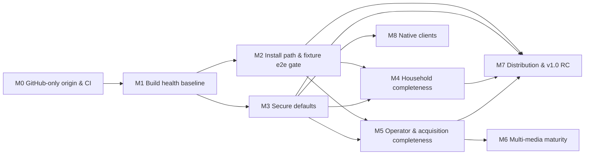

# MuxCore — Master Roadmap (canonical)

| | |
|---|---|
| **Status** | Canonical — v2.0, rewritten 2026-10-05 ([ADR-0001](docs/adr/0001-canonical-roadmap-and-spec-set.md)). Previous version preserved at [`docs/history/MASTER-ROADMAP-2026-09-02.md`](docs/history/MASTER-ROADMAP-2026-09-02.md). |
| **Owns** | Scope summary, priorities, milestones, dependencies, delivery sequencing, tasks, completion criteria, risks, and the documentation map |
| **Links, does not duplicate** | Business outcomes → [BRD](docs/specs/BRD.md) · capabilities & journeys → [PRD](docs/specs/PRD.md) · behaviour → [FRD](docs/specs/FRD.md) · requirements → [SRS](docs/specs/SRS.md) · design → [HLD](docs/architecture/HLD.md), [SDD](docs/architecture/SDD.md), [TDD](docs/architecture/TDD.md), [LLD](docs/architecture/lld/README.md) · decisions → [ADRs](docs/adr/README.md) |
| **Execution tracker** | GitHub Issues on `Muxcore-Media/umbrella` (and module repos). Each issue cites a task ID from this file (e.g. `T-M1-03`). This file stays authoritative for scope and status. |

**Maintenance rules**
1. Update task status here in the same PR that changes the work (`Todo` → `In progress` → `Done (evidence)`); keep finished milestones as a one-line summary with evidence, do not leave long checked-off lists.
2. New scope enters as an SRS requirement + a task here; never as a free-floating checklist elsewhere.
3. "Done" requires the stated verification to have been **run**; record it in the [validation log](#9-validation-log).
4. Smoke is sacred: no "deployable" claim without the fixture smoke passing ([ADR-0008](docs/adr/0008-fixture-only-acquisition-gate.md)).

---

## 1. Product in one page

**Purpose.** MuxCore is a self-hosted, modular media platform that replaces the fragmented Arr stack (Sonarr, Radarr, Lidarr, Readarr, Prowlarr, Bazarr, Tdarr, Seerr, download clients) and, over time, the Jellyfin web client, with one install: a core runtime (`muxcored`) hosting capability modules over a gRPC mesh, a household UI (`media-ui-app`), and an operator UI (`admin-ui`).

**Users.** Household members who browse/request/watch (P-1, P-2); the household operator (P-3); module developers (P-4); delivery agents (P-5). See [PRD §1](docs/specs/PRD.md#1-personas).

**Outcomes.** BO-1 one install replaces the stack · BO-2 household self-service · BO-3 Arr-grade decisions · BO-4 trust (install, migrate, update, secure defaults) · BO-5 daily control center · BO-6 own the watch experience · BO-7 beyond movies/TV. See [BRD §3](docs/specs/BRD.md#3-business-outcomes).

**Non-goals.** Hosted/multi-tenant SaaS, dashboards over existing Arr apps, bundled piracy sources or live-indexer testing, paid hard dependencies, full Tautulli API, a second playback-backend contract (for now), work in archived dump repos, telemetry. See [PRD §2.2](docs/specs/PRD.md#22-non-goals).

**Constraints.** BC-1 no paid accounts · BC-2 fixture-only acquisition · **BC-3 GitHub is the only origin** · BC-4 GitHub Free plan, private repos, no `write:packages` · BC-5 no hosted service/telemetry · BC-6 pre-1.0 beta. See [BRD §5](docs/specs/BRD.md#5-business-constraints).

## 2. Initial audit baseline vs target (2026-10-05)

This table preserves the initial audit, not the current implementation status.
Current task evidence is in §§5–6 and §9; the latest checkpoint is in §14.

| Area | Initial audit evidence | Target (v1.0 "household-ready", [PRD §5](docs/specs/PRD.md#5-product-level-acceptance-v10-household-ready)) |
|------|--------------------|------|
| Breadth | ~100 modules; movies/TV request→acquire→import→play implemented and fixture-proven; rich SPA (~1,100 tests) and admin-ui (~350 tests) | Same breadth; every Must capability Implemented |
| **Build health** | **46 of 97 Go modules fail to build at umbrella pins**; SPA typecheck fails; 3 script tests fail; integration suite cannot compile; 4 GitHub repos empty ([§9](#9-validation-log)) | All active repos green on GitHub CI (SM-8) |
| **CI / origin** | Workflows target offline self-hosted runners and a retired-origin mirror; ~1,500 retired-origin references | GitHub-hosted CI everywhere; zero retired-origin references (ADR-0002/0003) |
| Install | Registry compose + dev host work per docs; root compose broken; version skew v0.5.0–v0.5.8 across install paths; smoke does not assert fixture acquisition | One compose, one version train, smoke covers request→grab→import (SM-1) |
| Security defaults | Default admin password, insecure mesh in shipped compose, unauthenticated `Register`, no BFF CSRF, plaintext session files | Secure-defaults checklist 100 % (SM-4) |
| Household UX | Profiles missing; parental filter client-side except playback; Cast stubs; no automated a11y | J-02/J-03/J-08 e2e green; WCAG 2.1 AA [Proposed] |
| Operator UX | No indexer/downloader pages; wanted movie/TV only; migration = catalogue + profile names | J-04/J-05/J-09 covered (SM-5, SM-6) |
| Multi-media | Music partial (metadata repo empty); books partial; comics/audiobooks scaffold | Should-level (post-v1.0 allowed) |
| Native | iOS/tvOS partial; tvOS device validation blocked; Android repo empty | Should; hardware-dependent items stay Blocked |

## 3. Documentation map

| Path | Purpose | Status | Authoritative for |
|------|---------|--------|-------------------|
| [`AGENTS.md`](AGENTS.md) | Agent instructions: reading order, doc ownership, orchestration, toolchain notes, owner reference deployment | Current | How agents work in this repo |
| **`MASTER-ROADMAP.md`** (this file) | Canonical plan | Current | Scope, priority, milestones, tasks, status |
| [`docs/specs/BRD.md`](docs/specs/BRD.md) | Business requirements | Current | `BO-*`, `BC-*`, `SM-*`, stakeholders |
| [`docs/specs/PRD.md`](docs/specs/PRD.md) | Product requirements | Current | `P-*`, `CAP-*`, `J-*`, `NG-*`, v1.0 definition |
| [`docs/specs/FRD.md`](docs/specs/FRD.md) | Functional behaviour | Current | `WF-*`, `RULE-*`, state machines, permission model |
| [`docs/specs/SRS.md`](docs/specs/SRS.md) | Canonical requirements | Current | `FR-*`, `NFR-*` with status & verification |
| [`docs/architecture/HLD.md`](docs/architecture/HLD.md) | High-level design | Current | Components, trust boundaries, topology, data flows |
| [`docs/architecture/SDD.md`](docs/architecture/SDD.md) | Software design | Current | Patterns, collaboration, interface responsibilities, requirement satisfaction |
| [`docs/architecture/TDD.md`](docs/architecture/TDD.md) | Technical design | Current | Build/deps, CI, packaging, testing, security approach, migration |
| [`docs/architecture/lld/`](docs/architecture/lld/README.md) | Low-level design | Current | Acquisition, auth/sessions, core mesh, data ownership |
| [`docs/adr/`](docs/adr/README.md) | Decision records | Current | Architectural decisions (0001–0027) |
| [`docs/config-reference.md`](docs/config-reference.md) | Env var reference | Current, drift known (NFR-OPS-005) | Configuration names/defaults |
| [`README-UMBRELLA.md`](README-UMBRELLA.md), [`CONTRIBUTING.md`](CONTRIBUTING.md), [`CHANGELOG.md`](CHANGELOG.md) | Clone/bump workflow, commit/release process, changes | Current (after T-M0-03) | Process |
| `_mvp/README.md`, `_mvp/PORTS.md`, `_mvp/BFF-API.md`, `_mvp/docs/{PUBLIC-INSTALL,ACQUISITION,INFRA-BACKENDS,DUAL-LIBRARY-API,RELEASE-BUILD}.md` | Stack runbooks and API refs | Current with known gaps (BFF-API incomplete) | Stack operation |
| `media-ui-app/AGENTS.md`, `media-ui-app/docs/PLAYBACK.md` | Consumer UI design system, player | Current (parts aspirational: TanStack Query, Playwright, profiles) | UI conventions |
| `BAZARR-PARITY.md`, `TDARR-PARITY.md`, `TAUTULLI-TRACEARR-PARITY.md`, `LISTSYNC-PARITY.md` | Parity records | Historical/partly inaccurate → corrected in T-M0-05 | Nothing normative (SRS owns requirements) |
| `core.wiki/`, `muxcore-docs/wiki/` | User/developer wiki and its static-site snapshot | Partly stale; `muxcore-docs/wiki` is newer than `core.wiki` | End-user/developer guides (must not contradict specs) |
| `docs/FREEZE-PINS.md` | Pin snapshot 2026-09-07 | Historical | — |
| `TASKS.md`, `_mvp/docs/MASTER-ROADMAP.md`, `.project-management.md`, `IMPROVE-LOOP-SUMMARY.md`, `USABILITY-DEPLOY-LOOP-SUMMARY.md`, `AGENT-MODULE-AUDIT-2026-08-21.md`, `_mvp/docs/AGENT-MODULE-AUDIT-2026-08-21.md`, `_mvp/REPO-STATUS.md`, `_wave1/**`, `.tasks-loop-state.json`, `.improve-loop-state.json`, `.tasks-indexer-loop-state.json`, module `ROADMAP.md` files | Earlier plans, loop logs, audits | **Superseded / historical** (bannered in T-M0-05) | Nothing |
| `cache-memory/notes/`, `custom-scripts/notes/` | Old plans inside archived dumps | Historical (NG-7) | Nothing |

## 4. Conflicts found and how they were resolved

| # | Conflict | Resolution | Basis |
|---|----------|-----------|-------|
| C-1 | Retired self-hosted origin & CI documented as authoritative vs GitHub as actual tracker; the old host no longer serves it | GitHub only | Owner instruction 2026-10-05 → [ADR-0002](docs/adr/0002-github-sole-origin.md) |
| C-2 | Roadmap "only living doc" vs `.project-management.md` "tracking migrated to GitHub Issues" | Roadmap owns scope/status; Issues are the execution layer citing task IDs | [ADR-0001](docs/adr/0001-canonical-roadmap-and-spec-set.md) (Delegated) |
| C-3 | Two roadmap copies (root vs `_mvp/docs/`) diverged | Root is canonical; `_mvp` copy bannered superseded | Existing references point to root |
| C-4 | `CHANGELOG.md` lists "Public GHCR consumer mirror" and `docker-compose.public.yml` as Added; roadmap says GHCR blocked; file does not exist | Implementation evidence wins: GHCR **Blocked** (no `write:packages`), compose file absent → CHANGELOG corrected | Repo evidence + token scopes |
| C-5 | `BAZARR-PARITY.md` claims 56 providers / 184 languages / sync+upgrade complete; code has 2 providers, stubs | Code wins; doc corrected; SRS FR-SUB-001 Partial | Implementation evidence |
| C-6 | `LISTSYNC-PARITY.md` points at a missing file | Pointer replaced by SRS FR-MIG-004 reference | — |
| C-7 | Appendix C (Jellyfin parity) "no open rows" vs real gaps (profiles, server-side parental, Cast, a11y, i18n) | Gaps captured as SRS requirements in M4 | Owner playback decision (ADR-0005) requires parity |
| C-8 | `.tasks-loop-state.json` "0 open" vs open issues #2, #121, #151 | Loop state is historical; open issues mapped to tasks (T-M8-02, T-M5-04, T-M5-07) | GitHub Issues evidence |
| C-9 | Module `go.mod` sibling replaces (ensure-go-replaces.sh) vs "MVP modules pin published tags, no replace" (REPO-STATUS Wave 25–28) vs marketplace scan rejecting replaces | Published tags only; `go.work` for local dev | [ADR-0011](docs/adr/0011-go-workspace-and-published-versions.md) |
| C-10 | Draft PR #155 deletes module `AGENTS.md` / moves parity docs | Not adopted as-is; superseded by this doc set; per-module `ROADMAP.md` bannered | ADR-0001 |
| C-11 | `core.wiki` vs `muxcore-docs/wiki` drift (10 pages differ) | `muxcore-docs/wiki` is the working copy (newer, per its AGENTS.md); wiki sync is a task (T-M2-09) — resolved 2026-10-05: wikis identical, `sync-core-wiki.sh` keeps them so | Repo evidence |
| C-12 | Root CI `ubuntu-latest` vs runner doc "must use `native`" | Moot: GitHub-hosted runners | ADR-0003 |
| C-13 | Version skew (installer v0.5.0, operator v0.5.4, stack v0.5.7, starter v0.5.8) | Single release train (FR-INS-006) — implemented 2026-10-05 (`release-train.env`, `scripts/check-pins.sh`) | TDD §5 |
| C-14 | `request-media` used `contracts.CallerIDFromContext`/`WithCallerID` for the *end-user* caller, but core removed them (module caller identity is core-internal, `internal/callerid`) | Keep end-user caller in a module-local context key (`request-media/internal/authz`); no core API added | Core doc comment on `internal/callerid` ("NOT a module-facing API"); implementation evidence |
| C-15 | Umbrella `integration/` imported `integsupport` packages from core, media-movies, media-transcoder, playback-monitor, backup-local that were not in any published tag (core/backup-local versions only on orphaned branches), and asserted APIs that never existed (media-movies view state / batch refresh, playback-monitor rollups / anomaly detection) | Published `integsupport` in each module (core v0.6.3–v0.6.4 incl. caller-identity interceptor); tests for non-existent APIs rewritten to the published contracts; real bugs the suite exposed fixed upstream (media-transcoder v0.3.7–v0.3.8, media-movies v0.1.14–v0.1.15) | Implementation evidence (git history of each module) |
| C-16 | Rebuilt `metadata-musicbrainz` briefly advertised the generic `metadata` capability, which media-movies/media-tvshows/media-list-sync use to discover the TMDB-style `MetadataProvider` | Advertise only `metadata.music` + `metadata.musicbrainz` | Consumer code (`FindByCapability(ctx, "metadata")`) |
| C-18 | Registry compose runs the dev profile (plaintext mesh) with one container per module vs core ≥ v0.6.10 dialing security sidecars (authorizer/identity/auth, call policy, publish policy) in plaintext **only on loopback** (`internal/bootstrap.DialSidecar`) | Until the household switch (T-M3-02g, mesh TLS), `auth-local`, `call-policy-default`, `publish-policy-default` share core's network namespace (`network_mode: service:core`, names kept as network aliases on `core`); no core change — **resolved 2026-10-05**: in the household compose (`_mvp` cd23b18) core dials the sidecars over CN-checked TLS in their own containers (clean-room household run); the shared-network layout survives only in `docker-compose.dev.yml` | ADR-0016 (dev profile is loopback-only); implementation evidence (clean-room run) |
| C-17 | ADR-0011 "no filesystem `replace`" vs core's nested modules (`sdk/go/{client,module,mock}`, root → `./pkg/contracts`) replacing their own parent paths | Allowed: replaces that stay inside one repository are ignored by consumers and never leave the repo; ADR-0011 targets cross-repository replaces. `check-no-replace.sh` scans only module roots, and the CI template allows `./` | Go module semantics; implementation evidence |
| C-19 | Initial-audit summaries, FRD/LLD session sketches and several SRS/task rows still described defects already fixed in the 2026-10-05 validation log (including installer household, fixture defaults, restore/upgrade tests, CSRF and durable sessions) | Preserve the audit table and historical logs as dated evidence; update current statuses and design text from verified implementation. BFF sessions use encrypted JSON, not the earlier SQLite sketch. New branch checkpoints remain distinct from merged/deployed evidence | Existing §9 results, `session_store.go`, admin-ui `session/file_store.go`, T-M3-02/04/05; reconciled 2026-10-07 |
| C-20 | T-M7-01/TDD require train tags, but CONTRIBUTING and release CI used only umbrella `v*` tags | `train-YYYY.MM.N` must match committed metadata; retain historical `v*` support with separate note ranges and no post-tag write to main | [ADR-0024](docs/adr/0024-umbrella-release-trains.md); offline fixtures |
| C-21 | T-M4-05 said admin-ui `templ/a11y_test.go` was absent, but the pinned checkout already had static assertions; passing mocked UI checks could be mistaken for full WCAG/journey acceptance | Retain existing tests and add rendered DOM/axe/keyboard checks plus consumer Chromium fixtures. Automated-gate task evidence is separate from partial NFR-A11Y-001/002 and unproven full-stack journeys | [ADR-0025](docs/adr/0025-ui-verification-gates.md), local tests 2026-10-07 |
| C-22 | M7's blanket `write:packages` token blocker and B-2's blanket no-CI claim outlived later evidence | Core already published with workflow `GITHUB_TOKEN`; module-image GHCR still needs its workflow/private checkout setup. On 2026-10-07 UI CI/browser jobs started, so billing availability must be checked per run rather than assumed blocked everywhere | R-1, current GitHub PR/run observation; no claim that every repo's billing/credential blocker is resolved |
| C-23 | Core spool's textual host allow-list and config-reference default `all` did not express a connection-time address boundary | Retain exact host/port matching and explicitly listed LAN destinations; empty lists permit public destinations only, all DNS answers must pass before checked-IP dialing, and metadata/link-local destinations stay denied | [ADR-0028](docs/adr/0028-spool-dial-time-destination-policy.md), core `1eec416` and local race/lint evidence |
| C-24 | T-M5-07's raw `secrets-vault` compose profile and optional host flag could select both secrets providers although discovery expects a deliberate provider choice | Support a last-applied overlay and exclusive host selection; retain file defaults and volumes, require explicit stop/configure/migrate/start, and document the raw additive profile as unsupported for selection. Core's exclusive-capability list is unchanged | [ADR-0029](docs/adr/0029-secrets-provider-deployment-selection.md), narrow FR-INS-008 trace to existing T-M5-07; runtime acceptance remains separate |
| C-25 | The OIDC LLD proposed a new capabilities probe and SRS marked provider-aware pages wholly planned; consumer Acquisition remained viewer-visible after the first gate batch | Use actual typed AuthService responses without a new capability RPC; record the verified provider-aware and Acquisition/Requests-policy UI slices. Keep FR-AUTH-009 and FR-ADM-010 partial for their explicit remaining acceptance | admin-ui `c06ae6c`, media-ui-app `99b5ca3`, local verification below; no backend-authorization or live-provider inference |
| C-26 | FRD invite workflow said admin-ui's generated link opened the SPA and went directly Home, and its exhaustion rule omitted unlimited invites | Document the actual admin-ui redemption link and HTTP redemption-to-login handoff, retaining the separate SPA path. Apply exhaustion only to a positive finite limit | admin-ui `handler/invites.go`, `household_redeem.go`, caller/URL fixtures and auth-local `internal/store/invites.go`; no full-stack J-02 acceptance inferred |
| C-27 | NFR-MNT-005 literally required push-to-`main` although core's default branch is `master` | Target each repository's actual default branch; ADR-0003 defines hosted CI, not a mandatory branch name. Record present failures/successes by run rather than extending the old credential-count snapshot | GitHub core PR #97/#98 target and workflow evidence; no branch rename or CI-host change |
| C-28 | FR-PLAY-007/FRD described playback as the server-enforced exception, but its inputs and policy are not authoritative | Keep the requirement partial and describe the observed trust gaps before designing the provider/policy boundary; list/search/detail middleware alone would not close it | Read-only BFF review: `playback.go` request metadata, ignored rating/allowed tags in `parental.go`, self-service userdata mutation and provider-failure local fallback; implementation/design acceptance pending |

**Assumptions (labelled, revisit if wrong):** A-1 `MUXCORE_CI_TOKEN` exists in every repo (verified on `admin-ui` only). A-2 Content of the four empty GitHub repos is not recoverable from GitHub. A-3 Free-plan Actions minutes suffice once self-hosted jobs stop queueing. A-4 The owner's vault/homelab deployment remains in use as a reference deployment but is not a product requirement. A-5 Agents on `claude-workstation` cannot reach vault (no ZeroTier, no SSH key); module releases since 2026-10-05 are not redeployed there until the owner pulls them or grants access.

## 5. Milestones and dependencies

v1.0 = M0–M5 + M7 complete. M6 and M8 are Should-level and may ship after v1.0. No dates are committed (none have been approved); ordering is by dependency and priority.

| Milestone | Goal | Requirements closed | Status | Completion criteria (observable) |
|-----------|------|---------------------|--------|----------------------------------|
| **M0** | GitHub is the only origin; CI runs on GitHub-hosted runners; docs reconciled | NFR-MNT-005, NFR-MNT-006, NFR-MNT-009, NFR-SEC-012, NFR-COST-001, FR-SUB-002 | **Done** (2026-10-05) — criteria 1–5 verified locally (§9); the submodule-level hygiene step in umbrella CI skips until B-1 | (1) `scripts/check-retired-origin.sh` reports 0 matches over active content (excludes `docs/history/`, `docs/adr/`); (2) every active repo has `.github/workflows/ci.yml` with `runs-on: ubuntu-latest` and no `self-hosted`/`checkout-mirror`; (3) no retired-origin workflow directories in active repos; (4) `scripts/check-submodules.sh` passes (every pinned SHA fetchable from GitHub); (5) superseded docs bannered |
| **M1** | Every active module builds, vets, and tests green standalone and in the workspace | NFR-MNT-001…004, NFR-MNT-007, NFR-SEC-013, FR-BRG-001, FR-MM-001 (restore) | **Done locally** (2026-10-05) — criteria 1, 3–6 verified (§9); criterion 2 (per-repo CI green) and CI observation of 1/5 blocked by B-1 | (1) umbrella workspace job: `go build ./... && go vet ./...` green for all active modules; (2) each active repo's GitHub CI green on `main` at the umbrella-pinned SHA; (3) `media-ui-app` typecheck/test/build green; (4) `node --test scripts/*.test.mjs` and `_mvp/scripts/run-script-tests.sh` green; (5) `integration` compiles and runs; (6) no filesystem `replace` in any active `go.mod` |
| **M2** | A fresh install reaches a passing fixture smoke that covers request → grab → import → play | FR-INS-001/003(partial)/005/006, FR-AUTH-004 (e2e), FR-BAK-002/004, NFR-DATA-002, NFR-REL-001, NFR-OPS-005, NFR-PERF-003 | In progress — original local household/dev smoke and restore evidence passed 2026-10-05; GitHub clean-room evidence and a renewed run after current wiring are pending | (1) `docker compose up` from root succeeds in a clean container host and `_mvp/smoke.sh` passes; (2) smoke asserts fixture search→dispatch→import→library item; (3) one version pin across compose/installer/operator/starter (check script green); (4) restore drill script green; (5) upgrade test from previous tag green for household modules |
| **M3** | Secure defaults | NFR-SEC-001…011, FR-INS-003/004, FR-EXT-003, FR-BAK-003, NFR-REL-003, NFR-OPS-004 | In progress — core profile/enrollment and initial defaults shipped; remaining path/SSRF audit rows, phase-2 profile migration and renewed stack verification remain | Secure-defaults checklist (TDD §8) all items have passing tests; SM-4 = 100 % |
| **M4** | Household consumer completeness | FR-PLAY-007/009, FR-AUTH-010, FR-ADM-010, NFR-A11Y-001/002, NFR-DATA-003 | In progress — Settings role gates and both UI automated gates verified locally; profiles, parental enforcement, deletion, migration and full-stack journeys remain | Playwright fixture e2e J-02, J-03, J-08 green; axe checks green on core pages; server-side parental table test green |
| **M5** | Operator & acquisition completeness | FR-ADM-002/006/008/009, FR-AUTH-007/009, FR-MIG-002/003, FR-ACQ-005(corpus)/006/011, FR-SUB-001, FR-TRN-001, NFR-REL-004 | In progress — T-M5-11 published contract, provider and Devices consumer slices verified; live integration/revoke propagation and remaining operator/acquisition work pending | SM-3, SM-5, SM-6 met; issues #121 and #151 closed |
| **M6** | Multi-media maturity | FR-MM-002…005, FR-REQ-006, FR-PLAY-010 | Todo | Fixture acquire→import→consume test per media type green |
| **M7** | Distribution & v1.0 release candidate | FR-INS-001 (GHCR variant), release train | In progress — release preparation/notes verified locally; new train publication, central GHCR workflow and RC acceptance remain pending | Release `train-*` tag; release notes from Conventional Commits; SM-1/2/4/8 met; GHCR push when unblocked |
| **M8** | Native clients | FR-NAT-001…003 | Partly Blocked (device, Android source) | iOS/tvOS simulator tests for auth+resume green via manual workflow; hardware checklist completed when a device is available |
| **D** | Deferred | FR-AI-001, FR-PLAY-011, NFR-PERF-001/002, NFR-OPS-003, multi-tenant isolation (NG-1), k8s operator GA, `contracts-playback` service (NG-6), HA cluster | Deferred | Re-enters only via a new SRS priority + ADR where architectural |

## 6. Tasks

Status legend: `Todo`, `In progress`, `Done (evidence)`, `Blocked (reason)`.

### M0 — GitHub-only origin & CI

Prerequisites: none beyond `gh` access with `repo`+`workflow` scopes (available).

| ID | Objective | Refs | Depends | Completion check | Status |
|----|-----------|------|---------|------------------|--------|
| T-M0-01 | Umbrella CI on GitHub: add `.github/workflows/ci.yml` (hygiene checks, script tests, workspace build, commit lint); delete the retired-origin workflow directory and `.github/workflows/RETIRED.md` | NFR-MNT-005, TDD §4.2, ADR-0003 | — | Workflow run on a PR shows all jobs executing on `ubuntu-latest` | Done — `.github/workflows/ci.yml` green on GitHub (docs/scripts, gitleaks, workspace job; workspace steps skip until B-1) |
| T-M0-02 | CI templates + `scripts/sync-ci.sh`; roll out `.github/workflows/ci.yml` to every active module; delete retired-origin workflows, self-hosted jobs, `checkout-mirror` usage | NFR-MNT-005, NFR-COST-001, TDD §4.1 | T-M0-01 | `scripts/check-ci.sh` (new) passes over all submodules | Done — every active Go/Node module on the templates; `scripts/sync-ci.sh --check` ok (2026-10-05). Release template gained optional `RELEASE_ENTRY`/`RELEASE_LDFLAGS` repo variables (used by `muxcorectl-cli`) |
| T-M0-03 | Remove retired-origin references from active content (umbrella + modules), delete retired-origin-only scripts, update AGENTS/README/CONTRIBUTING/PUBLIC-INSTALL/wiki | NFR-MNT-006, ADR-0002, TDD §10 | — | `scripts/check-retired-origin.sh` exits 0 | Done — `scripts/check-retired-origin.sh` ok (2026-10-05); last references were legacy workflow directories in `core` and the M1 tail, all deleted |
| T-M0-04 | Submodule hygiene: `scripts/check-submodules.sh`; remove `media-ui-tv` and `muxcore-android` from `.gitmodules` (empty repos, recorded in TDD §2.1); track `playback-contract`/`metadata-musicbrainz` remediation in M1 | NFR-MNT-009 | — | Script green in CI | Done — script added; `media-ui-tv`, `muxcore-android`, `playback-contract` removed; `metadata-musicbrainz` rebuilt on `main` (T-M1-03) |
| T-M0-05 | Doc reconciliation: superseded banners (see §3), correct `CHANGELOG.md` (C-4), `BAZARR-PARITY.md` (C-5), `LISTSYNC-PARITY.md` (C-6), `.cursor/rules/muxcore-workspace.mdc`, `core.wiki/Roadmap.md` stub | ADR-0001, FR-SUB-002 | — | `scripts/check-docs.mjs` (links + SRS IDs) passes | Done — banners/moves to `docs/history/`, CHANGELOG/BAZARR/LISTSYNC corrected, `.cursor` rules updated; `check-docs.mjs` green |
| T-M0-06 | Secret scanning job (gitleaks, pinned version) in umbrella CI | NFR-SEC-012 | T-M0-01 | Job green; fails on a seeded test secret in a scratch PR | Done — gitleaks in umbrella CI with `.gitleaks.toml` (vendored doc placeholders allowlisted) |

### M1 — Build health baseline

Prerequisites: M0 T-M0-01/02 (so results are visible in CI).

| ID | Objective | Refs | Depends | Completion check | Status |
|----|-----------|------|---------|------------------|--------|
| T-M1-01 | `core` `main` green on GitHub CI; tag `v0.6.0` + `pkg/contracts/v0.6.0`, `sdk/go/client/v0.6.0`, `sdk/go/module/v0.6.0` | ADR-0011, LLD core §7 | T-M0-02 | Tags visible on GitHub; `go list -m github.com/Muxcore-Media/core@v0.6.0` resolves | Done — core `v0.6.0` (+ nested modules), `v0.6.1` (auth invite / circuit-breaker List protos), `v0.6.2` (module-manager race fix); `v0.5.8` restored at hash-matched `d732be6`; resolution tags per TDD §3.2 |
| T-M1-02 | Fold `playback-contract` package into `contracts-playback`; tag; repoint `jellyfin`, `plex`, `emby` | TDD §2.1, FR-BRG-001 | T-M1-01 | The three bridges build standalone | Done — `contracts-playback v0.2.0` `playbackv1`; jellyfin/plex/emby/playback-monitor shipped |
| T-M1-03 | Rebuild minimal `metadata-musicbrainz` (fixture corpus, `contracts-metadata` music RPCs used by `media-music`) | FR-MM-001 | T-M1-01 | `media-music` builds standalone; metadata-musicbrainz tests green | Done — `metadata-musicbrainz` v0.1.0 on `main` (default branch): WS/2 client (User-Agent, `fmt=json`, 1 req/s, 429/5xx → Unavailable), `MUSICBRAINZ_FIXTURE=1` embedded corpus, gRPC fixture e2e test, capabilities `metadata.music` + `metadata.musicbrainz` (C-16); `media-music` v0.3.0 builds standalone against it |
| T-M1-04 | Fix proto drift: `auth-local` (`authv1.InviteInfo`), `circuitbreaker-simple` (`ListRequest`) and any found by `check-proto-drift.sh` | NFR-MNT-001 | T-M1-01 | Both modules build/test green | Done — core v0.6.1; auth-local v0.1.14 (also restored missing `internal/policy` import), circuitbreaker-simple v0.1.5 |
| T-M1-05 | Fan-out: every active Go module requires `core v0.6.0`, drops `core/pkg/tenant` requires and all filesystem `replace`s, moves to GitHub-available tags of siblings, `go mod tidy`, tests green, patch tag | NFR-MNT-001, NFR-MNT-007, ADR-0011 | T-M1-01…04 | Per-repo CI green; `scripts/check-no-replace.sh` green | Done — all active modules shipped with published deps, green build/vet/test −race and lint; `scripts/check-no-replace.sh` ok (2026-10-05). Tail releases: media-music v0.3.0, media-automation v0.1.46 (corrupt descriptor regenerated; TV wanted-sibling deletion bug), request-media v0.3.2 (C-14), media-list-sync v0.1.10, media-library-maintainer v0.1.12, media-graph v0.1.3, admin-ui v0.1.13, muxcorectl-cli v0.1.1, media-movies v0.1.15, `_mvp` `d166018` (no tag: deployment repo). Per-repo GitHub CI still blocked by B-1 for repos without the secret |
| T-M1-06 | Root `integration/` compiles against `core v0.6.0` (`integsupport`) and runs with `-tags integration` | NFR-MNT-004 | T-M1-05 | Umbrella CI integration job green | Done (local) — compiles and passes locally against published core v0.6.4 and sibling `integsupport` packages (`go test -tags integration -race`, lint 0, C-15); umbrella CI job blocked by B-1 |
| T-M1-07 | `media-ui-app`: fix typecheck error and failing test | NFR-MNT-002 | — | `npm run typecheck && npm test && npm run build` green | Done — media-ui-app typecheck, 1,108/1,108 tests, build green (`d0012f3`) |
| T-M1-08 | Umbrella scripts: fix 3 failing `node --test` cases and eslint error | NFR-MNT-003 | — | `node --test scripts/*.test.mjs` and eslint green | Done — 60/60 node tests, eslint, shellcheck green |
| T-M1-09 | `scripts/gen-go-work.sh` + workspace build job; retire `scripts/ensure-go-replaces.sh` | ADR-0011, TDD §4.2 | T-M1-05 | Workspace job green | Done (local) — `gen-go-work.sh` now skips nested stub copies of other modules (`media-dlna/stub/core/...` made every workspace build fail); workspace `go build && go vet` green for all 97 active modules (2026-10-05); CI job needs B-1 |
| T-M1-11 | Clear golangci-lint debt and make lint blocking (`LINT_BLOCKING=true` repo variable) | NFR-MNT-005 | T-M1-05 | Lint job green and blocking | Done — lint 0 issues and `LINT_BLOCKING=true` on every module shipped in T-M1-05, including the tail |
| T-M1-10 | Bump umbrella pins to the green SHAs; regenerate `docs/FREEZE-PINS.md` | — | T-M1-05…09 | `git submodule status` clean; CI green | Done — pins at default-branch tips, `docs/FREEZE-PINS.md` regenerated; spool catalog 2.5.0: all 68 modules at latest tags, checksums recomputed with the ADR-0012 canonical build (core v0.6.5, `_mvp` populate script rewrite; reproducibility re-checked), `validate.py` OK. Found and fixed: admin-ui had no `cmd/module` (unloadable by core's resolver, v0.1.14), plex/emby manifests declared the retired `playback-contract` (v0.1.2) |

### M2 — Install path & fixture e2e gate (tasks; refine when M1 lands)

| ID | Objective | Refs | Completion check |
|----|-----------|------|------------------|
| T-M2-01 | Root `docker-compose.yml` includes `_mvp/docker-compose.registry.yml`; retire `docker-compose.ghcr.yml` (registry is a variable) | ADR-0007 | `docker compose config` valid in CI — **Done** (2026-10-05): root compose includes the registry file, ghcr variant retired; `docker compose config -q` green in `mvp` Script tests CI and in the umbrella workspace job |
| T-M2-02 | Publish set covers every module referenced by any compose profile | TDD §5 | compose-vs-publish check script — **Done** (2026-10-05): `_mvp/scripts/check-publish-set.sh` (+test); 19 modules added, 44/44 compose images covered |
| T-M2-03 | Smoke asserts fixture search → dispatch → import → library item (+ BFF play URL) | FR-INS-003, SM-1, ADR-0008, ADR-0014 | **Done locally (2026-10-05)** — later clean-room runs in §9 supersede the initial blockers: fixture indexer → torrent fixture engine → scanner import → media-movies → BFF stream 206 and playback resolve passed. This is historical train evidence; the 2026-10-07 wiring requires a renewed run before deployment/release claims |
| T-M2-04 | Single version train pin consumed by compose, installer, operator, starter, Helm | FR-INS-006 | `scripts/check-pins.sh` green — **Done** (2026-10-05): `release-train.env` (now train-2026.10.2: core/images v0.6.13, spool 2.6.0), check in umbrella CI; core release workflow fixed (v0.6.6/v0.6.7: Go version, syft) |
| T-M2-05 | Manifest `state_dirs` + `ExportState` coverage for household modules; restore drill script | FR-BAK-002/004, ADR-0013 | **Done locally (2026-10-05)** — host drill restored 18 modules; the later compose drill restored 16 with identical snapshot and original-password authentication (decoy refused). Manifest/volume coverage and `backup-local` archive re-indexing fixed earlier gaps; see §9 and `_mvp/docs/RESTORE.md`. New deployment changes still require renewed smoke/restore evidence |
| T-M2-06 | Upgrade-from-previous-tag tests for household modules | NFR-DATA-002, FR-INS-005, ADR-0015 | tests green — **Done** for the household set (2026-10-05): `core/sdk/go/module/moduletest` (sdk v0.6.1) + `scripts/upgrade-fixtures/snapshot.sh`; snapshot upgrade tests in request-media v0.3.3 (v0.2.7, v0.3.0, v0.3.2), auth-local v0.1.15 (v0.1.5), userdata-local v0.1.1, media-tvshows v0.1.14, media-movies v0.1.17 (v0.1.9, v0.1.15), media-automation v0.1.47, media-scanner v0.1.28. Found and fixed: media-movies `Init` hung on every v0.1.9 database; a follow-up sweep fixed the same cursor-held-across-write deadlock in media-library-maintainer v0.1.13 and media-transcoder-pool v0.2.2 and a hazard in media-tvshows v0.1.15. Image-level upgrade drill follows T-M2-10 |
| T-M2-07 | Env-var drift check vs `docs/config-reference.md` (remove phantom vars like `BACKUP_EXCLUDE`) | NFR-OPS-005 | check script green — **Done** (2026-10-05): `scripts/check-env-docs.mjs` + test, in umbrella CI |
| T-M2-08 | Remove or mark dev-only `media-ui-app/Dockerfile` + `nginx.conf`; complete `_mvp/BFF-API.md` route inventory with a test | SDD §5, TDD §7 | route-inventory test green — **Done** (2026-10-05): `routes_inventory_test.go` vs `BFF-API.md` (351 routes); found and fixed two ServeMux conflicts that made `mediauiprox` panic at startup; `media-ui-app` Dockerfile/nginx already marked dev-only |
| T-M2-09 | Sync `core.wiki` from `muxcore-docs/wiki`; remove homelab specifics from user docs | C-11, ADR-0002 | wiki diff empty; docs check green — **Done** (2026-10-05): `muxcore-docs/scripts/sync-core-wiki.sh --check` in sync; one homelab detail removed |
| T-M2-10 | Clean-room install job (`workflow_dispatch`): build images, start stack in podman/docker, run smoke | SM-1, ADR-0014 | job green — In progress: `scripts/clean-room.sh` **passes locally** (2026-10-05, rootless podman: 27 images from the pinned commits → `registry:2` → root compose → fixture smoke incl. acquisition → compose restore drill; idle RSS 470 MiB). `.github/workflows/clean-room.yml` written, not run: blocked by B-1. The first run found and fixed in `_mvp`: loopback gRPC binds, security sidecars unreachable by core in the dev profile (C-18), missing policy files / ffmpeg in images, admin-ui core/auth/userdata wiring, scanner watch dir, registry smoke never worked (no gRPC reflection → `proto/smoke.protoset`; wrong service names, field names, grpcurl argument order), compose project name |
| T-M2-11 | Module version single source: `Info().Version` drifts from `muxcore.json` and tags in ~87 of 95 modules (smoke discovery compares versions with the catalog) | FR-INS-006 | **Done** (2026-10-05): ADR-0021, `modulesdk.ManifestVersion` (sdk/go/module v0.6.3); 79 modules report the version embedded from `muxcore.json` |

### M3 — Secure defaults

Nine items from [TDD §8](docs/architecture/TDD.md#8-security-hardening-approach), one task each (`T-M3-01` … `T-M3-09`, in TDD order). Items 2, 3 and 6 are designed in [ADR-0016](docs/adr/0016-security-profiles.md)…[ADR-0019](docs/adr/0019-end-user-identity-propagation.md) and split into subtasks.

| ID | Objective | Refs | Status |
|----|-----------|------|--------|
| T-M3-01 | No default credentials; generated bootstrap secret; CI lint for default literals | NFR-SEC-001, FR-INS-004 | **Done** — `_mvp` 92810f5 (generated one-time admin secret, required compose secrets) + installer v0.3.7 (generated Postgres password) + example/dev-compose cleanup in auth-local, auth-oidc, operator, media-ui-app, storage-*, docs; `scripts/check-default-creds.sh` ok and in CI |
| T-M3-02 | Profiles `dev`/`household`: (a) core profile + CA defaults, (b) sidecar dial creds, (c) signatures in household, (d) SDK refuses insecure in household, (e) acquisition defaults fail closed, (f) installer `MUXCORE_DB_BACKEND`, (g) compose/installer switch to household (last, breaking) | NFR-SEC-003/010, FR-EXT-003, ADR-0016 | **Done** except phase 2 — (a)–(f) as before; (g) compose `_mvp` cd23b18 and installer v0.3.11 default to household (installer: fresh install, opt-in upgrade and `--dev` verified with real runs); phase-2 removal of profile inference scheduled one train later (ADR-0016) |
| T-M3-03 | Authenticated registration: (a) verified-peer module principal, (b) Register/Unregister rules + exclusive capabilities, (c) CSR enrollment + single-use tokens, (d) SDK `meshid`, (f) rebuild modules on the new SDK, (g) auth-oidc `CallerId` | NFR-SEC-002, ADR-0017, ADR-0018, ADR-0022 | **Done** — (a) core v0.6.9, (b) v0.6.11 → ADR-0022 (v0.6.14), (c)(d) v0.6.12, (f) all SDK modules rebuilt (core v0.6.12–v0.6.15, sdk v0.6.3–v0.6.5), (g) auth-oidc v0.1.6, auth-local v0.1.16; compose identity volumes + `gen-enrollment.sh` (`_mvp` cd23b18); household run proves verified-certificate registration of every service |
| T-M3-04 | BFF: CSRF, `POST /logout`, server timeouts, security headers, persisted sessions | NFR-SEC-004/006, NFR-REL-003 | **Done** — `_mvp` 831491f (CSRF Origin check, `POST /logout`, timeouts, security headers, persisted encrypted sessions) + media-ui-app be3e834 (POST sign-out) |
| T-M3-05 | admin-ui TLS dial helper; session store under data dir, protected, 0600 | NFR-SEC-003/005 | **Done** — admin-ui v0.1.15 (TLS dial helper for 27 sites + core client; hashed/encrypted 0600 sessions under the data dir; devices page no longer leaks session tokens) |
| T-M3-06 | End-user identity: (a) request-media bearer authn, (b) BFF / (c) admin-ui forward bearer and strip identity headers, (d) tenant middleware, (e) Jellyfin bridge | NFR-SEC-007, ADR-0019 | **Done** — (a) request-media v0.3.4, (b) BFF `_mvp` 831491f, (c) admin-ui v0.1.16, (d) core v0.6.11 `pkg/tenant` (`TENANT_TRUST_HEADERS`, `WithAuthenticatedTenant`), (e) jellyfin v0.3.2; ADR-0019, ADR-0020 |
| T-M3-07 | Loopback-by-default or auth: scheduler-cron, health-monitor `/status`, core `/metrics` | NFR-SEC-011 | **Done** — scheduler-cron v0.1.7, health-monitor v0.1.7, core v0.6.8; callers `_mvp`, admin-ui v0.1.16, muxcorectl-cli v0.1.2; Helm/kustomize secrets `_mvp` 085ede1 |
| T-M3-08 | Restore/target path allow-list in admin-ui | FR-BAK-003, NFR-SEC-008 | **Done** — admin-ui v0.1.15 confines restore `target_path` to `ADMIN_UI_RESTORE_ROOT` (`BACKUP_RESTORE_DIR`, `/data/restore`) |
| T-M3-09 | Audit HMAC when a key is configured | NFR-OPS-004 | **Done** — core v0.6.8 (`MUXCORE_AUDIT_HMAC_KEY[_FILE]`, `VerifyEntries`; signed-entry verification bug fixed) |

### M4 — Household completeness

| ID | Objective / refs | Status and remaining acceptance |
|----|------------------|---------------------------------|
| T-M4-01 | Server-side parental middleware in BFF (FR-PLAY-007) | In progress — prerequisite typed userdata-local authority foundation accepted in ADR-0030; source work starts as an unused producer with admin-bearer CAS writes and tenant-bound self/admin reads. Current playback still trusts request metadata/self-editable userdata. Trusted migration, media classification, failure handling and consumer route enforcement remain; no implementation acceptance yet |
| T-M4-02 | Profiles incl. kids/PIN (FR-AUTH-010) | Todo |
| T-M4-03 | Hide unsupported Cast/AirPlay (FR-PLAY-009) | Done — PR #37; SRS remains Part because Remote Playback API is not a Cast SDK implementation |
| T-M4-04 | Operator settings gating/migration (FR-ADM-010) | Part — `357461d` aligns indexer mutation controls with admin-only BFF writes; admin/manager Acquisition access and earlier role/capability gates remain. Local scoped 197, full 1246 and browser 52 tests pass, with established-session action coverage. Fresh direct-Settings role hydration remains a separate verified gap; settings migration/admin destination/manager page access remain open |
| T-M4-05 | Automated accessibility gates in both UIs (NFR-A11Y-001) | Done — SPA PR #38 retained; admin-ui `a567ab1` adds 13 rendered document audits, 15/15 axe suite/control and 6/6 keyboard checks. Local and hosted CI/Accessibility pass; PR #60 merged as `5206686`. NFR-A11Y-001 stays Part pending full browser/manual WCAG evidence (ADR-0025) |
| T-M4-06 | Playwright fixture e2e J-02/J-03/J-08 + viewports (NFR-A11Y-002) | Part — `357461d` has 52 Chromium HTTP-fixture cases across 375/768/1280/1920 px with local/hosted success, including prior keyboard/focus/reduced-motion and new established-session indexer actions. Fresh direct-Settings hydration remains open. These prove selected UI behavior, not real auth/session, acquisition/playback/resume or backend parental journeys. Screenshots are diagnostic, not comparison baselines (ADR-0025) |
| T-M4-07 | User deletion fan-out (NFR-DATA-003) | Todo |

### M5 — Operator & acquisition completeness

T-M5-01 indexer & downloader admin pages (FR-ADM-006) · T-M5-02 unified wanted across media (FR-ADM-002) · T-M5-03 per-page RBAC + OIDC-aware pages (FR-ADM-009, FR-AUTH-009) · T-M5-04 transcoder queue/pool profiles — issue #121 (FR-ADM-008, FR-TRN-001) · T-M5-05 migration depth + dry-run (FR-MIG-002/003) · T-M5-06 decision corpus + quality-tier cutoff (FR-ACQ-005/006, SM-3) · T-M5-07 explicit secrets-provider selection — issue #151 (FR-INS-008) · T-M5-08 downloader contract unification (FR-ACQ-011) · T-M5-09 subtitle providers beyond OpenSubtitles (FR-SUB-001) · T-M5-10 event-redelivery idempotency tests (NFR-REL-004).

**T-M5-03 per-page RBAC + OIDC-aware pages — Part:** admin-ui `c06ae6c` handles actual AuthService `Unimplemented` on user, TOTP, token and invite operations with explanatory control-free states; genuine failures remain errors, and invites use existing RPCs with the caller context. Local focused/full race, rendered accessibility and keyboard checks pass. Direct passkey endpoints, live OIDC acceptance and per-page RBAC remain; the global `admin.access` guard is unchanged.

**T-M5-07 explicit secrets-provider selection — Part:** `_mvp` `3ba1ec4` adds the last-applied compose overlay and host-runner selection in [ADR-0029](docs/adr/0029-secrets-provider-deployment-selection.md). Twenty-seven actual compose renders and host launcher/preflight/process fixtures pass locally, preserving default file behavior and unrelated reused PIDs. Operators explicitly stop the old provider and migrate secrets; external-provider connectivity and manual migration have not run. Requires `!reset` support; Docker Compose 2.40.3 verified, earlier versions and Podman Compose unverified.

**T-M5-11 all-sessions device list (FR-AUTH-007) — Part:** core v0.6.16 publishes the verified contract ([ADR-0026](docs/adr/0026-administrative-session-contract.md)). Auth-local `f57d194` and admin-ui `b84ecc7` provider/Devices slices pass hosted checks and have merged; local provider execution remains blocked by B-3. Live consumer integration and app/BFF bearer revalidation remain. Quick Connect has local-only sessions without a provider bearer and needs a provider device grant. Current checkpoints do not establish cross-app revocation.

### M6 — Multi-media maturity

T-M6-01 library-plus request routing (FR-REQ-006, FR-MM-002) · T-M6-02 media-type query shaping (FR-MM-003) · T-M6-03 library-plus imports via scanner (FR-MM-004) · T-M6-04 fixture metadata providers for books/comics/audiobooks (FR-MM-005) · T-M6-05 in-app consumption tests (FR-PLAY-010).

### M7 — Distribution & v1.0 RC

**T-M7-01 release-train tagging + notes generation — In progress:** tooling verified locally in umbrella `f82014b` ([ADR-0024](docs/adr/0024-umbrella-release-trains.md)); immutable committed pins/gitlinks, train-specific Conventional Commit ranges, historical `v*` support and tag-manifest validation are covered by offline fixtures. No real train tag or release has been cut for this checkpoint; publication follows stack acceptance. **T-M7-02 central module-image GHCR publish workflow — Todo:** workflow `GITHUB_TOKEN` can publish with `packages: write` (R-1); private checkout and actual module-image publication remain unverified. **T-M7-03 v1.0 RC checklist — Todo:** SM-1/2/4/8 are not yet satisfied for the current changes.

### M8 — Native clients

T-M8-01 iOS/tvOS simulator tests for auth + resume via manual macOS workflow (FR-NAT-001) · T-M8-02 tvOS hardware validation — issue #2 (**Blocked**: device) · T-M8-03 Android client (**Blocked**: no source on GitHub; decision needed whether to start fresh).

## 7. Risks, blockers, and plan-changing decisions

| ID | Item | Type | Effect | Response |
|----|------|------|--------|----------|
| B-1 | **Org Actions secret `MUXCORE_CI_TOKEN` missing in ~60 repos** (incl. umbrella, core, contracts-*) | Owner action | Their CI cannot fetch private sibling modules; umbrella workspace job skips | Owner creates a fine-grained PAT (read-only Contents on `Muxcore-Media/*`) and runs `gh secret set MUXCORE_CI_TOKEN --org Muxcore-Media --visibility all` (needs `admin:org`). Not done by the agent: it would mean copying the owner's broad OAuth token into many repos |
| B-2 | **Historical GitHub Actions billing/minutes failure** (2026-10-05 umbrella run 37348455715); current availability varies by run | External/per-run | On 2026-10-07 media-ui-app PR #40 CI/browser jobs started; this does not prove all repositories' billing or credential blockers resolved | Inspect actual run results; keep local evidence distinct. Path filters/cancellation remain appropriate (NFR-COST-001); do not assume every new job is blocked |
| B-3 | auth-local test dependency `modernc.org/sqlite@v1.55.0` redirects to excluded `storage.googleapis.com` in the current workspace network policy | Local environment blocker (2026-10-07) | Local provider execution is blocked; hosted baseline run 37354893703 passes on historical `7d2a6e7`, establishing a separate CI path | Auth-local feature `f57d194` now passes hosted CI separately from the historical baseline. Continue hosted checks for follow-ups; local execution and live integration remain distinct limits |
| B-4 | Helm tool download hosts (`get.helm.sh`, `storage.googleapis.com`) are blocked in the current workspace | Environment blocker (2026-10-07) | Current Helm wiring lacks a Helm render/lint run; compose and Kustomize checks are separate evidence | Run Helm verification when the tool is available; no claim that compose/Kustomize renders cover Helm |
| B-5 | Clean-room prerequisite image build cannot fetch Alpine APK indexes from excluded `dl-cdn.alpinelinux.org` | Environment blocker (2026-10-07) | Docker image pulls work, but the required `apk add --no-cache ca-certificates curl` fails before a new stack can be built | Resume from immutable approved snapshots when package retrieval is possible; no household/dev smoke, restore or new train acceptance claimed |
| R-1 | GHCR needs `write:packages` | Blocker (external), partly lifted | M7 GHCR variant | Core's release workflow pushed `ghcr.io/muxcore-media/muxcored:{0.6.7,v0.6.7}` with the workflow `GITHUB_TOKEN` (2026-10-05), so GHCR publishing works from GitHub Actions; the agent's own token still lacks `read/write:packages`, and module images (built centrally by `_mvp/scripts/publish-module-images.sh`) need a workflow with `packages: write` (T-M7-02). LAN-registry path unaffected (ADR-0007) |
| R-2 | Free-plan CI minutes | Risk | CI may stop gating | NFR-COST-001 measures; fallback in ADR-0003 |
| R-3 | Four empty GitHub repos (content only on retired host) | Blocker resolved by decision | Lost history for `media-ui-tv`, `muxcore-android` | Removed from pins; `playback-contract` folded; `metadata-musicbrainz` rebuilt |
| R-4 | Bulk dependency bump across ~85 repos | Risk | Regressions | Dependency-ordered fan-out with per-repo CI + workspace build |
| R-5 | Core security changes (NFR-SEC-002) affect every module's registration | Risk | Breaks older modules | Dev profile keeps current behaviour; household profile enforces; SDK updated first |
| R-6 | Physical Apple TV unavailable | Blocker | FR-NAT-002 | Stays Blocked; not required for v1.0 |
| R-7 | Historical tags whose content changed after publication (core `v0.5.1`/`v0.5.2`: old module tags' `go.sum` no longer verify) and spool 2.4.78 pins to tags that never existed on GitHub (request-media `v0.3.0`, auth-local `v0.1.7`) | Risk | Old versions cannot be rebuilt with checksum verification; upgrade fixtures had to be built with `GOSUMDB=off` | No further tag moves (TDD §3); spool `validate.py` checks remote tags; upgrade snapshots are committed so old builds are not needed again |
| D-1 | Whether to start a new Android client | Owner decision | M8 scope | Default: not started until owner asks (Could priority) |

## 8. Next actionable milestone

M0 and the original M1 local baseline are complete. M2 has historical local
household/dev smoke and restore evidence, but current deployment wiring needs a
renewed gate and GitHub clean-room evidence. Both compose and installer already
default to household. M3 still needs remaining SSRF/path audit rows and ADR-0016
phase-2 migration one train after the household switch; the current train has not
advanced. **M4 is active:** continue server-side parental enforcement, profiles,
operator-settings migration and true fixture-stack journeys. M5's session
contract can proceed to provider/consumer work using hosted verification while
the local B-3 dependency block remains; release tooling
is ready for a reviewed train only after acceptance. See §14 for the current
checkpoint and verification limits.

## 9. Validation log

Checks **actually run** (not proposed). Initial baseline environment:
`claude-workstation`, Go 1.27.1, Node 24.21.0, umbrella `d7cd743` with submodules
at pinned SHAs (4 empty repos not checked out). Later rows identify their own
environment/checkpoint; a previous pass is not a new deployment verification.

| Date | Check | Result |
|------|-------|--------|
| 2026-10-05 | `go build ./...`, `go vet ./...`, `go test -count=1 ./...` in each of 97 active Go modules (GOFLAGS=-mod=mod, private modules via `gh` credentials) | Build OK 51, build FAIL 46. Causes: `core/pkg/tenant` ambiguous/missing (≈31), missing tags `core v0.5.8` / `jellyfin v0.3.0` on GitHub (3), empty `playback-contract` (1+), absolute `/home/ender` replace (`playback-monitor`), proto drift (`auth-local`, `circuitbreaker-simple`). Of the 51 that built, 4 had test failures and `integration` failed vet/test. |
| 2026-10-05 | `media-ui-app`: `npm ci`, `npm run typecheck`, `npx vitest run`, `npm run build` | ci OK; typecheck FAIL (1 error: optional `webhook_url` vs `Record<string,string>`); tests 1,107 pass / 1 fail of 1,108; build FAIL (typecheck) |
| 2026-10-05 | `node --test scripts/*.test.mjs` | 53 pass / 3 fail (`bootstrap-umbrella` ×2, `script-stems` missing `scripts/build-lambda.sh`) |
| 2026-10-05 | `npx eslint .` in `scripts/` | 1 error (`app-fanout.mjs:680` unused var) |
| 2026-10-05 | `_mvp/scripts/run-script-tests.sh` | exit 0 |
| 2026-10-05 | GitHub state: `gh run list` (core, admin-ui, media-automation, media-ui-app), token scopes, org plan, secrets | Self-hosted runs queued/cancelled; scopes `gist, read:org, repo, workflow`; plan `free`; `MUXCORE_CI_TOKEN` present on admin-ui |
| 2026-10-05 | Per-module `go build`, `go vet`, `go test -race -count=1`, golangci-lint v2.12.2 (Go 1.26.6) before each release | Green for every module shipped in M0/M1 (~90); lint 0 findings for all shipped modules |
| 2026-10-05 | GitHub Actions on shipped repos that have `MUXCORE_CI_TOKEN` | 42/42 green after fixes (2 real failures fixed: torrent race, Keycloak test gating); repos without the token fail on private fetch (B-1) |
| 2026-10-05 | Umbrella CI (`.github/workflows/ci.yml`) | Green: docs/scripts, gitleaks, workspace (submodule steps skipped, B-1) |
| 2026-10-05 | core `go test -race -count=1 ./...`, vet, lint at `v0.6.2` | Green |
| 2026-10-05 | `media-ui-app` typecheck/test/build | Green (1,108/1,108) |
| 2026-10-05 | `_mvp/scripts/run-script-tests.sh`; compose `config -q` (registry + root) | Green |
| 2026-10-05 | `muxcore-docs` build + tests; `spool` validate | Green (148/148; validate OK) |
| 2026-10-05 | Session 2, Go 1.26.6: per-module build/vet/`test -race`/golangci-lint 2.12.2/gofmt before each release (metadata-musicbrainz, media-music, media-graph, media-automation, request-media, media-list-sync, media-library-maintainer, media-movies ×3, backup-local, playback-monitor, media-transcoder ×2, admin-ui, muxcorectl-cli, `_mvp`, core v0.6.3/v0.6.4 `integsupport`) | Green; real defects fixed: TV wanted-sibling deletion, corrupt automationv1 descriptor, list-sync edit disabling sources, swallowed RemoveSource errors, invalid DenyRequest field, BFF nil movies client, transcoder queued-job invisibility / cancel overwrite / Stop panics / ListPipelineRuns deadlock, movies core-client race |
| 2026-10-05 | `_mvp/scripts/run-script-tests.sh` | Green |
| 2026-10-05 | `integration`: `go vet -tags integration`, `go test -tags integration -p 1 -race -count=3`, lint `--build-tags integration` (GOWORK=off, published versions) | Green |
| 2026-10-05 | `scripts/sync-ci.sh --check`, `scripts/check-retired-origin.sh`, `scripts/check-no-replace.sh` | ok / ok / ok |
| 2026-10-05 | GitHub Actions on the session-2 releases | Fail at private module fetch (B-1: no `MUXCORE_CI_TOKEN`); local verification is the evidence |
| 2026-10-05 | Umbrella workspace: `scripts/gen-go-work.sh` + `go build ./... && go vet ./...` in every active Go module (Go 1.26.6) | Green (97/97) after the generator fix; first run failed 97/97 on ambiguous module paths from a nested stub |
| 2026-10-05 | `ALL_MODULES=1 _mvp/scripts/populate-spool-checksums.sh spool/tags/*.json`; rerun into a copy of `minimal.json`; `spool/scripts/validate.py` | All tags populated; rerun byte-identical; validate OK |
| 2026-10-05 | `scripts/check-submodules.sh`; `node --test scripts/*.test.mjs`; `node scripts/check-docs.mjs` | ok; 60/60; ok |
| 2026-10-05 | SSH to vault (ZeroTier and LAN) from `claude-workstation` | Unreachable (no ZT interface, no SSH key) — vault redeploy not possible from this host (A-5) |
| 2026-10-05 | `scripts/check-pins.sh` (+ `check-pins_test.sh`); installer/operator/starter/`_mvp` verify + `run-script-tests.sh` + installer `check-pin-matrix.sh` + starter `check-cookiecutter.sh` | 104 mismatches before the bump → ok after; all repo checks green |
| 2026-10-05 | `node scripts/check-env-docs.mjs`; `node --test scripts/*.test.mjs` | ok (898/902, 4 allowlisted); 67/67 |
| 2026-10-05 | core Release workflow v0.6.2–v0.6.7 | Failed: setup-go 1.26.5 < go.mod (fixed v0.6.6), missing `syft` (fixed v0.6.7), then GHCR "unknown blob" on push (transient; rerun) — `GITHUB_TOKEN` does reach GHCR from workflows (bears on R-1) |
| 2026-10-05 | `mvp` Script tests CI with `docker compose -f docker-compose.registry.yml config -q` | Green |
| 2026-10-05 | `_mvp`: `go test ./cmd/mediauiprox` (route inventory), `check-publish-set.sh` (+test), `run-script-tests.sh`, verify | Green (351 routes; 44/44 images) |
| 2026-10-05 | `muxcore-docs`: `npm ci && npm test && npm run build`; `sync-core-wiki.sh --check ../core.wiki` | 148/148, build ok; in sync |
| 2026-10-05 | Releases indexer-piratebay v0.1.6, downloader-native-torrent v0.3.10, media-movies v0.1.16, backup-local v0.1.5: verify (build/vet/test −race/lint/gofmt) | Green |
| 2026-10-05 | `mvp` Script tests CI on `059479d` (`check-state-coverage.sh` + tests, `docker compose -f docker-compose.registry.yml config -q`) | Green |
| 2026-10-05 | Upgrade tests (`go test -run Upgrade`) + verify in request-media, auth-local, userdata-local, media-tvshows, media-movies, media-automation, media-scanner; core `sdk/go/module` moduletest tests | Green; media-movies v0.1.9 upgrade hang found and fixed |
| 2026-10-05 | Cursor-held-across-write sweep over 90 active modules; regression tests in media-library-maintainer, media-transcoder-pool, media-tvshows (fail on old code, pass on new) | 2 deadlocks + 1 hazard fixed |
| 2026-10-05 | M3 releases (core v0.6.8–v0.6.13, auth-local, auth-oidc, admin-ui, request-media, jellyfin, scheduler-cron, health-monitor, media-automation, downloader-native-torrent, muxcorectl-cli, installer, `_mvp`): verify per repo; core integration suite against each core change; helm template/lint + kubectl kustomize renders | Green |
| 2026-10-05 | T-M3-03f/T-M2-11 fan-out: verify.sh before shipping each of 79 modules (core v0.6.12, sdk/go/module v0.6.3, manifest version) | Green 79/79 |
| 2026-10-05 | `_mvp/scripts/restore-drill.sh --mode host` (real stack, local) | PASS: 18 modules restored, snapshot equal, original admin password valid |
| 2026-10-05 | Train 2026.10.2: `scripts/check-pins.sh`, spool populate + `validate.py`, `scripts/check-default-creds.sh`, `node scripts/check-env-docs.mjs` | ok / validate OK / ok / ok |
| 2026-10-05 | core v0.6.14 / sdk/go/module v0.6.4 (dev restart replacement, SDK unregister + supervision re-register): root + SDK tests −race, lint, integration suite | Green |
| 2026-10-05 | admin-ui v0.1.18 audit context fix (test fails on old code) | Green |
| 2026-10-05 | First household compose run (`scripts/clean-room.sh`, rootless podman): before module TLS fan-out | Core + security sidecars over TLS OK; smoke failed — 26 modules served plaintext gRPC (fixed via `meshtls`, 28 module releases) |
| 2026-10-05 | `scripts/clean-room.sh --restore-drill` in **household** after the fan-out; `--dev` | PASS: 26 services enrolled, smoke incl. acquisition, restore drill (16 modules), idle RSS 531 MiB; dev PASS |
| 2026-10-05 | muxcore-installer household: real fresh install (core v0.6.15 + 21 modules, 20 enrolled, `profile=household`), v0.3.10 → opt-in upgrade + smoke, `--dev`, lost-identity re-enrollment | Pass |
| 2026-10-05 | Race regression tests media-tvshows/automation/scanner (fail on old code with ~60 reports each) | Pass on new code |
| 2026-10-05 | SSRF/path-confinement audit (33 URL sites, 29 path sites) → sdk/go/module v0.6.6 netguard/pathguard (tests incl. DNS rebinding, odd IP literals, symlink and sibling-prefix escapes) | Done; per-module fixes verified with verify.sh before each release (16 modules shipped) |
| 2026-10-05 | auth-local v0.1.19: TOTP encryption + session hashing with migration; v0.1.5 upgrade fixture still authenticates | Pass |
| 2026-10-05 | `scripts/clean-room.sh --restore-drill` (T-M2-10; rootless podman 4.3.1 + docker-compose v5.6.0, train-2026.10.2 / v0.6.13, profiles indexer-piratebay, downloader-torrent, backup-local) | PASS: 27 images built + pushed in 57 s; `up --wait` ok; smoke PASS incl. `OK acquisition fixture` (fixture indexer → torrent fixture engine → scanner import → media-movies → BFF stream 206 + playback resolve); idle RSS 469.9 MiB over 27 containers (NFR-PERF-003 budget 2 GiB); compose restore drill PASS (16 modules restored, snapshot equal, decoy password refused). Six earlier runs failed on the `_mvp` defects listed in T-M2-10 |
| 2026-10-05 | `_mvp/scripts/run-script-tests.sh` (incl. new `check-compose-grpc-binds_test.sh`, `check-smoke-protoset_test.sh`), `~/.muxcore-orch/verify.sh _mvp`, shellcheck of the new scripts | Green |
| 2026-10-06 | `media-ui-app` T-M4-05 (`vitest-axe`, PR #38) on `a89b960`, host `ampere-prod-instance`, Node 24.21.0, arm64 | `npm run typecheck` exit 0; `npm test` 177 files / 1127 tests passed; `npm run build` exit 0 (2049 modules). `color-contrast` + `region` disabled in axe config (not evaluable in jsdom). CI `Typecheck, test, build` SUCCESS |
| 2026-10-06 | `media-ui-app` T-M4-03 (FR-PLAY-009, PR #37) + offset-toast timer cleanup on `804e7f2` | `npm run build` exit 0; targeted Cast/AirPlay block 4 passed; full suite 478 suites / **1111 tests** 0 failed, `success: true`, exit 0. Regression test proven genuine: removing the `useEffect` teardown makes it fail (`expected "clearTimeout" to be called with arguments: [Timeout { msecs: 800 }]`, exit 1). Fixed the intermittent exit-1 (`ReferenceError: window is not defined` at `VideoPlayer.tsx:467`) that made CI red while all tests passed. CI `Typecheck, test, build` SUCCESS |
| 2026-10-06 | `media-ui-app` T-M4-04 (FR-ADM-010, PR #39) on `7b644bc`/`3558056` | `npm run typecheck` exit 0; `npm test` 491 suites / **1179 tests** 0 failed, `success: true`; `npm run build` exit 0 (2049 modules). New FR-ADM-010 suite covers viewer/admin/manager/approver/no-role across nav-link and direct-route absence, plus guards that personal panes stay reachable for a viewer. Regression proof: removing `canManageUsers()` from the `/users` route makes the viewer test fail exit 1 (`settings-users` rendered); restoring passes 113/113. CI `Typecheck, test, build` SUCCESS. Not fixed: `QualityPane`/`DelayPane` are feature-gated only — the attempted `canManageQuality()` gate broke 3 pre-existing tests, so it was reverted pending an owner decision |

**2026-10-07 branch checkpoints** (Go 1.26.6, Node 24.19.0 unless stated):

| Date | Check | Result |
|------|-------|--------|
| 2026-10-07 | Umbrella `f82014b`: `node --test scripts/*.test.mjs`; changelog/train shell fixtures; ShellCheck 0.11.0 on changed shell files; docs, default-credential, no-replace and diff checks | Node 69/69; both release fixture suites pass (also rerun by orchestrator); changed-shell lint and checks pass. Read-only current-train preparation succeeded; no real tag/release created |
| 2026-10-07 | `_mvp` `7dfd7c0`: `go test ./...`; `go test -race -count=1 ./cmd/mediauiprox`; `go vet ./cmd/mediauiprox`; script suite; shellcheck/diff; compose/Kustomize renders | Pass: full module tests (BFF 3.138 s), focused race (4.961 s), six new security test functions with subcases, guard/mount script. Script state coverage 36 entries / 5 stateless / 0 warnings; backup-local proto assertion skipped because sibling uninitialized. Household/dev/source compose renders with nine URL/default/empty assertions and three Kustomize overlays pass; Helm not run (B-4). No current clean-room/restore run |
| 2026-10-07 | `media-ui-app` `2073a0b`, Node 24.19.0/npm 11.9.0: typecheck, full Vitest, production build, Settings mutation check, Chromium browser fixtures | Local pass: 493 suites / 1196 tests (97.05 s), Settings 130/130; removing Quality route role gate fails four deny-role cases. Build 2049 modules; 20/20 browser cases (34.2 s) at four widths using Chromium 151.0.7922.173. Browser fixtures cover selected UI only, not full BFF journeys |
| 2026-10-07 | `admin-ui` `a567ab1`: `npm ci`; `npm test`; `npm run test:a11y`; `go test ./templ`; `make ci TEMPL=/tmp/admin-ui-tools/templ TAILWIND_BIN=./node_modules/.bin/tailwindcss` | Pass: six keyboard tests; 15 axe suite/control tests over 13 rendered documents; full race suite and CSS/binary builds. Original 60 s local handler-test timeout was insufficient; aligned with canonical CI's 15 min, final handler race run 104.176 s. Lint uses the documented go-vet fallback (golangci unavailable). Old Settings overlay fails duplicate-ID/checkbox-label checks; old nav script fails all six keyboard tests |
| 2026-10-07 | Core session-contract `e19d0ff`: `make test`, `make lint`, `scripts/check-proto-drift.sh`, generated-proto comparison, diff check | Pass: full race suite, go-vet lint, old/rebuilt-provider compatibility tests; protoc 29.3 with protoc-gen-go 1.36.12 / protoc-gen-go-grpc 1.6.2 reproduces generated files. Provider implementation is not included; auth-local dependency download blocked (B-3) |
| 2026-10-07 | GitHub media-ui-app PR #40 [Browser fixtures run 37571801123](https://github.com/Muxcore-Media/media-ui-app/actions/runs/37571801123) | Ran and failed 2/20: a transition briefly rendered duplicate title locators; browser fixture fix in progress. Confirms jobs can start, not that B-1/B-2 are resolved globally; local success is not substituted for remote success |
| 2026-10-07 | `media-ui-app` `6bc26ec`: exact detail-page h1 assertion after the GitHub transition failure | Local 20/20 browser fixtures (14.3 s) and 40/40 repeated navigation cases (47.5 s, no retries) pass; remote rerun tracked separately |
| 2026-10-07 | GitHub first-checkpoint workflows | Umbrella `f82014b` CI and Commit lint SUCCESS; admin-ui PR #60 Accessibility SUCCESS. `_mvp` PR #97 Go CI fails private fetch with empty `MUXCORE_CI_TOKEN` (B-1); script tests pass but its compose-config step lacks the fixture enrollment token for media-ffprobe, with a follow-up fix pending |
| 2026-10-07 | `node scripts/check-env-docs.mjs` in the sparse workspace | Fails with 576 documented variables whose owning modules are absent; no undocumented reads reported. Complete drift verification is unavailable from this checkout; valid configuration rows were preserved |
| 2026-10-07 | Latest first-batch hosted results | media-ui-app `6bc26ec` [Browser fixtures run 37572331426](https://github.com/Muxcore-Media/media-ui-app/actions/runs/37572331426) SUCCESS; its unit/build rerun still running at this checkpoint. Admin-ui PR #60 hosted Build/vet/race, Lint and Accessibility all SUCCESS; merged as `520668658a771b3f6355d1d5e77a4057208d3b18` |
| 2026-10-07 | `_mvp` `ae4a8c4` CI compose fixture follow-up | Exact workflow compose check and full `run-script-tests.sh` pass locally. CI fixture now generates a temporary 0600 env with 51 enrollment tokens, supplies the dev transcoder token, validates household and dev compose, and removes the file via trap. Hosted rerun and full clean-room remain separate pending evidence |
| 2026-10-07 | Clean-room prerequisite container-build probe (Docker 28.4) | `registry:2` and Alpine 3.21 pulls succeed. Required `apk add --no-cache ca-certificates curl` fails with APKINDEX `Permission denied` (apk exit 2 / Docker exit 1) at `dl-cdn.alpinelinux.org` (B-5); inherited proxy and TLS verification retained. No household/dev stack smoke or restore ran, and no active module branches were changed for the probe |
| 2026-10-07 | First-batch terminal hosted results and umbrella integration | media-ui-app PR #40 both hosted gates SUCCESS; merged as `f9963d80415ffd6c032447e1fa21929b84ab75ec`. `_mvp` `ae4a8c4` Script tests [run 37572573165](https://github.com/Muxcore-Media/mvp/actions/runs/37572573165) SUCCESS; Go CI still fails on B-1. Umbrella `395c0e2` pins approved source SHAs `6bc26ec` (UI), `a567ab1` (admin), `e19d0ff` (core) and `ae4a8c4` (`_mvp`); core and stack reviews remain open |
| 2026-10-07 | `media-ui-app` `99b5ca3`: typecheck, full Vitest, production build, scoped role/capability/approval tests and Chromium fixtures | Pass: 495 suites / 1233 tests (77.76 s); Settings 148 tests, scoped four files 185/185; build 2049 modules; 28/28 browser cases (31.5 s). Viewer/approver direct Acquisition/Requests-policy routes make no policy API calls at all four widths with capabilities enabled. Existing member readiness/quota and admin/manager/approver approval actions remain covered; backend authorization unchanged |
| 2026-10-07 | `admin-ui` `c06ae6c`: full `make ci`, targeted race matrix, rendered axe and keyboard tests | Pass: full race suite (handler 105.018 s), explicit template/CSS/binary builds, go-vet lint fallback; targeted 9 tests + 112 subtests, final race 1.345 s and independent orchestrator run 1.515 s. Keyboard 6/6, axe 17/17 over 15 actual rendered documents plus suite/control; four baseline regression cases fail as expected. Final copy-only invite text regeneration passed focused handler/template checks. No live OIDC or direct-passkey acceptance |
| 2026-10-07 | Core spool `1eec416` atop architecture-lint follow-up `aacd822`: full/focused race, URL fuzz, golangci and architecture lint | Full `make test` race suite passed before nonsemantic lint edits (spool 1.843 s, grpcmesh 22.009 s); final focused race 1.576 s, independent orchestrator focused race 1.592 s, golangci-lint 2.12.2 zero issues and go-arch-lint pass. URL parser fuzz passed 81,465 executions in 5 s. Regression fixtures cover DNS/redirect/address/policy boundaries, stalled-IPv6 fallback, cancellation and late losing socket closure. Architecture follow-up adds the pre-existing `integsupport` component; no contract or published tag change |
| 2026-10-07 | Umbrella `1c5d38e`, [CI run 37573087944](https://github.com/Muxcore-Media/umbrella/actions/runs/37573087944) | CI and Commit lint SUCCESS. New UI #41, admin #61 and core #97/#98 hosted runs remain separate pending evidence at this checkpoint |
| 2026-10-07 | media-ui-app `99b5ca3`, [CI run 37573893681](https://github.com/Muxcore-Media/media-ui-app/actions/runs/37573893681) and [Browser fixtures run 37573893622](https://github.com/Muxcore-Media/media-ui-app/actions/runs/37573893622) | Both hosted workflows SUCCESS; PR #41 merged as `d6a9fca8ea19c3e283687589f0ca38d4d68eadbd`. Exact source `99b5ca3` approved for the next integration pin |
| 2026-10-07 | `_mvp` `3ba1ec4`: full script suite, real compose provider matrix, host launcher/process fixtures, Go and shell checks | Pass: 38 top-level script checks including 27 real Docker Compose 2.40.3 renders (no render-error skips); unit and actual host up/restart/stop/stop-one fixtures. A stale PID pointing to an unrelated live process was reproduced and fixed narrowly for secrets-provider start/stop; regression preserves that process. Existing backup-local proto assertion remains skipped because its sibling is absent. `go test ./...` passes cached, ShellCheck/bash syntax/diff/no-replace checks pass. No external-provider connectivity, manual migration or full-stack run |
| 2026-10-07 | admin-ui `c06ae6c`, [CI run 37573988601](https://github.com/Muxcore-Media/admin-ui/actions/runs/37573988601) and [Accessibility run 37573988452](https://github.com/Muxcore-Media/admin-ui/actions/runs/37573988452) | Both hosted workflows SUCCESS; PR #61 merged as `ae99ba935e3044f6865ba1628b00f052bade44f0` |
| 2026-10-07 | admin-ui lock-only `9df6691`, source-map-js 1.2.2 build-dependency update | Clean npm install and audit including dev dependencies report zero findings; CSS build, six keyboard and 17 axe checks pass. Runtime-only audit already reported zero before this update. Exact Dependabot alert #5 identity and the standalone Tailwind binary remain unverified; no broader vulnerability-clean claim |
| 2026-10-07 | `_mvp` `3ba1ec4` independent review and publication | Orchestrator independently reran all 27 compose renders and host fixtures successfully; source pushed, PR #98 stacks on the PR #97 topic branch. Hosted result remains pending |
| 2026-10-07 | Core [PR #97 CI run 37573823200](https://github.com/Muxcore-Media/core/actions/runs/37573823200) and [PR #98 CI run 37574037033](https://github.com/Muxcore-Media/core/actions/runs/37574037033) | Both hosted workflows SUCCESS. Session-contract/architecture follow-up merged as `c2f8d56a1520eb0b9333dac5e1301cd8e952423b`; spool source `1eec416` merged as `8e04fc2d95d218f1cf74aa28a29bfad13ad6141a`. No dependency tag or provider implementation published |
| 2026-10-07 | `_mvp` `3ba1ec4`, [Script tests run 37574564697](https://github.com/Muxcore-Media/mvp/actions/runs/37574564697) and [Go CI run 37574564678](https://github.com/Muxcore-Media/mvp/actions/runs/37574564678) | Script tests SUCCESS. Go CI fails during private fetch with empty `TOKEN` and `could not read Username` (job 112640455628): B-1 remains, so this run provides no source build/test result |
| 2026-10-07 | admin-ui `9df6691`, [CI run 37574497259](https://github.com/Muxcore-Media/admin-ui/actions/runs/37574497259) and [Accessibility run 37574496907](https://github.com/Muxcore-Media/admin-ui/actions/runs/37574496907) | Both hosted workflows SUCCESS; lock-only PR #62 merged as `9c75564c43b36de11b36aff83dce68b3e2d8338a` |
| 2026-10-07 | Umbrella `2bbc9ccd68cdcc0e47ff214318cc4f9baae4b566` integration | Committed and pushed exact approved gitlinks: core `1eec416`, admin-ui `9df6691`, media-ui-app `99b5ca3`, `_mvp` `3ba1ec4`. Source and local/hosted verification limits are recorded in §12; this pin commit does not cut a release tag or establish full-stack acceptance |
| 2026-10-07 | Umbrella `78d0ddc`, [CI run 37574985038](https://github.com/Muxcore-Media/umbrella/actions/runs/37574985038) and [Commit lint run 37574985080](https://github.com/Muxcore-Media/umbrella/actions/runs/37574985080) | Both hosted workflows SUCCESS |
| 2026-10-07 | Core v0.6.16 producer and isolated Go consumer | Remote annotated tag `6139f0ff632ffabad841bd094fd52eb3209318c9` resolves to merged `8e04fc2d95d218f1cf74aa28a29bfad13ad6141a`. A clean `GOWORK=off` consumer downloads the tag without replace directives, compiles/runs ListSessions/RevokeSession interface/descriptor and old-provider `Unimplemented` compatibility checks, and passes `go mod verify`. Release workflow artifacts remain separate evidence |
| 2026-10-07 | media-ui-app `b1950e6`: keyboard/focus slice local verification | Typecheck and production build pass (2049 modules, 5.49 s); full Vitest 495 suites / 1234 tests (84.17 s), scoped three files 23/23, Chromium 44/44 (52.5 s) and final semantic menu-focus checks 4/4 at all widths pass. Isolated previous `99b5ca3` reproduces seven expected failures with one phone-shelf pass; an additional desktop check proves the pre-existing Downloads item lacks required focus, avoiding dependence on a newly added accessible label. More-menu, shelf endpoints/reduced-motion and invite status/error/focus paths covered; no full WCAG or real-backend acceptance |
| 2026-10-07 | Core v0.6.16 [release run 37575201268](https://github.com/Muxcore-Media/core/actions/runs/37575201268), draft release 405403125 | Workflow SUCCESS; draft metadata lists 18 nonempty assets with GitHub SHA-256 metadata: four platform archives, four SPDX files, one checksum file and nine signatures. Job 112642426089 records nine successful cosign signing/uploads and four GHCR pushes (`muxcored`/`core`, `0.6.16`/`v0.6.16`) at digest `sha256:c2abc2da2f9bbb6e4647ef8e138dbb592345c2532a00453e1761bc596ab0cd47`. Published auth proto/generated Go are byte-identical to the reviewed tree. Asset download returned 404 and registry readback Unauthorized, so independent cryptographic/artifact readback verification remains unavailable; no new household train or runtime deployment |
| 2026-10-07 | media-ui-app `b1950e6`, [CI run 37575626349](https://github.com/Muxcore-Media/media-ui-app/actions/runs/37575626349) and [Browser fixtures run 37575626354](https://github.com/Muxcore-Media/media-ui-app/actions/runs/37575626354) | Both hosted workflows SUCCESS; keyboard/focus PR #42 merged as `26be1ead2a1325d3ca11ad31088d7f53d7619b75`. No full WCAG or backend-journey claim |
| 2026-10-07 | admin-ui `b87ca35` Arr outbound guard: full `make ci`, focused/SDK race fixtures and prior-client regression proof | Full CI passes: Go build/race (handler 104.725 s), CSS build and golangci-lint 2.12.2 zero issues. Focused tests pass 11 top-level + 37 subtests; published SDK v0.6.6 guard tests pass 8 + 82. Coverage includes three Arr services/base paths, nine unsafe destinations, 20 redirect combinations, TLS certificate denial and blocked-handler no-import/no-scan behavior. Prior `9df6691` client overlay produces 24 expected failure events (two top-level + 22 subtests). Fixtures make no requests outside local test services; hosted review pending |
| 2026-10-07 | admin-ui `b87ca35` independent/hosted verification: [CI run 37576027430](https://github.com/Muxcore-Media/admin-ui/actions/runs/37576027430) and [Accessibility run 37576027490](https://github.com/Muxcore-Media/admin-ui/actions/runs/37576027490) | Independent focused race passes (arrmigrate 1.150 s, handler 1.036 s); both hosted workflows SUCCESS. PR #63 merged as `ad9ed1e8a17e50c2085964d8c93880247ffa1eb6` |
| 2026-10-07 | Auth-local historical baseline [run 37354893703](https://github.com/Muxcore-Media/auth-local/actions/runs/37354893703), source `7d2a6e7` | Hosted Build/vet/full race (job 112642770443) and lint (job 112642770621) SUCCESS. This verifies the historical source and available hosted path, not new session-provider source `f57d194`; local SQLite download remains blocked by B-3 |
| 2026-10-07 | Umbrella `534a6f5` third-batch integration | Committed and pushed approved source pins: `_mvp` `76c8a40` (documentation-only follow-up to `3ba1ec4`), admin-ui `b87ca35`, media-ui-app `b1950e6`; core remains `1eec416`. `_mvp` BFF-API now correctly describes indexer POST/PATCH/DELETE as admin-only; GET remains authenticated without a privileged-role requirement. Train metadata unchanged |
| 2026-10-07 | Umbrella `534a6f5`, [CI run 37576767273](https://github.com/Muxcore-Media/umbrella/actions/runs/37576767273) and [Commit lint run 37576767536](https://github.com/Muxcore-Media/umbrella/actions/runs/37576767536) | Both hosted workflows SUCCESS; workspace/private-token skip limitations remain |
| 2026-10-07 | media-ui-app `357461d` indexer controls | Typecheck/build (2049 modules, 3.91 s), scoped four files 197 tests (6.40 s), full 495 suites / 1246 tests (65.07 s), and 52/52 browser cases (37.9 s) pass. Eight new cases establish identity through actual Home/session refresh and observed cached roles before direct Acquisition, then verify admin PATCH/DELETE/POST payloads/refresh and manager read-only behavior without mutation requests. Prior `26be1ea` fails two manager tests because the Add form remains visible. The initial browser attempt passed 48/52 and exposed the separate fresh direct-Settings hydration defect; final established-session coverage does not close it |
| 2026-10-07 | media-ui-app `357461d`, [CI run 37576972268](https://github.com/Muxcore-Media/media-ui-app/actions/runs/37576972268) and [Browser fixtures run 37576972251](https://github.com/Muxcore-Media/media-ui-app/actions/runs/37576972251) | Both hosted workflows SUCCESS; PR #43 merged as `0b6d466105017e15aa80d58b046e0d230e776d29`. Fresh direct-Settings hydration remains a separate follow-up |
| 2026-10-07 | admin-ui `b84ecc7` provider Devices consumer | Full `make ci` passes: binary/CSS build, race handler 104.917 s and golangci 2.12.2 zero issues. Focused 50 events (16 top-level + 34 subtests), independent focused race 1.243 s, keyboard 6/6 and axe 22/22 over 20 documents pass. Replacing metadata Set with Append fails two top-level/two filter subtests, proving singleton actual-session bearer assertions. `GOWORK=off GOPROXY=off go mod verify` passes and published core v0.6.16 has no replace. Hosted/live provider acceptance and global session revalidation remain separate |
| 2026-10-07 | `_mvp` `76c8a40`, [Script tests run 37576679722](https://github.com/Muxcore-Media/mvp/actions/runs/37576679722) and [Go CI run 37576679699](https://github.com/Muxcore-Media/mvp/actions/runs/37576679699) | Current-source Script tests SUCCESS. Go CI job 112647022755 again fails before source checks: empty `TOKEN`, private Git `could not read Username` / terminal prompts disabled. Same B-1 credential blocker; no unchanged rerun needed |
| 2026-10-07 | Auth-local `f57d194`, [feature CI run 37576801789](https://github.com/Muxcore-Media/auth-local/actions/runs/37576801789) | Build/vet/full race/lint SUCCESS; PR #42 merged as `b3b6563c0b057d1b3635a631398d6d29e8e77c62`. This verifies feature source separately from the historical baseline; local Go execution remains blocked by B-3. Consumer propagation and Quick Connect remain outside this slice |
| 2026-10-07 | Admin-ui `b84ecc7`, [CI run 37577518829](https://github.com/Muxcore-Media/admin-ui/actions/runs/37577518829) and [Accessibility run 37577518699](https://github.com/Muxcore-Media/admin-ui/actions/runs/37577518699) | Both hosted workflows SUCCESS; Devices PR #64 merged as `598f638191d2492794fdcee0571e252ef81eac97`. No live provider integration or global bearer-revalidation claim |
| 2026-10-07 | userdata-local candidate `b199a59` under ADR-0030 | Pure parental-policy/auth/public-file-store race tests and corresponding vet pass, including independent review checks. Full Go test, SQLite HTTP/store race and full vet are blocked before compilation by the existing SQLite dependency fetch. Source is pushed for draft review; no full compile/runtime, provider acceptance, consumer enforcement or gitlink advancement |

## 10. Handoff (2026-10-05, end of session 2 — stopped on request)

Historical checkpoint, preserved for context. The current checkpoint is §14.

**State.**
- **Release train:** `train-2026.10.3` (`release-train.env`): core and images v0.6.15, spool 2.7.0. `check-pins` is ok.
- **Working trees:** no uncommitted work in any repo. Every listed release is pushed and tagged.
- **Household install:** the default for the registry compose (`_mvp` cd23b18) and the installer (v0.3.11). It is verified locally with `scripts/clean-room.sh --restore-drill` on rootless podman, and run-host stays `dev`.

**Security fan-out paused midway (NFR-SEC-008/009).**
- **Audit file:** findings and `file:line` rows are in the session's private file. The tables are reproduced in SRS evidence and in the CHANGELOG of each module that shipped a fix.
- **Shipped:**
  - core `sdk/go/module` v0.6.6 netguard/pathguard
  - media-transcoder v0.3.11 (critical unauthenticated :9526 fixed: mesh-cert caller allow-list, src confinement)
  - media-subtitles v0.5.5, media-root-folders v0.1.12, media-scanner v0.1.34, media-rename v0.2.12
  - notification-default v0.1.11, notification-apprise v0.1.9, playback-monitor v0.1.6, scheduler-cron v0.1.10, media-list-sync v0.1.13
  - media-movies v0.1.21, media-tvshows v0.1.20, downloader-native-torrent v0.3.16, downloader-qbittorrent v0.1.5, downloader-sabnzbd v0.1.6
  - auth-local v0.1.19 (NFR-SEC-005)
- **Not yet wired into the stack** (these modules refuse operations until the variables are set; the current train pins older images, so nothing deployed is affected):
  - `TRANSCODER_MEDIA_ROOTS`, `TRANSCODER_URL_SOURCE_HOSTS`, `TRANSCODER_ALLOW_URL_SOURCES`
  - `ROOTS_ALLOWED_PREFIXES`, `RENAME_ALLOWED_ROOTS`, `SUBS_MEDIA_ROOTS`, `SCANNER_ALLOWED_ROOTS`
  - `DOWNLOADER_INDEXER_HOSTS`, `QBIT_DOWNLOAD_ROOTS`
  - The BFF's mesh-TLS client for transcoder playback (`TRANSCODER_HTTP_URL=https://media-transcoder:9526`).

**Next steps, in order:**
1. **`_mvp` wiring** (compose, dev compose, run-host, Helm/kustomize):
   - Set the variables above.
   - Give the BFF a transcoder transport with the mesh client certificate, and restrict `playbackSourceURL` to `/stream/movies|tv/`.
   - Guard BFF arr migrate with netguard Integration.
   - Make list-sync, indexer, arr-migrate and root creation admin-only, not `manager`.
   - Then rerun `scripts/clean-room.sh --restore-drill` in household and `--dev`, and cut train 2026.10.4.
2. **Remaining audit rows:**
   - SSRF: jellyfin, plex, emby, metadata-tmdb, ai-runtime, auth-oidc, media-library-maintainer, indexer-torznab, indexer-piratebay, downloader-native-usenet, admin-ui arr migrate, core spool fetcher.
   - Paths: backup-local, media-books, media-comics, media-audiobooks, media-music, media-ffprobe, media-custom-formats, library-maintainer move path.
   - Then close M3 (SM-4 = 100 % of Must NFR-SEC rows).
3. **Follow-ups:**
   - Rework scheduler-cron's tagged integration test, which needs a loopback webhook.
   - The installer should take the player from the `mvp` repo, not the archived `media-ui`.
   - The installer compose runtime binds bare `:port` for gRPC.
   - Phase-2 removal of profile inference (ADR-0016).
   - ADR for the HTTP mesh-certificate caller allow-list (media-transcoder).
4. **M4, then M5.**

**Owner actions:**
- B-2: GitHub Actions billing / spending limit. No CI job starts.
- B-1: `MUXCORE_CI_TOKEN`.
- A-5: vault access or redeploy. Before redeploying vault:
  - Move `~/.muxcore/userdata.db` into `data/userdata/`.
  - Set `HEALTH_MONITOR_HTTP_TOKEN`.
  - Check `DOWNLOADER_ENGINE`.
  - Set the new root variables above.
- Workstation image: add the podman CNI `dnsname` plugin and a docker-compose binary.
- R-1, R-6, D-1 as before.

## 11. First delivery checkpoint (2026-10-07)

This records the first batch at `1c5d38e`; subsequent work and current next steps
are in §12. Pending statuses below are retained as the state of that checkpoint.

The first delivery batch is integrated by umbrella `395c0e2`; consumer UI PR #40
and admin-ui PR #60 have merged, while core and stack reviews remain open.
The table records verified source checkpoints and merge state. `release-train.env` remains
`train-2026.10.3` (core/images v0.6.15, spool 2.7.0); no release tag was created and
no vault deployment was attempted. The original 2026-10-05 full-stack passes
remain historical evidence.

| Repo | Checkpoint / review | Scope and remaining work |
|------|---------------------|--------------------------|
| umbrella | `f82014b`, [PR #195](https://github.com/Muxcore-Media/umbrella/pull/195) (draft) | T-M7-01 release preparation/workflow and clean-room dev transcoder token; release fixtures and GitHub CI pass. First actual train publication and T-M7-03 acceptance remain pending |
| media-ui-app | `2073a0b` + browser follow-up `6bc26ec`, [PR #40](https://github.com/Muxcore-Media/media-ui-app/pull/40), merged as `f9963d8` | T-M4-04 role gates and T-M4-06 browser fixtures. Local evidence and both hosted gates pass after the transition locator fix. Settings migration and full backend journeys remain open |
| admin-ui | `a567ab1`, [PR #60](https://github.com/Muxcore-Media/admin-ui/pull/60), merged as `5206686` | T-M4-05 rendered accessibility/keyboard gates and fixes; local module verification and hosted Build/vet/race, Lint and Accessibility pass. NFR-A11Y-001 remains partial |
| core | `e19d0ff`, [PR #97](https://github.com/Muxcore-Media/core/pull/97) (draft) | T-M5-11 additive session contract and compatibility fixtures; no provider implementation or published dependency tag |
| `_mvp` | `7dfd7c0` + CI fixture follow-up `ae4a8c4`, [PR #97](https://github.com/Muxcore-Media/mvp/pull/97) | Security-fan-out wiring and BFF boundaries pass local module/script/render checks. Follow-up compose enrollment fixture and hosted Script tests pass; private-fetch Go CI remains blocked by B-1 |

**Current verification limits.** Docker 28.4 and its daemon are available and
image pulls work, but the clean-room prerequisite Alpine package fetch fails
(B-5); no new household/dev smoke or restore ran. Helm download is
blocked (B-4); Kustomize/compose renders do not replace it. Auth-local provider
tests cannot fetch the SQLite dependency through the current network policy
(B-3). Git and the GitHub connector work even though `gh` CLI authentication is
unavailable. No VPN/TCP grants are configured for the owner's vault, and no
deployment was attempted. The sparse checkout prevents a complete env-doc drift
check; repository-wide claims retain their dated historical evidence.

**Next work within existing scope:**

1. Complete remaining core/stack reviews and private-fetch CI evidence, keeping
   integration pins on verified SHAs. Run the household/dev clean-room and
   restore gate before changing the train or making a deployable claim.
2. Continue the remaining NFR-SEC-008/009 audit rows. Core's spool dial guard is a
   new in-progress follow-up; it is not included in the session-contract checkpoint.
   Keep ADR-0016 phase-2 migration at its one-train compatibility boundary.
3. Continue M4's parental policy enforcement, profiles, settings migration, user
   deletion and full fixture-stack journeys. Browser HTTP fixtures alone do not
   establish those backend behaviors.
4. Continue T-M5-03 provider-aware operator pages (FR-AUTH-009, currently in
   progress after the admin accessibility checkpoint); then T-M5-11 provider and
   consumer work when B-3 clears. Session compatibility tests do not establish
   provider authorization or revoke propagation.

The full v1.0 completion criteria, GHCR module-image workflow and native/hardware
items remain open; this checkpoint closes only the verified task slices above.

## 12. Second delivery checkpoint (2026-10-07)

This records the second batch at `78d0ddc`, before the independent core producer
tag. Subsequent publication and current work are recorded in §13; no-tag and
pending-dependency statements below describe this earlier checkpoint.

The following second-batch source checkpoints have passed the recorded local
verification; final review state is recorded per repository. They are not new
release tags or proof of full-stack acceptance. Umbrella `2bbc9cc` commits and
pushes the approved source pins: core `1eec416`, admin-ui `9df6691`, media-ui-app
`99b5ca3` and `_mvp` `3ba1ec4`. Subsequent working changes are outside this
checkpoint. Core release-tag assessment remains read-only; no new tag was created.

| Repo | Checkpoint / review | Verified slice and remaining acceptance |
|------|---------------------|-----------------------------------------|
| core | `1eec416`, [PR #98](https://github.com/Muxcore-Media/core/pull/98), merged as `8e04fc2d`; session-contract [PR #97](https://github.com/Muxcore-Media/core/pull/97) `aacd822` merged as `c2f8d56a`, target `master` | Spool checked-IP transport and exact allow-listed LAN policy (ADR-0028), local race/real golangci/architecture and both hosted workflows pass. PR #97 follow-up fixes architecture lint's missing `integsupport` entry; session-provider implementation and published tag remain absent |
| admin-ui | `c06ae6c`, [PR #61](https://github.com/Muxcore-Media/admin-ui/pull/61), merged as `ae99ba93`; lock-only follow-up `9df6691`, [PR #62](https://github.com/Muxcore-Media/admin-ui/pull/62), merged as `9c75564c` | FR-AUTH-009 user/TOTP/token/invite unsupported states, caller-bound invite RPCs and partial-rotation outcome; full local and hosted gates pass for #61. Follow-up npm audit/build/keyboard/axe checks and both hosted #62 workflows pass. Live OIDC, direct passkeys, per-page RBAC and global bearer revalidation remain outside this slice |
| media-ui-app | `99b5ca3`, [PR #41](https://github.com/Muxcore-Media/media-ui-app/pull/41), merged as `d6a9fca8` | Acquisition/Requests-policy role-plus-capability gates; 1233 unit tests and 28 Chromium fixtures pass locally, and both hosted workflows pass. Operator Settings migration remains partial; member readiness/quota reads and approver actions are retained |
| `_mvp` | `3ba1ec4`, [PR #98](https://github.com/Muxcore-Media/mvp/pull/98), stacked on [PR #97](https://github.com/Muxcore-Media/mvp/pull/97) topic branch | Explicit secrets-provider selection (ADR-0029, FR-INS-008); 27 actual compose renders and host launcher/preflight/process fixtures pass within the full script suite and independent review. Hosted Script tests pass; Go CI private fetch fails on B-1. No live external backend or real migration has been exercised |

**Continue within existing scope:**

1. Complete `_mvp`'s hosted Go verification when B-1 clears; its script gate and
   local module checks remain separate evidence. Future pins require their own
   verified source checkpoint.
2. Finish remaining NFR-SEC-008/009 audit modules. Core spool is now a verified
   local slice; its HTTP guard does not cover Git clone or another module's URL
   client. ADR-0016 phase-2 migration stays at its one-train boundary.
3. Continue M4 parental list/search/detail enforcement, profiles, settings
   migration, user deletion and full fixture-stack journeys. UI browser fixtures
   do not establish server authorization or parental policy.
4. Continue T-M5-03 per-page RBAC and residual provider acceptance, and T-M5-11
   provider/consumer implementation when B-3 clears. The contract alone does not
   revoke an app's cached bearer or persistent cookie; Quick Connect's local-only
   sessions also need a provider device grant before all-devices closure.
5. Resume household/dev clean-room plus restore from immutable approved snapshots
   when B-5 clears; verify Helm when B-4 clears. External secrets connectivity,
   manual migration and provider switching need their own runtime acceptance.
   No new train or deployment is accepted by the local fixture results.

## 13. Producer and third delivery checkpoint (2026-10-07)

This records producer publication and verified source changes at `8082f79`.
Subsequent pins and current work are in §14; pending run/source states below
are retained as this checkpoint's history.

Core's independent module tag `v0.6.16` was pushed at merged source
`8e04fc2d95d218f1cf74aa28a29bfad13ad6141a`, whose tree matches reviewed source
`1eec416`. Module semver publication follows TDD §3 and CONTRIBUTING; it does
not advance the household release train. `release-train.env` remains
`train-2026.10.3`, core/images v0.6.15 and spool 2.7.0, and umbrella `2bbc9cc`
remains the reviewed integration pin checkpoint.

| Scope | Current evidence and outstanding verification |
|-------|-----------------------------------------------|
| Core producer | Annotated tag, isolated no-replace Go consumption/compatibility, `go mod verify` and proto/generated-file identity are verified. [Release run 37575201268](https://github.com/Muxcore-Media/core/actions/runs/37575201268) succeeds; draft metadata reports 18 assets, with signing/upload and four GHCR-push logs. Independent signature verification and artifact/registry readback remain unavailable; the draft is not a household release |
| T-M5-11 provider/consumer | Auth-local's historical hosted CI run 37354893703 was rerun while local SQLite dependency retrieval remains blocked by B-3: lint passes and race is still running. Provider and admin Devices consumer implementation are active, with no verified provider/consumer or all-device acceptance yet |
| NFR-A11Y-001 consumer | `b1950e6`, [PR #42](https://github.com/Muxcore-Media/media-ui-app/pull/42), merged as `26be1ead` after both hosted workflows pass. More-menu, shelf and invite keyboard/focus fixes have local typecheck/build, 1234 unit tests, 44 browser cases and prior-source regression proof. Full WCAG and backend-journey acceptance remain partial |
| NFR-SEC-009 admin | `b87ca35`, [PR #63](https://github.com/Muxcore-Media/admin-ui/pull/63), merged as `ad9ed1e8` after both hosted workflows pass. Published SDK v0.6.6 Integration retains direct HTTP/HTTPS local/LAN/base-path access and TLS verification while refusing redirects and implicit proxies. Full local `make ci`, focused/SDK race, old-client regression proof and independent review pass. Other outbound-client audit rows remain open |

**New discovery, separate from completed code:** T-M4-01 found that the existing
playback check does not establish a protected parental-policy boundary (C-28).
FR-PLAY-007 remains partial; policy authority, trusted media metadata and failure
behavior still need a design and verification. No parental enforcement fix is
included in the source checkpoints above. Further consumer indexer-action work
and admin Devices work likewise await their own verified checkpoints.

The household/dev smoke, restore, external secrets backend and all-device
acceptance limits from §12 remain. No new household train or runtime deployment
is established by independent producer publication.

## 14. Current integration and authority work (2026-10-07)

Umbrella `534a6f5` pins core `1eec416`, admin-ui `b87ca35`, media-ui-app `b1950e6`
and `_mvp` `76c8a40`. Core's source tree is identical to independently published
v0.6.16, while the household train remains core/images v0.6.15 and spool 2.7.0.
New working branches are outside these reviewed pins.

| Scope | Current evidence and acceptance boundary |
|-------|------------------------------------------|
| Auth-local sessions | Provider source `f57d194`, [PR #42](https://github.com/Muxcore-Media/auth-local/pull/42), merged as `b3b6563` after hosted feature build/vet/full race/lint pass. Historical baseline `7d2a6e7` passed separately; local Go execution remains blocked by B-3. Exact provider pin and live consumer propagation remain separate steps |
| Admin Devices | `b84ecc7`, [PR #64](https://github.com/Muxcore-Media/admin-ui/pull/64), merged as `598f6381` after hosted CI/Accessibility pass. Provider listing/revoke and separate local mode have full local CI, focused race, exact-bearer mutation proof and rendered UI gates. Live integration, app-cookie/BFF revoke propagation and Quick Connect device grants remain separate |
| Consumer indexer actions | `357461d`, [PR #43](https://github.com/Muxcore-Media/media-ui-app/pull/43), merged as `0b6d4661` after both hosted workflows pass. Admin-only mutation controls retain admin/manager Acquisition access; scoped 197/full 1246 unit tests and 52 browser cases pass locally. Eight new cases use an established session and do not fix fresh direct-Settings hydration |
| Parental policy authority | [ADR-0030](docs/adr/0030-authoritative-parental-policy-resource.md) is Accepted/Delegated before source edits. Candidate `b199a59` is pushed for draft review with pure policy/auth/file-store checks passing, but full/SQLite compilation remains dependency-blocked and hosted validation is pending. The separate typed resource is initially unused; no gitlink advancement, trusted migration or BFF enforcement acceptance |

The fresh direct-Settings discovery is a usability failure: an empty role cache
can render personal Profile before the session response, and the role write does
not notify Settings to re-evaluate. Establishing a real session before testing
indexer actions verifies those actions but does not fix or accept fresh direct
entry. FR-ADM-010 remains partial, including migration to admin-ui.

**Active prerequisites outside this verified checkpoint:** auth-local currently
collapses identity-store failures into an invalid-token response; typed,
context-aware error distinction is a separate follow-up. Admin request-time
bearer revalidation is also in progress: identity binding and current claims,
invalid-session logout versus outage 503 with the cookie retained, deep session
snapshots, and a revoke-during-RPC guard require their own tests. No global
revocation, outage-handling or fresh-Settings fix is accepted by the merged
provider/Devices/indexer slices above.

Runtime blockers and the full household/dev smoke, restore, parental/all-device
and WCAG acceptance limits remain. Baseline CI success, published contracts and
reviewed source are each distinct from verified feature behavior.
