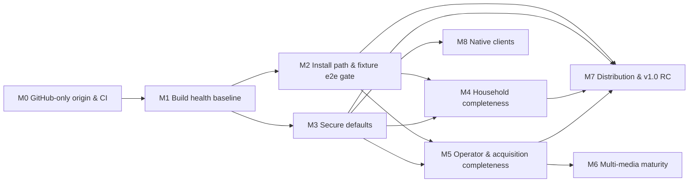

# MuxCore — Master Roadmap (canonical)

| | |
|---|---|
| **Status** | Canonical — v2.0, rewritten 2026-10-05 ([ADR-0001](docs/adr/0001-canonical-roadmap-and-spec-set.md)). Previous version preserved at [`docs/history/MASTER-ROADMAP-2026-09-02.md`](docs/history/MASTER-ROADMAP-2026-09-02.md). |
| **Owns** | Scope summary, priorities, milestones, dependencies, delivery sequencing, tasks, completion criteria, risks, and the documentation map |
| **Links, does not duplicate** | Business outcomes → [BRD](docs/specs/BRD.md) · capabilities & journeys → [PRD](docs/specs/PRD.md) · behaviour → [FRD](docs/specs/FRD.md) · requirements → [SRS](docs/specs/SRS.md) · design → [HLD](docs/architecture/HLD.md), [SDD](docs/architecture/SDD.md), [TDD](docs/architecture/TDD.md), [LLD](docs/architecture/lld/README.md) · decisions → [ADRs](docs/adr/README.md) |
| **Execution tracker** | GitHub Issues on `Muxcore-Media/umbrella` (and module repos). Each issue cites a task ID from this file (e.g. `T-M1-03`). This file stays authoritative for scope and status. |

**Maintenance rules**
1. Update task status here in the same PR that changes the work (`Todo` → `In progress` → `Done (evidence)`); keep finished milestones as a one-line summary with evidence, do not leave long checked-off lists.
2. New scope enters as an SRS requirement + a task here; never as a free-floating checklist elsewhere.
3. "Done" requires the stated verification to have been **run**; record it in the [validation log](#9-validation-log).
4. Smoke is sacred: no "deployable" claim without the fixture smoke passing ([ADR-0008](docs/adr/0008-fixture-only-acquisition-gate.md)).

---

## 1. Product in one page

**Purpose.** MuxCore is a self-hosted, modular media platform that replaces the fragmented Arr stack (Sonarr, Radarr, Lidarr, Readarr, Prowlarr, Bazarr, Tdarr, Seerr, download clients) and, over time, the Jellyfin web client, with one install: a core runtime (`muxcored`) hosting capability modules over a gRPC mesh, a household UI (`media-ui-app`), and an operator UI (`admin-ui`).

**Users.** Household members who browse/request/watch (P-1, P-2); the household operator (P-3); module developers (P-4); delivery agents (P-5). See [PRD §1](docs/specs/PRD.md#1-personas).

**Outcomes.** BO-1 one install replaces the stack · BO-2 household self-service · BO-3 Arr-grade decisions · BO-4 trust (install, migrate, update, secure defaults) · BO-5 daily control center · BO-6 own the watch experience · BO-7 beyond movies/TV. See [BRD §3](docs/specs/BRD.md#3-business-outcomes).

**Non-goals.** Hosted/multi-tenant SaaS, dashboards over existing Arr apps, bundled piracy sources or live-indexer testing, paid hard dependencies, full Tautulli API, a second playback-backend contract (for now), work in archived dump repos, telemetry. See [PRD §2.2](docs/specs/PRD.md#22-non-goals).

**Constraints.** BC-1 no paid accounts · BC-2 fixture-only acquisition · **BC-3 GitHub is the only origin** · BC-4 GitHub Free plan, private repos, no `write:packages` · BC-5 no hosted service/telemetry · BC-6 pre-1.0 beta. See [BRD §5](docs/specs/BRD.md#5-business-constraints).

## 2. Current state vs target (2026-10-05)

| Area | Current (evidence) | Target (v1.0 "household-ready", [PRD §5](docs/specs/PRD.md#5-product-level-acceptance-v10-household-ready)) |
|------|--------------------|------|
| Breadth | ~100 modules; movies/TV request→acquire→import→play implemented and fixture-proven; rich SPA (~1,100 tests) and admin-ui (~350 tests) | Same breadth; every Must capability Implemented |
| **Build health** | **46 of 97 Go modules fail to build at umbrella pins**; SPA typecheck fails; 3 script tests fail; integration suite cannot compile; 4 GitHub repos empty ([§9](#9-validation-log)) | All active repos green on GitHub CI (SM-8) |
| **CI / origin** | Workflows target offline self-hosted runners and a retired-origin mirror; ~1,500 retired-origin references | GitHub-hosted CI everywhere; zero retired-origin references (ADR-0002/0003) |
| Install | Registry compose + dev host work per docs; root compose broken; version skew v0.5.0–v0.5.8 across install paths; smoke does not assert fixture acquisition | One compose, one version train, smoke covers request→grab→import (SM-1) |
| Security defaults | Default admin password, insecure mesh in shipped compose, unauthenticated `Register`, no BFF CSRF, plaintext session files | Secure-defaults checklist 100 % (SM-4) |
| Household UX | Profiles missing; parental filter client-side except playback; Cast stubs; no automated a11y | J-02/J-03/J-08 e2e green; WCAG 2.1 AA [Proposed] |
| Operator UX | No indexer/downloader pages; wanted movie/TV only; migration = catalogue + profile names | J-04/J-05/J-09 covered (SM-5, SM-6) |
| Multi-media | Music partial (metadata repo empty); books partial; comics/audiobooks scaffold | Should-level (post-v1.0 allowed) |
| Native | iOS/tvOS partial; tvOS device validation blocked; Android repo empty | Should; hardware-dependent items stay Blocked |

## 3. Documentation map

| Path | Purpose | Status | Authoritative for |
|------|---------|--------|-------------------|
| [`AGENTS.md`](AGENTS.md) | Agent instructions: reading order, doc ownership, orchestration, toolchain notes, owner reference deployment | Current | How agents work in this repo |
| **`MASTER-ROADMAP.md`** (this file) | Canonical plan | Current | Scope, priority, milestones, tasks, status |
| [`docs/specs/BRD.md`](docs/specs/BRD.md) | Business requirements | Current | `BO-*`, `BC-*`, `SM-*`, stakeholders |
| [`docs/specs/PRD.md`](docs/specs/PRD.md) | Product requirements | Current | `P-*`, `CAP-*`, `J-*`, `NG-*`, v1.0 definition |
| [`docs/specs/FRD.md`](docs/specs/FRD.md) | Functional behaviour | Current | `WF-*`, `RULE-*`, state machines, permission model |
| [`docs/specs/SRS.md`](docs/specs/SRS.md) | Canonical requirements | Current | `FR-*`, `NFR-*` with status & verification |
| [`docs/architecture/HLD.md`](docs/architecture/HLD.md) | High-level design | Current | Components, trust boundaries, topology, data flows |
| [`docs/architecture/SDD.md`](docs/architecture/SDD.md) | Software design | Current | Patterns, collaboration, interface responsibilities, requirement satisfaction |
| [`docs/architecture/TDD.md`](docs/architecture/TDD.md) | Technical design | Current | Build/deps, CI, packaging, testing, security approach, migration |
| [`docs/architecture/lld/`](docs/architecture/lld/README.md) | Low-level design | Current | Acquisition, auth/sessions, core mesh, data ownership |
| [`docs/adr/`](docs/adr/README.md) | Decision records | Current | Architectural decisions (0001–0011) |
| [`docs/config-reference.md`](docs/config-reference.md) | Env var reference | Current, drift known (NFR-OPS-005) | Configuration names/defaults |
| [`README-UMBRELLA.md`](README-UMBRELLA.md), [`CONTRIBUTING.md`](CONTRIBUTING.md), [`CHANGELOG.md`](CHANGELOG.md) | Clone/bump workflow, commit/release process, changes | Current (after T-M0-03) | Process |
| `_mvp/README.md`, `_mvp/PORTS.md`, `_mvp/BFF-API.md`, `_mvp/docs/{PUBLIC-INSTALL,ACQUISITION,INFRA-BACKENDS,DUAL-LIBRARY-API,RELEASE-BUILD}.md` | Stack runbooks and API refs | Current with known gaps (BFF-API incomplete) | Stack operation |
| `media-ui-app/AGENTS.md`, `media-ui-app/docs/PLAYBACK.md` | Consumer UI design system, player | Current (parts aspirational: TanStack Query, Playwright, profiles) | UI conventions |
| `BAZARR-PARITY.md`, `TDARR-PARITY.md`, `TAUTULLI-TRACEARR-PARITY.md`, `LISTSYNC-PARITY.md` | Parity records | Historical/partly inaccurate → corrected in T-M0-05 | Nothing normative (SRS owns requirements) |
| `core.wiki/`, `muxcore-docs/wiki/` | User/developer wiki and its static-site snapshot | Partly stale; `muxcore-docs/wiki` is newer than `core.wiki` | End-user/developer guides (must not contradict specs) |
| `docs/FREEZE-PINS.md` | Pin snapshot 2026-09-07 | Historical | — |
| `TASKS.md`, `_mvp/docs/MASTER-ROADMAP.md`, `.project-management.md`, `IMPROVE-LOOP-SUMMARY.md`, `USABILITY-DEPLOY-LOOP-SUMMARY.md`, `AGENT-MODULE-AUDIT-2026-08-21.md`, `_mvp/docs/AGENT-MODULE-AUDIT-2026-08-21.md`, `_mvp/REPO-STATUS.md`, `_wave1/**`, `.tasks-loop-state.json`, `.improve-loop-state.json`, `.tasks-indexer-loop-state.json`, module `ROADMAP.md` files | Earlier plans, loop logs, audits | **Superseded / historical** (bannered in T-M0-05) | Nothing |
| `cache-memory/notes/`, `custom-scripts/notes/` | Old plans inside archived dumps | Historical (NG-7) | Nothing |

## 4. Conflicts found and how they were resolved

| # | Conflict | Resolution | Basis |
|---|----------|-----------|-------|
| C-1 | Retired self-hosted origin & CI documented as authoritative vs GitHub as actual tracker; the old host no longer serves it | GitHub only | Owner instruction 2026-10-05 → [ADR-0002](docs/adr/0002-github-sole-origin.md) |
| C-2 | Roadmap "only living doc" vs `.project-management.md` "tracking migrated to GitHub Issues" | Roadmap owns scope/status; Issues are the execution layer citing task IDs | [ADR-0001](docs/adr/0001-canonical-roadmap-and-spec-set.md) (Delegated) |
| C-3 | Two roadmap copies (root vs `_mvp/docs/`) diverged | Root is canonical; `_mvp` copy bannered superseded | Existing references point to root |
| C-4 | `CHANGELOG.md` lists "Public GHCR consumer mirror" and `docker-compose.public.yml` as Added; roadmap says GHCR blocked; file does not exist | Implementation evidence wins: GHCR **Blocked** (no `write:packages`), compose file absent → CHANGELOG corrected | Repo evidence + token scopes |
| C-5 | `BAZARR-PARITY.md` claims 56 providers / 184 languages / sync+upgrade complete; code has 2 providers, stubs | Code wins; doc corrected; SRS FR-SUB-001 Partial | Implementation evidence |
| C-6 | `LISTSYNC-PARITY.md` points at a missing file | Pointer replaced by SRS FR-MIG-004 reference | — |
| C-7 | Appendix C (Jellyfin parity) "no open rows" vs real gaps (profiles, server-side parental, Cast, a11y, i18n) | Gaps captured as SRS requirements in M4 | Owner playback decision (ADR-0005) requires parity |
| C-8 | `.tasks-loop-state.json` "0 open" vs open issues #2, #121, #151 | Loop state is historical; open issues mapped to tasks (T-M8-02, T-M5-04, T-M5-07) | GitHub Issues evidence |
| C-9 | Module `go.mod` sibling replaces (ensure-go-replaces.sh) vs "MVP modules pin published tags, no replace" (REPO-STATUS Wave 25–28) vs marketplace scan rejecting replaces | Published tags only; `go.work` for local dev | [ADR-0011](docs/adr/0011-go-workspace-and-published-versions.md) |
| C-10 | Draft PR #155 deletes module `AGENTS.md` / moves parity docs | Not adopted as-is; superseded by this doc set; per-module `ROADMAP.md` bannered | ADR-0001 |
| C-11 | `core.wiki` vs `muxcore-docs/wiki` drift (10 pages differ) | `muxcore-docs/wiki` is the working copy (newer, per its AGENTS.md); wiki sync is a task (T-M2-09) | Repo evidence |
| C-12 | Root CI `ubuntu-latest` vs runner doc "must use `native`" | Moot: GitHub-hosted runners | ADR-0003 |
| C-13 | Version skew (installer v0.5.0, operator v0.5.4, stack v0.5.7, starter v0.5.8) | Single release train (FR-INS-006) | TDD §5 |

**Assumptions (labelled, revisit if wrong):** A-1 `MUXCORE_CI_TOKEN` exists in every repo (verified on `admin-ui` only). A-2 Content of the four empty GitHub repos is not recoverable from GitHub. A-3 Free-plan Actions minutes suffice once self-hosted jobs stop queueing. A-4 The owner's vault/homelab deployment remains in use as a reference deployment but is not a product requirement.

## 5. Milestones and dependencies

v1.0 = M0–M5 + M7 complete. M6 and M8 are Should-level and may ship after v1.0. No dates are committed (none have been approved); ordering is by dependency and priority.

| Milestone | Goal | Requirements closed | Status | Completion criteria (observable) |
|-----------|------|---------------------|--------|----------------------------------|
| **M0** | GitHub is the only origin; CI runs on GitHub-hosted runners; docs reconciled | NFR-MNT-005, NFR-MNT-006, NFR-MNT-009, NFR-SEC-012, NFR-COST-001, FR-SUB-002 | **In progress** (this doc set landed) | (1) `scripts/check-retired-origin.sh` reports 0 matches over active content (excludes `docs/history/`, `docs/adr/`); (2) every active repo has `.github/workflows/ci.yml` with `runs-on: ubuntu-latest` and no `self-hosted`/`checkout-mirror`; (3) no retired-origin workflow directories in active repos; (4) `scripts/check-submodules.sh` passes (every pinned SHA fetchable from GitHub); (5) superseded docs bannered |
| **M1** | Every active module builds, vets, and tests green standalone and in the workspace | NFR-MNT-001…004, NFR-MNT-007, NFR-SEC-013, FR-BRG-001, FR-MM-001 (restore) | Todo | (1) umbrella workspace job: `go build ./... && go vet ./...` green for all active modules; (2) each active repo's GitHub CI green on `main` at the umbrella-pinned SHA; (3) `media-ui-app` typecheck/test/build green; (4) `node --test scripts/*.test.mjs` and `_mvp/scripts/run-script-tests.sh` green; (5) `integration` compiles and runs; (6) no filesystem `replace` in any active `go.mod` |
| **M2** | A fresh install reaches a passing fixture smoke that covers request → grab → import → play | FR-INS-001/003(partial)/005/006, FR-AUTH-004 (e2e), FR-BAK-002/004, NFR-DATA-002, NFR-REL-001, NFR-OPS-005, NFR-PERF-003 | Todo | (1) `docker compose up` from root succeeds in a clean container host and `_mvp/smoke.sh` passes; (2) smoke asserts fixture search→dispatch→import→library item; (3) one version pin across compose/installer/operator/starter (check script green); (4) restore drill script green; (5) upgrade test from previous tag green for household modules |
| **M3** | Secure defaults | NFR-SEC-001…011, FR-INS-003/004, FR-EXT-003, FR-BAK-003, NFR-REL-003, NFR-OPS-004 | Todo | Secure-defaults checklist (TDD §8) all items have passing tests; SM-4 = 100 % |
| **M4** | Household consumer completeness | FR-PLAY-007/009, FR-AUTH-010, FR-ADM-010, NFR-A11Y-001/002, NFR-DATA-003 | Todo | Playwright fixture e2e J-02, J-03, J-08 green; axe checks green on core pages; server-side parental table test green |
| **M5** | Operator & acquisition completeness | FR-ADM-002/006/008/009, FR-AUTH-007/009, FR-MIG-002/003, FR-ACQ-005(corpus)/006/011, FR-SUB-001, FR-TRN-001, NFR-REL-004 | Todo | SM-3, SM-5, SM-6 met; issues #121 and #151 closed |
| **M6** | Multi-media maturity | FR-MM-002…005, FR-REQ-006, FR-PLAY-010 | Todo | Fixture acquire→import→consume test per media type green |
| **M7** | Distribution & v1.0 release candidate | FR-INS-001 (GHCR variant), release train | Blocked (GHCR needs `write:packages`); LAN-registry path not blocked | Release `train-*` tag; release notes from Conventional Commits; SM-1/2/4/8 met; GHCR push when unblocked |
| **M8** | Native clients | FR-NAT-001…003 | Partly Blocked (device, Android source) | iOS/tvOS simulator tests for auth+resume green via manual workflow; hardware checklist completed when a device is available |
| **D** | Deferred | FR-AI-001, FR-PLAY-011, NFR-PERF-001/002, NFR-OPS-003, multi-tenant isolation (NG-1), k8s operator GA, `contracts-playback` service (NG-6), HA cluster | Deferred | Re-enters only via a new SRS priority + ADR where architectural |

## 6. Tasks

Status legend: `Todo`, `In progress`, `Done (evidence)`, `Blocked (reason)`.

### M0 — GitHub-only origin & CI (next actionable milestone)

Prerequisites: none beyond `gh` access with `repo`+`workflow` scopes (available).

| ID | Objective | Refs | Depends | Completion check | Status |
|----|-----------|------|---------|------------------|--------|
| T-M0-01 | Umbrella CI on GitHub: add `.github/workflows/ci.yml` (hygiene checks, script tests, workspace build, commit lint); delete the retired-origin workflow directory and `.github/workflows/RETIRED.md` | NFR-MNT-005, TDD §4.2, ADR-0003 | — | Workflow run on a PR shows all jobs executing on `ubuntu-latest` | Todo |
| T-M0-02 | CI templates + `scripts/sync-ci.sh`; roll out `.github/workflows/ci.yml` to every active module; delete retired-origin workflows, self-hosted jobs, `checkout-mirror` usage | NFR-MNT-005, NFR-COST-001, TDD §4.1 | T-M0-01 | `scripts/check-ci.sh` (new) passes over all submodules | Todo |
| T-M0-03 | Remove retired-origin references from active content (umbrella + modules), delete retired-origin-only scripts, update AGENTS/README/CONTRIBUTING/PUBLIC-INSTALL/wiki | NFR-MNT-006, ADR-0002, TDD §10 | — | `scripts/check-retired-origin.sh` exits 0 | Todo |
| T-M0-04 | Submodule hygiene: `scripts/check-submodules.sh`; remove `media-ui-tv` and `muxcore-android` from `.gitmodules` (empty repos, recorded in TDD §2.1); track `playback-contract`/`metadata-musicbrainz` remediation in M1 | NFR-MNT-009 | — | Script green in CI | Todo |
| T-M0-05 | Doc reconciliation: superseded banners (see §3), correct `CHANGELOG.md` (C-4), `BAZARR-PARITY.md` (C-5), `LISTSYNC-PARITY.md` (C-6), `.cursor/rules/muxcore-workspace.mdc`, `core.wiki/Roadmap.md` stub | ADR-0001, FR-SUB-002 | — | `scripts/check-docs.mjs` (links + SRS IDs) passes | Todo |
| T-M0-06 | Secret scanning job (gitleaks, pinned version) in umbrella CI | NFR-SEC-012 | T-M0-01 | Job green; fails on a seeded test secret in a scratch PR | Todo |

### M1 — Build health baseline

Prerequisites: M0 T-M0-01/02 (so results are visible in CI).

| ID | Objective | Refs | Depends | Completion check | Status |
|----|-----------|------|---------|------------------|--------|
| T-M1-01 | `core` `main` green on GitHub CI; tag `v0.6.0` + `pkg/contracts/v0.6.0`, `sdk/go/client/v0.6.0`, `sdk/go/module/v0.6.0` | ADR-0011, LLD core §7 | T-M0-02 | Tags visible on GitHub; `go list -m github.com/Muxcore-Media/core@v0.6.0` resolves | Todo |
| T-M1-02 | Fold `playback-contract` package into `contracts-playback`; tag; repoint `jellyfin`, `plex`, `emby` | TDD §2.1, FR-BRG-001 | T-M1-01 | The three bridges build standalone | Todo |
| T-M1-03 | Rebuild minimal `metadata-musicbrainz` (fixture corpus, `contracts-metadata` music RPCs used by `media-music`) | FR-MM-001 | T-M1-01 | `media-music` builds standalone; metadata-musicbrainz tests green | Todo |
| T-M1-04 | Fix proto drift: `auth-local` (`authv1.InviteInfo`), `circuitbreaker-simple` (`ListRequest`) and any found by `check-proto-drift.sh` | NFR-MNT-001 | T-M1-01 | Both modules build/test green | Todo |
| T-M1-05 | Fan-out: every active Go module requires `core v0.6.0`, drops `core/pkg/tenant` requires and all filesystem `replace`s, moves to GitHub-available tags of siblings, `go mod tidy`, tests green, patch tag | NFR-MNT-001, NFR-MNT-007, ADR-0011 | T-M1-01…04 | Per-repo CI green; `scripts/check-no-replace.sh` green | Todo |
| T-M1-06 | Root `integration/` compiles against `core v0.6.0` (`integsupport`) and runs with `-tags integration` | NFR-MNT-004 | T-M1-05 | Umbrella CI integration job green | Todo |
| T-M1-07 | `media-ui-app`: fix typecheck error and failing test | NFR-MNT-002 | — | `npm run typecheck && npm test && npm run build` green | Todo |
| T-M1-08 | Umbrella scripts: fix 3 failing `node --test` cases and eslint error | NFR-MNT-003 | — | `node --test scripts/*.test.mjs` and eslint green | Todo |
| T-M1-09 | `scripts/gen-go-work.sh` + workspace build job; retire `scripts/ensure-go-replaces.sh` | ADR-0011, TDD §4.2 | T-M1-05 | Workspace job green | Todo |
| T-M1-10 | Bump umbrella pins to the green SHAs; regenerate `docs/FREEZE-PINS.md` | — | T-M1-05…09 | `git submodule status` clean; CI green | Todo |

### M2 — Install path & fixture e2e gate (tasks; refine when M1 lands)

| ID | Objective | Refs | Completion check |
|----|-----------|------|------------------|
| T-M2-01 | Root `docker-compose.yml` includes `_mvp/docker-compose.registry.yml`; retire `docker-compose.ghcr.yml` (registry is a variable) | ADR-0007 | `docker compose config` valid in CI |
| T-M2-02 | Publish set covers every module referenced by any compose profile | TDD §5 | compose-vs-publish check script |
| T-M2-03 | Smoke asserts fixture search → dispatch → import → library item (+ BFF play URL) | FR-INS-003, SM-1, ADR-0008 | smoke step green on fixture stack |
| T-M2-04 | Single version train pin consumed by compose, installer, operator, starter, Helm | FR-INS-006 | `scripts/check-pins.sh` green |
| T-M2-05 | Manifest `state_dirs` + `ExportState` coverage for household modules; restore drill script | FR-BAK-002/004 | drill script green |
| T-M2-06 | Upgrade-from-previous-tag tests for household modules | NFR-DATA-002, FR-INS-005 | tests green |
| T-M2-07 | Env-var drift check vs `docs/config-reference.md` (remove phantom vars like `BACKUP_EXCLUDE`) | NFR-OPS-005 | check script green |
| T-M2-08 | Remove or mark dev-only `media-ui-app/Dockerfile` + `nginx.conf`; complete `_mvp/BFF-API.md` route inventory with a test | SDD §5, TDD §7 | route-inventory test green |
| T-M2-09 | Sync `core.wiki` from `muxcore-docs/wiki`; remove homelab specifics from user docs | C-11, ADR-0002 | wiki diff empty; docs check green |
| T-M2-10 | Clean-room install job (`workflow_dispatch`): build images, start stack in podman/docker, run smoke | SM-1 | job green |

### M3 — Secure defaults

Tasks are the nine items of [TDD §8](docs/architecture/TDD.md#8-security-hardening-approach), one task each (`T-M3-01` … `T-M3-09` in that order), each closing the SRS IDs listed there and verified by the tests named in the SRS "Verify" column.

### M4 — Household completeness

T-M4-01 server-side parental middleware in BFF (FR-PLAY-007) · T-M4-02 profiles incl. kids/PIN (FR-AUTH-010) · T-M4-03 hide unsupported Cast/AirPlay (FR-PLAY-009) · T-M4-04 move operator sections from consumer Settings to admin-ui (FR-ADM-010) · T-M4-05 `vitest-axe` + admin-ui a11y tests (NFR-A11Y-001) · T-M4-06 Playwright fixture e2e J-02/J-03/J-08 (+ viewport checks, NFR-A11Y-002) · T-M4-07 user deletion fan-out (NFR-DATA-003).

### M5 — Operator & acquisition completeness

T-M5-01 indexer & downloader admin pages (FR-ADM-006) · T-M5-02 unified wanted across media (FR-ADM-002) · T-M5-03 per-page RBAC + OIDC-aware pages (FR-ADM-009, FR-AUTH-009) · T-M5-04 transcoder queue/pool profiles — issue #121 (FR-ADM-008, FR-TRN-001) · T-M5-05 migration depth + dry-run (FR-MIG-002/003) · T-M5-06 decision corpus + quality-tier cutoff (FR-ACQ-005/006, SM-3) · T-M5-07 secrets-vault registry-compose profile — issue #151 · T-M5-08 downloader contract unification (FR-ACQ-011) · T-M5-09 subtitle providers beyond OpenSubtitles (FR-SUB-001) · T-M5-10 event-redelivery idempotency tests (NFR-REL-004) · T-M5-11 all-sessions device list (FR-AUTH-007).

### M6 — Multi-media maturity

T-M6-01 library-plus request routing (FR-REQ-006, FR-MM-002) · T-M6-02 media-type query shaping (FR-MM-003) · T-M6-03 library-plus imports via scanner (FR-MM-004) · T-M6-04 fixture metadata providers for books/comics/audiobooks (FR-MM-005) · T-M6-05 in-app consumption tests (FR-PLAY-010).

### M7 — Distribution & v1.0 RC

T-M7-01 release-train tagging + notes generation · T-M7-02 GHCR publish workflow (**Blocked**: needs a token with `write:packages`) · T-M7-03 v1.0 RC checklist run (SM-1, SM-2, SM-4, SM-8).

### M8 — Native clients

T-M8-01 iOS/tvOS simulator tests for auth + resume via manual macOS workflow (FR-NAT-001) · T-M8-02 tvOS hardware validation — issue #2 (**Blocked**: device) · T-M8-03 Android client (**Blocked**: no source on GitHub; decision needed whether to start fresh).

## 7. Risks, blockers, and plan-changing decisions

| ID | Item | Type | Effect | Response |
|----|------|------|--------|----------|
| R-1 | GHCR needs `write:packages` | Blocker (external) | M7 GHCR variant | LAN-registry path unaffected (ADR-0007); owner can refresh the token scope |
| R-2 | Free-plan CI minutes | Risk | CI may stop gating | NFR-COST-001 measures; fallback in ADR-0003 |
| R-3 | Four empty GitHub repos (content only on retired host) | Blocker resolved by decision | Lost history for `media-ui-tv`, `muxcore-android` | Removed from pins; `playback-contract` folded; `metadata-musicbrainz` rebuilt |
| R-4 | Bulk dependency bump across ~85 repos | Risk | Regressions | Dependency-ordered fan-out with per-repo CI + workspace build |
| R-5 | Core security changes (NFR-SEC-002) affect every module's registration | Risk | Breaks older modules | Dev profile keeps current behaviour; household profile enforces; SDK updated first |
| R-6 | Physical Apple TV unavailable | Blocker | FR-NAT-002 | Stays Blocked; not required for v1.0 |
| D-1 | Whether to start a new Android client | Owner decision | M8 scope | Default: not started until owner asks (Could priority) |

## 8. Next actionable milestone

**M0 — GitHub-only origin & CI.** Prerequisites are met. Start with T-M0-03 and T-M0-05 (no dependencies) and T-M0-01, then T-M0-02. M0 is complete when the five criteria in §5 are observable in CI. M1 follows immediately; T-M1-07 and T-M1-08 have no dependencies and can run in parallel with M0.

## 9. Validation log

Checks **actually run** (not proposed). Environment: `claude-workstation` container, Go 1.27.1, Node 24.21.0, umbrella `d7cd743` with submodules at pinned SHAs (4 empty repos not checked out).

| Date | Check | Result |
|------|-------|--------|
| 2026-10-05 | `go build ./...`, `go vet ./...`, `go test -count=1 ./...` in each of 97 active Go modules (GOFLAGS=-mod=mod, private modules via `gh` credentials) | Build OK 51, build FAIL 46. Causes: `core/pkg/tenant` ambiguous/missing (≈31), missing tags `core v0.5.8` / `jellyfin v0.3.0` on GitHub (3), empty `playback-contract` (1+), absolute `/home/ender` replace (`playback-monitor`), proto drift (`auth-local`, `circuitbreaker-simple`). Of the 51 that built, 4 had test failures and `integration` failed vet/test. |
| 2026-10-05 | `media-ui-app`: `npm ci`, `npm run typecheck`, `npx vitest run`, `npm run build` | ci OK; typecheck FAIL (1 error: optional `webhook_url` vs `Record<string,string>`); tests 1,107 pass / 1 fail of 1,108; build FAIL (typecheck) |
| 2026-10-05 | `node --test scripts/*.test.mjs` | 53 pass / 3 fail (`bootstrap-umbrella` ×2, `script-stems` missing `scripts/build-lambda.sh`) |
| 2026-10-05 | `npx eslint .` in `scripts/` | 1 error (`app-fanout.mjs:680` unused var) |
| 2026-10-05 | `_mvp/scripts/run-script-tests.sh` | exit 0 |
| 2026-10-05 | GitHub state: `gh run list` (core, admin-ui, media-automation, media-ui-app), token scopes, org plan, secrets | Self-hosted runs queued/cancelled; scopes `gist, read:org, repo, workflow`; plan `free`; `MUXCORE_CI_TOKEN` present on admin-ui |
