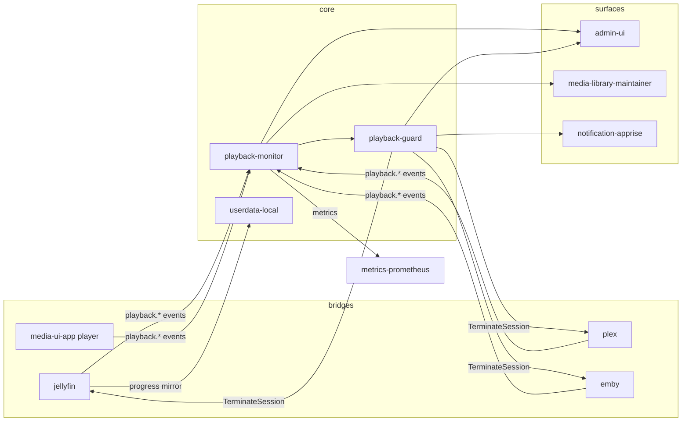

# Tautulli / Tracearr → MuxCore parity

**Goal:** Replace Tautulli (Plex monitoring) and Tracearr (multi-server monitoring + sharing detection) with native MuxCore modules, bridges, and admin surfaces.

Legend: `[x]` shipped · `[~]` partial · `[ ]` missing · **Waiver** = accepted MuxCore-native equivalent

Reference clones used for this audit: `/tmp/muxcore-ref/Tautulli`, `/tmp/muxcore-ref/tracearr`.

---

## Executive summary — module plan

| # | Module | Action | Role | Primary capability |
|---|--------|--------|------|-------------------|
| 1 | **`playback-monitor`** | **NEW** | analytics | `playback.monitor` |
| 2 | **`playback-guard`** | **NEW** | security | `playback.guard` |
| 3 | **`plex`** | **NEW** | playback bridge | `playback.plex` |
| 4 | **`emby`** | **NEW** | playback bridge | `playback.emby` |
| 5 | **`jellyfin`** | **EXTEND** | playback bridge | `playback.jellyfin` (existing) |
| 6 | **`userdata-local`** | **KEEP** | household loop | `userdata.local` (existing) |
| 7 | **`admin-ui`** | **EXTEND** | operator UI | `/playback/*` surfaces |
| 8 | **`media-library-maintainer`** | **EXTEND** | consumer | query `playback-monitor` instead of scanning userdata files |
| — | `notification-apprise` | reuse | alerts | violation/session notifications |
| — | `database-postgres` | reuse | storage | Timescale-friendly session history (optional) |
| — | `database-sqlite` | reuse | storage | default single-node session history |
| — | `metrics-prometheus` | reuse | ops | export session/transcode counters |
| — | `cache-redis` | reuse (optional) | live state | active-session cache + WS fanout |
| — | `scheduler-cron` | reuse | jobs | rollups, imports, poller backfill |

**Net new modules: 4** (`playback-monitor`, `playback-guard`, `plex`, `emby`).

**Extended modules: 3** (`jellyfin`, `admin-ui`, `media-library-maintainer`).

**Explicit non-goals / waivers:** Tautulli mobile app parity, Tautulli newsletter builder, Plex Pass / Plex.tv account admin screens, Tracearr mobile app, Tracearr Tailscale integration (defer unless requested).

---

## Why four new modules (not one monolith)

Tracearr ships as one Node app; MuxCore splits by **capability boundary** and **optional deployment**:

| Concern | Module | Rationale |
|---------|--------|-----------|
| Session history + stats + live activity + import + public API | `playback-monitor` | Tautulli/Tracearr shared core; always-on for any household running playback |
| Sharing rules, trust scores, violations, terminations | `playback-guard` | Tracearr differentiator; optional for admins who only want Tautulli-class stats |
| Plex SSE + Plex API normalization | `plex` | Same pattern as existing `jellyfin` bridge; only deployed when Plex is in the stack |
| Emby session poll + plugin SSE | `emby` | Same; only when Emby is in the stack |

Keeping bridges separate matches `jellyfin` today and avoids pulling Plex/Emby deps into households that only use Jellyfin + native UI.

---

## Feature inventory (union target)

### A. Shared baseline (Tautulli ∩ Tracearr)

| Feature area | Tautulli evidence | Tracearr evidence | MuxCore target module |
|--------------|-------------------|-------------------|------------------------|
| Live session / activity dashboard | `get_current_activity`, `get_activity` | `/sessions`, WebSocket | `playback-monitor` + `admin-ui` | `[x]` SSE `/events/streams` + `/streams` dashboard |
| Session history (search/filter/sort) | `get_history`, `session_history` tables | `sessions` table, `/history` | `playback-monitor` | `[x]` |
| Home / top statistics | `get_home_stats` | `/stats/dashboard` | `playback-monitor` | `[x]` |
| Plays-by charts (date, DOW, hour, month) | `get_plays_by_*` (15+ endpoints) | `/stats/plays`, `/stats/concurrent` | `playback-monitor` | `[x]` |
| Transcode / stream-type analytics | `get_plays_by_stream_type`, stream resolution charts | `/stats/quality`, transcode fields on sessions | `playback-monitor` | `[x]` transcode + stream/source/platform×resolution charts + public `/stats/plays/*` |
| User list + per-user stats | `get_user_*`, `users` table | `/users/*`, `server_users` | `playback-monitor` |
| Device / platform breakdown | `get_user_player_stats`, platform charts | `/stats/devices`, `/stats/platforms` | `playback-monitor` |
| IP + geolocation on sessions | `user_ips`, geo fields | `geo_*` on `sessions`, stream map | `playback-monitor` + optional GeoIP provider |
| Library section stats | `get_library_*`, `library_sections` | `/library/*`, `libraries`, `library_items` | `playback-monitor` |
| Recently added tracking | `get_recently_added`, `recently_added` table | library sync jobs | `playback-monitor` (or **Waiver**: reuse `media-scanner` events) |
| Stream / session notifications | `notifiers` (40+ agents), `notify_log` | destinations + Discord/webhook | `playback-monitor` triggers → `notification-apprise` |
| Server health / resources | `get_server_resources` | `/servers` live stats, SSE plugin CPU/RAM | `playback-monitor` + bridge status from `jellyfin`/`plex`/`emby` |
| Public read API | Tautulli API v2 (`cmd=` + 97 `get_*` handlers) | Public API v2 (`/api/v2/public/*`) | `playback-monitor` gRPC + HTTP |
| History import | PlexWatch / Plexivity import | Tautulli + Jellystat import | `playback-monitor` |
| Live TV + music sessions | Tautulli session types | `media_type` enum includes livetv/music | bridges normalize types → `playback-monitor` |

### B. Tracearr-only (beyond Tautulli)

| Feature | Tracearr evidence | MuxCore target module |
|---------|-------------------|------------------------|
| Multi-server unified dashboard | `servers.type` plex/jellyfin/emby | `playback-monitor` aggregates all bridges |
| Sharing detection rules (6 types) | `rules.type` enum, rules engine | `playback-guard` |
| Trust scores | `users.aggregate_trust_score`, `server_users.trust_score` | `playback-guard` |
| Violations + bulk acknowledge/dismiss | `violations`, `/violations` | `playback-guard` + `admin-ui` |
| Impossible travel / simultaneous locations | rules evaluators, crossings | `playback-guard` |
| Device velocity / concurrent stream limits | rules evaluators | `playback-guard` |
| Geo restriction rules | rules evaluators | `playback-guard` |
| Account inactivity alerts | rules evaluators | `playback-guard` |
| Session termination | `terminationLogs`, termination service | `playback-guard` → bridge RPC |
| Interactive stream map | Leaflet UI, `sessions.geo_*` | `admin-ui` (data from `playback-monitor`) |
| Library analytics depth (storage ROI, duplicates, stale, engagement) | `/library/storage`, `/library/duplicates`, etc. | `playback-monitor` (library snapshot sync) | `[x]` storage summary + duplicates + stale + top content + public library routes |
| Real-time WebSocket updates | Socket.io | `playback-monitor` HTTP `/ws` or mesh event fanout |
| Plex SSE instant sessions | Plex poller SSE | `plex` |
| Jellyfin/Emby SSE plugin push | plugin version checks, push endpoints | `jellyfin` / `emby` HTTP ingest → events |
| User merge across servers | `userMergeAudits` | `playback-guard` or `playback-monitor` admin RPC |
| Cross-server duplicate / dead-weight reports | library routes | `playback-monitor` |

### C. Tautulli-only (Plex ecosystem extras)

| Feature | Status / waiver |
|---------|-----------------|
| Plex sync list tracking | `[x]` `plex` bridge polls `plex.tv/servers/{machine_id}/sync_lists`; HTTP `GET /sync-lists` + gRPC `ListSyncLists` |
| Tautulli newsletters | **Waiver** — use `notification-apprise` digest templates instead |
| Tautulli mobile app API | **Waiver** — MuxCore admin-ui + optional future companion |
| 40+ notifier agents baked in | **Waiver** — Apprise covers super-set; wire triggers only |
| Embedded Plex/Web themed UI | **Waiver** — MuxCore admin-ui styling |
| `sql` / backup admin API | **Waiver** — `backup-local` + operator tooling |

---

## Current MuxCore state (baseline)

| Area | Today | Gap vs Tautulli/Tracearr |
|------|-------|--------------------------|
| Household progress / continue watching | `userdata-local` JSON blobs | No session history, no transcode/device/geo dimensions |
| Jellyfin playback events | `jellyfin` publishes `playback.started/progress/stopped` | Events not persisted; payload lacks transcode, IP, geo, quality |
| Maintainer watch operands | `media-library-maintainer` scans userdata progress files | Crude aggregates only; no per-session data; MAINTAINER-PARITY waived external stats |
| Operator monitoring UI | `admin-ui` `/dashboard/monitor`, `/events` | Module health/events — not stream analytics |
| Plex / Emby | not present | Required for Tracearr multi-server parity |
| Sharing detection | not present | Tracearr core differentiator |
| Public playback API | not present | Required |

---

## Module specifications

### 1. `playback-monitor` (NEW)

**Replaces:** Tautulli core + Tracearr analytics/history/library stats.

**Capabilities:** `playback.monitor`, `playback.analytics`, `settings`

**Inputs (mesh events):**

- `playback.started`, `playback.progress`, `playback.stopped` (normalized from all bridges + future native player)
- Optional: `media.imported`, `library.refreshed` for recently-added rollups

**Storage (SQLite default; Postgres/Timescale recommended at scale):**

- `sessions` — full session rows (Tracearr-shaped superset)
- `session_continuations` — pause/resume chains
- `server_users`, `servers` — multi-server identity map
- `library_items`, `library_snapshots` — library analytics
- `daily_stats` / materialized rollups — chart performance

**RPC / HTTP (representative):**

- `IngestSessionEvent`, `ListActiveSessions`, `GetSession`, `ListHistory`
- `GetHomeStats`, `GetPlaysByDate`, `GetPlaysByHour`, `GetPlaysByDayOfWeek`, `GetPlaysByStreamType`, … (mirror Tautulli chart set)
- `GetLibraryStats`, `GetLibraryStorage`, `GetTopContent`
- `ImportTautulli`, `ImportJellystat`
- `ListServers`, `UpsertServer` (logical server registry — physical connections stay in bridges)
- Public HTTP: read-only API compatible with Tracearr v2 shape where practical

**Does NOT own:**

- Household continue-watching blobs (`userdata-local`)
- Sharing rule evaluation (`playback-guard`)
- Raw Plex/Jellyfin/Emby API calls (bridges)

---

### 2. `playback-guard` (NEW)

**Replaces:** Tracearr rules engine, trust scores, violations.

**Capabilities:** `playback.guard`, `settings`

**Depends on:** `playback-monitor` gRPC (sessions, users, geo timeline)

**Rule types (Tracearr parity):**

1. `impossible_travel`
2. `simultaneous_locations`
3. `device_velocity`
4. `concurrent_streams`
5. `geo_restriction`
6. `account_inactivity`

**RPC:**

- CRUD rules, `EvaluateSession`, `ListViolations`, `AcknowledgeViolations`
- `GetTrustScore`, `ResetTrustScore`, `MergeUsers`
- `TerminateSession` → calls bridge (`jellyfin`/`plex`/`emby`) to kill stream

**Notifications:** publish to `notification-apprise` on violation / inactivity.

---

### 3. `plex` (NEW bridge)

**Pattern:** clone `jellyfin` module layout (gRPC + HTTP + settings.json).

**Capabilities:** `playback.plex`, `playback`, `settings`

**Responsibilities:**

- Plex SSE session stream (primary) + `/status/sessions` poll fallback
- Plex.tv sync-list polling (`/servers/{machine_id}/sync_lists`) — Tautulli sync parity
- Normalize to shared `PlaybackSessionEvent` protobuf (shared with other bridges)
- Publish mesh events consumed by `playback-monitor`
- Optional: library refresh hooks, item link store (MuxCore ID ↔ Plex rating key)
- Session termination API for `playback-guard`

**Env (representative):** `PLEX_URL`, `PLEX_TOKEN`, `PLEX_SSE`, `PLEX_SYNC_LIST_POLL_SEC`, `PLEX_CATALOG_SYNC_SEC`

---

### 4. `emby` (NEW bridge)

**Pattern:** same as `plex` / `jellyfin`.

**Capabilities:** `playback.emby`, `playback`, `settings`

**Responsibilities:**

- Session poll + accept Tracearr-compatible SSE plugin POSTs
- Normalize events → mesh
- Termination RPC

---

### 5. `jellyfin` (EXTEND)

**Already ships:** webhooks, session poll, userdata sync, item links.

**Extensions for parity:**

- Enrich `playbackEventPayload` with: `client`, `device`, `platform`, `play_method`, `transcode_*`, `bitrate`, `remote_ip`
- HTTP endpoint for SSE plugin push (Tracearr Media-Server-SSE compatible)
- gRPC `TerminateSession`
- Forward enriched events to `playback-monitor` (in addition to userdata mirror)

---

### 6. `userdata-local` (KEEP — waiver boundary)

**Scope:** progress, favorites, prefs, playlists, queue for `media-ui-app` household loop.

**Not expanded into session analytics.** Overlap is intentional but shallow:

| Data | `userdata-local` | `playback-monitor` |
|------|------------------|-------------------|
| Resume position | authoritative | optional mirror |
| Watched flag for UI | authoritative | derived from sessions |
| Session history rows | no | authoritative |
| Charts / geo / transcode | no | authoritative |

`media-library-maintainer` should eventually prefer `playback-monitor` aggregates over scanning userdata files for `playback.*` operands (richer + correct play counts).

---

### 7. `admin-ui` (EXTEND)

**New routes (Tautulli/Tracearr operator UX):**

| Route | Purpose |
|-------|---------|
| `GET /streams` | Dashboard (active streams, home stats, recent history) |
| `GET /streams/history` | Global history table |
| `GET /streams/users` | User watch-time stats |
| `GET /streams/stats` | Platform / transcode analytics |
| `GET /playback/users/{id}` | User detail (devices, IPs, charts) |
| `GET /playback/libraries` | Library analytics tabs |
| `GET /playback/map` | Stream map |
| `GET /playback/stats/*` | Chart pages |
| `GET /streams/guard` | Rules + violations (`playback-guard`) |
| `GET /playback/servers` | Multi-server registry + bridge status |
| `POST /playback/import` | Tautulli/Jellystat import |

Reuse existing `admin-ui` auth, settings patterns, templ components.

---

## Shared contract (recommended)

Add **`playback-contract`** (shared proto module):

- `PlaybackSessionEvent` — normalized ingest envelope (`playback-contract/proto/playbackv1/session.proto`)
- `Session`, `SessionFilter`, stats query messages — `[x]` `query.proto` (`Session`, `SessionFilter`, `StatsRangeQuery`, `ChartQuery`, `HomeStatsQuery`, `ConcurrentStreamsQuery`)
- Bridge services implement `PublishSessionEvent` or publish via core event bus with schema validation

Bridges should **not** write session DB directly; single writer (`playback-monitor`) avoids split-brain.

---

## Event flow

---

## Parity checklist (implementation tracker)

### Phase 1 — Tautulli baseline on Jellyfin-only installs

| Item | Module | Status |
|------|--------|--------|
| Normalized session event schema | `playback-contract` + bridges | `[x]` `PlaybackSessionEvent` proto; jellyfin/plex/emby publish contract JSON on mesh |
| Session persistence + history API | `playback-monitor` | `[x]` SQLite + ingest + filtered history + public `/history` cursor API |
| Active sessions view | `playback-monitor` + `admin-ui` | `[x]` gRPC/HTTP + `/streams` + public `/streams` |
| Home stats + top plays charts | `playback-monitor` + `admin-ui` | `[x]` home stats + charts on `/streams/stats`; Tautulli grouped date chart RPC/HTTP + public `/stats/plays/by-date` |
| User list + watch time stats | `playback-monitor` + `admin-ui` | `[x]` `/streams/users` + `ListUserWatchStats` + UUID identity API |
| Transcode / platform breakdown | `playback-monitor` | `[x]` `GetStreamAnalytics` + resolution/source/platform combo charts |
| Jellyfin enriched events | `jellyfin` | `[x]` session poll + webhook + Tracearr SSE client (`JELLYFIN_SSE`) |
| Mesh playback event subscription | `playback-monitor` | `[x]` `playback.started/progress/stopped` + `playback.library.item` catalog sync |
| Session start/stop notifications | `playback-monitor` → `notification-apprise` | `[x]` `notification_rules` CRUD + guard `playback.guard.violation` mesh event + admin `/streams/notifications` |
| Maintainer `playback.*` via monitor RPC | `media-library-maintainer` | `[x]` `GetItemWatchStats` + userdata fallback |

### Phase 2 — Tracearr multi-server

| Item | Module | Status |
|------|--------|--------|
| Plex bridge + SSE | `plex` | `[x]` session poll + Plex SSE + sync lists (`ListSyncLists`, `GET /sync-lists`) |
| Emby bridge + plugin SSE | `emby` | `[x]` session poll + SSE ingest + terminate |
| Multi-server registry | `playback-monitor` | `[x]` auto-register on ingest + `ListServers` + `/streams/servers` |
| Tautulli history import | `playback-monitor` | `[x]` `ImportTautulliHistory` RPC + `POST /import/tautulli` |
| Jellystat import | `playback-monitor` | `[x]` `ImportJellystatHistory` RPC + `POST /import/jellystat` |
| Public read API v2 subset | `playback-monitor` | `[x]` Tracearr v2 routes + extensions: health, servers, plays charts (hour/dow/month/top-users), library growth via `/library/storage/history` |
| Library analytics pages | `playback-monitor` + `admin-ui` | `[x]` `ListLibraryStats` + `ListLibraryDuplicates` + `ListStaleLibraryItems` + `GetLibraryStorageSummary` + `ListTopContent`; `/streams/libraries` storage ROI cards; public `/api/v2/public/library/{duplicates,stale,storage}`; periodic catalog sync with `file_size_bytes` from jellyfin/plex/emby bridges |
| Stream map | `admin-ui` | `[x]` `/streams/map` Leaflet + geo pins from session `geo_*` |
| WebSocket live updates | `playback-monitor` | `[x]` **Waiver:** SSE `/events/streams` + admin `/streams/events` (Tracearr uses WebSocket) |

### Phase 3 — Tracearr guard

| Item | Module | Status |
|------|--------|--------|
| Six rule types | `playback-guard` | `[x]` all six evaluators on `playback.started` + tests |
| Trust scores | `playback-guard` | `[x]` default 100, −10/violation, RPC + `/streams/guard` UI |
| Violations UI + bulk actions | `playback-guard` + `admin-ui` | `[x]` list/ack/terminate UI + notification destinations CRUD (`/notification/destinations`, `/streams/notifications`) with rule routing |
| Session termination | `playback-guard` + bridges | `[x]` guard `TerminateSession` → jellyfin/plex/emby + admin UI |
| Concurrent streams rule | `playback-guard` → `playback-monitor` | `[x]` evaluator + tests |
| GeoIP enrichment | `playback-monitor` | `[x]` opt-in `PLAYBACK_MONITOR_GEOIP=1` + `geo_*` on sessions |
| User merge | `playback-guard` + `playback-monitor` | `[x]` `MergeUsers` + `MergeUserIdentity` RPCs, UUID identity map, alias merge, session repoint, `/streams/guard/merge` UI |

---

## Maintainer integration (revoke prior waiver)

`MAINTAINER-PARITY.md` — `[x]` maintainer queries `playback-monitor` gRPC (`GetItemWatchStats`, `ListWatchUsers`) with userdata-local fallback when monitor absent.

---

## Parity completion audit (2026-08-20)

### Objective requirements

| Requirement | Status | Evidence |
|-------------|--------|----------|
| Analyze Tautulli + Tracearr reference projects | **Complete** | Feature inventory §A–C; reference paths in doc header |
| Analyze current MuxCore codebase | **Complete** | §Current MuxCore state + module specs (updated through v0.1.0) |
| Determine module count and placement | **Complete** | §Executive summary — **4 new**, **3 extended**, reuse list |
| Concrete module/feature mapping plan | **Complete** | This file (`TAUTULLI-TRACEARR-PARITY.md`) + `spool/tags/playback-plus.json` |
| Build Tautulli/Tracearr feature parity (scoped v0.1.0) | **Complete** | Phase checklist 26/26 `[x]`; all playback-stack tests green; waivers in §Non-goals / §C |

### Test gate (2026-08-20)

All green (`go test ./...`):

- `playback-monitor`, `playback-guard`, `playback-contract`, `jellyfin`, `plex`, `emby`

### Phase checklist scorecard

| Phase | `[x]` | `[~]` | Notes |
|-------|-------|-------|-------|
| Phase 1 (Tautulli baseline) | 10 | 0 | v0.1.0 baseline shipped |
| Phase 2 (Tracearr multi-server) | 9 | 0 | Public API v2 superset shipped |
| Phase 3 (Tracearr guard) | 7 | 0 | Notification destinations + rule routing shipped |
| Tautulli-only (§C) | 1 | 0 | Plex sync lists `[x]`; newsletters/mobile/API waivers |

### Remaining gaps (priority)

1. **Full Tautulli REST API** — explicitly out of v0.1.0 scope (97 `get_*` handlers); baseline covered by monitor gRPC/HTTP + public v2 superset.
2. **Admin notification rules UI** — `[x]` `/streams/notifications` proxies monitor `/notification/rules` (list, create, delete).
3. **Postgres/Timescale deploy tag** — `[x]` `spool/tags/playback-plus-postgres.json` + `PLAYBACK_MONITOR_DATABASE_URL` / `PLAYBACK_MONITOR_TIMESCALE=1` in playback-monitor.
4. **Tracearr destination routing** — `[x]` `notification_destinations` table + HTTP CRUD + rule `destination_ids` + admin UI (discord/slack/webhook/apprise subset vs Tracearr ntfy/gotify/push).
5. **Proto deferred messages** — `[x]` `playback-contract/proto/playbackv1/query.proto` shipped with helper methods.

### Deliverable evidence (analysis portion)

The **module mapping deliverable** is satisfied by:

1. §Executive summary (modules 1–8 + reuse)
2. §Why four new modules
3. §Module specifications (1–8)
4. Architecture diagram + `spool/tags/playback-plus.json`

Implementation of the scoped union target (§A–C with documented waivers) is **complete** for v0.1.0. Not claimed: full Tautulli `cmd=` API (97 handlers), Tracearr mobile/Tailscale, ntfy/gotify destination types.

---

## Spool / deploy tags

Suggested new spool tag **`playback-plus`**: `playback-monitor`, `playback-guard`, `jellyfin`, optional `plex`, optional `emby`, `notification-apprise`, `database-sqlite`. Tag file: `spool/tags/playback-plus.json`.

Postgres/Timescale variant: spool tag **`playback-plus-postgres`** (`spool/tags/playback-plus-postgres.json`) adds `database-postgres` + optional `cache-redis`; set `PLAYBACK_MONITOR_DATABASE_URL` on playback-monitor.

---

## Baseline

**v0.1.0 baseline** — Module mapping deliverable complete (§Executive summary). Phase checklist: **26 `[x]`**, **0 `[~]`**. Full Tautulli API (97 `get_*` handlers) not claimed. See §Parity completion audit.
