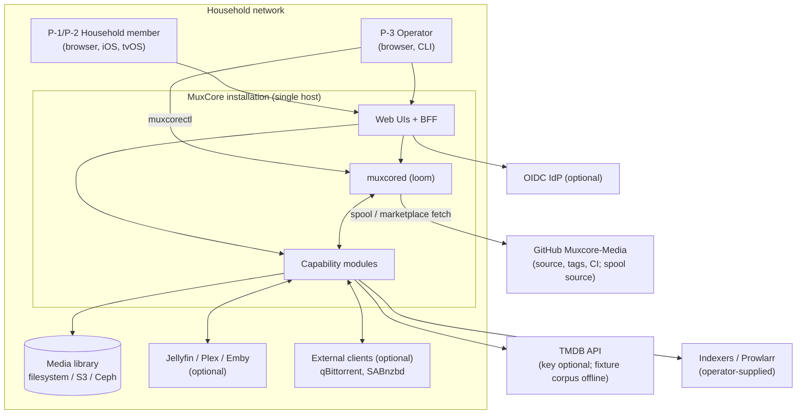
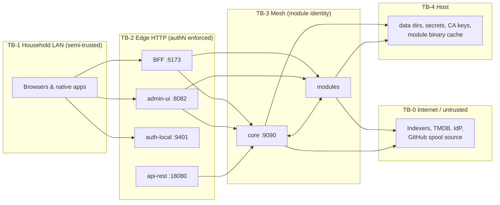
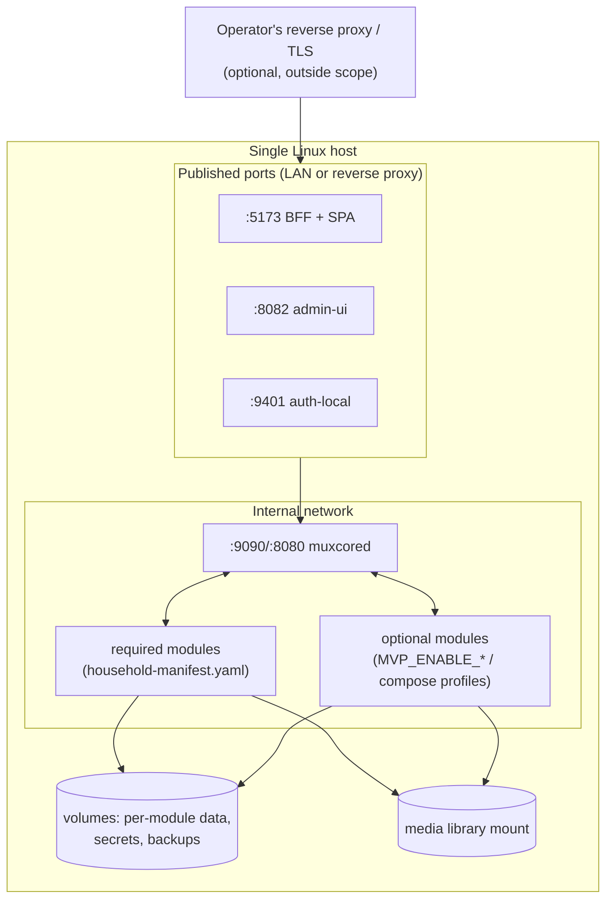

# MuxCore — High-Level Design (HLD)

| | |
|---|---|
| **Status** | Active — v1.0 (2026-10-05) |
| **Owns** | System context and boundaries, major components and their responsibilities, trust boundaries, integrations, deployment topology, major data flows |
| **Does not own** | Subsystem collaboration patterns (→ [SDD](SDD.md)), engineering choices and delivery strategy (→ [TDD](TDD.md)), detailed contracts and algorithms (→ [LLD](lld/README.md)) |
| **Satisfies** | Structural basis for all `CAP-*`; specifically NFR-DATA-001, NFR-SEC-002/003, NFR-REL-001 |

---

## 1. System context

**Boundary:** everything inside "MuxCore installation" is first-party software running on hardware the household controls (BC-5). External systems are optional except the filesystem. There is no MuxCore-operated cloud service.

## 2. Major components

| Component | Responsibility | Repo(s) | Runtime |
|-----------|----------------|---------|---------|
| **Core (loom)** | Module registry and lifecycle, capability discovery, mesh call routing with call/publish policy, event bus (+ optional WAL), storage orchestration, audit log, spool/marketplace deploy, cluster membership | `core` | `muxcored`; gRPC `:9090`, HTTP `:8080` |
| **Policy & identity modules** | Call policy, publish policy, authentication, authorisation, identity extraction | `call-policy-default`, `publish-policy-default`, `auth-local` (or `auth-oidc`) | sidecars; auth HTTP `:9401` |
| **Consumer UI + BFF** | Household SPA; BFF serves SPA, terminates browser sessions, aggregates library/request/playback/userdata APIs, streams media | `media-ui-app` (SPA), `_mvp/cmd/mediauiprox` (BFF) | BFF HTTP `:5173` |
| **Operator UI** | Server-rendered admin (templ + HTMX); talks to core and modules | `admin-ui` | HTTP `:8082` |
| **REST facade** | Authenticated HTTP → core gRPC for scripts/tools | `api-rest` | HTTP `:18080` |
| **CLI** | Operator CLI over core gRPC | `muxcorectl-cli` | — |
| **Library managers** | Domain records per media type, media-admin API, events | `media-movies`, `media-tvshows`, `media-music`, `media-books`, `media-comics`, `media-audiobooks` | sidecars |
| **Acquisition** | Wanted queue, search, scoring, grab, dispatch, import orchestration | `media-automation`, `media-custom-formats`, `indexer-*`, `downloader-*` | sidecars |
| **Import & enrichment** | Scan/import, rename, root folders, probe, tagging, metadata, subtitles, intro/outro, graph | `media-scanner`, `media-rename`, `media-root-folders`, `media-ffprobe`, `media-tagging`, `metadata-tmdb`, `metadata-musicbrainz`, `media-subtitles`, `media-intro-outro`, `media-graph` | sidecars |
| **Requests & userdata** | Request lifecycle; per-user progress/favorites blob | `request-media`, `userdata-local` | sidecars |
| **Playback services** | Transcode (local/pool), session analytics, sharing guard, DLNA, bridges | `media-transcoder`, `media-transcoder-pool`, `playback-monitor`, `playback-guard`, `media-dlna`, `jellyfin`, `plex`, `emby` | sidecars |
| **Platform services** | Secrets, encryption, database, cache, locks, storage backends, backup, health, metrics, tracing, logging, scheduler, executor, workflow, feature flags, rate limit, notifications | `secrets-*`, `encryption-aesgcm`, `database-*`, `cache-*`, `distributed-lock-sqlite`, `storage-*`, `backup-local`, `health-monitor`, `metrics-prometheus`, `tracing-otlp`, `logging-file`, `scheduler-cron`, `executor-shell`, `workflow-tapestry`, `feature-flags-file`, `ratelimit-tokenbucket`, `notification-*` | sidecars |
| **Distribution** | Dev host runner, compose stacks, image publishing, installer, k8s operator (scaffold) | `_mvp`, `muxcore-installer`, `muxcore-operator`, `spool` (catalogue) | — |
| **Native clients** | iOS and tvOS apps over the BFF; Android (repo empty) | `muxcore-ios`, `media-tvos-app`, `muxcore-android` | — |

Archived dumps (`media-ui`, `media-jellyfin`, `cache-memory`, `custom-scripts`, `muxcorectl`) are **not** components (NG-7).

## 3. Trust boundaries

| Boundary | Enforcement today | Gaps (requirement) |
|----------|-------------------|--------------------|
| TB-1 → TB-2 | Session cookies via auth-local code exchange; admin-ui CSRF; trusted-proxy CIDRs | BFF CSRF/Origin checks (NFR-SEC-004), server timeouts (NFR-SEC-006) |
| TB-2 → TB-3 | Bearer forwarded as `x-auth-token`; core `AuthInterceptor` asks `authorizer` | admin-ui dials modules insecurely (NFR-SEC-003); request-media trusts `X-Caller-Id` (NFR-SEC-007) |
| Inside TB-3 | TLS/mTLS available (core CA, 365-day certs); call/publish policy | `Register` unauthenticated; CN not bound to module ID (NFR-SEC-002); insecure in shipped compose (NFR-SEC-003) |
| TB-3 → TB-0 | Spool host allow-list, checksum, publisher, optional signatures; SSRF guard in spool resolver | Signatures optional (FR-EXT-003); SSRF coverage elsewhere (NFR-SEC-009) |
| TB-3 → TB-4 | Modules run with loom privileges unless sandboxed (gVisor/Firecracker opt-in) | Sandbox off by default (accepted risk for single-household; see [ADR-0004](../adr/0004-modular-sidecar-architecture.md) consequences) |

## 4. Deployment topology

### 4.1 Supported topologies

| Topology | Status | Description |
|----------|--------|-------------|
| **Single host, containers (household)** | Primary target (BO-1) | `docker compose` with images from a LAN OCI registry (Path A, `_mvp/docker-compose.registry.yml`) or GHCR when publishing is unblocked ([ADR-0007](../adr/0007-install-paths-github-only.md)) |
| **Single host, binaries (dev / soak)** | Implemented | `_mvp/run-host.sh up` runs `muxcored` + modules from `_mvp/bin` with pidfiles/logs |
| **Installer** | Partial | `muxcore-installer` TUI → env-driven pipeline; fetches GitHub releases with SHA-256 verification |
| **Kubernetes (Kustomize/Helm/operator)** | Scaffold / Deferred | `_mvp/deploy/`, `muxcore-operator` v0.1.0 |
| **Multi-node cluster** | Implemented in core, not productised | Seed join with `join_token`, heartbeat, leader, orphan resurrection |

### 4.2 Reference household deployment

TLS for browser traffic is terminated by an operator-provided reverse proxy (any; the project ships a sample `Caddyfile`). The specific homelab edge described in historical docs is not part of the product.

## 5. Major data flows

| Flow | Path | Detail |
|------|------|--------|
| **DF-1 Request → library** | SPA → BFF `/api/request` → `request-media` → (approve) → `media-movies`/`media-tvshows` `Add*` → event `media.*.added` → `media-automation` wanted | [FRD WF-04](../specs/FRD.md) |
| **DF-2 Acquisition** | `media-automation` → `indexer-*` Search → `media-custom-formats` Score → `downloader-*` Add → `download.*` events → `media-scanner` ImportPath → library file events | [FRD WF-05](../specs/FRD.md), [LLD acquisition](lld/acquisition-pipeline.md) |
| **DF-3 Playback** | Client → BFF `/api/playback/resolve` → probe (`media-ffprobe`) → direct `/stream/*` or `media-transcoder` HLS → progress → `userdata-local` (+ `playback-monitor` session events) | [FRD WF-07](../specs/FRD.md) |
| **DF-4 Auth** | Browser → app → auth-local `/login` → code → app `/auth/callback` → `/login/exchange` → app session; mesh calls carry the auth-local token | [LLD auth](lld/auth-and-sessions.md) |
| **DF-5 Module lifecycle** | module → core `Register` → registry/capability index → `PostRegisterHook` wiring → health loop | [LLD core](lld/core-mesh-and-modules.md) |
| **DF-6 Backup** | `scheduler` (in-process cron in backup-local) → `ExportState` on Backupable peers + directory tarballs → archive dir | [FRD WF-09](../specs/FRD.md) |

## 6. Data ownership (summary)

Each stateful module owns a private SQLite file (WAL, single writer) under its data directory; `database-postgres` is an optional backend for modules that support it. Core owns only its audit log, optional event WAL, CA material, and module binary cache. Cross-module references are string IDs; consistency is eventual via events ([ADR-0009](../adr/0009-per-module-data-ownership.md)). The full per-module table lives in [LLD data ownership](lld/data-ownership.md).

## 7. Explicit exclusions

- Multi-tenant isolation (NG-1) — `core/pkg/tenant` exists but is not enforced end-to-end.
- High availability for a single household — cluster mode exists but is not a v1.0 target.
- Hosted control plane, telemetry, licensing server — none (BC-5).
