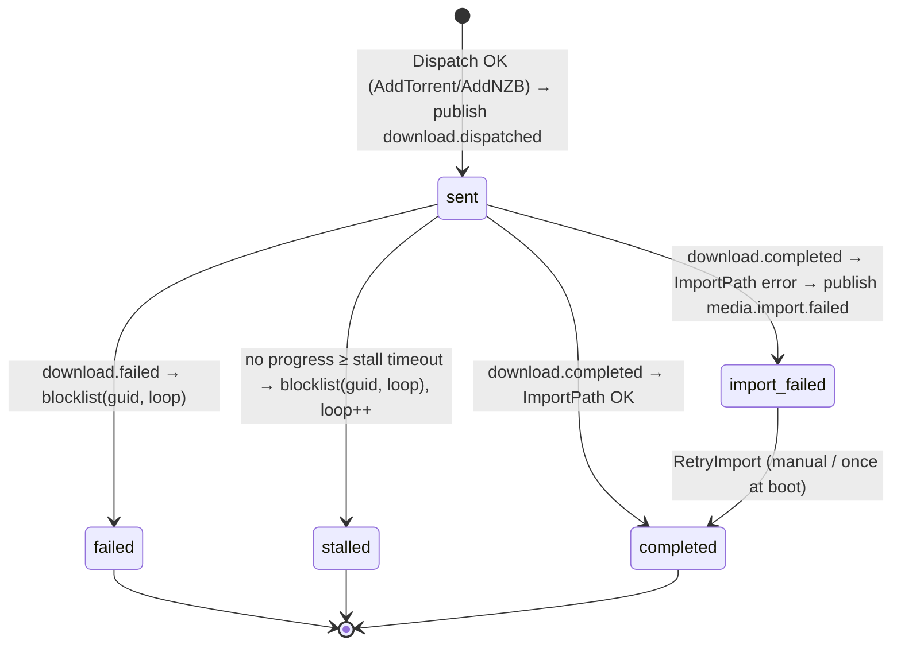

# LLD — Acquisition pipeline

| | |
|---|---|
| **Status** | Active — v1.0 (2026-10-05); describes code at umbrella-pinned `media-automation` |
| **Scope** | `media-automation`, `media-custom-formats`, `indexer-*`, `downloader-*`, `media-scanner` import hand-off |
| **Requirements** | FR-ACQ-001…012, FR-LIB-001, NFR-REL-004, NFR-SEC-010 |
| **Behaviour spec** | [FRD WF-05](../../specs/FRD.md#wf-05-acquisition-wanted--search--score--grab--download--import-j-03-j-04) |

## 1. Data model (`media-automation`, SQLite)

| Table | Key | Purpose | Defined in |
|-------|-----|---------|-----------|
| `wanted_items` | `id`; unique `(item_type, item_id)` | One row per wanted movie/episode/album/book/…: `monitored`, `missing`, `quality_profile_id`, `current_score`, `file_acquired_at`, `last_searched`, TV fields (`season_number`, `episode_number`, `absolute_number`, `series_id`, `series_type`, `clean_titles`) | `internal/module.go` (`CREATE TABLE wanted_items` + guarded `ALTER`s) |
| `download_history` | `id` | One row per dispatch: `wanted_item_id`, `guid`, `indexer`, `score`, `download_protocol`, `download_id`, `status`, `status_detail`, timestamps | `internal/module.go` |
| `release_blacklist` | `(wanted_item_id, guid, loop)` | Per-attempt-loop blocklist | `internal/stall.go` |
| `delay_profiles`, `release_seen` | — | Protocol delay and first-seen tracking | `internal/delay.go` |
| `series_overrides` | — | Per-series release-group/quality overrides | `internal/overrides.go` |

`attempt_loop` (stall loop counter) scopes the blocklist; a new loop forgives earlier blocklisted GUIDs.

## 2. Search and selection algorithm

```
for each wanted item due for search (RSS loop every 15 min, or SearchNow):
    providers := Discovery.FindByCapability("indexer") minus held providers
    results   := parallel Search(providers, query(item)) ; merge ; dedupe by GUID
    results   -= release_blacklist[item, current loop]
    results   := filterTVReleaseGrain / pack rules / size cap (max_release_gb) / series overrides
    for r in results: r.score := MediaCustomFormats.ScoreRelease(r) else scoreRelease(r) // fallback
    best := argmax score (TV: + scoreTVReleaseBoost)
    if decideGrab(profile, item.missing, item.current_score, best.score, item.file_acquired_at, now)
       and delayElapsed(best.protocol, release_seen):
         validateDispatchGrab(best)   // fixture gate
         Dispatch(best)
```

`decideGrab` (`internal/module.go:2046`) is a pure function — the canonical rule (RULE-ACQ-1):

1. `candidate ≤ 0` → no. 2. `MinScore > 0 && candidate < MinScore` → no. 3. item missing → **yes**.
4. `!UpgradeAllowed` → no. 5. `CutoffScore > 0 && current ≥ CutoffScore` → no. 6. `candidate ≤ current` → no.
7. `UpgradeDelayMinutes > 0` and (`file_acquired_at` unknown or delay not elapsed) → no. 8. otherwise **yes**.

**Planned change (FR-ACQ-006):** add `profile.CutoffQualityTier`; step 5 becomes "current ≥ cutoff score **or** current quality tier ≥ cutoff tier". Quality tier comes from `media-custom-formats.ParseQuality`. Backwards compatible: tier `""` = disabled.

## 3. Dispatch and download lifecycle



- Status writes go through `finishHistoryStatus` / `finishHistoryStatusWhere` (`internal/history_status.go`), which include a `WHERE` guard on the expected prior status — this makes event redelivery a no-op for terminal rows (NFR-REL-004; systematic redelivery tests still **Planned**).
- `pending` is the column default but `Dispatch` writes `sent` directly; `pending` rows are not expected in normal operation.
- Stall timeout: 180 min default; auto loops 60 → 360 min (`stall.go`).

## 4. Import hand-off

| Item type | Import call | Owner |
|-----------|-------------|-------|
| movie, tv, music | `ScannerService.ImportPath(path, hints)` (gRPC) | `media-scanner` → rename/probe/place → `media.file.imported` |
| book, comic, audiobook | `POST /api/{books|issues|audiobooks}/{id}/import` (HTTP) | library module; registers in place (FR-MM-004 will route through scanner) |

## 5. Fixture gate

`validateDispatchGrab` (`internal/dispatch_guard.go`) refuses non-fixture releases when `DOWNLOADER_ENGINE ∈ {fixture, fake}` or `QBIT_FIXTURE` is set. Downloader-side: `downloader-native-torrent` uses `fixtureEngine` under the same env; live mode requires `WG_CONF` (`enforceLiveDownloaderVPN`).

**Planned (NFR-SEC-010):** invert the default — `downloader-native-torrent` uses the fixture engine unless `DOWNLOADER_ENGINE=live` **and** `WG_CONF` is readable; the household compose sets nothing (→ fixture).

## 6. Error handling and retries

| Failure | Handling |
|---------|----------|
| Indexer error | Logged; other providers' results still used |
| Indexer rate-limit | Provider held 15 min (`holdIndexer`) |
| Scorer unavailable | Local fallback `scoreRelease` (resolution, source, seeders, size) |
| Downloader unavailable at dispatch | Dispatch error; item remains wanted; retried next loop |
| Import error | `import_failed` + event; retry on demand and once at boot |
| Duplicate events | Guarded status updates (see §3) |

## 7. Concurrency

Single SQLite connection per module (`SetMaxOpenConns(1)`) serialises writes. Indexer searches run concurrently per item (`parallelIndexerSearch`); `Dispatch` is non-blocking relative to large `ImportPath` operations (since `media-automation` v0.1.1).
