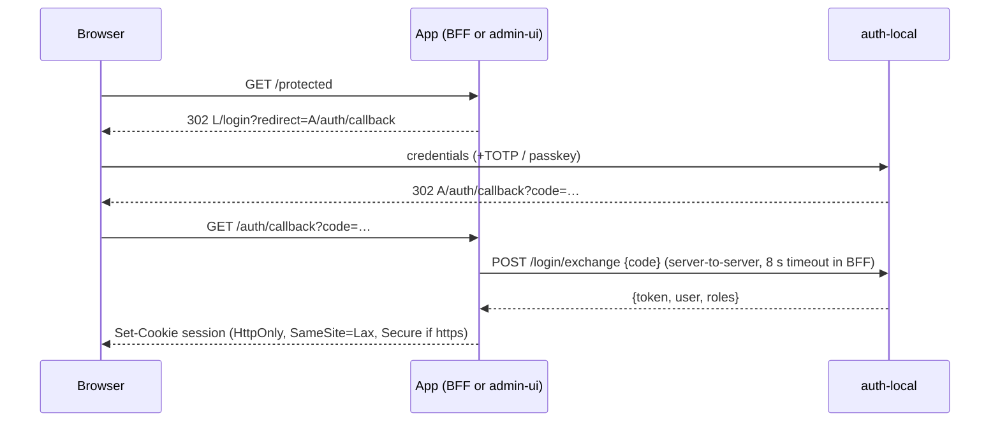

# LLD — Authentication, authorisation, and sessions

| | |
|---|---|
| **Status** | Active — v1.0 (2026-10-05) |
| **Scope** | `auth-local`, `auth-oidc`, `admin-ui` session layer, BFF (`_mvp/cmd/mediauiprox`) session layer, core `AuthInterceptor` |
| **Requirements** | FR-AUTH-001…010, NFR-SEC-002…007, NFR-REL-003 |
| **Behaviour spec** | [FRD §1, WF-02, WF-03](../../specs/FRD.md) |

## 1. auth-local data (SQLite, default `~/.muxcore/auth.db`)

| Table | Contents | Protection |
|-------|----------|------------|
| `users` | id, username, bcrypt hash (cost 12), roles (JSON), tenant | bcrypt |
| `sessions` | Session token hash, user, kind (`full`, `api-token`, …), expiry (24 h) | SHA-256 token hashes; plaintext-token migration shipped in auth-local v0.1.19 (NFR-SEC-005) |
| `api_tokens` | `token_hash`, prefix, scopes | hashed |
| `totp` | encrypted secret | AES-256-GCM with migration, auth-local v0.1.19 (NFR-SEC-005) |
| `webauthn_credentials`, `webauthn_sessions` | passkeys | — |
| `invites` | SHA-256 token hash, role, tenant, max uses, uses, expiry, revoked_at | hashed |

Bootstrap: `BootstrapAdminFromEnv` creates an admin only if `users` is empty and both `AUTH_BOOTSTRAP_USER` and `AUTH_BOOTSTRAP_PASSWORD` are set.

## 2. Login code exchange

The app stores the auth-local token server-side, keyed by its own session ID, and forwards it as gRPC metadata `x-auth-token` on mesh calls.

## 3. App session stores

| App | Store | TTL | Protection and limitations |
|-----|-------------|-----|--------|
| BFF | `sessions.json` under `MEDIA_UI_USERDATA_DIR`, backed by an in-memory map (`session_store.go`) | 24 h | SHA-256 session IDs; upstream token sealed with AES-256-GCM; file/key mode 0600. Key from `MEDIA_UI_SESSION_KEY` or generated `session.key`. Missing directory or unusable key falls back to memory-only with a warning; such sessions do not survive restart (NFR-REL-003). |
| admin-ui | JSON file (`session.NewFileStore`) under `ADMIN_UI_DATA_DIR`, fallback `MEDIA_UI_USERDATA_DIR`, then `$XDG_STATE_HOME/muxcore/admin-ui` or `~/.local/state/muxcore/admin-ui` | 30 min | Hashed session IDs and AES-256-GCM bearer ciphertext, file/key mode 0600; key from `ADMIN_UI_SESSION_KEY` or generated `session.key`. `ADMIN_UI_SESSION_FILE` can override the file. Legacy plaintext files are removed/discarded; temp fallback exists only when no home/state directory can be resolved (NFR-SEC-005). |

Expired or undecryptable persisted sessions are discarded, requiring sign-in.
The shipped JSON implementation supersedes the earlier unimplemented SQLite
sketch; requirements constrain protection and restart behavior, not the file
format (roadmap conflict C-19).

## 4. CSRF and request hygiene

| App | CSRF behavior | Timeouts and headers (NFR-SEC-004/006) |
|-----|-------|--------------------------|
| admin-ui | Double-submit cookie `csrf-token` + `X-CSRF-Token` on mutating methods | Existing server hardening and CSP/frame headers |
| BFF | Allowed Origin/Referer for cookie-authenticated mutations; `POST /logout` | `http.Server`: read-header 10 s, read/write/idle 120 s; streaming routes lift read/write deadlines. CSP, `nosniff`, `Referrer-Policy: strict-origin-when-cross-origin`, `X-Frame-Options: SAMEORIGIN` (same-origin reader frames are supported). |

Native clients authenticate with a bearer (`Authorization` / `X-MuxCore-Session`) and are exempt from Origin checks; cookie-authenticated requests are not.

## 5. Mesh authorisation (core)

`grpcmesh/auth.go` `AuthInterceptor`:

1. Allow-list (no auth): `ModuleRegistration.Register/Unregister`, `Discovery.Join` (join token), `Heartbeat`, `Events.Subscribe/Unsubscribe/GetStats`.
2. Otherwise: if `authorizer` and `identity` providers are registered → `ExtractIdentity` (forwards `authorization`, `x-caller-id`) → `Authorizer.Can(session, fullMethod, "*")`.
3. Failures: per-caller exponential backoff; permanent lockout after 100 failures.

The interceptor's public-method allow-list does not waive registration-service
checks. Household Register/Unregister bind verified certificate CNs to module IDs;
`BootstrapRegister` exchanges a single-use token for a module certificate.
Exclusive security capabilities and replacement/dev restart behavior follow
[ADR-0017](../../adr/0017-mesh-module-identity.md) and
[ADR-0022](../../adr/0022-registration-rules-dev-restarts.md). Protected RPCs
distinguish module and end-user principals, using the module allow-list in
`auth.go` or the user authorizer as appropriate (ADR-0020). Public method and
service-level policies remain owned by their implementations; NFR-SEC-002 is
the authenticated security-capability registration requirement.

## 6. OIDC variant

`auth-oidc` implements `/login`, `/login/exchange`, `/oidc/callback`, `/logout` with
PKCE + nonce; roles come from `AUTH_OIDC_ROLES_CLAIM` / `AUTH_OIDC_ROLE_MAP` /
`AUTH_OIDC_DEFAULT_ROLES`. Unsupported identity operations return
`codes.Unimplemented`.

The T-M5-03 provider-aware admin path uses actual AuthService results rather than
adding a GetCapabilities RPC or guessing from the provider name. Only typed
`Unimplemented` from the invoked AuthService operation produces an explanatory,
control-free page or fragment. Discovery `Unimplemented`, transport failures,
expired/denied sessions and permission failures stay errors; failed GETs do not
turn into successful empty lists. There is no capability cache.

The covered surfaces are users list/detail/create form and mutations, TOTP,
per-user tokens, `/keys` catalogue/mutations and invites list/create/revoke.
TOTP mutation controls appear only after a successful status response. Existing
`admin.access` authorization remains; this work does not implement per-page
manager RBAC (FR-ADM-009). Direct passkey endpoints and a live OIDC acceptance run
remain outside this slice, so FR-AUTH-009 stays partial.

Invite administration uses the existing AuthService RPCs with the actual caller's
`x-auth-token`; public redemption remains HTTP. The auth provider owns creator
attribution. Token rotation preserves the new one-time token if old-token revoke
is unsupported or unconfirmed, explains that partial outcome and emits no
successful-rotation audit event. Revoke/invite response error fields must be
handled as failures rather than success redirects.

## 7. Administrative session contract (T-M5-11)

[ADR-0026](../../adr/0026-administrative-session-contract.md) adds
`AuthService.ListSessions` and `RevokeSession` in core's auth proto, published in
core v0.6.16. An isolated consumer verifies the tagged module without a workspace
or replace directive, and the published auth proto/generated Go match the
reviewed source byte-for-byte. Producer contract, provider implementation and
consumer UI have separate source checkpoints; all-session end-to-end acceptance
remains incomplete.

The provider must require a current full admin end-user session in `x-auth-token`;
a module certificate alone is insufficient. Management IDs and continuation
tokens must not disclose or act as bearer credentials. Active-only lists use
creation-time/ID ordering, a default page size of 100 and a maximum of 500, with
filter-bound cursors. Revoke atomically matches `(user_id, session_id)` and is
idempotent for unknown or previously revoked pairs. App cookie sessions must
revalidate their upstream bearer before administrative revoke can take effect
across clients. Old/rebuilt providers return `Unimplemented` for unsupported
methods. Auth-local `f57d194` implements the provider and passes hosted feature
CI; live cross-module consumer integration and BFF bearer revalidation remain
outstanding under FR-AUTH-007. Admin request-time revalidation is described in
§7.2. The independently verified consumer slice is described below.

BFF Quick Connect currently creates a local-only app session without an upstream
provider bearer. Bearer revalidation therefore cannot list or revoke that path
through this contract by itself. T-M5-11 also needs a provider device-grant
integration before claiming all-device coverage.

### 7.1 Provider Devices consumer

Admin-ui `b84ecc7` uses the published core v0.6.16 contract and passes local and
hosted CI/Accessibility checks. `/devices` lists
provider sessions by default; `/devices?scope=local` retains the app-local
rename/revoke view and its existing POST paths. Local cookie hashes are never
treated as provider management IDs. An optional exact `user_id` filter, fixed
page size 100, and opaque page token support First/Next navigation; changing the
filter resets the cursor.

Each actual ListSessions/RevokeSession call forwards exactly one bearer from the
app session, replacing inherited metadata values. Missing/blank bearer returns
401 without an RPC. This does not add global app-session revalidation: provider
authorization still determines whether a forwarded bearer is currently valid.
Typed `Unimplemented` from the actual auth operation renders a control-free
explanation; discovery failure and auth/permission/input/provider errors stay
distinct failures rather than a successful empty list.

The separate `POST /devices/provider/revoke` sends the exact body
`(user_id, session_id)` and preserves the list filter separately. Success returns
to the first filtered page and audits actor, target user and opaque management
ID. It neither revokes API keys nor promises immediate cross-app cookie/session
invalidation; its effect is observable at the next provider validation. Local
handler/race/accessibility fixtures are separate from live provider acceptance.

### 7.2 Admin request-time bearer revalidation

Admin-ui [PR #65](https://github.com/Muxcore-Media/admin-ui/pull/65) is merged and
pinned as `4e9692e` (reviewed `efe28f9`). The binding/authorization follow-up in
[PR #67](https://github.com/Muxcore-Media/admin-ui/pull/67), reviewed source
`7e00627` on the later `6d0eb55` base, is merged as `c686129` and, with #68–#70, is carried by the 2026-10-09 admin-ui pin `ddeced6`.
Full/focused local race, lint, build and rendered UI checks pass; hosted CI
passes build/vet/full race/lint. Accessibility evidence for this follow-up is
local (8 interaction and 31 axe checks); no separate hosted Accessibility run
was triggered. The behavior below describes that reviewed follow-up source.

`requireAuth` first validates a non-empty provider bearer, then checks
`AuthService.Can` for `admin.access` on `admin.ui`, before invoking the page
handler. Validate's body contains the exact bearer stored with the local
session. Both calls replace inherited credential metadata with exactly one
`x-auth-token` and one `authorization: Bearer …` from that same binding; browser
identity headers are not credential sources. Local-only sessions still skip
Validate, and their Can call removes inherited bearer metadata.

Each discovery-plus-RPC check has its own eight-second deadline. These deadlines
are not passed to the protected handler: authentication occurs at request or
stream establishment and does not cancel an already established stream.

| Result | Response and local session effect |
|--------|-----------------------------------|
| Validate returns `Valid: false`, an empty user or a different user; Validate/Can returns `Unauthenticated` | `RevokeIfBound` atomically deletes only the local session whose user and upstream bearer match the checked snapshot. A matching or already absent session clears the cookie and redirects to login (303, or 200 with `HX-Redirect` for HTMX). A replacement binding is retained and receives 503 |
| Validate/Can returns `PermissionDenied`, or Can returns `Allowed: false` | HTTP 403 Forbidden; retain the cookie/session and do not invoke the page handler |
| Discovery/dial failure, nil RPC response, `Internal`, `Unavailable`, deadline/cancellation or another operational error | HTTP 503 with a retry message; retain the cookie/session and do not invoke the page handler |
| Binding is gone after either RPC | Clear the cookie and send the login redirect; do not invoke the page handler |
| User or provider bearer has changed after either RPC | HTTP 503; preserve the replacement binding and do not invoke the page handler |

The post-RPC binding checks apply to successful and failed responses. The
atomic comparison inside `RevokeIfBound` also protects a replacement made after
a snapshot check, so a late invalid response cannot revoke a newer binding.

Successful Validate preserves the canonical claim behavior from #65: username,
roles and tenant are updated from current public claims, and the session file
is rewritten only if one of those changes. Tenant comes only from Validate's
`tenant_id`, without the login-time token-claim fallback. The bound user ID,
`Permissions` and provider bearer are not changed. The handler receives a deep
copy built under the same lock as the claim update; `Store.Get` returns a copy.
A revoked session is not recreated, and a replaced bearer does not receive the
old call's claims.

These local/fake-provider checks do not establish live provider integration,
BFF cookie revalidation, Quick Connect device grants or termination of an
established stream. Invalid-versus-outage handling depends on auth-local
returning storage and cancellation failures as gRPC errors rather than
`Valid: false`.

## 8. Operator and playback HTTP boundaries

The direct BFF applies the per-route role rules in FRD RULE-AUTH-3 before module
calls. A hidden Settings link is not the authorization boundary. Arr migration
uses the Integration SSRF profile for explicit operator-configured local/LAN
services, denies metadata/link-local targets at dial time, and refuses redirects
to prevent forwarding `X-Api-Key` to a new origin.

The BFF's transcoder transport uses its enrolled mesh certificate and trusted CA
for HTTP as well as gRPC ([ADR-0027](../../adr/0027-transcoder-http-mesh-boundary.md)).
Browser identity headers are stripped; dev container calls use the shared operator
token. Only relative movie/TV stream sources enter the playback proxy or direct
fallback. Root/host allow-lists remain enforced by the source and transcoder
modules as well as the BFF input checks.

The admin-ui Arr migration client also uses the published SDK v0.6.6 Integration
profile. Private and loopback destinations remain allowed for explicitly
configured operator services, while the SDK checks resolved IPs before dialing
and denies metadata/link-local and its blocked special-use ranges. Its existing
30-second timeout, direct HTTP/HTTPS and reverse-proxy base paths remain; TLS
certificate verification is retained. `MaxRedirects=-1` refuses even same-origin
redirects, and the guarded transport does not use implicit environment HTTP
proxies. The API key therefore stays on requests to the configured origin.
