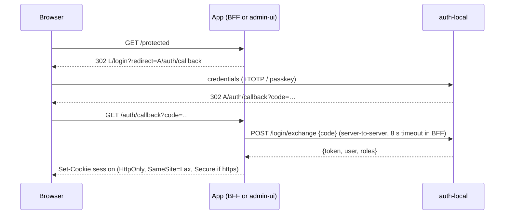

# LLD — Authentication, authorisation, and sessions

| | |
|---|---|
| **Status** | Active — v1.0 (2026-10-05) |
| **Scope** | `auth-local`, `auth-oidc`, `admin-ui` session layer, BFF (`_mvp/cmd/mediauiprox`) session layer, core `AuthInterceptor` |
| **Requirements** | FR-AUTH-001…010, NFR-SEC-002…007, NFR-REL-003 |
| **Behaviour spec** | [FRD §1, WF-02, WF-03](../../specs/FRD.md) |

## 1. auth-local data (SQLite, default `~/.muxcore/auth.db`)

| Table | Contents | Protection |
|-------|----------|------------|
| `users` | id, username, bcrypt hash (cost 12), roles (JSON), tenant | bcrypt |
| `sessions` | 32-byte random token (SHA-256 hex), user, kind (`full`, `api-token`, …), expiry (24 h) | **plaintext token** → hash at rest (NFR-SEC-005) |
| `api_tokens` | `token_hash`, prefix, scopes | hashed |
| `totp` | secret | **plaintext** → encrypt with `encryption` capability or local key (NFR-SEC-005) |
| `webauthn_credentials`, `webauthn_sessions` | passkeys | — |
| `invites` | SHA-256 token hash, role, tenant, max uses, uses, expiry, revoked_at | hashed |

Bootstrap: `BootstrapAdminFromEnv` creates an admin only if `users` is empty and both `AUTH_BOOTSTRAP_USER` and `AUTH_BOOTSTRAP_PASSWORD` are set.

## 2. Login code exchange

The app stores the auth-local token server-side, keyed by its own session ID, and forwards it as gRPC metadata `x-auth-token` on mesh calls.

## 3. App session stores

| App | Store today | TTL | Target |
|-----|-------------|-----|--------|
| BFF | In-memory map (`sessionStore`) | 24 h | SQLite under BFF data dir; random session ID; auth-local token encrypted at rest; survives restart (NFR-REL-003) |
| admin-ui | JSON file (`session.NewFileStore`), default dir `os.TempDir()/muxcore-admin-ui` | 30 min | Data dir required (`ADMIN_UI_DATA_DIR`, default `$XDG_STATE_HOME/muxcore/admin-ui`); file mode 0600; bearer encrypted (NFR-SEC-005) |

## 4. CSRF and request hygiene

| App | Today | Target (NFR-SEC-004/006) |
|-----|-------|--------------------------|
| admin-ui | Double-submit cookie `csrf-token` + `X-CSRF-Token` on mutating methods; CSP and frame headers | Unchanged |
| BFF | None; `GET /logout`; bare `http.ListenAndServe` | Middleware: for non-GET/HEAD/OPTIONS require `Origin` (or `Referer`) host ∈ {public origin, trusted origins}; `POST /logout`; `http.Server{ReadHeaderTimeout: 10s, ReadTimeout: 60s, WriteTimeout: 0 for /stream/* else 60s, IdleTimeout: 120s}`; headers `X-Content-Type-Options: nosniff`, `Referrer-Policy: same-origin`, `X-Frame-Options: DENY` |

Native clients authenticate with a bearer (`Authorization` / `X-MuxCore-Session`) and are exempt from Origin checks; cookie-authenticated requests are not.

## 5. Mesh authorisation (core)

`grpcmesh/auth.go` `AuthInterceptor`:

1. Allow-list (no auth): `ModuleRegistration.Register/Unregister`, `Discovery.Join` (join token), `Heartbeat`, `Events.Subscribe/Unsubscribe/GetStats`.
2. Otherwise: if `authorizer` and `identity` providers are registered → `ExtractIdentity` (forwards `authorization`, `x-caller-id`) → `Authorizer.Can(session, fullMethod, "*")`.
3. Failures: per-caller exponential backoff; permanent lockout after 100 failures.

**Target (NFR-SEC-002):**
- `Register` requires either a verified mTLS client certificate whose CN equals the module ID being registered, or a single-use bootstrap token (`certauth.GenerateToken`, issued via `muxcorectl modules token` — new admin RPC).
- Registration of an exclusive security capability (`call.policy`, `publish.policy`, `authorizer`, `identity`, `auth`) when a provider already exists is rejected unless the existing provider is unhealthy and the new registrant presents the same identity.
- `Events.Subscribe` requires an authenticated caller outside the dev profile.
- Caller identity for audit is the authenticated module ID, not the peer address.

## 6. OIDC variant

`auth-oidc` implements `/login`, `/login/exchange`, `/oidc/callback`, `/logout` with PKCE + nonce; roles from `AUTH_OIDC_ROLES_CLAIM` / `AUTH_OIDC_ROLE_MAP` / `AUTH_OIDC_DEFAULT_ROLES`. User CRUD, TOTP, WebAuthn, API-token RPCs return `codes.Unimplemented`. admin-ui must call a capability probe (`GetCapabilities`-style RPC or treat `Unimplemented` as "unsupported") and hide those pages (FR-AUTH-009).
