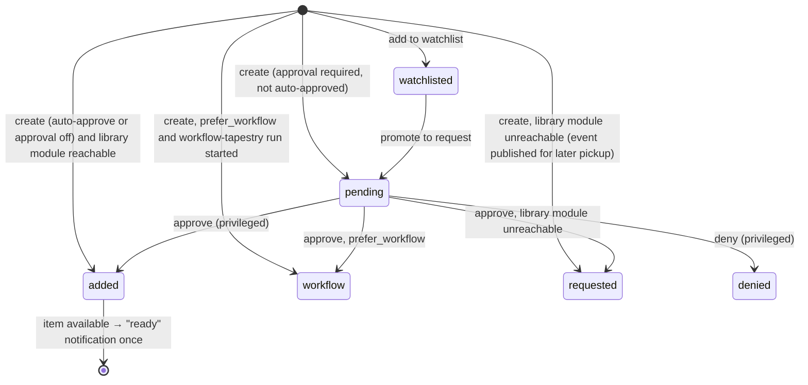
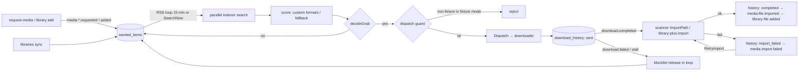

# MuxCore — Functional Requirements Document (FRD)

| | |
|---|---|
| **Status** | Active — v1.0 (2026-10-05) |
| **Owns** | Workflows (`WF-*`), business rules (`RULE-*`), permission model, state machines, validation, and normal / alternate / failure paths |
| **Does not own** | The canonical, testable requirement statements — those live in the [SRS](SRS.md) and are referenced here by ID. Implementation detail (schemas, algorithms) lives in [LLD](../architecture/lld/README.md). |
| **Traces from** | Journeys `J-*` and capabilities `CAP-*` in the [PRD](PRD.md) |

Where this FRD describes **current** behaviour, it cites code. Where it describes **target** behaviour that is not yet implemented, the paragraph is labelled **Target** and links the SRS requirement that carries the gap.

---

## 1. Permission model

Roles and permissions are owned by the identity module (`auth-local`; `auth-oidc` maps IdP claims to the same roles). Core enforces nothing role-specific itself — it asks the registered `authorizer` (`core/internal/grpcmesh/auth.go`).

| Role | Permissions (`auth-local/policies.yaml`) | Intended for |
|------|------------------------------------------|--------------|
| `admin` | `*` | Household operator |
| `manager` | `media.*`, `storage.*`, `modules.read`, `modules.manage` | Trusted co-operator (approve requests, manage libraries) |
| `user` | `media.request`, `media.view`, `media.search` | Household member who may request |
| `viewer` | `media.view`, `media.search` | Household member who may not request (e.g. child) |
| `module` | Enumerated gRPC methods (storage, auth validate/can/identity) | Mesh services |

**RULE-AUTH-1** — A missing `policies.yaml` falls back to built-in defaults; a policy file that parses to zero roles denies everything (fail-closed). *(Current, `auth-local`.)*
**RULE-AUTH-2** — `admin-ui` requires `admin.access` on `admin.ui` for every request; only `admin` passes under default policy. *(Current, `admin-ui` `requireAuth`.)* **Target:** per-page permissions so `manager` can use request/library pages → `FR-ADM-009`.
**RULE-AUTH-3** — The consumer BFF generally treats `admin` and `manager` as privileged (`sessionHasPrivilegedRole`). Library removal and file deletion, library monitoring/quality PATCHes, series overrides, interactive release grab/search/block, wanted/activity actions, blocklist clear, delay profiles, debrid add, `formats/sync-trash`, rename, import, subtitle download, `livetv/timers` and `sessions/{id}/stop` require that privileged role (BFF route table `requirePrivileged`, `_mvp` PR #100; before it they had no role check, C-30; the stop route stays role-gated even though native sessions are now bound to the verified user, because Jellyfin/Plex ownership cannot be proven), and changing `root_folder_path` in a library PATCH requires `admin`. List-sync handlers, indexer create/edit/delete, migration import, and root-folder create/update require `admin`. Indexer HTTP GET requires an authenticated session without an additional privileged-role check; root browse/probe/delete retain their privileged-role rules. Userdata scope is the session's user unless the caller is privileged. Consumer Quality/Delay, Acquisition and Requests-policy Settings links and direct routes require `admin`/`manager` plus the relevant feature capability. Denied policy routes render personal Profile without fetching that policy; member acquisition-readiness and request-quota information remain available. These UI checks do not change backend authorization. Operator settings migration to admin-ui remains incomplete (FR-ADM-010). *(Current, `_mvp/cmd/mediauiprox`; `media-ui-app` Settings and `AcquisitionSetupBanner`.)*
**RULE-AUTH-4** — Request approval requires a privileged role; `REQUEST_AUTO_APPROVE_USERS` lists user IDs that bypass the pending queue. *(Current, `request-media/internal/approval.go`, `settings.go`.)*

Consumer Acquisition indexer mutation controls require `admin`
(`canManageIndexers`); admin/manager pane navigation and direct-route access
still use `canManageAcquisition` plus the acquisition capability. This mirrors
the existing BFF write boundary without restricting its authenticated GET.
Fresh direct-Settings identity hydration was addressed by media-ui-app #44 (fixture-level; FR-ADM-010 remains partial for settings migration).

T-M5-12 source `0ef06f3` (media-ui-app #47, local and hosted checks pass;
merged as `517ba0a`, pinned via `b00db38`) mirrors the BFF operator roles for its active mutation
controls, with root assignment admin-only. Reads, playback, personal state and
approver decisions retain their existing behavior. A fresh pending identity
with no roles hides operator controls; cached privileged roles can remain
visible during pending/transient refresh. A completed downgrade, clear or
cross-tab correction removes the controls and their open dialogs. These are
cosmetic controls; the BFF authorizes each request. Reviewed follow-up #48
`adf6d29` (merged as `b00db38`, the pinned `media-ui-app`; local/hosted gates pass) adds typed denial
feedback across the covered operator surfaces. In rename and series-override
forms, fixed safe denial feedback remains visible after the session refresh
removes privileged controls. Those fixtures perform one attempted mutation and
one session read, without retrying the mutation or retaining unauthorized
controls. Add-to-wanted feedback can still disappear, and session Stop polling
can clear its feedback; general denial-message retention is not established.
Settings migration remains open (FR-ADM-010).

Personal Display preferences in reviewed #49 `ef4d284` (merged as `79cc826`,
unpinned; not in the `b00db38` pin) follow cache updates through a revision subscription. Fields untouched
in the current visit hydrate from returned preferences; sparse per-field drafts
preserve edits, focus and an unsaved theme choice. Saving remains explicit,
preserves unrelated cached preferences, and clears submitted drafts without
erasing newer edits. Fixtures cover actual PUT payloads, applied theme and
remount behavior. Accepted follow-up #50 `54585c6` (merged as `ba68ada`,
unpinned) keeps Display drafts editable while loading and permits Save only
after a successful GET for the current document/session. A failed read offers
explicit Retry; session-generation invalidation offers explicit reload. Neither
read completion nor retry submits preferences automatically. Drafts and focus
are retained. Preference edit revision, request order and a pending marker
prevent stale GET/PUT results from replacing saved edits or readiness; failed
PUT retains the marker, and only a matching successful acknowledgment clears
it. Raw unknown preference keys and existing normalization/parental aliases
are preserved. Local, independent and hosted checks pass (roadmap §9).

Display Retry clears its pane error and restores correct Save readiness.
Accepted follow-up #51 `3622cf6` (merged `1e95d22`, unpinned) also subscribes the
application's progress-sync warning to the latest current-generation GET result:
it remains during retry or failure, clears after successful recovery, and ignores
stale/out-of-generation completions. Drafts/focus are retained with no remount or
automatic PUT; PUT success alone does not clear the read warning. Exact local,
independent and hosted checks pass (roadmap §9). Non-preference blob ordering,
backend concurrent writes and provider/device durability remain residuals. Other personal panes,
parental/PIN behavior and backend persistence contracts are outside the slice
→ FR-PLAY-004, FR-ADM-010.

## 2. Workflows

### WF-01 Install and first admin (J-01)

1. Operator obtains the stack (see [ADR-0007](../adr/0007-install-paths-github-only.md)): registry compose (`_mvp/docker-compose.registry.yml`), dev host (`_mvp/run-host.sh up`), or installer (`muxcore-installer`).
2. Core starts, required modules (list in `_mvp/household-manifest.yaml` `required:`) register over gRPC and become `running`.
3. First admin is created via `AUTH_BOOTSTRAP_USER`/`AUTH_BOOTSTRAP_PASSWORD` **only when the user table is empty** (`auth-local/internal/store/bootstrap.go`).
4. Operator logs into admin-ui and sees module health.

- **Alternate:** installer TUI collects values interactively (`muxcore-installer`).
- **Failure:** a required module fails Init → core marks it `degraded`, publishes `module.degraded`; admin-ui dashboard shows it; smoke fails.
- **Current:** bootstrap scripts and the installer generate a one-time secret, or compose requires an operator-supplied value; fixed default credentials are rejected by the repository check → `NFR-SEC-001`, `FR-INS-004`.
- **Optional secrets provider:** the supported external-provider path selects one provider through the last-applied compose overlay or dev-host flag; default installs retain `secrets-file`. Stop the old provider explicitly, configure the selected backend and migrate secrets manually before restarting dependents. Neither compose `up` alone nor discovery order performs this transition. Selection design and verification limits: `FR-INS-008`, [ADR-0029](../adr/0029-secrets-provider-deployment-selection.md).

### WF-02 Login and session (all journeys)

1. Unauthenticated browser hits BFF (`:5173`) or admin-ui (`:8082`) → redirect to `auth-local /login?redirect=…`.
2. User authenticates (password, then TOTP if enrolled; or passkey). auth-local issues a one-time code and redirects to the app's `/auth/callback`.
3. The app exchanges the code server-to-server (`/login/exchange`) and issues **its own** session cookie (`HttpOnly`, `SameSite=Lax`, `Secure` when the public origin is https).
4. Session TTL: auth-local 24 h; BFF 24 h, persisted under `MEDIA_UI_USERDATA_DIR`; admin-ui 30 min (`ADMIN_UI_SESSION_TTL`), persisted under its durable data directory. App session identifiers are hashed and upstream bearer tokens encrypted in 0600 JSON files. BFF operation without a usable persistence directory/key falls back to memory-only with a warning → `NFR-REL-003`.

- **Alternate:** native clients use `/api/mobile/auth/*` (iOS deep link `muxcore://auth/callback`) or `/api/tv/login` + Quick Connect (tvOS).
- **Reviewed native drafts** (iOS `6bc13a5`, tvOS `fe08722`, both #1; unmerged/unpinned): JSON requests use BFF bearer authentication through dedicated cookie-free sessions that reject redirects. The configured server and user/tenant verified through `/api/session` bind the offline account record that can load or sync; ownerless legacy records stay preserved and are not assigned to the next sign-in. An iOS legacy token without a verified scope requires reauthentication before it can attach a cache. Browser CSRF and the existing Quick Connect flow remain unchanged. Linux package/socket checks pass; Apple sign-in and playback journeys remain pending (roadmap B-6, `FR-NAT-001`).
- **Alternate:** `auth-oidc` replaces auth-local's login with an OIDC PKCE flow. An actual AuthService operation returning typed `Unimplemented` makes admin-ui show an explanation without mutation controls for the covered user, TOTP, token and invite surfaces. Discovery failures, provider `Unauthenticated`/`PermissionDenied` responses and backend errors remain errors; no provider-name inference or capability cache is used. This does not add global upstream-session revalidation. Direct passkey endpoints and live OIDC acceptance remain pending → `FR-AUTH-009`, [auth LLD §6](../architecture/lld/auth-and-sessions.md#6-oidc-variant).
- **Reviewed BFF source** (`1cff996`, PR #104 merged as `214484f`, pinned via `_mvp` `e9fbf38`): each protected provider-linked cookie/native session calls `Validate` with an eight-second bound. User and tenant stay immutable; current username/roles refresh. Invalid/revoked credentials or a principal mismatch remove only the matching binding (API 401, browser login redirect). Provider denial returns 403 `auth.forbidden`; outages/unsupported validation return retryable no-store 503 `auth.unavailable`; both retain the local session. Public recovery remains available. Local-only/Quick Connect grants and termination of established streams remain outside this slice; live propagation is unverified → `FR-AUTH-007`.
- **Failure:** code exchange timeout (8 s in BFF) → error page, no session. Invalid/expired session → redirect to login.
- **Current:** cookie-authenticated BFF mutations require an allowed Origin/Referer, logout is `POST`, and browser servers set timeouts/security headers. Native bearer-authenticated requests are exempt from the browser Origin check. Persistence/key rotation behavior is documented in the [auth LLD](../architecture/lld/auth-and-sessions.md) → `NFR-SEC-004`, `NFR-SEC-005`, `NFR-SEC-006`.

### WF-03 Invite and onboarding (J-02)

1. Admin creates an invite (role, max uses, expiry) in admin-ui `/invites` through the existing AuthService RPC, forwarding the current caller's bearer on the actual call → auth-local stores a SHA-256 token hash (`internal/store/invites.go`). Nonpositive form uses map to the contract's unlimited `-1`; positive expiry hours become seconds, with zero preserving the provider default. Explicit tenant wins, then the session tenant; creator attribution belongs to the auth provider.
2. The generated admin-ui link opens `/invite/redeem?token=…`; admin-ui's public redemption handler calls the auth provider's HTTP peek/redeem endpoints to create the account with the invite's role.
3. Successful admin-ui redemption redirects the member to auth login (`handler/household_redeem.go`); creating the account does not itself establish an app session.

- **Alternate:** the consumer SPA separately supports `/invite/:token` (`InviteJoin.tsx`) using BFF `GET /api/invite/peek` and `POST /api/invite/redeem`, with a login handoff after success. It is not the link generated by admin-ui.
- **Accepted creator/erasure target (implementation pending):** [ADR-0036](../adr/0036-invite-creator-authority-and-erasure.md) defines supplied-bearer precedence, current immutable creator checks serialized with erasure, and marker-named creator cleanup. Source acceptance remains pending under T-M4-07 E2; legacy label-only provenance remains an explicit manual-reconciliation limit, without broad orphan cleanup → `FR-AUTH-003`, `NFR-DATA-003`.
- **RULE-INV-1** — Redemption fails if the invite is revoked, expired, or its finite use limit is exhausted (`max_uses > 0 && uses >= max_uses`). The provider stores an unlimited limit as zero. *(Current, auth-local `internal/store/invites.go`.)*
- **Alternate:** unsupported list/create/revoke RPCs render the explanatory provider state; genuine failures are not reported as an empty invite list or successful mutation. Public peek/redemption continue using HTTP.
- **Failure:** invalid token → generic "invite not valid" (no distinction between expired/revoked, to avoid enumeration).

### WF-04 Request lifecycle (J-03)

State machine (`request-media/internal/status.go`, `approval.go`):

- **RULE-REQ-1** — Quotas: `MaxPendingPerUser` and `MaxPerWeek` per requester are enforced at creation, except for auto-approved users' pending limit. *(Current, `reqquota`.)*
- **RULE-REQ-2** — Only a `pending` request can be approved or denied; only a `watchlisted` record can be promoted. *(Current.)*
- **RULE-REQ-3** — A "ready" notification is sent at most once per request (`request_ready_notified`). *(Current.)*
- **RULE-REQ-4** — `request-media` derives the end-user caller from a validated bearer. BFF/admin-ui forward the bearer and strip client identity headers; module identity uses the mesh certificate rather than an untrusted end-user header ([ADR-0019](../adr/0019-end-user-identity-propagation.md), [ADR-0020](../adr/0020-module-principal-allowlists.md)) → `NFR-SEC-007`.
- **Known permission mismatch (C-34):** canonical request-media `10483aa` checks resource `media.request` with separate create/list/approve/deny actions. Current auth-local/OIDC policies split at the first dot, so default user `media.request` and manager `media.*` do not authorize that resource. Existing lifecycle/guard fixtures remain evidence for their own behavior; they do not establish a working member/manager request journey. A producer correction and member-ownership/shared-policy decision remain planned and blocked; no live journey rejection or permission-model change is asserted → `FR-REQ-001`, `FR-ADM-009`.
- **Gap:** music/book/comic/audiobook requests: `media.music.requested` is defined but has no subscriber in `media-automation` → `FR-MM-002`.

Accepted admin request-adapter source `b747861` (#71, merged as `aa2b904`,
unpinned) uses the producer's existing `mediaType` create key. TV search does not infer type from the selected option:
untyped/movie results are omitted with an unavailable explanation and no request
controls. Canonical producer search still requests MOVIE and omits result type;
typed TV fixtures verify the adapter contract only, not a canonical TV journey.

The five existing-admin create/approve/deny writes make at most one upstream
POST without following redirects. Only 2xx navigates to success; post-auth
adapter failures return fixed safe no-store error content with HTMX error
selection. A 12-second total request budget starts before unchanged auth guards,
and form reads are bounded. Nonempty bodies with unsupported/absent/invalid
Content-Type are refused before dispatch; valid URL-encoded forms with charset
and existing empty-body handling remain. A completed form parse clears its read
deadline. Only a confirmed socket-read-timeout refusal before dispatch may use
a one-second detached rendering context; provider work never does, and ordinary
caller cancellation stays honored. Auth-budget expiry retains the guard's
plaintext 503. Global `admin.access`, session guards, read clients and authority
remain unchanged; this is not manager access or a provider permission correction.

Exact-head local, independent and hosted Go/TCP, interaction and rendered
accessibility checks pass (roadmap §9). Go-rendered templates, jsdom/axe and
synthetic HTMX selection/status handling do not establish full browser XHR/navigation, visual
contrast or live provider acceptance. The external bulk-classification feature
preserved by the merge is outside this adapter review's full feature scope.

### WF-05 Acquisition: wanted → search → score → grab → download → import (J-03, J-04)

Business rules (current, `media-automation/internal`):
- **RULE-ACQ-1 (grab decision)** — Grab only if score > 0 and ≥ profile `min_score`. If the item is missing, grab the best. If present, grab only when upgrades are allowed, current score < `cutoff_score`, the candidate is strictly better, and `upgrade_delay_minutes` have elapsed since `file_acquired_at`.
- **RULE-ACQ-2 (delay profiles)** — Per-protocol delay before grabbing (default torrent 15 min, usenet 0).
- **RULE-ACQ-3 (blocklist scope)** — Blocklisted releases are keyed on `(wanted_item_id, guid, loop)`: scoped to the current attempt loop, not global.
- **RULE-ACQ-4 (stall)** — A download with no progress for the stall timeout (default 180 min; auto loops 60 → 360 min) is marked `stalled`, its release blocklisted, and the item re-enters search.
- **RULE-ACQ-5 (indexer rate limit)** — An indexer that signals rate limiting is held for 15 min.
- **RULE-ACQ-6 (fixture gate)** — When `DOWNLOADER_ENGINE=fixture|fake` or `QBIT_FIXTURE` is set, any non-fixture grab is refused (`dispatch_guard.go`). The shipped native torrent engine defaults to fixture and the dispatch guard fails closed; explicit live configuration remains subject to RULE-ACQ-7 → `NFR-SEC-010`.
- **RULE-ACQ-7 (live VPN)** — Live torrenting requires `WG_CONF`; Init fails otherwise (`enforceLiveDownloaderVPN`).

History status values: `sent` → `completed` | `failed` | `stalled` | `import_failed` (`history_status.go`). `import_failed` → `completed` via `RetryImport` (manual, or once at boot via `retryImportFailed`).

- **Gap:** quality-tier cutoff ("upgrade until Bluray-1080p") is not modelled; only score cutoff → `FR-ACQ-006`.
- **Gap:** books/comics/audiobooks search uses a generic search type; library-plus import registers files in place without move/rename → `FR-MM-003`, `FR-MM-004`.

### WF-06 Library import and rename

1. `media-scanner` `ImportPath` parses the filename, enriches with `media-ffprobe` and episode lookups, previews the target path via `media-rename` `Preview`, moves/links into the root folder, records `imported_files`, publishes `media.file.imported`.
2. `media-movies` / `media-tvshows` record the file and publish `media.movie.file.added` / `media.tv.episode.file.added`; automation re-scores (`onFileAdded`) and clears or keeps the wanted item.

- **Failure:** unparseable name → import fails with reason; history `import_failed`; visible in admin-ui `/failed-downloads` and `/queue`.

### WF-07 Playback (J-03, J-10)

1. Client calls BFF `/api/playback/resolve` with the media `src` (the handler reads `src`, not an item ID; C-29).
2. BFF runs the S5a parental gate (`parental_gate.go`, `_mvp` `7e0f45c`): the policy comes from the `userdata-local` provider (ADR-0030, authenticated principal only), not from request-supplied metadata or userdata preferences. The previous `_mvp` pin `3c16074` denied all restricted playback; the 2026-10-09 pin `e9fbf38` first carried the combined S5b integration; current source pins are in roadmap §14. S5b source `0b51bfd` (PR #103, merged as `41a18c0`, pinned via `e9fbf38`; production checks at `4054780`, final focused race/lint and review pass) obtains operator classification from media-movies/media-tvshows v0.1.23 and maps TV episodes through `GetEpisode`; recognized movie/episode sources pass only when the shared evaluator permits them. Classification is cached only for playback, at most 30 s from lookup start, and re-evaluated against the current policy. Ambiguous bare segment `media_id` references and subtitle IDs not bound to the verified session and authorized item remain denied for restricted principals; a valid bound track fetch is served with current authorization. For a restricted principal the subtitle track list is built only from sidecars the BFF can prove belong to the authorized item (conservative filename match, no competing video owner, module rows naming that media file), and each advertised track is bound to the verified session and item; a fetch requires that binding, rechecks the current policy and classification, and fails closed for unbound, expired, evicted, restart-lost, other-session or revoked bindings and for provider outages (`_mvp` #102 `e9fbf38`, source `530537d`; pinned, not deployed). Filename ownership trusts the operator-managed library (misnamed, symlinked or replaced-after-listing sidecars can carry other content); unrestricted behavior is unchanged and the unrestricted subtitle-path confinement (T-M3-10) stays separate (roadmap T-M4-01). It probes the file and returns `direct` or `transcode` (HLS via `media-transcoder`) plus subtitle/audio tracks, segments (intro/outro), chapters. Transcoder requests use the BFF's mesh certificate in household mode; browser source inputs are restricted to relative movie/TV stream routes ([ADR-0027](../adr/0027-transcoder-http-mesh-boundary.md)).
3. Player streams `/stream/*` or `/stream/hls`; progress is sent to BFF userdata (`/api/userdata`). The BFF can acknowledge its local fallback, so a successful response alone does not prove `userdata-local` persistence (T-M4-09). A native player also reports session events to `POST /api/playback/session`; the BFF forwards them to `playback-monitor` under a key derived from the verified tenant, user and the client's `session_id` (`native:<tenant>:<user>:<session_id>` with tenant and user query-escaped, so a `:` inside either cannot shift the fields into another namespace; `muxcore-native`), so a member can only address their own sessions. A `session_id` over 256 bytes or with non-printable characters is rejected (`400 playback.session_id_invalid`), and with auth required a request with no resolvable principal gets `401 api.unauthorized` (T-M5-13, `_mvp` `3c16074`). Stopping a session from the operator view stays admin/manager only (RULE-AUTH-3).
4. **Near-term alternate:** play via Jellyfin deep link (`/api/jellyfin/play`) when the bridge is enabled ([ADR-0005](../adr/0005-consumer-ui-replaces-jellyfin-web.md)).

- **RULE-PLAY-1** — Resume offers the last position when progress is between the configured thresholds; "watched" is set at the completion threshold. *(Current, `lib/userdata.ts`.)*
- **Reviewed native recovery drafts** (T-M4-09; iOS `6bc13a5`, tvOS `fe08722`, unmerged/unpinned): an edit and its pending state are saved together for the verified server/user/tenant. Failed requests or invalid/mismatched acknowledgments retain pending work and show an error/retry state; sign-out clears visible data without giving it to another account. Writes serialize, retain newer edits across earlier responses and preserve current replacement sections after a fresh read. Only locally changed progress/favorite entries are sent. Portable fixtures cover cache reload and response races; they do not verify app-process restart, Apple runtime or real provider/device durability. S9b corrected the canonical BFF blob path and authenticated transport, integrated at fixture level in umbrella #217; ordinary blob fallback and real-provider/native durability remain separate, so `FR-PLAY-004` stays Part.
- **Blob contract gaps** (T-M4-09): userdata-local `e544b35` merges favorite maps by key in both its public fallback store and provider store; a key omitted from PUT is retained. Provider parsing also fills omitted preferences/playlists/queue before merging, whereas the public fallback preserves omitted sections, and typed provider preferences discard unknown keys. The reviewed native candidates preserve replacement sections and retain removal intent when the returned blob still contains that favorite; missing/invalid acknowledgments retain pending work. Consistent omission/deletion, unknown-field preservation and concurrent-write semantics remain a backend contract task with no design chosen; read-before-write alone does not establish cross-device atomicity → `FR-PLAY-004`.
- **RULE-PLAY-2 (accepted target, partially enforced)** — The S5a gate enforces the policy lookup and fail-closed handling (an unconfigured, failed or unclassifiable case is denied); locally verified S5b source `0b51bfd` adds tag/rating evaluation against owning-module classification for recognized movie/TV items; the integration pin `e9fbf38` (2026-10-09) now includes it, undeployed. Restricted parental policy uses exact normalized tags; blocked tags win, and a nonempty allowed set requires at least one matching tag without overriding rating/unrated restrictions. Kids mode defaults to PG without an explicit threshold. Unavailable/malformed classification or an unconfigured/failed policy lookup never implies unrestricted access. Explicit unrestricted mode is an authenticated administrative decision. Profile/PIN unlock is separate work → `FR-PLAY-007`, [ADR-0030](../adr/0030-authoritative-parental-policy-resource.md).
- **Failure:** transcoder unavailable → resolve returns direct-only; incompatible codec shows an error with a Jellyfin handoff option when available.
- **Locally verified S5b behavior:** paginated movie/TV lists request the owning module's narrowing filter and recheck every row; an inconsistent page returns generic no-store `503 parental.classification_unavailable` with no rows or total ([ADR-0032](../adr/0032-fail-closed-paginated-classification.md)). Collections expose visible counts; companion libraries require complete bounded enumeration and deterministic ordering before local totals/pagination, otherwise the same 503. Item/detail/PATCH fields are freshly checked. Genuine gRPC NotFound is blocked (403); legacy missing-item Unknown remains generic 503. External search and the other C-DENY routes stay denied for restricted principals.
- **Reviewed operator source** (admin-ui `154d74b`, PR #68 merged as `f14e50b`; pinned via `ddeced6`): movie/series content-rating pages read the owning module and save only with the current admin role plus bound provider bearer, then verify readback before confirmation. Explicit NR and clearing/unavailable are distinct, TV episodes inherit the series rating, and the UI explains the privileged-account limitation. These fixtures do not establish live restricted-account enforcement.
- **Reviewed operator follow-up** (T-M4-01 F1/F3, `FR-PLAY-007`; admin-ui `dfdaa2f`, #69 merged as `1a90d8c`, pinned via `ddeced6`): a shared 12 s content-rating budget starts before fresh session/admin revalidation and provider work; body reads are bounded and timeout refusal retains a separate render-only response window. After dispatch, emit one sanitized confirmed/refused/uncertain audit outcome through the existing best-effort sink; durable delivery is not newly guaranteed. A timeout or failed readback does not report success or automatically retry the write. The loaded/empty/error distinctions in #68 remain; read-only review established no new F2 state gap. Local gates, independent review and exact-head hosted build/vet/race/lint pass; accessibility is local only because the hosted workflow did not trigger.
- **Reviewed bulk operator workflow** (T-M4-01, `FR-PLAY-007`; admin-ui `26015bc`, #70 merged and pinned as `ddeced6`): an admin-only `/content-ratings` page applies an operator rating, explicit unrated value or clear to up to 200 selected movie/TV titles; the per-item editors remain. Each dispatched write is read back once, and only a matching rating and source is confirmed; refused, uncertain (timeout, unknown or failed/mismatched readback) and unattempted titles stay distinct, with no automatic retry. One audit entry per attempted write carries the requested values, and stored values appear only after confirmation. A 401/403 stops further calls and preserves partial results; only the request's validated provider bearer is forwarded; a handler that cannot extend its response deadline refuses the apply, and failed or unloaded lists are never shown as empty libraries. A full apply can last about 2 min 15 s, so an edge proxy must allow at least that interval (undeployed, unverified requirement); large slow batches report the remainder as unattempted. Local and hosted gates and independent review pass; one reviewer-proven flaky baseline test remains (roadmap §6/§9). This does not add S9 transport or a live restricted-account journey.
- **Transport / remaining target:** [ADR-0033](../adr/0033-userdata-http-mesh-transport.md) S9a–e provide authenticated provider identity and caller admission while retaining fresh bearer checks; umbrella #217 records arm64 household fixture integration. That evidence does not establish deployment, a live restricted-account journey, profiles/PIN, public-image protection or native-client acceptance → `FR-PLAY-007`. Playback does not trust caller classification or blob preferences and has no provider-failure local fallback. T-M3-10 subtitle confinement remains separately blocked. Unsupported Cast/AirPlay controls are hidden; Remote Playback API support does not provide a Cast SDK implementation → `FR-PLAY-009`.

### WF-08 Operator triage (J-04, J-09)

admin-ui `/queue`, `/activity`, `/failed-downloads`, `/wanted`, `/calendar`, `/dashboard/health`. Actions: remove, retry import, blocklist and re-search. **Gaps:** wanted is unified for movie/TV only (`wanted.go`), separate `/music/wanted`; no indexer/downloader management pages → `FR-ADM-002`, `FR-ADM-006`.

### WF-09 Backup and restore (J-06)

1. `backup-local` creates tar.gz archives on a cron schedule (`BACKUP_SCHEDULE_CRON`) of configured directories and `Backupable` peers (`ExportState`), with SHA-256 and retention by count/age.
2. Restore extracts into a target directory with path-traversal checks.

- **Current:** household state coverage is checked against manifest state entries and mounted volumes; host and compose restore drills passed locally (roadmap §9). Admin-ui confines restore targets to its configured restore root, while the BFF uses `BACKUP_RESTORE_DIR` → `FR-BAK-002..004`. Remaining path-confinement audit work in other modules stays tracked under `NFR-SEC-008`.

### WF-10 Module registration, discovery, and deploy (J-07)

1. A module process dials core `:9090`, calls `ModuleRegistration.Register` with its info and capabilities; core wraps it in a `SidecarProxy`, re-wires policies/auth (`PostRegisterHook`), and indexes capabilities.
2. Peers find it with `Discovery.FindByCapability` and call it directly (most modules) or via `ModuleMesh.Call` (policy-checked).
3. Marketplace deploy (`SpoolService.DeployTag`): version pattern → repo host allow-list → shallow clone → contract reconcile → source scan → build → SHA-256 checksum → publisher allow-list → signature (ed25519/minisign) when required.

- **RULE-MOD-1** — With no `call.policy` provider registered, every `ModuleMesh.Call` fails; with no `publish.policy`, every publish (including core lifecycle events) is denied. *(Current.)*
- **RULE-MOD-2** — Exclusive security capabilities require authenticated module registration. Bootstrap tokens enroll a module certificate; Register/Unregister bind the verified certificate CN to its module ID. Replacement and dev restart behavior follow [ADR-0022](../adr/0022-registration-rules-dev-restarts.md) → `NFR-SEC-002`.
- **RULE-MOD-3** — Household marketplace deploys and orphan resurrection require signatures; curated boot tags retain their checksum trust anchor ([ADR-0016](../adr/0016-security-profiles.md)) → `FR-EXT-003`.

### WF-11 Migration from Arr (J-05)

admin-ui `/migrate` connects to Radarr/Sonarr/Lidarr APIs (`arrmigrate/client.go`) and imports library catalogues and quality-profile names. **Target:** also root folders, indexers, download clients, custom formats/scores, and tags; dry-run preview; idempotent re-run → `FR-MIG-001..004`.

The operator-configured source may use HTTP/HTTPS, loopback, LAN or a reverse-proxy
base path. The published SDK Integration guard checks resolved destinations at
dial time, denies metadata/link-local and other blocked special-use addresses,
and refuses every redirect before another request can carry `X-Api-Key`. A
destination or redirect rejected during the source fetch stops that migration
attempt before any catalogue import or library scan.
Existing `admin.access` and CSRF checks still apply → `NFR-SEC-009`.

## 3. Cross-cutting validation rules

- **RULE-VAL-1** — All user-supplied filesystem paths (root folders, restore targets, library-plus imports) must resolve inside a configured allow-listed root (`validateLibraryPath` is the existing pattern). → `NFR-SEC-008`
- **RULE-VAL-2** — Outbound HTTP to user-configured URLs (indexers, lists, spool) must check the destination at connection time; a textual host allow-list alone does not establish the address boundary. Core's HTTPS spool path checks every DNS answer and dials checked literal addresses, including redirects. Exact listed hosts may use intentional LAN destinations, but metadata/link-local and blocked special-use addresses remain denied ([ADR-0028](../adr/0028-spool-dial-time-destination-policy.md)). Other module audit gaps remain tracked separately → `NFR-SEC-009`.
- **RULE-VAL-3** — IDs crossing module boundaries are strings (`tmdb_id`, `item_id`, `wanted_item_id`); no cross-module foreign keys. Consumers must tolerate a referenced item having been deleted (soft-fail, not crash).
- **RULE-VAL-4** — Optional peers degrade softly: library-plus BFF routes return HTTP 200 with `available:false` when the peer is absent. *(Current.)*
