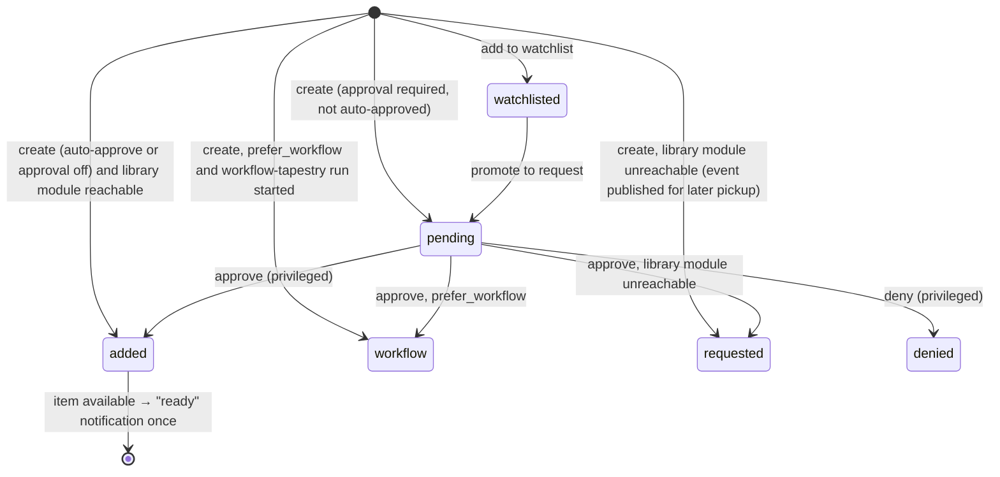
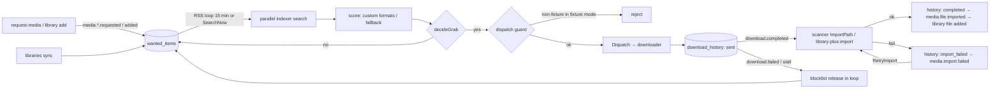

# MuxCore — Functional Requirements Document (FRD)

| | |
|---|---|
| **Status** | Active — v1.0 (2026-10-05) |
| **Owns** | Workflows (`WF-*`), business rules (`RULE-*`), permission model, state machines, validation, and normal / alternate / failure paths |
| **Does not own** | The canonical, testable requirement statements — those live in the [SRS](SRS.md) and are referenced here by ID. Implementation detail (schemas, algorithms) lives in [LLD](../architecture/lld/README.md). |
| **Traces from** | Journeys `J-*` and capabilities `CAP-*` in the [PRD](PRD.md) |

Where this FRD describes **current** behaviour, it cites code. Where it describes **target** behaviour that is not yet implemented, the paragraph is labelled **Target** and links the SRS requirement that carries the gap.

---

## 1. Permission model

Roles and permissions are owned by the identity module (`auth-local`; `auth-oidc` maps IdP claims to the same roles). Core enforces nothing role-specific itself — it asks the registered `authorizer` (`core/internal/grpcmesh/auth.go`).

| Role | Permissions (`auth-local/policies.yaml`) | Intended for |
|------|------------------------------------------|--------------|
| `admin` | `*` | Household operator |
| `manager` | `media.*`, `storage.*`, `modules.read`, `modules.manage` | Trusted co-operator (approve requests, manage libraries) |
| `user` | `media.request`, `media.view`, `media.search` | Household member who may request |
| `viewer` | `media.view`, `media.search` | Household member who may not request (e.g. child) |
| `module` | Enumerated gRPC methods (storage, auth validate/can/identity) | Mesh services |

**RULE-AUTH-1** — A missing `policies.yaml` falls back to built-in defaults; a policy file that parses to zero roles denies everything (fail-closed). *(Current, `auth-local`.)*
**RULE-AUTH-2** — `admin-ui` requires `admin.access` on `admin.ui` for every request; only `admin` passes under default policy. *(Current, `admin-ui` `requireAuth`.)* **Target:** per-page permissions so `manager` can use request/library pages → `FR-ADM-009`.
**RULE-AUTH-3** — The consumer BFF generally treats `admin` and `manager` as privileged (`sessionHasPrivilegedRole`), but list-sync handlers, indexer create/edit/delete, migration import, and root-folder create/update require `admin`. Indexer reads and root browse/probe/delete keep their existing privileged-role rules. Userdata scope is the session's user unless the caller is privileged. Consumer Quality/Delay, Acquisition and Requests-policy Settings links and direct routes require `admin`/`manager` plus the relevant feature capability. Denied policy routes render personal Profile without fetching that policy; member acquisition-readiness and request-quota information remain available. These UI checks do not change backend authorization. Operator settings migration to admin-ui remains incomplete (FR-ADM-010). *(Current, `_mvp/cmd/mediauiprox`; `media-ui-app` Settings and `AcquisitionSetupBanner`.)*
**RULE-AUTH-4** — Request approval requires a privileged role; `REQUEST_AUTO_APPROVE_USERS` lists user IDs that bypass the pending queue. *(Current, `request-media/internal/approval.go`, `settings.go`.)*

## 2. Workflows

### WF-01 Install and first admin (J-01)

1. Operator obtains the stack (see [ADR-0007](../adr/0007-install-paths-github-only.md)): registry compose (`_mvp/docker-compose.registry.yml`), dev host (`_mvp/run-host.sh up`), or installer (`muxcore-installer`).
2. Core starts, required modules (list in `_mvp/household-manifest.yaml` `required:`) register over gRPC and become `running`.
3. First admin is created via `AUTH_BOOTSTRAP_USER`/`AUTH_BOOTSTRAP_PASSWORD` **only when the user table is empty** (`auth-local/internal/store/bootstrap.go`).
4. Operator logs into admin-ui and sees module health.

- **Alternate:** installer TUI collects values interactively (`muxcore-installer`).
- **Failure:** a required module fails Init → core marks it `degraded`, publishes `module.degraded`; admin-ui dashboard shows it; smoke fails.
- **Current:** bootstrap scripts and the installer generate a one-time secret, or compose requires an operator-supplied value; fixed default credentials are rejected by the repository check → `NFR-SEC-001`, `FR-INS-004`.
- **Optional secrets provider:** the supported external-provider path selects one provider through the last-applied compose overlay or dev-host flag; default installs retain `secrets-file`. Stop the old provider explicitly, configure the selected backend and migrate secrets manually before restarting dependents. Neither compose `up` alone nor discovery order performs this transition. Selection design and verification limits: `FR-INS-008`, [ADR-0029](../adr/0029-secrets-provider-deployment-selection.md).

### WF-02 Login and session (all journeys)

1. Unauthenticated browser hits BFF (`:5173`) or admin-ui (`:8082`) → redirect to `auth-local /login?redirect=…`.
2. User authenticates (password, then TOTP if enrolled; or passkey). auth-local issues a one-time code and redirects to the app's `/auth/callback`.
3. The app exchanges the code server-to-server (`/login/exchange`) and issues **its own** session cookie (`HttpOnly`, `SameSite=Lax`, `Secure` when the public origin is https).
4. Session TTL: auth-local 24 h; BFF 24 h, persisted under `MEDIA_UI_USERDATA_DIR`; admin-ui 30 min (`ADMIN_UI_SESSION_TTL`), persisted under its durable data directory. App session identifiers are hashed and upstream bearer tokens encrypted in 0600 JSON files. BFF operation without a usable persistence directory/key falls back to memory-only with a warning → `NFR-REL-003`.

- **Alternate:** native clients use `/api/mobile/auth/*` (iOS deep link `muxcore://auth/callback`) or `/api/tv/login` + Quick Connect (tvOS).
- **Alternate:** `auth-oidc` replaces auth-local's login with an OIDC PKCE flow. An actual AuthService operation returning typed `Unimplemented` makes admin-ui show an explanation without mutation controls for the covered user, TOTP, token and invite surfaces. Discovery failures, provider `Unauthenticated`/`PermissionDenied` responses and backend errors remain errors; no provider-name inference or capability cache is used. This does not add global upstream-session revalidation. Direct passkey endpoints and live OIDC acceptance remain pending → `FR-AUTH-009`, [auth LLD §6](../architecture/lld/auth-and-sessions.md#6-oidc-variant).
- **Failure:** code exchange timeout (8 s in BFF) → error page, no session. Invalid/expired session → redirect to login.
- **Current:** cookie-authenticated BFF mutations require an allowed Origin/Referer, logout is `POST`, and browser servers set timeouts/security headers. Native bearer-authenticated requests are exempt from the browser Origin check. Persistence/key rotation behavior is documented in the [auth LLD](../architecture/lld/auth-and-sessions.md) → `NFR-SEC-004`, `NFR-SEC-005`, `NFR-SEC-006`.

### WF-03 Invite and onboarding (J-02)

1. Admin creates an invite (role, max uses, expiry) in admin-ui `/invites` through the existing AuthService RPC, forwarding the current caller's bearer on the actual call → auth-local stores a SHA-256 token hash (`internal/store/invites.go`). Nonpositive form uses map to the contract's unlimited `-1`; positive expiry hours become seconds, with zero preserving the provider default. Explicit tenant wins, then the session tenant; creator attribution belongs to the auth provider.
2. The generated admin-ui link opens `/invite/redeem?token=…`; admin-ui's public redemption handler calls the auth provider's HTTP peek/redeem endpoints to create the account with the invite's role.
3. Successful admin-ui redemption redirects the member to auth login (`handler/household_redeem.go`); creating the account does not itself establish an app session.

- **Alternate:** the consumer SPA separately supports `/invite/:token` (`InviteJoin.tsx`) using BFF `GET /api/invite/peek` and `POST /api/invite/redeem`, with a login handoff after success. It is not the link generated by admin-ui.
- **RULE-INV-1** — Redemption fails if the invite is revoked, expired, or its finite use limit is exhausted (`max_uses > 0 && uses >= max_uses`). The provider stores an unlimited limit as zero. *(Current, auth-local `internal/store/invites.go`.)*
- **Alternate:** unsupported list/create/revoke RPCs render the explanatory provider state; genuine failures are not reported as an empty invite list or successful mutation. Public peek/redemption continue using HTTP.
- **Failure:** invalid token → generic "invite not valid" (no distinction between expired/revoked, to avoid enumeration).

### WF-04 Request lifecycle (J-03)

State machine (`request-media/internal/status.go`, `approval.go`):

- **RULE-REQ-1** — Quotas: `MaxPendingPerUser` and `MaxPerWeek` per requester are enforced at creation, except for auto-approved users' pending limit. *(Current, `reqquota`.)*
- **RULE-REQ-2** — Only a `pending` request can be approved or denied; only a `watchlisted` record can be promoted. *(Current.)*
- **RULE-REQ-3** — A "ready" notification is sent at most once per request (`request_ready_notified`). *(Current.)*
- **RULE-REQ-4** — `request-media` derives the end-user caller from a validated bearer. BFF/admin-ui forward the bearer and strip client identity headers; module identity uses the mesh certificate rather than an untrusted end-user header ([ADR-0019](../adr/0019-end-user-identity-propagation.md), [ADR-0020](../adr/0020-module-principal-allowlists.md)) → `NFR-SEC-007`.
- **Gap:** music/book/comic/audiobook requests: `media.music.requested` is defined but has no subscriber in `media-automation` → `FR-MM-002`.

### WF-05 Acquisition: wanted → search → score → grab → download → import (J-03, J-04)

Business rules (current, `media-automation/internal`):
- **RULE-ACQ-1 (grab decision)** — Grab only if score > 0 and ≥ profile `min_score`. If the item is missing, grab the best. If present, grab only when upgrades are allowed, current score < `cutoff_score`, the candidate is strictly better, and `upgrade_delay_minutes` have elapsed since `file_acquired_at`.
- **RULE-ACQ-2 (delay profiles)** — Per-protocol delay before grabbing (default torrent 15 min, usenet 0).
- **RULE-ACQ-3 (blocklist scope)** — Blocklisted releases are keyed on `(wanted_item_id, guid, loop)`: scoped to the current attempt loop, not global.
- **RULE-ACQ-4 (stall)** — A download with no progress for the stall timeout (default 180 min; auto loops 60 → 360 min) is marked `stalled`, its release blocklisted, and the item re-enters search.
- **RULE-ACQ-5 (indexer rate limit)** — An indexer that signals rate limiting is held for 15 min.
- **RULE-ACQ-6 (fixture gate)** — When `DOWNLOADER_ENGINE=fixture|fake` or `QBIT_FIXTURE` is set, any non-fixture grab is refused (`dispatch_guard.go`). The shipped native torrent engine defaults to fixture and the dispatch guard fails closed; explicit live configuration remains subject to RULE-ACQ-7 → `NFR-SEC-010`.
- **RULE-ACQ-7 (live VPN)** — Live torrenting requires `WG_CONF`; Init fails otherwise (`enforceLiveDownloaderVPN`).

History status values: `sent` → `completed` | `failed` | `stalled` | `import_failed` (`history_status.go`). `import_failed` → `completed` via `RetryImport` (manual, or once at boot via `retryImportFailed`).

- **Gap:** quality-tier cutoff ("upgrade until Bluray-1080p") is not modelled; only score cutoff → `FR-ACQ-006`.
- **Gap:** books/comics/audiobooks search uses a generic search type; library-plus import registers files in place without move/rename → `FR-MM-003`, `FR-MM-004`.

### WF-06 Library import and rename

1. `media-scanner` `ImportPath` parses the filename, enriches with `media-ffprobe` and episode lookups, previews the target path via `media-rename` `Preview`, moves/links into the root folder, records `imported_files`, publishes `media.file.imported`.
2. `media-movies` / `media-tvshows` record the file and publish `media.movie.file.added` / `media.tv.episode.file.added`; automation re-scores (`onFileAdded`) and clears or keeps the wanted item.

- **Failure:** unparseable name → import fails with reason; history `import_failed`; visible in admin-ui `/failed-downloads` and `/queue`.

### WF-07 Playback (J-03, J-10)

1. Client calls BFF `/api/playback/resolve` with item ID.
2. BFF runs an existing parental check using request-supplied metadata and userdata preferences (`playback.go`); this does not establish authoritative enforcement (gap below). It probes the file and returns `direct` or `transcode` (HLS via `media-transcoder`) plus subtitle/audio tracks, segments (intro/outro), chapters. Transcoder requests use the BFF's mesh certificate in household mode; browser source inputs are restricted to relative movie/TV stream routes ([ADR-0027](../adr/0027-transcoder-http-mesh-boundary.md)).
3. Player streams `/stream/*` or `/stream/hls`; progress is written to userdata (`/api/userdata`) and mirrored to `userdata-local`.
4. **Near-term alternate:** play via Jellyfin deep link (`/api/jellyfin/play`) when the bridge is enabled ([ADR-0005](../adr/0005-consumer-ui-replaces-jellyfin-web.md)).

- **RULE-PLAY-1** — Resume offers the last position when progress is between the configured thresholds; "watched" is set at the completion threshold. *(Current, `lib/userdata.ts`.)*
- **Failure:** transcoder unavailable → resolve returns direct-only; incompatible codec shows an error with a Jellyfin handoff option when available.
- **Gap / Target:** list/search/detail restrictions lack server enforcement. Playback resolve trusts caller-supplied tags/rating/unrated; `parental.go` ignores rating and allowed tags, self-service userdata updates can change preferences, and a failed provider read falls back to possibly empty local data. Protected policy authority, trusted media metadata and failure behavior need a verified design before any route is accepted as enforcing the restriction → `FR-PLAY-007`. Unsupported Cast/AirPlay controls are hidden; Remote Playback API support does not provide a Cast SDK implementation → `FR-PLAY-009`.

### WF-08 Operator triage (J-04, J-09)

admin-ui `/queue`, `/activity`, `/failed-downloads`, `/wanted`, `/calendar`, `/dashboard/health`. Actions: remove, retry import, blocklist and re-search. **Gaps:** wanted is unified for movie/TV only (`wanted.go`), separate `/music/wanted`; no indexer/downloader management pages → `FR-ADM-002`, `FR-ADM-006`.

### WF-09 Backup and restore (J-06)

1. `backup-local` creates tar.gz archives on a cron schedule (`BACKUP_SCHEDULE_CRON`) of configured directories and `Backupable` peers (`ExportState`), with SHA-256 and retention by count/age.
2. Restore extracts into a target directory with path-traversal checks.

- **Current:** household state coverage is checked against manifest state entries and mounted volumes; host and compose restore drills passed locally (roadmap §9). Admin-ui confines restore targets to its configured restore root, while the BFF uses `BACKUP_RESTORE_DIR` → `FR-BAK-002..004`. Remaining path-confinement audit work in other modules stays tracked under `NFR-SEC-008`.

### WF-10 Module registration, discovery, and deploy (J-07)

1. A module process dials core `:9090`, calls `ModuleRegistration.Register` with its info and capabilities; core wraps it in a `SidecarProxy`, re-wires policies/auth (`PostRegisterHook`), and indexes capabilities.
2. Peers find it with `Discovery.FindByCapability` and call it directly (most modules) or via `ModuleMesh.Call` (policy-checked).
3. Marketplace deploy (`SpoolService.DeployTag`): version pattern → repo host allow-list → shallow clone → contract reconcile → source scan → build → SHA-256 checksum → publisher allow-list → signature (ed25519/minisign) when required.

- **RULE-MOD-1** — With no `call.policy` provider registered, every `ModuleMesh.Call` fails; with no `publish.policy`, every publish (including core lifecycle events) is denied. *(Current.)*
- **RULE-MOD-2** — Exclusive security capabilities require authenticated module registration. Bootstrap tokens enroll a module certificate; Register/Unregister bind the verified certificate CN to its module ID. Replacement and dev restart behavior follow [ADR-0022](../adr/0022-registration-rules-dev-restarts.md) → `NFR-SEC-002`.
- **RULE-MOD-3** — Household marketplace deploys and orphan resurrection require signatures; curated boot tags retain their checksum trust anchor ([ADR-0016](../adr/0016-security-profiles.md)) → `FR-EXT-003`.

### WF-11 Migration from Arr (J-05)

admin-ui `/migrate` connects to Radarr/Sonarr/Lidarr APIs (`arrmigrate/client.go`) and imports library catalogues and quality-profile names. **Target:** also root folders, indexers, download clients, custom formats/scores, and tags; dry-run preview; idempotent re-run → `FR-MIG-001..004`.

The operator-configured source may use HTTP/HTTPS, loopback, LAN or a reverse-proxy
base path. The published SDK Integration guard checks resolved destinations at
dial time, denies metadata/link-local and other blocked special-use addresses,
and refuses every redirect before another request can carry `X-Api-Key`. A
destination or redirect rejected during the source fetch stops that migration
attempt before any catalogue import or library scan.
Existing `admin.access` and CSRF checks still apply → `NFR-SEC-009`.

## 3. Cross-cutting validation rules

- **RULE-VAL-1** — All user-supplied filesystem paths (root folders, restore targets, library-plus imports) must resolve inside a configured allow-listed root (`validateLibraryPath` is the existing pattern). → `NFR-SEC-008`
- **RULE-VAL-2** — Outbound HTTP to user-configured URLs (indexers, lists, spool) must check the destination at connection time; a textual host allow-list alone does not establish the address boundary. Core's HTTPS spool path checks every DNS answer and dials checked literal addresses, including redirects. Exact listed hosts may use intentional LAN destinations, but metadata/link-local and blocked special-use addresses remain denied ([ADR-0028](../adr/0028-spool-dial-time-destination-policy.md)). Other module audit gaps remain tracked separately → `NFR-SEC-009`.
- **RULE-VAL-3** — IDs crossing module boundaries are strings (`tmdb_id`, `item_id`, `wanted_item_id`); no cross-module foreign keys. Consumers must tolerate a referenced item having been deleted (soft-fail, not crash).
- **RULE-VAL-4** — Optional peers degrade softly: library-plus BFF routes return HTTP 200 with `available:false` when the peer is absent. *(Current.)*
